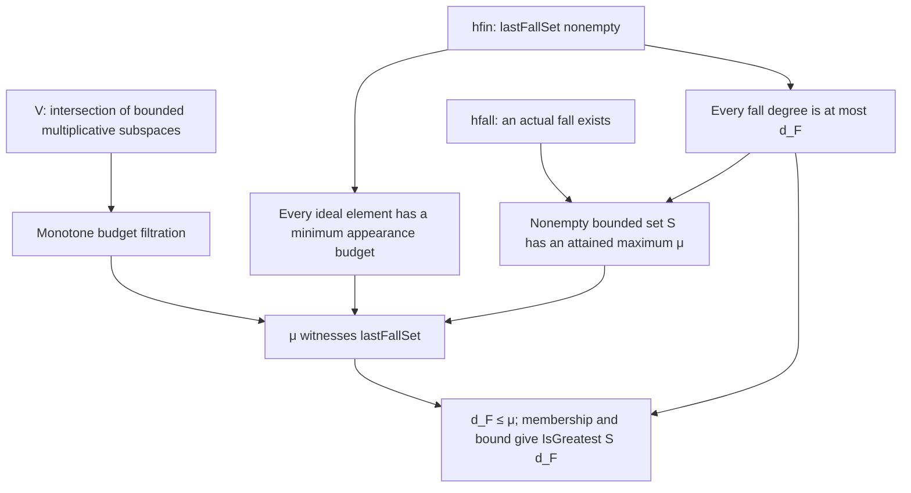

# T-1106: LastFall declaration, proof, and model boundary

The pinned declaration faithfully expresses the conditional maximum theorem:
under explicit finiteness and degree-fall hypotheses, the last fall degree is
an attained greatest element of the set of fall degrees. Static inspection
found no missing hypothesis, circular assumption, or substitution of a scalar
identity for the polynomial invariant. The concrete witness below establishes
satisfiability mathematically. Fresh Lean execution remains pending because
the coordinator reserved the build slot and reported constrained disk capacity.

This report owns only the Lean declaration/proof/model joint in the
[precommitted plan](../review_plan.yaml), published at
`2b0cfe1401831c9493cfe047a515955f38d037b8`. No sibling report was read. Source
literature comparison and the finite-profile inference belong to the other
reviewers. This review is independent source review, not the plan's blind
re-derivation task.

| Dimension | Finding |
| --- | --- |
| Exact source | `199f3aaaa6d37d2fce59f4d8c8fe8d2eb8b50672` |
| Declaration | `CryptoResearch.FallDegree.lastFallDegree_eq_max_degreeFall` |
| Fresh machine status | `not_verified`: no Lean, Lake, Rust, or dependency build was launched |
| Historical machine evidence | Receipt reports build/audit passing and the exact elaborated type; consistency checked below |
| Semantic fidelity | `faithful_scoped` for the conditional invariant statement |
| Overall owned-joint verdict | `inconclusive`: positive semantic finding, mandatory fresh machine gate pending |
| Review outcome | `inconclusive` for completed validation; no official scientific status changed |

## Input binding and historical evidence

The reviewed [module](../../../../formal/CryptoResearch/FallDegree/LastFall.lean)
has SHA-256 `d99149d14a425a6281e977927ece74516cc76796aae9718807e1f03ed19fb5a5`.
The [target](../../../../formal/targets/lastfall-is-max-degree-fall.yaml) has
SHA-256 `74ecb7ee9f8dcf67e14e732bd8382498f648147a6a002d258e1d7b634e065ea9`.
Both are unchanged between the source and precommitted plan revisions.
The Lean pin is `leanprover/lean4:v4.35.0-rc1`; the Mathlib pin is
`7fa22735254ddf7e11f119250a9f2d0352bc7c3a`, with the full dependency pins in
`formal/lake-manifest.json`. No installed dependency checkout or binary was
authenticated in this pass.

The [historical receipt](../../2026-10-31-hosted-formal-receipts/receipts/lastfall-is-max-degree-fall.json)
names source revision `232f4e78abe6cd8eca285fb2be075d3fdd40ee33`, reports
`machine_verified`, and explicitly leaves semantic review pending. Its audit
log contains the named declaration's elaborated type and lists only
`propext`, `Classical.choice`, and `Quot.sound`. Its project log reports 749
theorems audited. The checked `formal/AxiomAudit.lean` collects transitive
axioms and throws on any outside those three; this source inspection is not
an execution of that audit.

[check_bindings.py](check_bindings.py) performs a static content comparison,
recorded in [input_checks.json](input_checks.json). All four direct hashes
(theorem, target, toolchain, manifest), all 10 recorded verifier files, and
67 tracked entries of the 68-entry workspace map match both the reviewed
source and the receipt's declared source revision. The remaining entry,
`formal/CryptoResearch.lean`, is a deliberately generated, untracked root.
The check records a separate reconstruction from the pinned generator header
and tracked module names. That reconstruction matches the recorded root hash
at both revisions; it is not a historical file readback. None of these
comparisons authenticates historical execution.

The receipt's elaborated type is:

```lean
CryptoResearch.FallDegree.lastFallDegree_eq_max_degreeFall.{u_1, u_2}
  {σ : Type u_1} {k : Type u_2} [Field k]
  {F : Set (MvPolynomial σ k)}
  (hfin : (CryptoResearch.FallDegree.lastFallSet F).Nonempty)
  (hfall : ∃ f ∈ Ideal.span F,
    f.totalDegree < CryptoResearch.FallDegree.degreeFall F f) :
  IsGreatest
    {d | ∃ f ∈ Ideal.span F,
      CryptoResearch.FallDegree.degreeFall F f = d ∧ f.totalDegree < d}
    (CryptoResearch.FallDegree.lastFallDegree F)
```

This is an archived elaboration, not a fresh `#check`. The universes and the
absence of a `Finite σ` assumption are substantive: the declaration covers
arbitrary variable types conditionally. Its finite-variable specialization is
immediate. The coefficient structure is an actual Mathlib field and the ring
is actual `MvPolynomial`, not an abstract placeholder for polynomials.

## Definitions and proof obligations

At module lines 47–51, `V F i` is the infimum of all `k`-submodules containing
the generators of total degree at most `i` and closed under products satisfying
`deg f + deg g ≤ i`. The family is inhabited by the full submodule. Intersections
preserve both conditions: lines 70–85 prove generator membership and bounded
multiplication for `V` itself. Thus `sInf` has the intended smallest-space
meaning, rather than merely an opaque lower bound on possible spaces.

The proof of monotonicity at lines 56–61 correctly shows that every admissible
space for the larger budget is admissible for the smaller budget. The degree
bound at lines 89–99 uses `restrictTotalDegree` as an admissible space, with
Mathlib's product degree inequality. It establishes that membership in `V F i`
forces total degree at most `i`. Also, `Ideal.span F`, viewed as a `k`-submodule,
is an admissible space at every budget, so the construction cannot introduce
polynomials outside the ideal. That last observation is a mathematical
consequence of the definition; the target proof does not invoke a separately
named `V ≤ Ideal.span` lemma.

`degreeFall` and `lastFallDegree` are natural-valued infima (lines 109–119).
An empty infimum returns zero, which does not encode infinity. The theorem
uses `hfin` to obtain membership of `lastFallDegree F` in `lastFallSet F`
before using that minimum. This gives, for every ideal element `f`, an actual
budget `max (lastFallDegree F) f.totalDegree` where `f` appears. Every subsequent
use of `mem_V_degreeFall` is supplied with this nonemptiness witness. The
unguarded helper `degreeFall_le` is safe because its membership argument itself
witnesses a nonempty fall set.

The central argument, lines 133–178, has four independently meaningful steps:

1. If `deg f < d_f`, membership of `f` at `max(d_F, deg f)` forces `d_f ≤ d_F`.
   The alternative `d_f ≤ deg f` contradicts the strict fall inequality.
2. `hfall` supplies a member of the set `S` of fall degrees. Step 1 bounds `S`
   above, so `Nat.sSup_mem` supplies an attained maximum `μ`.
3. For every ideal element `f`, either it has a fall and `d_f ≤ μ`, or it has
   no fall and `d_f ≤ deg f`. Minimum membership and `V_mono` put `f` in
   `V F (max μ (deg f))`. Thus `μ ∈ lastFallSet F` and `d_F ≤ μ`.
4. Combine the two inequalities and return both fields of `IsGreatest`:
   membership of `d_F` in `S` and the upper-bound property.

There is no assumed equality, missing maximum-attainment step, or appeal to
the measurement interpretation in this proof. The later representation-degree
lemmas (lines 185 onward) are not dependencies of the named theorem. They
offer another hypothesis from which finiteness follows; they do not remove
finiteness from this declaration.



## Worked controls and satisfiability

All controls in this section are mathematical derivations from the inspected
definitions. They were not submitted to Lean, and no expected elaboration
failure is being reported as a kernel result.

**Remove `hfall`: empty system.** Take one variable over any field and
`F = ∅`. The zero submodule is admissible at every budget, so `V F i = {0}`.
The generated ideal is zero, every budget belongs to `lastFallSet F`, and
`d_F = 0`. The only ideal element is zero, whose appearance degree and total
degree are both zero. Hence `S = ∅`; `IsGreatest S 0` is false because its
membership field is false. This satisfies `hfin` and falsifies the conclusion
with `hfall` deleted.

**Remove `hfall`: nonempty no-fall system.** Take `F = {x}`. Every nonzero
ideal element is `xq` and has degree `1 + deg q`. The closure generates it
within that degree; the degree bound on `V` rules out any earlier appearance.
Thus `d_f = deg f` for every ideal element, including zero. Again `d_F = 0`
and `S = ∅`. Nonemptiness of `F` or `lastFallSet F` cannot replace `hfall`.

**Remove `hfin`: an allowed infinite-variable model.** Let `σ = ℕ`, write
`x_j = X j`, let `D_j = j + 2`, and take
`F = {x_j^(D_j), x_j^(D_j) + x_j : j ∈ ℕ}` over any field. At budget `D_j`,
subtracting the two generators yields `x_j`, so `d_(x_j) ≤ D_j`. For any
`d < D_j`, the ideal generated by all variables except `x_j` is an admissible
submodule at budget `d`: the two generators indexed by `j` are both too large
to be required, and every required generator indexed by another variable lies
in that ideal. This ideal excludes `x_j`, as witnessed by setting all other
variables to zero. Thus `d_(x_j) = D_j > 1 = deg x_j`.

These are unbounded fall degrees. For any proposed uniform budget `D`, choose
`j` with `D_j > max(D,1)`. Then `x_j` is an ideal element absent from
`V F (max D 1)`, so `lastFallSet F = ∅` and the natural-valued definition
returns `d_F = 0`. The conclusion is false even though `hfall` holds. This
control uses the theorem's actual arbitrary-variable type; it is not a claim
of infinite last fall degree for a finite-variable system.

**Positive nonvacuity witness.** In one variable set `F = {x², x²+x}`.
For budgets zero and one no generator qualifies, so the zero submodule is
admissible and `V F 0 = V F 1 = {0}`. At budget two, subtraction gives
`x = (x²+x) - x²`, hence `d_x = 2 > 1`. The ideal generated by `F` equals
`(x)`: both generators are multiples of `x`, and their difference is `x`.
For any nonzero ideal element `f = xq`, the field polynomial ring gives
`deg f = 1 + deg q`. Starting with `x ∈ V F 2`, monotonicity and bounded
multiplication place `f` in `V F (max 2 (deg f))`. Zero is already in every
submodule. Therefore `2 ∈ lastFallSet F`, while `x` excludes budgets zero and
one; thus `d_F = 2`. Both hypotheses are jointly satisfiable without using
the reviewed theorem to obtain the witness.

**Empty appearance-set guard.** With `F = ∅` and `f = x`, the polynomial
is outside the generated ideal and never appears. Its `degreeFall` is zero,
less than its total degree one. Thus the informal phrase “`d_f ≥ deg f`
always” must retain an ideal-membership/appearance hypothesis. The theorem's
uses retain the necessary witnesses, so this boundary does not invalidate it.

## Documentation findings within the owned scope

The closure comment at lines 43–46 says that truncated subtraction would
permit “every `g`” when `deg f > i`. It actually permits only `deg g = 0`,
which means constants (including zero). Multiplication by constants is already
closed in a `k`-submodule. Consequently, on these submodules, the added
constant products are harmless; the comment's claim that truncation alone
creates a different closure is overstated. The additive guard actually used
is correct and directly states the intended degree budget.

The phrase in the monotonicity comment that both defining conditions “weaken”
as `i` grows reverses their direction: larger budgets impose more requirements
on candidate spaces and therefore shrink the admissible family. The proof
uses the correct inclusion. These are documentation corrections, not failed
proof obligations.

The module's introductory measurement sentence and its helper's mention of
an “observed” rank-profile fall have no corresponding matrix, row-space,
algorithm, cutoff, or run object in the elaborated declaration. This reviewer
records only that syntactic boundary; the profile inference joint remains
with T-1107.

## Remaining machine gate and archive scope

The coordinator instructed this reviewer to keep the pass static because a
separate F4 build owns the next exclusive slot, then reported disk pressure.
The local read-only snapshot showed about 36.6 GiB available memory, 7.9 GiB
free root storage, and 17 GiB free `/dev/shm`; these fluctuating readings did
not establish exclusive ownership or the required 16 GiB reserve after the
prospective Lean peak. No dependency tree was downloaded or materialized.

A fresh validation must bind an isolated input tree and the exact pins, build
`CryptoResearch.FallDegree.LastFall` explicitly, print the named elaborated
type and axioms, run the fail-closed transitive audit, and retain complete
pre/post source and verifier inventories plus command logs. The mathematical
controls above supply concrete next formalization targets. A successful
future gate is a new record and must not rewrite the historical receipt or
this pending status.

`origin/main` was initially fetched at the reviewed source SHA; the first merge
returned `Already up to date.` The archive-time fetch observed main advance to
`0c9dddeb6aaf1c36ac6cdb41c293233f9709b6fe`; that revision was merged without
conflicts into the report branch. The review and hash comparisons remain bound
to the original producer SHA. The report commit changes only
the assigned `lean/` directory. The diagram above is supplied for the
coordinator's combined review PDF; no independent machine-passing status or
official evidence transition is claimed by this packet. No canonical research
graph is changed because this pass establishes no new measured quantity.

The composition checker has one schema issue for the coordinator to reconcile:
`tools/check_review_independence.py` accepts `TASK-...` identifiers, while this
frozen plan uses the Conductor references `T-1105`, `T-1106`, and `T-1107`.
This attestation preserves its actual assigned identity `T-1106`. An additive
identity mapping or compatible plan addendum is needed before a passing
composition check can be claimed; this reviewer did not modify the plan.
