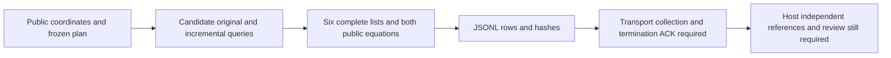

# Controlled followup candidate source delivery

TASK-20261029-8afe17; source development only; maximum_runs=0. No scientific execution, fresh curve/point panel, entropy, Modal call, benchmark, status transition or Git operation occurred in this continuation. All executable checks use the disclosed F11/r13 and F23/r17 fixtures and deterministic negative mutations. Root owns canonical application and archive.

The actual original ungated_attempt is AST-identical to historical compute.py. curve.py and constructor.py are byte-identical to their historical counterparts. The local incremental evaluator seeds the first Miller chain, reuses each already-paid doubling slope once, continues all L queries after an undefined numerator, and retains original noncounter outputs. Eleven original prototype tests remain.

The complete enumerator uses MSB query order, lexicographic erased assignments, increasing flip weight and lexicographic defined-index combinations. Six fixed cells share the incremental trace. Every word remains after a recovery, every legal interval gets both actual public equations, and zero gets checking costs while excluded from distinct nonzero M. Only actual excess erasures cap a list. The t0.e0 cell explicitly preserves original UNDEFINED status alongside capped=true. Other cap cells say CAPPED_ERASURES. Uniform host reference domain is 1..r-1, denominator r-1, without replacement, budget min(M,r-1), saturation at full domain.

run_public has strict public model/base/target keys, candidate imports only, intent-before-trace emission, streamed JSONL, incremental file sealing, observed versus expected counts and incomplete completion on failure. It retains only one trace and its six lists during processing. Sampling failures retain proposal/cost data in the error message and incomplete summary; later scheduled slots remain explicit gaps through the frozen input plan and observed counts. The engine never asserts a transport termination ACK. Host-only references must wait for actual collection, seal verification, quiescence and termination ACK supplied by transport.

cohort.plan() performs zero draws. Source implements four 12-curve stages, four curves in each 10/13/16-bit tier; discovery/validation eight arms; confirmation only circuit2.a1, 64 distinct public coordinate targets and eight blindings. Sampler requires public nonce and positive explicit proposal limits. Each p,j key is checked against caller-held exclusions across stages and all exposed keys. Curve and target rejection records are retained. Candidate results never enter eligibility. Future generated jobs comprise 345600 singles,24576 calibration traces,12288 confirmation traces,73728 cells; physical predicate calls before controls total1033728. Samplers were not invoked in this source task.

Observed fixture checks: final19tests passed RC0. Hand values retained include F11 a5,b1 target7 -> k4,x7; F23 doubling coordinates and Z sequence(22,1,6,13,1,22); F11 doubled slope8. Exhaustive bounded word coverage is independently compared with all binary words on these fixed trace lengths only. Mutations cover erased positions/caps, one wrong digit, incomplete trace, wrong recurrence sign, canonical upper endpoint and wrong conversion. The canonical k=r endpoint fails; this test does not independently isolate a <= upper-bound mutant from the separate k<r range guard. Zero word k0 receives two scalar multiplications, both failed equations and M0. Stock jsonschema validates emitted fixed F11/F23 trace/cell branches, calibration null incremental, and a fixed F11 streaming worker invocation with b1 stub. Tests require jsonschema; worker uses standard library only. An earlier test failed because the test's base trace already contained erased bits; the deterministic mutation test was corrected to normalize all original answers before adding exactly e erasures. This was a test defect, not discarded experimental data.

Bounded source review: handoff, AGENTS, relevant literature/observation/retrieval/intermediate-cost rules, goal, original constructor/arithmetic, original ungated function, old cohort excerpt, prototype/test starting files, decoder design and named reports were inspected. Some combined report/AGENTS reads were output-truncated; no full-corpus reading is claimed. The primary AGS PDF URL retrieval in this continuation failed with URLError tunnel502, so no primary text was independently re-read here. Existing named internal reports record its theorem assumptions; this implementation is the specified elementary complete-list procedure, not an AGS learner. KB tools unavailable; bounded absence makes no novelty claim. Runtime skill/environment status was read; HTTP policy observed enforced unrestricted, no credentials were read. Initial missing executor-implementation SKILL path was reported by shell and not silently treated as read.

Remaining concrete admission gaps: exact future nonce/caps/exposed-key inventory, input/source/runtime/protocol pins, full scientific controls/reference integration, enforced worker/checker access isolation and denial probes, transport seal/termination integration, independent arithmetic and operation-counter replay, frozen analysis and independent review, lawful preapproval/checkpoint/run-skill admission. Sampler and full study job generation are source-only and unexecuted. Counter ledgers cover disclosed abstract field/group/scalar/RNG/list and common families, but interpreter/container/RSS/I/O/native allocation and built-in integer internals are not exhaustively metered; cohort modular-power counters are abstract call/bit counts. No counter advantage qualification follows. Physical common point generation may repeat identically across arms and every repeated cost remains present. Future point/curve eligibility must be reviewed with the exact frozen sampler population. No timing qualification, family closure, exponent, scalar-ordering or significance conclusion follows.

This diagram is a source/custody map, not a verified scientific graph change. Root owns any required synthesis PDF/canonical graph work; no extra output paths were introduced. Source hashes, exact test command/stdout/stderr/RC and input hashes/read depths are in engine-delivery.json. Model identity/probe/inference costs are unobserved and remain null.
