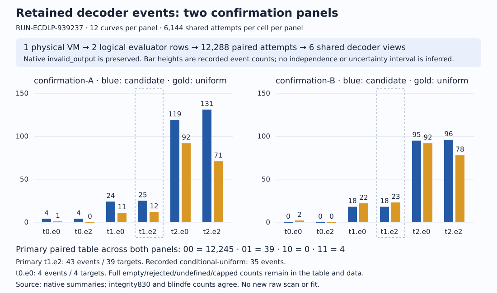

# Controlled follow-up: reviewed finite observations

EXP-ECDLP-080f41 / RUN-ECDLP-939237 · 2026-10-30 · TASK-20261029-2f1fc7

## Finite procedures and retained recoveries

Observations only. EXP-ECDLP-080f41 / RUN-ECDLP-939237 / TASK-20261029-2f1fc7. This composition presents the working finite list procedures, their counted scalar recoveries, retained failures and the scope of independent checks. It changes no scientific status, goal, hypothesis or lane, and does not supply a security, usefulness, novelty, speedup, exponent or family-closure verdict.

The fixed primary t1.e2 procedure records 43 recovery events on 39 distinct curve-target identities, across 12,288 shared confirmation attempts. The strict t0.e0 reference records 4 events on 4 targets. The retained matched-M conditional-uniform stream records 35 primary-cell events. These are observed finite outputs worth presenting; differences of these counts are descriptive and do not establish a mechanism or a cost advantage. [N, I, F]

The implemented procedure uses a fixed public predicate trace, complete bounded-error/erasure word enumeration, integer intervals and public scalar checks. For the frozen transformation P=aG and Q′=bQ, k is converted as x=a·b⁻¹·k mod r. Both transformed and original equations are required. The six fixed views use t∈{0,1,2}, e_max∈{0,2}; t1.e2 was primary before this cohort. Query traces continue through undefined answers; every branch, conversion and check remains paid. This describes the retained algorithm, not a fresh theorem or extrapolation. [P, D, A]

One physical candidate invocation created one VM and executed one engine. Its native supervisor receipt remains invalid_output: driver returncode 0, checker 1, published=false, after JSON/YAML manifest serialization failed the original checker. A separate complete read-only JSON supervisor view later passed compatibility validation; one host postrun on that view returned 0 with complete status. Neither derivative rewrites the native failure. [R, N, I]

Two export rows describe the original and incremental strict evaluators on the same VM, targets and paired trace population. Each records 12,288 attempts, 172,032 predicate queries, 4 strict recovered events and 4 recovered targets out of 1,536. They are not two independent trials. Six decoder cells are repeated views of those shared traces. [N, I, F]

| Recorded scope | Value |
| --- | --- |
| Retained cohort / confirmation curves | 48 / 24 |
| Setups / calibration single records | 216 / 345,600 |
| Intent / physical trace records | 36,864 / 36,864 |
| Decoder cells / curve-cell rows | 73,728 / 144 |
| Confirmation targets / blindings each | 1,536 / 8 |
| Native trial / logical evaluator rows | 1 / 2 |

## All six shared views and retained outcomes

The graph separates confirmation-A and confirmation-B and displays every frozen cell. Each panel contains 12 curves and 6,144 attempts per cell. Uniform bars are one recorded conditional reference realization; candidate work determining M is not free. The repeated targets, eight blindings and six cell views are nested, not independent population draws. [N, I, F]

Every row below has 12,288 attempts across 24 confirmation curves. Events, recovered targets and uniform events are copied from retained summaries; outcome statuses and M0 are independently recounted by integrity 830. Omitted status keys in the source mean zero recorded instances in these complete summaries; the table uses arithmetic zeros only for that explicitly complete count table. The 127 strict t0.e0 cap flags are recorded as UNDEFINED; t1.e0/t2.e0 retain explicit CAPPED_ERASURES. All 144 curve/cell rows, including 78 zero-event rows, are retained in observations.json and the source. No success-only filtering occurs.

The primary paired table is 00=12,245,01=39,10=0,11=4. Its 39 additional recorded events share the baseline attempts. Distinct recovered targets are ORs over eight blindings of each target. Sums of events and targets across different cells are not presented as a larger independent sample. [F]

| Cell | Events | Targets | Uniform | Empty | Rejected | Undefined | Capped | M0 |
| --- | --- | --- | --- | --- | --- | --- | --- | --- |
| t0.e0 | 4 | 4 | 3 | 7688 | 4469 | 127 | 0 | 7819 |
| t0.e2 | 4 | 4 | 0 | 7731 | 4553 | 0 | 0 | 7735 |
| t1.e0 | 42 | 38 | 33 | 6 | 12113 | 0 | 127 | 133 |
| t1.e2 | 43 | 39 | 35 | 6 | 12239 | 0 | 0 | 6 |
| t2.e0 | 214 | 183 | 184 | 0 | 11947 | 0 | 127 | 127 |
| t2.e2 | 227 | 196 | 149 | 0 | 12061 | 0 | 0 | 0 |

## Calibration, sampling and uncertainty

The frozen study spans four stages (discovery, validation, confirmation-A, confirmation-B), prime subgroup bit tiers 10/13/16 and four slots per tier per stage. Calibration uses 24 discovery/validation curves, eight fixed arms and 1,800 retained draws per curve/arm, plus 128 trace starts. Confirmation uses 24 further curves, 64 targets and 8 nonzero blindings per target. No fitting, radius choice or target-dependent orientation is added by this composition. The source sampling/PRNG model and its exposure history remain assumptions to audit, not independently regenerated facts. [P, N, F]

All 192 calibration arm records have 1,800 draws. There are 345,600 total draws and 127 undefined responses. Signed correct-minus-wrong numerators range from−208 to 171, always divided by all 1,800 draws. Undefined responses stay in that denominator. The frozen protocol’s 1/512 calibration resolution literal is explicitly NOTQUALIFIED: the actual score lattice is 1/1800, and a lattice is not a confidence interval. All 192 signed-numerator/denominator/status records are retained in observations.json. Calibration labels, correlation truth and PRNG streams were not independently regenerated. [N, I, F]

The primitive physical-query arithmetic is 345,600 calibration singles +344,064 calibration trace queries +172,032 original confirmation queries +172,032 incremental confirmation queries =1,033,728. The six decoders add views, not new predicate traces. This is arithmetic on retained components and the frozen schedule, independently derived by fe; it is not a hardware counter replay. [I, F]

Curve is the population unit. Fixed-curve restart formulas require their stated complete independent-restart model; no pooled iid sample of 12,288 heterogeneous curve attempts is asserted. The historical conditional zero-event bound 1−(.05/144)^(1/512) and calibration bound 384exp(−9) retain those assumptions; this report adds no new interval, p-value, fit or significance claim. A zero count does not establish q=0 or an infinite true retry cost. [D, C, A, F]

All 48 now-exposed full models, bases and(p,j) identities are copied from the native exposed-curves.json into observations.json. They must inform future cohort exclusions. The frozen pre-existing exclusion list is unchanged. This composition generates no curve, target, seed, nonce or entropy.

Fresh A/A, planted-positive and inferential-negative arms remain explicitly excused by the frozen descriptive contract. Deterministic source fixtures, paired original/incremental equality, post-ACK BSGS and conditional references do not manufacture those fresh arms, detector sensitivity, a noise floor or exchangeable-null p-values. The 24 null files retain 1,023 draws each with support, duplicates and ties; 48 uniform files include 24 scheduled zero-byte calibration files. These are retained conditional-reference facts, not missing successful runs. [P, N, I]

| Stage | Arms | Draws | Undefined | Signed numerator range |
| --- | --- | --- | --- | --- |
| discovery | 96 | 172,800 | 76 | −168…152 |
| validation | 96 | 172,800 | 51 | −208…171 |

## Paid components and concrete retained cost records

Costs remain vectors with different instruments and scopes. Worker setup/common/query/reduction/conversion/list/both-verification work, host oracle construction, conditional references and BSGS cold/warm work stay separate. No sum across field/group/wrapper families or worker/host backends is a scalar cost. Native RSS, interpreter allocations, I/O and integer internals are unmetered; clocks and independent native counter replay remain unqualified. [P, I, F, analysis/references]

M=0 means zero nonzero uniform guesses, not zero candidate effort. Across all six views, 15,820 M0 cells retain 15,614 word records and 15,820 recorded order-inverse calls, with 8 zero-candidate checks in those M0 cells. Common trace work is attached once to 7,819 shared trace identities. The complete M0 vectors are retained in observations.json. All 452 legal zero-word checks across all cells remain separate from M. [F]

The following worked records were selected by the first lexicographic confirmation curve, confirmation-A-10-0, target0000 and fixed primary t1.e2; they are not population statistics or a favorable-result subset. They are copied from existing analysis/references files without solving or replaying a reference. Complete source vectors and selected full records accompany observations.json.

On that curve’s 512 primary decoder attempts, 6,144 words were constructed, 2,145 candidate lookups/public-candidate checks were recorded and 4,290 verification scalar-multiply calls were recorded. Setup, physical trace/blinding, conversion and failures remain charged separately; these decoder components are not an end-to-end budget. [analysis]

The host BSGS worked target records scalar 374 for public point(552,348), with successful public verification. Its cold setup and warm online vectors remain separate; warm_setup_increment=0 means reuse of the already paid setup. Integrity 830 separately verified 1,536 retained BSGS original equations. This does not qualify BSGS memory/clock or a matched-cost comparison. [references, I]

| Record component | Recorded count |
| --- | --- |
| Primary decoder word construction | 6,144 |
| Primary decoder order inversions | 512 |
| Primary decoder public candidate checks | 2,145 |
| Primary verification field inversions | 47,310 |
| Primary verification field multiplications | 159,050 |
| Physical incremental trace predicate memberships | 5,632 |
| Physical incremental trace initial Miller coefficients | 512 |
| Physical incremental state updates | 5,120 |
| Host BSGS setup group adds / stored points | 27 / 27 |
| Host BSGS online group adds / table lookups | 13 / 14 |
| Host BSGS online public scalar check | 1 |

## Six-joint review composition and witness scope

Five assigned joints hold within their stated scopes. The full sixth joint remains inconclusive. In particular, a complete nonzero-uniform/zero-cost/decoder host-reference comparison was outsidefe’s native-only read scope. Its finite nonzero law, native M/deduplication/zero/list/conversion checks hold; that does not qualify realized host generator behavior or every unsuccessful reference equation. Integrity 830 reaggregated retained host streams but did not rerun their generators. This composition does not turn that coverage into a complete independent reference-realization validation. [I, F, Q]

Integrity 830 used separate affine modular addition and double-and-add multiplication, sharing no producer Curve/Group/Oracle arithmetic. It verified original and transformed equations plus conversion for 534 recovered decoder-word witnesses and 8 paired strict witnesses. It also verified 1,536 retained BSGS original equations. These are genuine checks on finite scalar witnesses, not fresh experiments, a solver rerun or validation of failed branches. Generator/reference PRNG/truth-label construction, actual historical isolation, clocks and native counter execution replay remain gaps. [I]

The pre-outcome blind phase sealed note 859328a6… at 01:09:43.646974 UTC, root ACK 7297659e… at 01:10:29.150507, before raw reads began 01:14:49.500920. Full exact hashes, note/scripts/results and ACK are preserved in checks.json. The permitted full trial-plan exposed embedded historical administrative text (27 fixtures, 7 mutation groups, 49 native facts); this was disclosed and acknowledged. Neither reviewer declared a sibling-report read. [F]

The actual composition checker was rerun for this task using exactly the two task directories and returned 0/PASS. It verifies declared joint ownership, blindness and controls, not hidden agent reads or serving-model identity. Requested review policies and sessions are provenance; no backend authentication or model probe is fabricated. [Q, composition.json]

| Owner | Joint | Result |
| --- | --- | --- |
| 830 | protocol/source/runtime/custody | holds, retained-evidence scope |
| 830 | no-host-reference-before-ACK | holds, gate/source scope |
| 830 | raw/export/count/failure coverage | holds, retained coverage scope |
| fe | 1,033,728 physical-call arithmetic | holds, finite arithmetic scope |
| fe | shared six-cell/paired dependence | holds, nested denominator scope |
| fe | nonzero uniform/zero cost/decoder | INCONCLUSIVE as full host comparison |

## Native history, export views and additive corrections

The native failure remains immutable. Separate representation bridge review validated the full JSON supervisor view rather than deleting omitted supervisor fields. The host postrun executed once, returned 0 and preserved source complete/observed-only/not_assessed, wall_valid=false and counter_replay_qualified=false. Source and experiment-root derivative exports both have actual protocol/file validation 0; their distinct export hashes must not be collapsed. [N, I, Q]

Integrity 830 binds source export 218e4e7b… in postrun-from-view-346631/export.json. Blind fe binds opaque root derivative c96a2393… in experiments/EXP-ECDLP-080f41/export.json without opening its payload. Both represent the same paired evaluator study through different rebased file views. Export identity is not a claim that both reviewers semantically read the same bytes. Large exports are committed identity pointers; no git-show payload success or new remote GET is asserted by this composition.

Custody keeps 197 postrun-domain files and 10 native-report-domain files with their two excluded indexes:209 nested logical paths. c09’s actual fixed three-path archive at 13f37cf589ac21dec1cd92ba161c55396795b31d remains unchanged. Existing full-GET records cover 46 source objects plus the native report PDF; this task did not repeat network retrieval. The source-generated1,716-page PDF remains explicitly UNINSPECTED. The separate 3-page native PDF has preserved earlier all-page root/agent inspection. This new report is rendered afresh from report.typ and inspected separately.

Root’s first combined independence command passed report.md paths, found no review_attestation blocks and returned 2. A late shell set-e allowed commit 24e0e40e2ff5bf48fad034629782e8b75d580cf5 to claim combined PASS prematurely. The original commit is preserved. The corrected exact-two-directory command actually returned 0/PASS at 2026-10-30T01:29:49.683350 UTC; the additive root record, published with the destination amendment at d3af2ec2ab, records both failure and correction. No original review or raw record was rewritten. [Q]

Blind fe’s original protocol_sha256 field held raw file c27bbea0…, rather than standard frozen semantic 4e3aa54f…. Root refused integration and requested metadata-only correction. Original sealed review bytes/hash remain in checks; note, seal, ACK, raw observations and the inconclusive verdict are unchanged. Both final native review schema/file checks returned 0. A formatting repair is not a mathematical finding. [F, Q]

The old EXP-ECDLP-956f81/RUN-ECDLP-c8d9b0 failed-attempt report, four old payloads, reader, fixture and all established metrics remain preserved. DEC-20261030-adcc31 prospectively assigned this fresh observations-080f41 sibling. This task does not write final 95’s decision or checkpoint.

| Identity | SHA-256 |
| --- | --- |
| Source export | 218e4e7b66aab84005a5174f184e882cb6ccb932ac5134aa352431df8aeb8339 |
| Root derivative | c96a2393bfd90e605d9f12f6bfc0e974701c6fdc003f9d0760cb17956d37c6b3 |
| Frozen semantic protocol | 4e3aa54f421cdf1c4fe5b5c96edeac9898c628c625e98cf0d1fe8d997d1ccf60 |

## Verification, next discriminating step and sources

The additive controlled_followup_080f41_observations reader authenticates exact committed source hashes/statuses, both exact authorized identity-pointer export bindings and the frozen semantic protocol/verification/postrun/report/review facts. It emits 19 neutral measured-count series under controlled.939237.*, retains the native invalid-output count and legitimate zero, and distinguishes one physical VM from two shared logical rows. It never downloads payloads or reads a working-tree fallback. Missing/malformed/stale/hash/status/pointer/row/count mismatches emit nothing. No planned count, success-only filter, qualified clock or inferred missing measurement is added.

Actual focused validation: the historical fixture was copied unchanged and run against the proposed exporter together with the new 080f41 fixture:7 tests passed, RC 0. Tests cover actual tiny synthetic Git refs, dirty-source immunity, missing pointers and source hashes, malformed/stale bindings, self-consistently rehashed wrong frozen protocol hash/status, wrong URI prefix with the same digest, and bad status/pointer/physical-population records, legitimate zeros and measured counts differing from plans. Every preexisting exporter function AST is unchanged; main gains one new call. Outside source-projection checks are not publication of committed metrics; root must test the canonical patch, commit, and run the committed exporter. Exact commands/results are recorded in composition.json.

Next discriminating step before any fresh candidate: independently validate the already realized host-reference construction and cost scope under a separately frozen bounded task. Check generator/PRNG and truth-label semantics, exact-mask support/duplicates/ties, uniform success/failure public equations and M0 separation, BSGS cold/warm/setup vectors and paid shared/list work. Deliver independently archived complete coverage/mutation evidence or a named remaining gap. This composition authorizes no new candidate, reference generation, curve or entropy.

Knowledge promotion is not warranted here: finite retained observations and bounded witness/arithmetic checks do not supply an independently supported generalized mathematical claim while reference realization, calibration truth/PRNG, native counter replay, isolation and clock obligations remain. Working finite algorithms and counted recoveries remain visible. The dated historical research-map.svg and decoder/controls/design-audit sources were checked against the ECDLP frontier index and left unchanged: the former remains an immutable historical proposal view, while no graph-supported generalized claim or official status is revised. The new local SVG records these observations.

Primary-source provenance is internal. The frozen protocol, retained native/postrun/analysis/references/report and both completed review records were read for this composition, alongside AGENTS/coordinator/coordinate/research-visuals and the earlier decoder/controls/design-audit reports. Existing papers cited in those design reports were not independently reread; no novelty conclusion relies on them. Exact paths, byte hashes, read depth and gaps are in observations.json source_records. Raw streams were not rescanned, and no scientific pipeline, host solver, generator, fit, nonce, curve or entropy was executed.

| Citation | Canonical primary source |
| --- | --- |
| P | experiments/EXP-ECDLP-080f41/protocol.json |
| R | experiments/EXP-ECDLP-080f41/runs/RUN-ECDLP-939237/execution-receipt.json |
| N | experiments/EXP-ECDLP-080f41/reports/run-20261029T2258Z/observations.json |
| I | coordination/goals/GOAL-ECDLP-e70832/batches/BATCH-cbf9d7/reviews/TASK-20261029-830629/experiment.review.json |
| F | coordination/goals/GOAL-ECDLP-e70832/batches/BATCH-cbf9d7/reviews/TASK-20261029-fe803f/experiment.review.json |
| Q | coordination/goals/GOAL-ECDLP-e70832/batches/BATCH-cbf9d7/reviews/round-composition-root-check.json |
| D / C / A | docs/reports/classical-ecdlp-further-leads-20261029/{decoder/report.md,controls/report.md,review/design-audit.md} |

