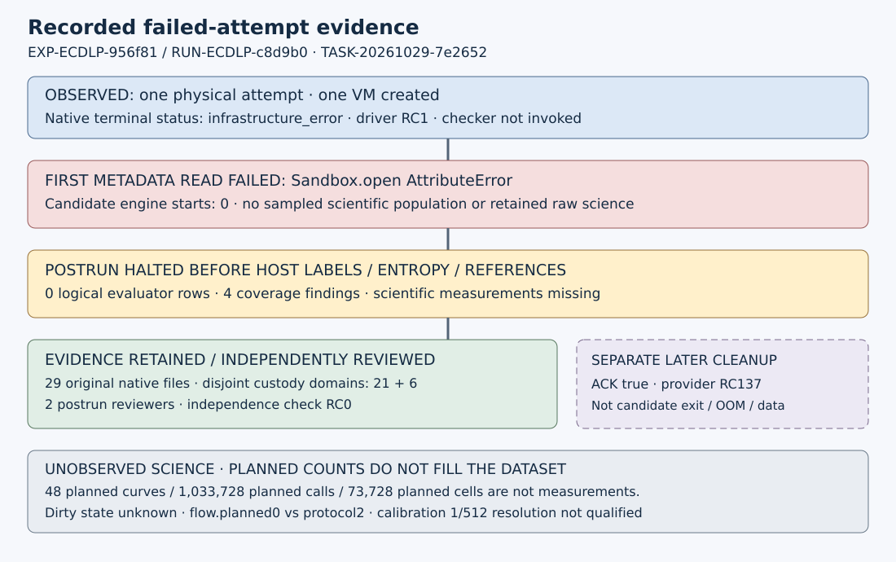

# Reviewed failed-attempt observations

EXP-ECDLP-956f81 / RUN-ECDLP-c8d9b0 / GOAL-ECDLP-e70832 / H-ECDLP-6674c9. TASK-20261029-7e2652 composes the two completed postrun reviews. This report records an infrastructure failure and its evidence coverage; it changes no scientific status and supplies no mathematical verdict.

One physical attempt created one VM. The first pinned-image metadata read raised `AttributeError: 'Sandbox' object has no attribute 'open'` before worker staging and candidate-engine execution. There are zero recorded engine starts and zero retained evaluator aggregate rows. Predicate measurements, sampled curves, decoder outcomes, recovery rates, calibration scores and solver/reference results are **missing**, rather than measured zeros.

## Observation

| Retained quantity | Actual count or status | Scope |
| --- | ---: | --- |
| Attempted physical trials | 1 | One native RUN and supervisor receipt |
| Completed / infrastructure-failed / timed-out trials | 0 / 1 / 0 | Native terminal status `infrastructure_error` |
| VM creations / candidate-engine executions | 1 / 0 | Controller-recorded operational counts |
| Retained logical evaluator rows | 0 | Both original and canonical-path exports have `runs=[]` |
| Missing-coverage findings | 4 | Full protocol/export check refuses qualification |
| Candidate/reference scientific measurements | Missing | No science-bearing retained population |
| Native dirty-tree state | Unknown | No independently bound native field/evidence |

Native host orchestration lasted from 2026-10-29T21:53:39.045750Z to 21:53:40.757379Z, a derived interval of 1.711629 seconds. That interval is not an algorithm runtime. CPU time, candidate peak memory, qualified clocks and independent native-counter replay are unavailable. The actual launch authority was `3982e1a7626c11b4b57db544cf9548f25d658af0`; historical source was C3 `c4d0d3ed9d0732a72559a11871271e195635af88` with M3 `a7b60afdf7b15dceb59d38fd301c05f73deef425`. Later source repairs do not rewrite the failed attempt.

The original native receipt still has termination ACK null, collection incomplete and UID1000 quiescence false. A separate later cleanup record for the same sandbox acknowledges requested termination with provider returncode137 at 22:02:50.903688Z. That is neither a candidate exit nor an OOM observation. It supplies no retroactive collection success. The integrity review verifies all29 original native files against their retained capture inventory/archive, and both disjoint postrun/report custody domains (21+6 content files).

The diagram shows recorded process and evidence stages because no scientific values are available for a quantitative comparison. Its editable SVG and the adjacent observations.json retain the source/data for every label. Solid boxes show recorded operational/evidence facts; the dashed box is a separate later cleanup event. Planned scientific work is explicitly unobserved.

## Comparison and review composition

The independent integrity reviewer TASK-20261029-76c06b owned three joints. Protocol/source/runtime/custody is **inconclusive** for successful measurement qualification: exact failed custody verifies, but no runtime measurement exists and the clean/pushed narrative lacks bound provenance. No-host-reference-before-ACK **holds within this failure path**: actual postrun stopped before host module import, seed, scalar labels or references. Raw/export/count/failure coverage **holds within the retained failure scope**: absent measurements and all four missing-coverage findings are disclosed. None of these labels qualifies a successful scientific study or provider isolation generally.

The blind reviewer TASK-20261029-e7c11e owned the physical-call arithmetic, shared-cell/paired denominator and nonzero-reference/decoder semantics. Its first phase was sealed at 22:54:06.866349Z, SHA256 `8a186913bc2d00425474fc8592d217b56ddae6063a39a8b1338c53f865ea89a6`, before outcome/code/report exposure. The fixed scientific statement's numeric totals were visible; derivation was from its primitive parameters. Phase2 deliberately opened the selected old records at 22:54:21.444137Z. Sibling reports and future data remained unread in that review.

The blind derivation confirms the **planned** arithmetic: 345600 calibration singles +344064 calibration-trace calls +172032 original-confirmation calls +172032 incremental-confirmation calls =1033728. The six decoder views share traces, so73728 planned cell views are not73728 independent experiments. Conditional reference probability is `m/(r-1)` for `m=min(M,r-1)` distinct uniformly selected nonzero guesses; M0 gives no reference draws while common/setup/list/M-determination work remains charged. Actual schedules, legal lists, M, costs, equality, rates and reference outcomes are unqualified because the run contains no such records. No actual zero-hit interval applies.

Integrity attacks reject the five tested source/member/archive/ACK/count mutations. The blind review rejects artificial independent six-cell multiplication, zero-hits-implies-q0, duplicate/zero candidates counted as distinct legal support, and M/r at nonzero-domain saturation. A strict-to-nonstrict dyadic upper-bound change is an equivalent mutant under oddr, rather than a falsely claimed detected error. No actual wrong-scalar mutation or fresh fixture was performed by that blind review.

The actual independence checker returnsRC0: `PASS: 2 report(s), every joint owned and attested, blindness respected, controls declared`. It was run with exactly the B19 frozen review plan and reports76c06b/e7c11e; the separate source-repair7352c1 review was excluded. This composition reads both completed reviews openly; it does not claim another blinded review.

## Additive qualifications

1. **Native clean/pushed sentence:** the historical native report says the launch checkout was clean and fully pushed. Its allowed native inputs do not bind contemporaneous evidence for that assertion. Do not rely on the sentence; dirty-tree state remains **unknown**. Parent/root context is not independent proof. The published report and native bytes are preserved.
2. **Planned flow:** source and canonical-path exports retain `flow.planned=0`, the count of emitted logical observations. The frozen protocol plans **two** evaluator aggregate observations. Keep both facts visible: actual zero rows are missing coverage, not a completed zero-recovery study. The four full-check findings remain failures.
3. **Calibration resolution:** frozen text says `1/512 fixed-curve attempt fraction`, while calibration defines signed score/all1800draws. The resolution field is **NOT QUALIFIED for calibration**. No calibration data exist here. Any separately collected future score must report the actual signed numerator, retained denominator and undefined count; grid spacing is not uncertainty or a confidence interval. No frozen bytes are silently corrected.

## Inference, limitations and next work

This failed attempt establishes the recorded infrastructure stopping point, byte custody and honest measurement absence. It provides no candidate recovery rate, bias, q0, solver-validity, cost comparison, timing result, exponent or family-level conclusion. Frozen A/A, positive and inferential negative controls have descriptive-scope excuses, rather than executed scientific control outcomes. Knowledge promotion is **not_warranted** because no candidate execution or independently supported scientific measurement exists. H-ECDLP-6674c9 remains scientifically unpromoted; no official goal/hypothesis change is made.

TASK-20261029-2163c5 should archive this exact composition/report/metrics delivery and actual review custody, closing only this administrative failed-attempt lane when its acceptance conditions hold. This old EXP/RUN is never retried. Any scientific measurement uses separate admitted identities; its results cannot fill this record retroactively. No new trial, curve, target, seed, oracle or reference was generated for this composition.

Historical `docs/reports/classical-ecdlp-controlled-followup-20261029/study-map.svg`, the old native `reports/run-20261029T2153Z/pipeline.svg`, and the ECDLP known-results map schema were checked. They are unchanged: the first remains an explicitly prospective source-readiness diagram, the second is immutable accurate failure history, and no mathematical graph edge changes. The new local map records this composition only.

## Committed progress metrics and verification

The same delivery extends `tools/progress_metrics.py` with eight neutral `controlled.c8d9b0.*` count series: attempted/completed/infrastructure-failed/timed-out trials, recorded VM/engine counts, retained logical rows and missing-coverage findings. Every value is recomputed against six hash-bound **committed** primary files at one immutable ref. Failed status is retained. Missing scientific quantities and plan counts emit no series; a dirty working tree, missing source, hash/type/status mismatch or substituted count cannot supply a sample. Every preexisting exporter function except the one added call in main has unchanged AST, preserving established series.

Focused synthetic Git tests cover valid failed status and legitimate zeros, changed counts, missing fields, bool/negative/substituted values, source/hash/status qualification, and real committed reads despite corrupt dirty files. The unchanged transfer-metrics regression is also run against the delivered exporter: four tests pass. The full exporter against committed df0303b8b51e6008662ea77e27c7fd64d6273070 returnsRC0 in 0.739 seconds, with no new controlled series before this new report is committed. It uses only stdlib and is below60seconds. The first outside CLI attempt returnedRC2 because the outside package directory has noGit; rerunning with documented `PM_REPO_PATH` pointing at the canonical repository corrects only that path configuration. All failed command logs are retained outside; no trial was retried.

## Sources and provenance

All scientific/evidence references here are **internal, directly read** at committed source df0303b8b51e6008662ea77e27c7fd64d6273070. Relevant sources were the exact old native receipt/raw result, source postrun and original/canonical-path export/validation, frozen protocol and output contract, both review reports/checks/attestations/experiment reviews and frozen review plan. Exact hashes and executed commands are in adjacent observations.json and B19/composition.json. Procedural sources were AGENTS.md, observation/literature/progress-metrics rules, Coordinator and research-visuals skills, existing exporter and transfer regression, prior factual metadata reconciliation and graph source. No external scientific literature or model probe was accessed in this zero-science composition; novelty and mathematical literature claims are outside scope. The serving model identity is unverified and recorded null, rather than invented.
