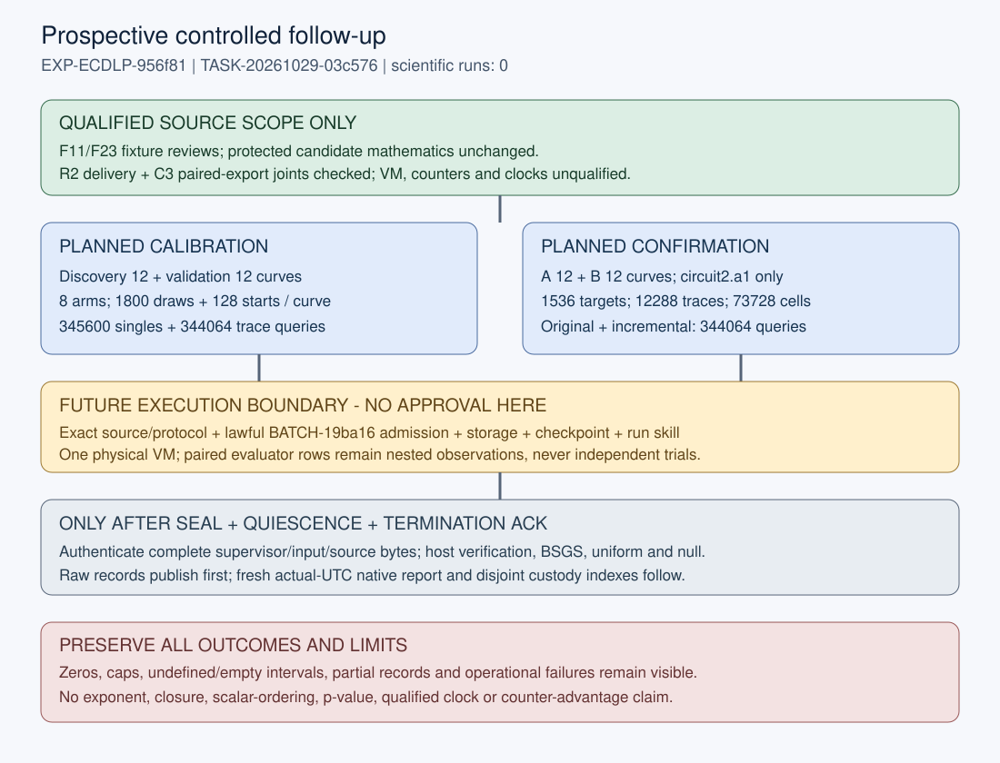

# Source-bound prospective readiness - metadata v2

2026-10-29. Coordinator TASK-20261029-03c576, GOAL-ECDLP-e70832, source BATCH-2fe40f. Reserved EXP-ECDLP-956f81 and physical parent RUN-ECDLP-c8d9b0. The prospective specification remains review_required, frozen, approved_by:null and execution_authorized:false. This report qualifies only the published source-review scope. It grants no approval or execution and records no scientific result.

Actual C3 source is c4d0d3ed9d0732a72559a11871271e195635af88; M3 manifest metadata is a7b60afdf7b15dceb59d38fd301c05f73deef425. Original producers, source snapshots, both original reviews, repair186322/snapshotf796a3/review19bc99 and export producerb9f48c/snapshotb5a89f/review489ab1 are completed and published. The after-dispatch STATICLOCK gate was actually satisfied before freezing. Actual scientific runs, SDK imports/calls, fresh scientific entropy/nonce/curve/target draws, old-cohort reanalysis and benchmarks in this task remain zero.

## What the source reviews establish

Original math review182d42 preserves its conditional symbolic proof and 17 independent groups/114 deterministic F11/F23 erasure/radius configurations. Its public-domain assumptions are nonsingular E/F_p, p>3, odd prime subgroup r!=p and the exposed normalized-function definition. The sealed raw coefficient C differs from source Z=-C/r; source transport plus slope was correctly reconciled after unblinding. That blind-notation limitation remains. Proof SHA256 is d9ce34e707f04e8cfc7402738220192e2a3e936fb14c7f5687a6690aa9f6fb88. Less-than versus less-than-or-equal is an equivalent mutant under the range/coprimality assumptions; it was not falsely reported rejected. Removing the upper guard is an inequivalent rejected mutant. Candidate source bytes remain unchanged.

Historical delivery reviewa13be8 reported D1-D6 breaks; those immutable failures remain. Repaired review19bc99 reports seven exact joints holding within tested source scope with actual independence-check RC0. C3 changes only postrun exporter/tests, followed by both manifests. Fresh review489ab1 reports C3-E1 through C3-E6 holding within disclosed fixture/API scope, with actual independence-check RC0. Its published report SHA256 is5e3d70a02ac0a9ac9ef14f5d58775dc5adba7c3b397486210e6817a73507d534; attestation8ef84a573ab3667d6a91f04dd2d6dff2d32c072567ffac518e480517b26cf104; checksf415a8b00b20117b6fb883d56f0c65e25b7c08df7282b6ef16026416ebcde552. Review publicationb44839b9a76c52b7a11dc1dcac29617a32949bb3 and completed releaseb3e91e4e945b42600e322f3943a3d01b893215a4 are actual, not prospective hashes.

In the disclosed C3 F11/F23 fixture, independent raw summation finds2 retained paired attempts,11 queries,1 strict recovered event,2 retained unique targets and1 recovered unique target per method. The separate original-only calibration trace is excluded from both paired totals. The F23 strict failure remains distinct from its decoder-cell recovery. These are software fixtures, not production tiers or scientific samples. Producer42 regressions are producer history; readiness did not rerun their arithmetic.

The generic export checker validates schema, coverage and file hashes; it does not independently recompute raw metrics. Post-export forged12288/172032 counts pass that generic check and fail the reviewer's raw comparison. A future review must independently sum actual raw observations. Direct make_export trusts caller status/identity; direct verify_bundle trusts authenticated_inputs. The normal postrun route must first enforce complete supervisor custody, authenticate_inputs, executing/copied source pins, production population and independent host checks. Fixed-tree c.run and frozen-tuple c.make_plan seams are disclosed, not actual provider/OS/VM evidence.

Complete zero worker counter vectors pass semantic checks. Correct public equations, source tests and host counters do not establish independent worker counter execution replay. Actual VM isolation, qualified clocks, native RSS, interpreter allocations, I/O and Python integer internals remain unqualified/unmetered. All clocks remain wall_valid=false and counter_replay_qualified=false. No exponent, family closure, scalar-ordering, significance or counter-advantage conclusion follows.

## Frozen prospective population and counts

The target is48 fresh distinct public(p,j) curves: discovery12, validation12, confirmation-A12 and confirmation-B12; each stage has four curves in each10/13/16-bit subgroup tier. Charts and generators are repeated views, never new curves. The identity-only exclusion union contains218 keys, prior178 plus recent40, from administrative inventory SHA256 b0910b0620b27d0b487603772ce624588d26c035a66df83bee30c9f5c5ceae21. No target/scalar/raw-outcome or old-cohort counter/recovery analysis was used to build it. Reject excluded keys and every repeated key across all48 slots.

Calibration uses24 curves and eight fixed arms: coefficients(1,-4),(-2,-1), each with a=1,2,3,5. There are1800 nominal shared coordinate draws/curve and128 nominal starts/curve/arm:43200 nominal draws,345600 single-arm observations,3072 nominal starts,24576 arm traces and344064 calibration trace predicate calls. C3 preserves actual repeated deterministic coordinate generation per arm; all repeated physical work is charged.

Confirmation uses only circuit2.a1:24 curves,64 distinct public Q/curve,8 fresh nonzero b/Q,1536 target slots and12288 paired traces. All six t=0,1,2 by e_max=0,2 cells share each Q,b,L, yielding73728 cell outcomes. L is11/14/17 by tier. Original and incremental evaluators each make172032 physical predicate calls,344064 together. The old card's172032 line counts ONE evaluator. Overall physical candidate calls before additional controls/references are345600+344064+344064=1033728. There are216 setups,382464 distinct jobs and36864 trace/intent records. Six cells do not multiply physical query costs or independent samples.

The primary descriptive cell contrast is t1.e2 versus t0.e0; every cell remains. Enumerate all declared words in fixed order even after recovery. Preserve strict half-open interval/range checks, both transformed/original public equations, empty words and zero-check work. Distinct legal nonzero M excludes zero. No coefficient/base/circuit/seed/cap fitting, training, winner selection or tuning occurs between stages.

## Two logical observations, one physical parent

The real export arms are confirmation_original(baseline) and confirmation_incremental(candidate), sharing instance candidate-vm and replicate0. Observation IDs derive from actual allocated parent RUN plus .original/.incremental. Both retain the actual same worker and public nonce; no missing observed value is copied from planning. They are logical observation IDs, not new ledger RUNs or VM invocations. Each row contains only its method's actual strict paired-confirmation attempts, queries, recovery/status/unique-target observations and primitive families. Calibration original-only work, setup/common, six shared decoder-cell outcomes/costs and host references remain separately linked auxiliary streams.

Flow counts logical observations. Generic flow.completed can include a failed/excluded row. Row.succeeded means a completed authenticated observation, not scalar-recovery success; a valid observation may recover zero scalars. Physical supervisor/VM counts remain once in actual backend/controller custody. Missing/empty/partial/duplicate/zero-start work remains absent or failed/excluded with actual counts and checker shortfalls. No second row, recovery or planned12288/172032 count is fabricated.

## Seeds, execution and resource route

No realized nonce or target exists now. After actual future admission the worker draws one public32-byte nonce and records nonce-event.json before sampling. Exact preserved SHA256 rejection streams use curve/{stage}-{tier}, points/{curve_id}, trace-starts/{curve_id} and target-blinding/{trace_id} namespaces and source-frozen draw IDs. Stage streams are domain separated under the stated PRG/ideal-hash model, not independent physical entropy claims. Public Q comes from coordinate x/root/sign rejection, never known-k generation. Reject y=0 and wrong subgroup. Public nonce reproducibility does not supply scalar labels. Candidate-derived publicly verified scalars are legitimate outputs.

Prospective machine/proposal caps, selected before data by Coordinator judgment under standing authorization, are10000 curve proposals/slot,1024 coordinate proposals/request,1024 target proposals/curve;21600s candidate,21900s sandbox and22200s supervisor;4GiB collected total,2GiB/file,64MiB/JSONL line. The orbit ceiling1196032=16*(2^10+2^13+2^16) conservatively exceeds exact-tier r totals. These are operational guards, not measured runtime predictions or budget exhaustion. All cap/timeout/partial outcomes remain; no automatic retry or replacement nonce. The candidate reads a complete file when hashing;2GiB/file is below12GiB VM memory, not a native-RSS proof. Remote disk capacity and realtime output disk enforcement are not inferred.

The actual host interpreter route is /workspace/classical-ecdlp-endpoint-reuse/runtime-20261028/bin/python. Metadata-only inspection observed Python3.12.14 and Modal distribution1.6.2 without SDK import. Driver/check/postrun/supervisor must use that absolute interpreter; PATH starts with its bin directory while preserving injected host proxy/CA/authentication variables. Do not substitute system Python. Worker CPU2,memory12288MiB,VM blocked network,UID/GID1000,closed descriptors,root-owned source and exact clear environment are unchanged. Existing B2 app is ap-EAHJ6SjvmeY99EQ2I47duh; image im-zz2zzbG7JE9xilcBO1QJMh is a Modal object ID, not an OCI digest. The image's native executable is not the candidate implementation.

After full coordination/admission, root may apply the existing reversible execution-only harness sparse profile plus selected EXP. Root must actually measure at least13GiB free canonical overlay and6GiB free /tmp. No profile,eviction,upload or after-profile free-space success happened here. Source work used the full checkout. The13GiB overlay envelope is raw4+worst archive4.1+postrun3+headroom1.9GiB, with no compression savings assumed. Postrun bound:73728 uniform rows x16KiB=1.125GiB(max M484 at L17,e2,t2),73728 host-cell rows x8KiB=.5625GiB,all24 packed-null files<.5GiB,other reference/calibration/analysis/export/report/index outputs<.5GiB,total<2.6875GiB,reserved3GiB. Host-cell rows contain count maps/17-bit geometry rather than decoder word lists; null support stays symbolic and both draw/multiplicity hex copies are counted.

Actual pre-profile df reported about10.63GiB overlay and8.79GiB /tmp. /tmp is tmpfs, so the6GiB staged artifact-cache/compaction residency counts toward16GiB cgroup RAM. Permit it only after postrun quiesces with at least8GiB measured cgroup memory headroom; never overlap high-RSS verification. Use process-scoped ARTIFACTS_CACHE (legacy CRYPTO_AR_BLOB_CACHE if used),serial verified storage,then release only verified local hydration/cache before restoring full checkout for ledger work. Preserve remote objects/history and all logical/content/blob digests. Exceeded envelopes remain operational failures; no scientific retry is authorized by this report.

## Controls, references and statistical scope

Fresh A/A/reset/reorder/chart/perfect-half/wrong-root/constant/clustered-channel arms are unimplemented in this fixed workload and individually excused in the protocol. Their known F11/F23 source fixtures and deterministic mutations qualify source only. Named source evidence includes182d42 and19bc99 checks; C3-E4 additionally checks paid F11 BSGS known-k7 and zero-M uniform without a draw. Abstract Z7/Z31 error controls are hand-derived specifications only. No fresh noise-floor,detector-sensitivity,mechanism,covariance or negative scientific verdict borrows absent controls as passes. Extra fresh control predicate calls are0. Actual paired original/incremental confirmation equality is separately charged correctness evidence.

All candidate queries must finish,collect/seal/read back,quiesce and receive actual provider termination ACK before host-only labels/orbits/BSGS/reference work. Normal postrun independently authenticates invocation/copied/executing bytes and frozen workload first. Host references comprise up to48 paid orbits within1196032 points,1536 BSGS target solves on24 setup objects,73728 conditional matched-M uniform calls and up to24 eligible calibration null files. BSGS setup is charged once per actual object,not64 times from repeated disclosure; cold/warm scope is explicit.

The null uses1023 with-replacement orientations per eligible curve over support2^(D-1). Preserve asymmetric/undefined-anchor ineligibility,D=1degeneracy,duplicates,multiplicities and ties. It evaluates only retained1800 primary-bank points and128 starts/curve; full eligible lookup work is88190784,not additional candidate queries or a full-orbit recovery census. All inferential p-values remain null: this is a conditional descriptive sign ensemble without asserted exchangeability. Uniform guesses are distinct nonzero scalars up to min(M,r-1),with zero-M and saturation retained and exact probability min(M,r-1)/(r-1). M-determination,all failed checks,RNG,rejection,generation and memory are not free. Host and worker counters are separate abstract backends,not replayed equivalents.

Calibration precision uses m1800,K192,epsilon0.1 and384*exp(-9)<.05 for fixed-curve independent draws under the stated ideal/PRG model. It does not establish curve-population precision or rare13-bit power. Confirmation has512 attempts/curve; planning q=.02 illustrates event detection only and predicts no recovery. Complete zero-success cell bounds use1-(.05/144)^(1/512) under the fixed-curve independent uniform-b restart model; nonzero rates remain descriptive. Calibration192 and confirmation144 are separate stated families,not one global95percent claim. Curves are population units; targets/restarts/cells/charts are nested/paired. A/B panels remain separate. Zero observed successes leave retry costs undefined/null,not q=0. Setup+target preparation+E[complete online]/q requires its restart assumptions,full failed work and uncertainty; no measured attack bound is claimed.

## Output custody and publication order

Future executor a0ca95 owns the whole RUN subtree,including nested modal/raw/temp and storage manifests. Its exact top-level artifacts are the eight supervisor GENERATED roles plus manifest.yaml,raw-result.json,modal-evidence.tar.gz and modal-evidence-manifest.json. The evidence archive and member manifest bind all actual nested bytes. Source-created complete postrun names are host-cells.jsonl,verification.json,host-seed-event.json,analysis.json,calibration.json,references.json,export.json,export.validation.json,postrun-result.json,report.md,report.svg and report.pdf. Preserve conditional partial-analysis.json and all partial/missing-output failures. Dynamic names are null-{actual_curve_id}.json and uniform-{actual_curve_id}.jsonl,never guessed identities.

The active real V4 output contract SHA256 is8c471bd212331143a82122ad4b2c669f5fe3a1d459b510eaf56add59c01152b2. It covers complete/conditional/dynamic outputs and actual C3/M3; filename emission sites are unchanged by C3. It supplies static path coverage independently of any later03-dependent approved preview. The inner source snapshot0047c968f61c796ca27cd9e0b528cfe9d92f7284 and outer nine-path queue archiveR3b88c661b100d793c43e9099e03beee3567cf2344(parent0047) have distinct actual custody roles.

Raw run records publish first. Postrun owner41f0d5 then owns E/postrun,E/reports and any new experiment-root export derivative,where E=experiments/EXP-ECDLP-956f81. Its fixed new indexes are E/postrun/output-custody.json and E/reports/run-report-custody.json. Domains are disjoint; neither index hashes itself or the other. They inventory all actual conditional/dynamic/report files and .artifacts.json logical/content/blob forms. The native fresh write-once E/reports/run-<actual-first-trial-UTC>/ directory derives from retained launch.started_at,crosschecked execution-receipt.started_at,formatted YYYYMMDDTHHMMZ; no timestamp is reserved. It contains actual command/environment/host/code/counts/failures,local graph source/data and inspected PDF or exact renderer blocker. Never mutate sealed RUN data. Preserve original source postrun export/validation/report bytes; any E/export.json is a new path-rebased derivative with its own actual file check. Coordinator interpretation is separately owned.

The historical producer eight-preview/nine-page PDF misassociation,stale readback link and original review-independence errors remain. R2's distinct clean eight-page fixture PDF/inspection does not rewrite that history. The metadata-v1 PDF and all6page previews/readback are preserved with the exact prior tenfile packet; metadata-v2 is a new once-only render from corrected report metadata and the unchanged editable SVG. Its page count,text readback,every-page visual inspection and exact hashes are recorded separately after rendering in readiness-blockers.json; preview/readback files are outside the renderer input directory.

## Actual diagnostics and remaining admission

The real canonical protocol validator returned RC0 with0 findings. The real canonical driver plan-only returned RC0,verified five worker/thirteen host source files,full protocol file SHA,actual C3 revisions and all eight input roles. It reports fresh_draws:0,measurement_started:false,automatic_retry:false,wall_valid:false,counter_replay_qualified:false. No SDK branch or scientific run was invoked. Existing disclosed full F11/F23 fixture protocol validation and export --verify-files also returned RC0 in this readiness task as read-only checks; their fixture arithmetic was not rerun.

The prior actual unchanged metadata-v1 draft preapproval command returned RC2,approvable:false. It used the actual unapproved draft specification/trial plan and outside future queue/handoff,not an invented final approved preview. Root had placed the five static/protocol/spec/trial files; their tenfile source03 archive/publication is still pending. Its actual checker blocker strings follow verbatim; they are preserved v1 diagnostics,not a new v2 preapproval result:

- canonical draft specification is not committed with these bytes at source_ref
- input_sha256: experiments/EXP-ECDLP-956f81/protocol.json is not committed with these bytes at origin/experiment/classical-ecdlp-endpoint-reuse-20261026
- input_sha256: harness/classical_ecdlp_controlled_followup/compute-plan.json is not committed with these bytes at origin/experiment/classical-ecdlp-endpoint-reuse-20261026
- input_sha256: harness/classical_ecdlp_controlled_followup/prior-exclusions.json is not committed with these bytes at origin/experiment/classical-ecdlp-endpoint-reuse-20261026
- packet: no lawful open lane for this queue within goal concurrency
- prospective queue/handoff: exact trial-plan and approval binding mismatch
- prospective specification must bind this ID, approval decision, frozen and authorized state
- prospective trial plan must bind schema, experiment, frozen state and approval decision
- specification.input_bindings.engine_plan: harness/classical_ecdlp_controlled_followup/compute-plan.json is not committed with these bytes at origin/experiment/classical-ecdlp-endpoint-reuse-20261026
- specification.input_bindings.prior_exclusions: harness/classical_ecdlp_controlled_followup/prior-exclusions.json is not committed with these bytes at origin/experiment/classical-ecdlp-endpoint-reuse-20261026
- specification.input_bindings.protocol: experiments/EXP-ECDLP-956f81/protocol.json is not committed with these bytes at origin/experiment/classical-ecdlp-endpoint-reuse-20261026

These are actual publication/prospective-state/lane/binding conditions,not mathematical negatives. The reserved H-ECDLP-6674c9 and IDEA-20261029-009e52 bodies are actually absent and intentionally owned by future admission TASK-20261029-4e4d9d; no unrelated hypothesis is substituted. Exact source03 release/archive and final332 custody are pending. Final332 depends on this task; this task does not depend on its future hash. No cycle or future commit is invented.

Next,root publishes the exact tenfile source03 packet and completes final332 custody. A separate lawful BATCH-19ba16 must then materialize its reserved H/IDEA bodies and lane,create the exact approved-byte preview,obtain actual unchanged preapprovalRC0/approvable:true,and record/archive the standing-authorization technical decision. Only then may actual ready selector,live claim,measured resources,clean pushed S3 checkpoint and run-skill dispatch admit the one physical trial. This report does not perform or claim any of those later actions. The corrected V4.1 helper compares only selected instances/replicates/warmups while preserving required power/preflight_runtime; this was an administrative correction,no schema/source gate change.

## Public blinding transfer assessment (metadata v2)

This is the required top-level map assessment for the existing public input setup,adapted to the transfer assessment profile and docs/confound-control.md. It is a companion draft assessment,not a new certificate,scientific experiment,performance claim or official transition. The specification keeps variable_ledger.crosses_map:true. The original nested mathematical note remains unchanged; a complete typed declaration now also appears at experiment.transfer_obligations. No frozen protocol,source,case,sampler,seed,count,cap or scientific control changed.

Typed path: source(E/F_p,G,r,Q=[x]G) -> public(P=[a]G,Qprime=[b]Q) on the SAME E/F_p and order-r subgroup -> candidate k with [k]P=Qprime -> x=a*b^-1*k mod r with [x]G=Q. The transported relation is k=b*a^-1*x mod r. No supplied scalar label is needed for the forward map. This is kind:other/public_blinding,not a new curve,isogeny,coordinate change or destination-solver reduction. Genus/dimension/field-extension and polarization changes are not applicable; the group object and representation stay the same.

Fixed assumptions are p>3,nonsingular ordinary short-Weierstrass E,certified odd prime r!=p,nonidentity G,Q in the certified subgroup,and known nonzero a,b modulo r. Multiplication by each unit permutes that subgroup with trivial subgroup kernel; the explicit inverse proves conditional recovery on that domain. Preserve the same curve,field,chart,group order,subgroup and nonidentity. Change the public base,target and scalar relation. Predicate words,error/erasure patterns,prepared-base quantities and costs may change; no bias,ordering,independence or advantage transfers automatically.

The identity_map control names existing C-source: original and incremental use the identical transported tuple and the identity coordinate presentation,with paired semantic equality and t0.e0 embedding. This is the already-planned paired-equivalence/source-fixture comparison. It is NOT a claim that a dedicated fresh a=b=1 or chart-change experiment ran,or that the nontrivial blinding map itself is identity. Fresh chart/reset/A/A controls remain explicitly excused with their original limits.

The matched_random control names existing C-description: the already-planned post-ACK same-domain matched-M uniform scalar-list reference on E,G,Q,r. Its budget is min(M,r-1),with distinct nonzero guesses,zero-M and saturation retained. It is conditional on actual candidate M and does not make M-determination free. It is not a newly sampled random destination curve,an exchangeable null,an extra scientific arm or an additional query/sample count. Host reference work remains after seal/quiescence/termination ACK and independent authentication; no fresh reference was run in this metadata correction.

Obligation states: existence/explicit forward map/subgroup preservation/conditional inverse are supported as the already-declared elementary unit-scalar identities under the stated domain,with existing source/F11-F23 review references. Implementation evidence remains the exact published182d42/19bc99/489ab1 scope. Actual fresh production-map/population/isolation/reference behavior is unknown pending lawful execution; it is not filled from software fixtures. Destination-cost advantage,scaling,novelty,qualified clocks and native counter replay are unestablished and outside the descriptive claim. Fresh isomorphism/destination-curve controls are not applicable to a new-curve claim here because no such claim is made; their absence cannot support a stronger transfer conclusion. The weakest remaining empirical obligations are actual source-bound admission,complete independent production verification and preserved failures.

Costs retain all setup [a]G,target [b]Q,RNG/rejection,inversion/conversion,failed words/undefined/capped branches,both public checks and memory. Original/incremental costs are separately observed abstract families; matched-M host costs stay conditional and separate. This metadata supplies no free setup,no uncharged solver,no new recovery rate or full-solver ratio. A mismatch of inverse/public equations is an implementation failure in scope,not a family refutation.

Root's actual initial scoped check_experiment returned RC1 with exactly one error and no advisories: "experiments/EXP-ECDLP-956f81/specification.yaml: variable_ledger.crosses_map is true; transfer_obligations is required". Protocol schema/driver RC0 did not cover that ledger shape. The failure/program/stdout/stderr and exact uncommitted metadata-v1 outside/canonical tenfile bytes,old PDF SHA256 b41e37ae1748b742c37f14c4196ec97cac2f41d0c0693707bebb7ccb982ebc2c,all6PNGs and readback are preserved under readiness-history/typed-map-v1-before-correction-20261029. History manifest SHA256 a806f3385bc4df862d20b3eb15f240fadf39b4fea6974b51144a1eefd305c24c. The old frozen protocol file remains0b6e90a9cf9d79dd40fc43966c8aefd15cd6007feeb8ebf76f5ced3bb3149636. Specification/trial metadata versions advance to2 before any data or publication; protocol version1 and all scientific parameters stay exact. The prior preapprovalRC2 and its11blockers remain actual historical diagnostics; no earlier successful typed check is invented.

After root placed the corrected canonical metadata,its actual integration/check_source03_spec.py invoked vl.Ctx(legacy_paths=set()) and vl.check_experiment on the canonical specification. It returned RC0 with errors:[] and advisories:[]. Actual record integration/source03-typed-corrected-v2.json SHA256 527a3d39d013eaf234733b4bb40775e677573aa9faddfddd11cd8499faaa2af3 and stdout/stderr are retained and embedded in readiness-blockers.json alongside the initial RC1. No full-ledger sweep or scientific work ran. This current typed pass is distinct from prior protocol/schema/driver passes and from historical metadata-v1 preapprovalRC2; no current-v2 preapproval or scientific approval is invented. Future BATCH19 still needs its exact approved-byte checker result. The correction is necessary before source03 publication,no new source review gate.

## Source bindings and read provenance

- experiments/EXP-ECDLP-956f81/protocol.json SHA256 0b6e90a9cf9d79dd40fc43966c8aefd15cd6007feeb8ebf76f5ced3bb3149636
- harness/classical_ecdlp_controlled_followup/compute-plan.json SHA256 151ac18d4cc055559970f37f1789e58696ce745fdea801335b0a852c7575094d
- harness/classical_ecdlp_controlled_followup/prior-exclusions.json SHA256 e5df7991b388f1c36cf654e15f02c9d46c1c08a046de1eef66405418de4fff9d
- experiments/EXP-ECDLP-956f81/specification.yaml SHA256 9d8890571011c666e1f488f505cc48e880a372669d08d79a5f7776ae3b1c024e
- experiments/EXP-ECDLP-956f81/trial-plan.json SHA256 b8745f1edc54bc72b9c443a52fe7bdcd86a0531c479be9cdb1b6b94ee5e55143
- Protocol canonical body without freeze: 235ff73f09bc0948148b93e8e4ea6e6e8dea30637ce4380ebf263d48ab06a009

The invocation/trial plan binds the FULL actual protocol file SHA,distinct from its canonical-body freeze hash. Hash order is acyclic:real C3/M3/static plan/exclusions,then full frozen body/file,then invocation/spec/trial. This report and PDF never hash themselves. Final332/source03 archive hashes remain pending.

Protocol extensions retain exact source-path/hash/read-depth ledgers,all original and repaired review records,actual C3/M3 manifest union and full administrative output custody. Primary internal sources read include AGENTS,Coordinator,literature/observation,experiment-protocol,run,research-visuals,source contracts and published review reports/check/attestations. Some combined initial reads were truncated; exact bytes were hashed and semantic inspection focused on relevant branches/structured fields. Knowledge tools were unavailable; no new external primary paper retrieval,theorem implementation,literature-completeness or novelty claim is made. Requested/achieved model identity,usage and probes were not inferred or fabricated. Root alone owns canonical application,Git,claims,archives,credentials and any later approval or scientific transition.
