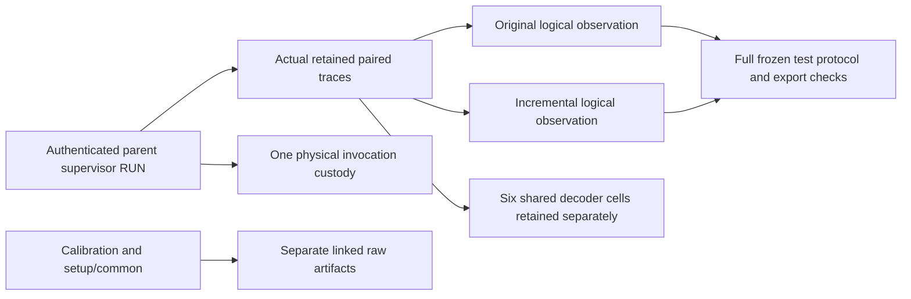

# Paired evaluator export source correction

TASK-20261029-b9f48c, 2026-10-29, session /root/controlled_export_repair. Source-only implementation observations; no scientific, mathematical, performance, novelty, approval or closure verdict.

Actual code C3 is `c4d0d3ed9d0732a72559a11871271e195635af88`; separate manifest metadata M3 is `a7b60afdf7b15dceb59d38fd301c05f73deef425`. Root committed and pushed each before these later records were authored. Two Python files changed: postrun/run_postrun.py and postrun/test_postrun.py. Four version mirrors exactly match their canonical files. The immutable root inventory helper returned0 against actual C3/M3, all four aliases, all19 independently preserved source hashes and the full manifest source maps. C2/M2 source inventory and original cards, reviews, archives and error receipts stay historical; no earlier inventory is rebound to new live bytes.

The exporter emits original and incremental strict confirmation evaluator observations from actual retained traces selected by the authenticated host plan's paired_trace_ids. IDs are parent RUN plus .original/.incremental; backend_ref, worker, instance and observed public nonce are shared. These IDs are logical observation IDs, never new ledger RUNs or VM invocations. Flow counts logical observations; physical invocation facts remain once in original supervisor/controller/backend custody. Each method retains its own actual attempt/query counts, strict recovery status counts, recovered unique targets and primitive counter families. Calibration original-only traces, setup/common, six shared decoder outcomes and host references stay linked separately; no planned12288/172032 count is substituted.

The complete test-only frozen protocol and export are retained outside at `/workspace/classical-ecdlp-endpoint-reuse/controlled-followup-20261029/export-repair-final-fixture`. They use actual canonical C3 exporter/analysis paths and actual C3/M3 source/manifest paths and hashes, never versioned source mirrors. Frozen body hash is `7f63dd82dd94e16c06aa54169b7472c923c441adaf59bbc9d88ad85f411e2e5e`; actual protocol file SHA256 is `de54a01b2e161221dce421b0159d6f817e3d3c8fc6314e7553e3a500671a0f37`; export SHA256 is `ffbb1649bde512a6f85c209a40facf94155b7210cf6d24372a5b753fa7cbc637`. The unchanged tool's protocol validate and check-export --protocol --verify-files each returned0; direct schema and lint_export findings are empty. The fixture executes disclosed F11 and F23 paired arithmetic and a separate original-only calibration attempt with no fresh entropy or population draw. It is a direct exporter test seam, not production host verification or a production confirmation tier. Its single fixed transport identity and vm_creates=1 are synthetic fixture metadata; no actual SDK/VM was launched. In this fixture both rows retain two paired attempts and11 predicate queries, with one strict recovery event per method; actual F23 strict failure and decoder t2.e2 recovery remain distinct.

Missing methods, empty/unexecuted methods, partial queries, missing traces, duplicate traces and zero engine starts retain absent/excluded observations and actual findings. The unchanged checker rejects duplicate observation IDs, duplicate execution cells, absent arms and padded rows for their intended reasons. File corruption fails actual file verification. Existing supervisor corruption and independent invocation/copied-input/source-pin regressions still refuse before host module/entropy work. Production48curve/workload checks, caller authentication boundary, schema/parser law, candidate math, engine, cohort, sampler and seed law are unchanged.

Final regression counts are16transport+10host+16postrun=42passing. Exact argv, stdin, stdout, stderr and returncodes for producer captured runs and full-protocol CLI checks are embedded in fixture-checks.json, including one failed incorrect strict-status assertion and its corrected rerun. Root independently reported42canonical regressions with entropy denied outside explicit fixed mocks; root logs remain under integration/export-code-tests.stdout.txt and .stderr.txt. Test durations are diagnostic output, not a benchmark. An earlier first run had eight repeated fixture-schema errors (six invalid enum/nonempty requirements), corrected without changing schema/checker. Its exact output provenance is the interactive tool transcript, explicitly distinguished from stored replay output. A recorder cwd label was corrected before delivery to actual /workspace, leaving output bytes unchanged.

Sources checked (internal): AGENTS.md and extended contract, exact task card and DEC-20261029-3f0c21, export-observation-contract-3f0c21.json, STATICLOCK-export-gate-3f0c21.json, export-review-plan-489ab1.json, export-preserved-hashes-3f0c21.json, immutable verify_export_inventory.py, docs/experiment-protocol.md, unchanged protocol/export/review schemas and tools/experiment_protocol.py, original C2 review report/read-attestation/check records, related raw record/engine/analysis/host/controller/transport contracts, and experiment-protocol skill. These primary internal specifications establish the representation and validation requirements. No external primary mathematical/statistical paper was retrieved under the no-network scope; no literature-completeness or novelty inference follows. Existing scientific graphs were checked through the prior source reports and require no new scientific relationship; the diagram below records the source flow. No experiment run, research search or decision review was performed here, so no new standalone scientific PDF is authored. Existing renderer regression PDFs are test outputs only.

Native worker-counter replay, VM isolation and clocks remain unqualified; wall_valid=false. Native RSS, interpreter allocations, I/O and Python integer internals remain unmetered. Serving backend/model/probe/usage/achieved effort are unknown and null. Requested policy is executor-implementation, medium; no achieved provenance is inferred. New source snapshot TASK-20261029-b5a89f and fresh independent xhigh review TASK-20261029-489ab1 remain required before source03 final STATICLOCK/release. Root alone owns canonical publication, claims and any later scientific admission.
