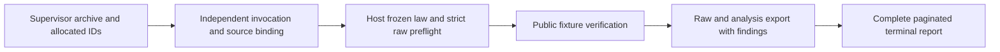

# Controlled follow-up source repair186322

TASK-20261029-186322; executor implementation; 2026-10-29. This is a source repair delivery for fresh independent recheck. It grants no scientific admission, performance qualification, hypothesis status or closure.

Actual published code C2 is `a79250131aec7a0d71c23fe497a4c027ae676f66`. Actual separate manifest metadata M is `410471bf433489a38577ef6ca5c399af587771de`. Root published nine Python files and nine byte-identical versioned mirrors first, then two manifests and two mirrors. [The inventory](../../../coordination/goals/GOAL-ECDLP-e70832/batches/BATCH-2fe40f/repairs/TASK-20261029-186322/source-inventory.json) maps all eleven archival versions to real canonical paths, actual commits and SHA256 values. Future executable inputs remain the canonical paths. No inventory or delivery predicts its own containing commit. Original snapshot f28bac0066, original cards, reports, receipts and their bad-case evidence remain historical records; the amendment does not reinterpret them as passing.

## Observations

The complete repair fixture command returned0:39tests (16transport,10host,13postrun). The command patched `os.urandom` to fail globally; explicit nested software mocks use disclosed fixed bytes. The test command, exact Python stdin, environment, stdout/stderr, return code and individual mutant labels are in [fixture-checks.json](../../../coordination/goals/GOAL-ECDLP-e70832/batches/BATCH-2fe40f/repairs/TASK-20261029-186322/fixture-checks.json). No elapsed value is a benchmark. Root separately reported the canonical39suite passing and checked actual5worker/13host source payloads; the executor independently ran the published inventory helper against actual C2/M and all eleven real/live/mirror aliases, which returned0.

| Defect | Source change and executed bounded check |
|---|---|
| D1 supervisor envelope | Postrun checks the supplied supervisor root before reading the inner receipt or importing verifier/reference. Archive corruptions, missing members, divergent duplicate receipt and failed/zero-data cases reject before host modules/entropy, both through the function and normal CLI (exit1). Inner transport requires an explicit argument and is labeled `inner_transport_only`; it grants no supervisor qualification. |
| D2 independent pins | Production reuses the independently checked frozen invocation planner, compares its entire controller plan, all eight copied static input hashes/semantics, copied manifest bytes and their exact source maps/revisions, recomputed fingerprint, and actual executing host module paths/bytes. Worker pins must equal these independent pins. All eight copied-role mutants reject. A further full originalC2-style replay consistently changes plan/summary/completion to ff/ee, recomputes completion/controller/custody byte seals, and rejects against controller/config00 in the injected fixture seam and ordinary production branch before verifier import/call or entropy. The ordinary fixture branch supplies an explicit frozen-planner mock; no real scientific protocol or production run was invented. |
| D3 independent workload | Host reconstructs48production stage/tier slots, actual r bits and public domain/exclusion identity, global(p,j) uniqueness, public targets/IDs and all setup/single/trace/paired/six-cell IDs without importing worker planning. The worker plan is compared with this derived law. Pure no-draw construction gives216setups,382464jobs and1033728physical calls, with73728shared-trace cell records. Resealed omitted-single plus shrunken worker plan and the original F11 confirmation-A-16 calibration-arm disguise reject before Oracle. Fixtures use explicit F11/F23 laws, unavailable through implicit specimen labels. |
| D4 strict host parsing | All JSON/JSONL parsing is bounded, rejects duplicate keys, NaN/Infinity and numeric overflow1e999, and requires complete final JSONL newlines. Resealed semantic parser mutants exercise the actual verifier, before labels. Schemas and rejection conditions remain; exact-schema Validator instances are cached. Missing and negative counter-family cases still reject. No caching performance claim is made. |
| D5 allocated identity/export | Allocated RUN/EXP and operational status agree across supervisor manifest, raw-result, protocol snapshot and controller identity. Real unified export carries the allocated RUN rather than synthesizing a protocol suffix; it binds the four outer envelope/archive files and raw candidate data. Wrong identities/status/receipt/member cases reject. Deliberate skeletal fixture protocol lint findings remain visible and unqualified. |
| D6 full reports | Reports paginate all rows and failures, separate calibration and A/B, retain six-cell outcomes, target coverage, paired discordants, reference/null/support/duplicates/ties, cold/warm and cost scope plus raw links/digests. Export findings are computed first; raw/analysis export precedes terminal reports, avoiding report/export self-hashes. Twenty repeated F11 display rows plus first/last/failure/export/calibration/reference/null/cost canaries survive PDF extraction. The rich fixture has8pages; all8actual PNG pages were viewed by this session and the delegated renderer session, with no clipping or overlap observed. These display rows are no new curves. |

## Mathematics and limits

All eight protected candidate/reference/interface hashes are byte-exact at C2/live and are included in the inventory. `curve.py`, `constructor.py`, `engine.py`, `cohort.py`, `worker_runtime.py`, `host/reference.py` and both interfaces were not repaired or modified. The original completed math report's17/17groups and114enumeration configurations are cited as historical internal evidence, not rerun or enlarged here. Its raw coefficient relation `C_r=-r*Z_source` and resulting plus-slope source recurrence remain explicit. The strict-upper comparison remains the actual source rule; changing only `<` to `<=` is equivalent in its valid odd-order/range domain, so no fabricated failing equivalent mutant is claimed. An executed host-cell test rejects an equal-count duplicate-word replacement while leaving the actual unique-by-construction producer enumeration unchanged.

The controller's AST check is explicitly a narrow static literal-import/direct-name-call screen. Aliased dynamic import remains outside its promise and a known accepting test documents that limit. It proves no actual VM isolation. Independently callable custody now rejects duplicate entries and missing host-plan/public-cohort entries. Uniform reference retains distinct nonzero effectiveM/(r-1), saturation at r-1 and explicit zero costs/null ratios; candidate M determination remains excluded from the reference's paid costs.

No SDK was imported/called, no VM/network/credential operation was used, no fresh entropy/nonce/curve/target/cohort was drawn, and no old-cohort reanalysis or timing benchmark occurred. Only disclosed F11/F23 software fixtures, deterministic mutations and no-draw schedule construction were used. Actual VM isolation, complete native worker counter replay, qualified clocks, native RSS, interpreter allocations, I/O and Python integer internals remain unqualified or unmetered. The actual serving backend, resolved model, usage, probe and achieved effort are unverified null; requested policy/effort are executor-implementation/medium. Delegated implementation sessions are not independent review.

No new mathematical, scalar-ordering, significance, attack-cost, exponent, performance or scientific verdict follows. A fresh independent source recheck must assess this exact snapshot before any separate future trial admission.

## Prior sources and preservation

Before choosing repairs, this session read the exact card, AGENTS, executor contract, literature/observation rules, DEC-e49bbc/problem, both completed original reports182d42/a13be8, original C1/C2 programs and outputs, interfaces/source and immutable inventory verifier. These are internal provenance. Installed `jsonschema.validators.validate` documentation/source recommends reusing a Validator for known valid schemas; caching retains the same selected draft/schema and rejection acceptance set. No external primary Miller/AGS source was retrieved under this zero-network card; no literature novelty or theorem claim depends on that gap.

Fixture-checks retains22unchanged historical input hashes compared byte-for-byte with published input commitccdd896a6a, including original reviews/checks/attestations and snapshot receipt. All original bad cases stay original; no producer or reviewer record was rewritten. Minor integration mistakes and their corrections are retained in fixture-checks. The only scientific graph checked was the existing source/proof scope: none changed. This source-flow diagram is explanatory only:

Root owns canonical edits, all Git publication, claims, snapshot and downstream decisions. The outside package contains the eleven source aliases plus the four new delivery records at their exact card paths. No merge or auto-merge was requested or performed by this executor.
