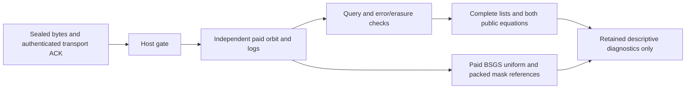

# Independent host verifier source delivery

TASK-20261029-865798. Resumed session `/root/controlled_verifier_resume`, requested executor-implementation / medium. The outside package was empty on resume: no predecessor implementation was inherited. Serving model, adapter probe, inference usage and billing were not observed and remain null. Root owns claims, canonical application, archival records, publication and any later independent review. No Git, VM, SDK, fresh random source, curve/target sampler, old cohort reanalysis, benchmark or scientific trial was invoked. Maximum scientific runs remains zero.

The eight software test groups exercise only the disclosed F11 model `(p,a,b,r,P)=(11,1,6,13,(2,7))` and F23 `(23,11,5,17,(5,22))`, deterministic artificial channels and negative mutations. F23 was supplied by root as disclosed fixture data. The embedded published engine F11 record is data, not imported implementation. Source correctness here is unadmitted and supplies no scientific verdict, advantage, exponent, significance or closure claim.

`verify_bundle(root,evidence,plan,interface,emit=None)` rejects missing seal, complete-collection assertion, UID1000 quiescence or transport termination ACK before constructing any host orbit/log, labels or references. It verifies every collected byte hash and exact seven-file set, forbids symlinks/extra files, binds the exact collected public cohort bytes to its pinned SHA256 and binds every setup model/base and confirmation target coordinates to that public data, then validates the supplied data-only engine schema, provenance, completion manifest, exact frozen row schedules and original-only versus paired schedules. All eight arm definitions are fixed; paired confirmation is primary circuit2.a1 only. It checks independent prime/order/domain/membership witnesses, prepared bases, all L query points and seven answer fields, strict intervals, both public equations, conversion, complete deterministic lists, nonzero M, caps and error/erasure geometry. Original/incremental semantic fields agree independently of their distinct count vectors. Raw sealed files remain available on every rejection; the caller must retain exceptions and any partial host emission. No output is returned to worker.

The independent Z oracle accumulates slopes along successive public additions by P and solves the final r-cycle constraint. This differs from a binary Miller seed and doubling transport; a small slope-sum construction and every cocycle pair are additional disclosed-fixture checks. Independence shares the stipulated normalized slope cocycle, ordinary affine group law and deterministic prime test assumptions. No new engine, curve, constructor, incremental prototype or producer implementation was read/imported. The old verifier's first180 lines were consulted for public arithmetic/domain conventions; no wholesale source import occurs. The data-only engine interface sets record field names, reason/nullability conventions and assignment-first word ordering; those transport conventions are not independent mathematics.

The exhaustive fixture software checks retain504 complete perfect-half cells and84 capped cells across three fixed (a,b) conversions. Empty intervals retained are1173 on F11 and2628 on F23; legal zero checks retained are63 and60. These counts describe the test workload, not candidate scientific observations. A separate zero-only word is checked/costed but has M=0. List truncation, M/zero-count corruption, wrong sign/scale/conversion, erasure omission, endpoint metadata, duplicate IDs, negative counters, modified query coordinates and missing custody fail. The published F11 trace/cell pass; five deterministic mutations fail; a complete original-only F11 bundle passes and a falsely paired plan and changed public-cohort bytes fail. Actual ready EMPTY_INTERVAL F11 `(circuit1.a3,Q=P)` has bits10100 and raw rounded k9. No nonidentity Z-zero occurs on either disclosed fixture; the ZERO_BASE_Z/anchor-null branch is a clearly synthetic mutation of the host oracle, not a claimed actual-curve outcome. Exact stdout/stderr and return code are embedded in verifier-delivery.json.

`reference.BSGS` solves the same public targets with a paid baby table, cold setup and warm reuse; all30 disclosed fixture points, including identity for software control only, are checked. Each solve returns a fresh primitive-vector delta rather than cumulative prior work. Uniform reference draws distinct nonzero scalars from1..r-1 by a sparse partial Fisher-Yates map, at budget min(M,r-1), and includes per-call primitive and SHA256/rejection counts. Denominator is r-1; M is distinct converted nonzero candidates, never number of words or equations. Legal zeros are independently checked and charged. Matched-M is conditional: work determining M must be charged for any standalone solver interpretation.

The primary-arm exact-mask reference preserves symmetric holes and the anchor pair, reporting ineligible or singleton cases. Fixed1023 with-replacement draws use a frozen32-byte seed and domain-separated SHA256 counter stream; fairness/uniformity assumes ideal hash blocks and is not proved for SHA256. Orientations are packed MSB-first, with exact duplicate multiplicities; support is symbolic2^(D-1), with a small exact integer only below2^63. Reconstruct at most one r-vector at a time. Chart views transport the same assignment rather than redraw. Retained-bank statistics use only supplied host logs of existing calibration draws and starts, preserving duplicates; the fixed reference count is exactly1023. Each reference returns an unconditional ternary-correlation numerator/denominator and exact-word q0 numerator/denominator on retained starts, with descriptive greater/equal/less tie counts. Future protocol must freeze1800 bank points and128 starts per primary calibration curve; no new VM query or full all-r recovery census is requested. There is no exchangeability or p-value assertion.

Input hashing and JSONL parsing stream; oracle objects are shared across all eight arms per curve. Default total host-orbit cap1196032 points covers the48-curve10/13/16bit prospective tier maxima; each retained point has one point tuple, orbit reference, log entry and Z entry. Null packed payload at r<65536 is at most1023*4096 bytes before hexadecimal encoding, plus a multiplicity representation and one temporary label vector. Source paths avoid gigabyte-sized full null tables or decimal expansion of2^32767. One trace and six bounded cells are processed at a time. This is a structural payload bound, not a measured RSS/native-allocation/disk guarantee; transport owns collection capacity. Schedule ID sets and per-curve oracles remain in host memory.

Host counters are a separate abstract backend: affine group calls, scalar bits, field add/sub/mul/square/inverse/negation and oracle construction payload/operations. Compound calls overlap their primitive counts and must not be summed with contained primitives as independent work. Field modular reduction, comparisons, Python allocation, hashing internals, parsing, I/O and native RSS are not fully metered; inverse internals and integer bit complexity are excluded. BSGS/uniform expose setup versus online deltas and sparse PRNG counters. Worker counter vectors are preserved and checked only for schema/nonnegative shape. Public equation validation and these independent host counts do not establish VM operation-counter execution replay or a qualified counter comparison. Every clock remains wall_valid=false. Incidental unittest elapsed text is an operational test-run log, not a benchmark.

Source corrections before delivery include replacing initial uncompressed null tables/large decimal support with packed/symbolic output; assignment-first word order from the published interface; per-reference primitive deltas; schema/metadata corrections for calibration incremental=null, EMPTY_INTERVAL candidate_scalar/checks=null, setup ZERO_BASE_Z/Y anchor=null, and exact committed attempt reason strings/recovered scalar_prime/retained_bit_reads=0. Root supplied those final metadata conventions from committed source8e3db9bc94 as data-only clarification; implementation source remained unread. Root identified the last metadata gaps during source review; they are corrected and covered by fixtures/mutations. No failed software command is presented as mathematical evidence. Initial filename-only search found the empty package and returned1; it produced no scientific result.

Remaining obligations: authenticate custody and process isolation outside this module; bind exact source/input/seed/exclusion/sampler/protocol/runtime and schedules before data; independently replay candidate VM counters for any counter-advantage claim; qualify native memory and clocks separately; review and freeze these sources. The parser checks public point validity and source-bound schedules but does not independently replay the future coordinate-rejection sampler or its seed broker; that source-bound review remains a concrete blocker to sampler qualification. Incomplete worker outcomes are retained and fail the complete-bundle gate, never interpreted as mathematical negatives. Optional histogram/FFT is deliberately omitted: independent numerical-error and sampling-bound review is missing. No SFT learner, dense-DFT advice, floor-carry optimizer or new scientific admission is supplied. Root must link these gaps to the canonical existing goal impediments/problem records; this exactly-six-file outside scope creates no canonical problem or scientific transition.

The bounded source review below records actual byte hashes and read depth. Primary papers were not retrieved in this session; their results in producer reports are contextual citations, not independently adopted theorem implementations. The relevant arithmetic is derived from the supplied explicit blind cocycle proof and decoder identities. KB retrieval was unavailable. External literature completeness and novelty are unclaimed. Cloud runtime skill/status were read: current enforced unrestricted HTTP policy and no configured identities/secrets were reported; no credential use or network work occurred.

The inline map is the source-stage proof map. No scientific evidence review, canonical graph update or separate PDF is asserted within this six-file delivery.

## Source manifest

- `AGENTS.md` — `25a35345fbc5a4dd64df105418bc613d20475d284569be62f586923459056fb4`; read; first output truncated, relevant binding sections retained; internal.
- `ledger/handoffs/TASK-20261029-865798.yaml` — `ae3c9005678b034e1bcd61153f6673b7a277cac06489a57a261e2141472a8781`; full; internal.
- `agents/coordinator.md` — `410b3be4737a58dbf31c469b6b2d103740598e2b3c0a86610fa64af0b80128ad`; full; internal.
- `docs/agent-contract-extended.md` — `239585d3a78b749e78839910c9e23b12e97fa551211ff512bd819248a35fdf2b`; targeted literature/observation/intermediate-cost/retrieval sections; internal.
- `docs/agent-contract-supplement.md` — `01c609973d5092e26a16a24eadb5954e4f8d297133d1b600a656f8b94f488b46`; targeted obstruction/research-direction/runtime sections; internal.
- `ledger/goals/GOAL-ECDLP-e70832/goal.yaml` — `06e32097af503fa080f0f880dcaf061fd95d3b461cba2a3cad938b943953ff54`; full; internal.
- `docs/reports/classical-ecdlp-further-leads-20261029/decoder/report.md` — `6c6efae9b6aca8b2d9a8e77ea56c058fadd6bec9ffaba311917e2da9f98b4349`; full; internal.
- `docs/reports/classical-ecdlp-further-leads-20261029/decoder/experiment-design.json` — `be1032d914ab84a5cbdc7dba26d6763312dc41f258ffa7efb6c4cad05be5fe75`; full; internal.
- `docs/reports/classical-ecdlp-further-leads-20261029/controls/report.md` — `5ea1f7439dc837497f62c922f2effdd8a8ce35d63fcdc3a7aa971a04786a40a3`; full; internal.
- `docs/reports/classical-ecdlp-further-leads-20261029/review/blind-derivation.md` — `3da674a687dffb65c8b29ff5b132bbfaf150bb93cbec768fbbd2c72ec84949a9`; full; internal.
- `docs/reports/classical-ecdlp-further-leads-20261029/review/design-audit.md` — `951bf1f9829c8559cc90d3774383f29535e115f56957ff8577826b222222b5c9`; full; internal.
- `harness/classical_ecdlp_transfer_successor/verify.py` — `2654f5c9d800233447c8e2deed5a9fff7ee674adc1fb5214319e184857ca7d5a`; first180 lines only; standard affine formulas and deterministic64bit primality pattern consulted; internal.
- `docs/reports/classical-ecdlp-endpoint-reuse-20261026/non-generic-next/report.md` — `6e32543fd02ef1587c56750acdb58f5205e3fc78787966b28c343d7c42ef97b4`; full; internal.
- `orchestration/model-bindings.yaml` — `707c5c15218d1701bac1cd71907e3914b6e0f6d422e35d3f9226e0322ab77dee`; first80 lines only; operator assertions not serving receipt; internal.
- `harness/classical_ecdlp_controlled_followup/engine-interface.json` — `3a7be27cbc28d1e0ddc062b640dbddac23b233bbfa8de3343b0963cb1e3e3cec`; data-only schema/metadata/sample; initial summary then published exact data contract; internal.
