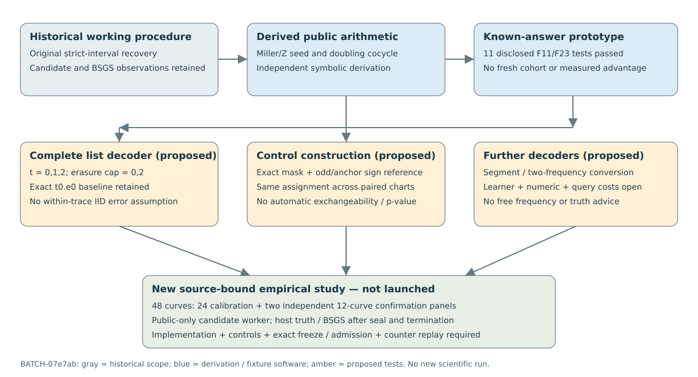

# Further classical ECDLP leads: controlled next steps

2026-10-29 · GOAL-ECDLP-e70832 · BATCH-07e7ab · TASK-20261029-72ee23.

This round produced source-grounded derivations, an incremental prototype, eleven disclosed known-answer software tests, and two independent technical reviews. It ran **no new scientific cohort, no decoder panel and no old-cohort reanalysis**. These results prepare further empirical work; they do not settle the broader algorithmic leads or change a scientific status.

## What is fixed and what was checked

The historical fixed-circuit study remains a working finite baseline: 40 fresh curves, 2,508 public targets and 102,828 recorded primary attempts. Its candidate recoveries and the small order-17 working domain are observations at that tested scope. Neither the observed failures nor comparison with BSGS closes all Miller-coordinate constructions or decoders.

The new three-source package is fixed at `1190b8a541e4a2b28e4b03f806c4d0a654222315`; its exact twelve files have custody at `ca8020d048f158c38d4081fa79490ac9a1f0b0b9`. The four review files are published at `4a8d9494b0f55ff1beb21dd500b5fb448fd2d4ec`. [Sources and read-depth limits](sources.json) bind their complete bytes. The independent reviewers read separate joints and no sibling reports; the blind derivation began without the new producer output. Distinct serving models and formal runtime/adapter verification are not established.

**Observed software fact:** the incremental producer's single recorded invocation passed eleven tests on the already disclosed F11 and F23/order17 fixtures. It retained fixed-L calls after undefined values and compared all non-counter trace/witness fields with `compute.py::ungated_attempt`. The deliberately wrong-sign recurrence is detected. These are source-fixture checks, not fresh recovery rates, independent counter replay or timing measurements.

**Derived and independently examined:** the blind reviewer supplied a separate divisor/Laurent proof of the slope cocycle, finite-group primitive existence/uniqueness, and public addition-chain seed construction. With the complete identity/vertical/tangent convention and `r≠p`, transport obeys `Z(2R)=2Z(R)+lambda(R,R)`. The proof does not itself validate the submitted implementation, establish scalar ordering, or price an end-to-end algorithm.

## Lead 1: preserve the procedure while reusing arithmetic

The prototype initializes Z once and reuses the slope from the reduction's existing doubling. For `b=bit_length(r)`, `L=b+1`, and `C_r=b+popcount(r)-2`, the source-level repeated-Miller component removes `(L−1)C_r` group-add calls. Initial normalization and every update, field/character operation, setup, blinding, conversion and public check remain paid. This is a derived component formula, not a measured total speed ratio or p-exponent.

Under the forward chart `phi_u(x,y)=(u²x,u³y)`, the correct weights are `lambda'=u lambda`, `Z'=uZ`, `c'=u⁻²c`, so `c(x−xP)` is invariant. The same fixed alpha,beta give `g'=ug` and `anchor'=u anchor`; normalized values and holes transport. An earlier inverse-weight/beta-change suggestion was caught before trials. The F11 wrong-beta fixture preserves the bit while changing the normalized value, so full intermediate values are necessary controls. Chart copies are paired views, not fresh curves.

## Lead 2: recover from bounded errors and erasures

For `D=2^L`, the exact half-bit trace of scalar s is `V(s)=floor(Ds/r)`. A complete radius-t list with e erasures contains at most `2^e sum_(j=0)^min(t,L−e) binom(L−e,j)` words. Keep `k=ceil(rV/D)` only when `0≤k<r` and `Dk<r(V+1)`, then check both transformed and original public equations. Under a fixed prepared predicate and independent uniform nonzero blinding, the exact success fraction is the fraction of nonzero s with errors≤t and erasures≤e_max. This conditional identity needs no independent within-trace errors; it does need complete enumeration and no hidden pruning.

The independent audit re-derived abstract controls showing why marginal accuracy is insufficient: an anchored odd Z/7 function with accuracy 2/3 can have zero exact-word success; a Z/31 example has perfectly correlated trace errors despite the same marginal. These are hand-derived validator controls, not new public coordinate predictors or curve measurements. Every word, empty interval, cap, failed branch, scalar conversion and equation remains charged. The exact original t0.e0 procedure is retained, rather than replaced by a favorable reference.

Two additional leads remain concrete but unimplemented. A published segment/multiplication-code conversion can use an imperfect half predicate under its stated query/error model. A same-prepared-base two-frequency identity can recover `x=beta/alpha` from matching nonzero heavy components without requiring half ordering. Both connect to prior internal work; neither is claimed novel. AGS Theorem 5's bounded-complex excerpt defers the general construction. Its Boolean Theorem 6 has weight dependence `tau^-5.5` (amplitude dependence epsilon^-11), not a justified unknown-frequency epsilon^-2 cost. Ternary erasures, numerical thresholds, list discovery and O(tau^-2) cross-list candidates require executable, priced constructions before admission. A constant punctured at identity creates nonzero coefficients of size |c|/r; that control is separate from an all-residue DC-only constant.

## Controls distinguish questions rather than manufacture a verdict

Oddness, anchoring and coordinate covariance do not identify scalar ordering. The proposed single-arm synthetic reference preserves the exact symmetric undefined mask and fixed orientations at the anchor, draws orientations on remaining ± pairs, and transports the same assignment across charts. Its finite support may be tiny or degenerate. Requiring the identical full normalized cocycle instead leaves no primitive freedom by uniqueness. Both boundaries are reported.

Such constrained functions are descriptive references unless a null law makes the candidate exchangeable with them. A shuffled table, many duplicate draws or a plus-one rank does not supply that assumption. A joint multi-arm maximum additionally needs a genuine coupling across the shared primitive. No p-value or algebraic attribution is claimed here.

The 2026-10-24 atlas implication from marginal equidistribution to a “hash/closure” remains a scoped prospective discriminant for its earlier proposal. The older “no measured bit advantage” premise is dated context. Neither is adopted as a present universal conclusion. Historical records and all earlier graphs/data remain unchanged.

## One selected next implementation and empirical study

[The machine-readable next specification](next-experiment-spec.json) selects one source-implementation path: complete bounded-radius decoding plus paired original/incremental evaluation. Fixed circuit2.a1 uses primary t1.e2 versus exact t0.e0, with all six t∈{0,1,2}×e_max∈{0,2} cells isolating flips and erasures. This choice is disclosed as informed by exposed F23 results. No coefficient/base/radius/seed is fitted on confirmation.

The proposal has 24 calibration curves and 24 untouched confirmation curves (two independent panels of twelve), spanning 10/13/16-bit subgroup orders. Calibration characterizes eight frozen arms using the original evaluator. Confirmation pairs original and incremental circuit2.a1 on 1,536 targets with eight blindings each: 12,288 traces and 73,728 paired decoder-cell outcomes. Its 172,032 point-query slots mean **344,064 physical predicate evaluations** when both evaluator implementations run. The six decoder cells share each incremental trace; they are not six independent query samples. Calibration adds 345,600 single-point arm evaluations and 344,064 original trace-query evaluations. The selected proposal therefore has 1,033,728 physical predicate evaluations before additional controls/references; all these are planned, derived counts, not executed measurements. The earlier separate eight-arm engineering proposal is not silently appended.

Curve is the population unit; restarts, targets, cells, nulls and charts are nested or paired. The calibration Hoeffding design addresses fixed-curve precision. The planning q=0.02 and 512 restarts address fixed-domain event detection, not population-of-curves precision or a predicted rate. Sparse events and heterogeneous panels can remain inconclusive. There is no exponent fit.

The existing coordinate sampler draws public points without known k, so its public nonce is not itself a secret-log leak. The old full compute program later runs fresh BSGS/diagnostics inside its VM; the proposed worker excludes those operations. New candidate-only source emits sealed public results; after full readback and worker quiescence/termination acknowledgement, a trusted host may construct scalar logs and run independent diagnostics/BSGS. No truth or baseline result returns to a live candidate. If a future sampler instead forms Q=[k]P, the corresponding generation seed/labels must be private. This source-flow plan still needs exact closure and isolation probes. Cross-backend counters disclose their boundary; matched timing is not claimed.

Before data: implement the enumerator/nulls and independent verifier, check negative mutants and t0 embedding, bind the public-input worker/host-only verifier, qualify counters or retain their gap, freeze all counts/sources/sampling/analysis/runtime, pass exact admission and save the required checkpoint. This current batch authorizes no trial. User continuation authorizes proceeding to that new implementation phase; readiness must still be demonstrated, never inferred.

## What completion means here

The next-action decision ranks a concrete implementation/test; it makes no support/reject, novelty, advantage or closure decision. GOAL-ECDLP-e70832 stays active and H-ECDLP-e1270c stays specified. Final source/review/synthesis custody is completed separately; the write-once checkpoint records actual receipts and explicitly pending administrative custody without predicting its future hash. Global ledger validation retains 64 pre-existing failures; scoped checks are reported separately, never as global green.

Primary-source passages and read depths are recorded by the producer/reviewer manifests: [Voloch 1997](https://www.math.canterbury.ac.nz/~f.voloch/Pdfs/zeta3.pdf), [Akavia–Goldwasser–Safra 2003](https://www.cs.tau.ac.il/~safra/PapersAndTalks/hardcore.pdf), [Hemerik–Goeman](https://arxiv.org/pdf/1411.7565), [Phipson–Smyth](https://gksmyth.github.io/pubs/PermPValuesPreprint.pdf). Source retrieval is bounded; absent search matches are not novelty evidence.
