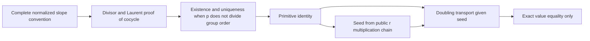

# Blind derivation of normalized Z transport

Task: `TASK-20261029-ce384a`; joint: `J-recurrence`; date: 2026-10-29.
This is an independent symbolic review from the permitted statement and old public report. No new producer output, sibling review, scientific trial, software control, timing, or Git diff was read or run. It makes no scientific status decision or performance qualification.

## Statement and conditional transport

Let `E/F_p` be the nonsingular short Weierstrass curve
\(y^2=x^3+ax+b\), with \(p>3\), and let \(G\) be the declared cyclic subgroup of odd prime order \(r\ne p\). Values of \(Z\) and slopes lie in \(\mathbf F_p\); integer coefficients below are reduced modulo \(p\), not modulo \(r\). The supplied identity is
\[
Z(R+S)=Z(R)+Z(S)+\lambda(R,S),\qquad Z(O)=0. \tag{1}
\]
The slope convention must be complete:

| Inputs | \(\lambda(R,S)\) |
|---|---|
| Either point is \(O\) | \(0\), without reading affine coordinates |
| Finite inverse points, including a finite point with \(y=0\) added to itself | \(0\), the vertical convention |
| Finite points with distinct abscissas | \((y_S-y_R)/(x_S-x_R)\) |
| Equal finite points with \(y_R\ne0\) | \((3x_R^2+a)/(2y_R)\) |

Substitution \(S=R\) in (1), with no additional theorem, gives
\[
\boxed{Z(2R)=2Z(R)+\lambda(R,R).} \tag{2}
\]
For \(R_i=2^iR\), \(z_i=Z(R_i)\), and \(\ell_i=\lambda(R_i,R_i)\),
\[
z_n=2^nz_0+\sum_{i=0}^{n-1}2^{n-1-i}\ell_i. \tag{3}
\]
This is a recurrence for values of an already defined primitive. It does not by itself evaluate the seed \(z_0\), prove (1), identify a scalar bit, or compare implementations. The reverse identity divides by \(2\) in \(\mathbf F_p\). If only \(T=2R\) is supplied, finding the point \(R=[(r+1)/2]T\) uses inversion of \(2\) modulo \(r\), a distinct operation whose scalar-multiplication cost must be charged.

## Domain, public interface and exceptions

A transport call needs the public curve/field model, a valid point \(R\), and the correctly normalized value \(Z(R)\). It needs no hidden multiplier of \(R\). The declared domain or caller must guarantee membership in \(G\); a checked \([r]R=O\) alone need not prove membership in one particular cyclic subgroup if all rational \(r\)-torsion is present. An explicit generator is unnecessary for the transport formula, although an application may need it to state its target subgroup.

For nonidentity \(R\in G\), odd order implies \(y_R\ne0\) and \(2R\ne O\). Consequently all nonidentity doubling steps use the ordinary finite tangent formula. A zero tangent numerator is allowed and gives slope zero; a flex or a point of order three is not an additional exceptional branch. At \(R=O\), both sides of (2) are zero and affine formulas must be bypassed. For general addition, \(S=-R\) gives \(Z(-R)=-Z(R)\); a vertical pair must be recognized before division. Equal abscissas on this model mean equality or inversion, so these branches exhaust finite denominator failures. Outside the stated odd-order domain, a finite \(y=0\) point is two-torsion: the vertical convention applies to its doubling, never the displayed tangent quotient.

Nonsingularity supplies the elliptic group law. Characteristic \(p>3\) justifies this short-model formula and the divisions by \(2\). Primality of \(r\) is stronger than transport needs: (2) follows in any group where (1) holds. Coprimality \(p\nmid |G|\) is the relevant hypothesis for existence/uniqueness and the seed construction below. Oddness simplifies tangent-domain handling and makes point halving unique. These hypotheses have different jobs and must not be interchanged.

## A separate symbolic proof of the full primitive identity

The conditional derivation above assumes (1). Here is a separate argument for the slope cocycle and a primitive; it does not inherit the old report's claim of a prior algebra pass.

Use the local parameter \(t=-x/y\) at \(O\). In the short model,
\(x=t^{-2}+O(t^2)\) and \(y=-t^{-3}+O(t)\). For finite nonvertical addition, let
\(\ell_{R,S}=y-y_R-\lambda(R,S)(x-x_R)\) be the chord or tangent line, let \(T=R+S\), and set
\[
g_{R,S}=-\ell_{R,S}/(x-x_T).
\]
For a finite vertical pair set \(g_{R,-R}=x-x_R\); if either input is \(O\), set \(g=1\). Line/vertical intersection divisors give in every case
\[
\operatorname{div}(g_{R,S})=[R]+[S]-[R+S]-[O].
\]
Each \(g\) has leading Laurent coefficient one. For nonvertical addition its expansion is
\(t^{-1}(1+\lambda(R,S)t+O(t^2))\); a vertical factor has expansion
\(t^{-2}(1+O(t^2))\), and an identity factor is one. Thus its first normalized Laurent coefficient is exactly the stated slope, including exceptional cases.

The two products
\(g_{R,S}g_{R+S,T}\) and \(g_{S,T}g_{R,S+T}\) have equal divisors. Their ratio has no zeros or poles on the nonsingular projective curve and is constant; their leading normalizations make that constant one. Comparing first Laurent coefficients proves
\[
\lambda(R,S)+\lambda(R+S,T)
=\lambda(S,T)+\lambda(R,S+T). \tag{4}
\]
This is the slope cocycle theorem, with the standard projective-curve fact about pole-free rational functions explicitly used. It is not established merely by checking a doubling formula.

For a finite group \(G\) of size \(r\) with \(r\ne0\) in \(\mathbf F_p\), define, for this existence argument only,
\[
Z_*(R)=-\frac1r\sum_{T\in G}\lambda(R,T). \tag{5}
\]
Summing (4) over \(T\) and using that translation permutes \(G\) proves (1) for \(Z_*\); normalized identity slopes give \(Z_*(O)=0\). If two primitives satisfy (1), their difference is a homomorphism \(G\to(\mathbf F_p,+)\). Its values are annihilated by \(r\), hence are zero. Therefore this primitive is unique. Formula (5) is a symbolic existence argument, not subgroup enumeration performed in this session or a proposed cheap evaluator. If \(p\mid |G|\), division and the uniqueness argument fail; this argument supplies no replacement theorem in that domain.

The signs are fixed. With \(t=-x/y\), the leading normalization above gives **plus** \(\lambda\) in the first line coefficient. If normalized Miller coefficients \(C_r\) obey the prior report's relation \(C_r(R+S)=C_r(R)+C_r(S)-r\lambda(R,S)\), then \(Z=-C_r/r\), not \(+C_r/r\). A change of line, parameter, or coefficient convention needs its own sign derivation. Adding an arbitrary constant to \(Z\), or negating \(Z\) while retaining the same defect, does not preserve (1). In fact the identity case of (1) already forces \(Z(O)=0\). Under \(x'=u^2x,y'=u^3y\), slopes scale by \(u\); uniqueness then requires \(Z'(R')=uZ(R)\).

## Public seed construction, conditional on (1)

There is also a seed construction that needs no hidden scalar, table of logs, or summation over \(G\). Along a public addition chain for \([r]R\), maintain
\[
Z([n]R)=nZ(R)+D_n(R),\quad D_0=D_1=0,
\]
with the update
\[
D_{a+b}=D_a+D_b+\lambda([a]R,[b]R). \tag{6}
\]
All points and slopes in this recurrence are computed from \((E,p,r,R)\). Since \([r]R=O\),
\[
Z(R)=-r^{-1}D_r(R) \quad\text{in }\mathbf F_p. \tag{7}
\]
A binary chain has \(O(\log r)\) group/field steps, including its slope work and field inverse of \(r\bmod p\). This is a derived algebraic operation bound, not a measured improvement or an ECDLP attack-cost bound. Final inverse additions and intermediate identity points use the complete branches above. For \(R=O\), every accumulated defect is zero. The correctness of (7) follows from (1); an implementation of (6) is not independent evidence for (1).

## Permitted prior F11 consistency check

The old report supplies \(E/\mathbf F_{11}:y^2=x^3+x+6\), order \(r=13\), and \(P=(2,7),2P=(5,2),3P=(8,3)\). Using only these supplied points, hand arithmetic gives
\[
\lambda(P,P)=(3\cdot2^2+1)/(2\cdot7)=2/3=8,
\quad \lambda(2P,P)=(7-2)/(2-5)=5/8=2.
\]
The ordinary addition formulas give the supplied second and third points, and (1) requires
\(Z(2P)=2Z(P)+8\), \(Z(3P)=3Z(P)+10\) in \(\mathbf F_{11}\). This is a disclosed hand-derived consistency relation, not a fresh empirical trial or a checked numerical \(Z\) seed. No software control or new log exists. The report's anchored wrong-root example concerns an ordered square root, not a numerical evaluation of \(Z\), and cannot certify this evaluator.

## What equality validation would and would not establish

A future equality check against a separately derived, normalized reference can establish correctness on its exact inputs and branches. A check sharing the same seed or recurrence can miss a common error. It does not establish a cost gain, complete coverage, a scalar-bit predicate, an error law, a solver, novelty, or a family-wide claim. Uniqueness makes \(Z\) independent of which generator names the same subgroup; oddness and one anchor do not establish generator-ordered scalar information.

The concrete next check is source-level: bind a proposed implementation to (6)–(7), account for its seed and every addition/doubling slope and inversion, and verify identity/vertical/tangent branch equivalence against an independently specified reference. Any subsequent empirical panel or timing comparison needs its own admitted protocol; this review authorizes no run. Construction, common point work, online work, failures/undefined attempts, memory, and final recovery/verification remain separate costs. No baseline comparison was performed, so no cost qualification follows here.

## Sources, boundaries and unresolved obligations

Both permitted scientific inputs were read fully. Provenance is `internal`, verified as read by the fresh `TASK-20261029-ce384a` session; hashes bind the bytes read, not independently verified Git ancestry:

| Source | SHA-256 |
|---|---|
| `coordination/goals/GOAL-ECDLP-e70832/batches/BATCH-07e7ab/review-plan.yaml` | `395743c06c6970cf20688488ebe0f0d9121c9c11fbdcbaeb16fb127709f9e261` |
| `docs/reports/classical-ecdlp-endpoint-reuse-20261026/non-generic-next/report.md` | `6e32543fd02ef1587c56750acdb58f5205e3fc78787966b28c343d7c42ef97b4` |

Governance reads were `AGENTS.md`, the own handoff, the linked literature/observation/retrieval/intermediate-cost rules in `docs/agent-contract-extended.md`, and the obstruction/research-direction rules in `docs/agent-contract-supplement.md`. The cloud runtime skill and safe environment-status metadata were read as required by session instructions. A filename-only `AGENTS.md` discovery listed paths but did not open their contents. No other scientific source was read. No primary-paper or KB search was performed because this task deliberately restricts scientific inputs; therefore no literature-completeness, historical verification, or novelty claim is made. Prior report links and its asserted earlier checks were not followed or adopted as independently verified evidence.

The producer implementation, source/runtime binding, empirical equality, complete cost accounting and any relationship between \(Z\) and ordered scalar information remain unreviewed. This report resolves the mathematical joint only at the symbolic level stated above. It supplies an inline proof map within the prescribed two-file delivery; no separate PDF or canonical graph mutation was made. Serving-model identity, actual inference usage and adapter verification were not observed and are left null in the accompanying session declaration. Root owns canonical application, archival records and any subsequent review composition.
