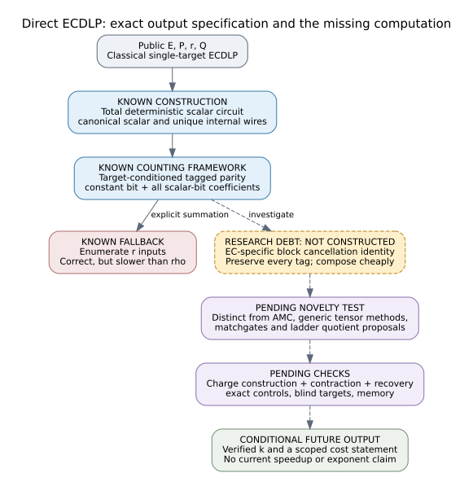

# Classical-only ECDLP research outside index calculus

25 October 2026. Planning report; no new attack or performance claim.

**Latest implementation:** [the all-ten-track finite pilot has completed](../../../experiments/EXP-ECDLP-fe3337/reports/run-20261025T0526Z/HEADER.md), with [241 recorded rows](../../../experiments/EXP-ECDLP-fe3337/reports/run-20261025T0526Z/observations.md), a [seven-page report](../../../experiments/EXP-ECDLP-fe3337/reports/run-20261025T0526Z/report.pdf) and a [working C++ harness](../../../harness/classical_ecdlp_pilot/README.md). The original planning documents below remain historical; the pilot does not establish a new attack.

**Classical algorithms only, running on ordinary CPUs or GPUs.** Quantum algorithms, quantum hardware, and simulation of a quantum attack are excluded. A Boolean circuit in this report is an ordinary deterministic bit program; tensor contraction is classical summation and multiplication of finite arrays.

This review proposes a direct scalar-circuit workstream and identifies the exact missing contribution: an elliptic-curve-specific cancellation identity that evaluates a target-conditioned tagged parity response cheaply. The response formulation itself is established algebraic model counting. It is explicitly excluded from the novelty claim.

The requested novelty criterion remains unresolved. The plan gives a precise object, prior-work collisions, discovery tasks, controls, cost accounting, and rejection conditions instead of presenting a renamed known method as a new algorithm.

**Follow-up experiment programme:** [all ten classical workstreams](programme/README.md), [per-lead designs](programme/LEADS.md), [shared measurements and criteria](programme/EXPERIMENTS.md), and [printable programme](programme/report.pdf). A C++ point-level reference now passes 13,731 development assertions. These checks are separate from scientific trials; no new cancellation construction or speedup is established. Several original proposals are IC-specific, so their possible direct successors are explicitly distinguished.

- [Research plan and review](PLAN.md)
- [Printable report, including the mechanism diagram](report.pdf)
- [Diagram](mechanism.svg) and [editable source](mechanism.dot)
- [Sources and review boundaries](SOURCES.md)
- [Indexed source manifest](indexed-sources.tsv): 147 atlas rows and 52 known-result rows, Git blob hashes checked against GitHub metadata
- [Classical-only filtered matches](atlas-match-classical.txt) and [original unfiltered repository matcher output](atlas-match-direct.txt)
- [Pinned scope](review-scope.json)

Blue boxes are known constructions; the dashed amber box is the unsupplied research operation; dashed edges are proposed future work. There are no measured algorithm data in this report, so the visual is explanatory rather than a performance plot.

## Execution status

| Requirement | Status |
| --- | --- |
| Orient with the three named repositories | Completed at the pinned, selective review scope |
| Index the cross-repository lead and known-result maps | 199 source blobs checked |
| Read all research and every branch/raw archive | Partial; not claimed |
| Identify and reject known-method repackagings | Documented, including AMC and tensor/counting wrappers |
| Deliver a concrete non-IC research plan | Complete |
| Certify a novel, previously untested ECDLP algorithm | Unresolved |
| Implement/run a new solver or scientific experiment | Not performed in this planning task |
| Establish an advantage or change a scientific status | Not performed |

The report creates no official hypothesis or experiment record, approves no trial, and updates no canonical attack frontier. Existing lead dispositions and frozen evidence are unchanged. The lead atlas and known-result map were checked as prior-work indexes; no graphable verified result was added.

The original source index and lexical matches include a historical quantum-resource lead. It is explicitly excluded from candidate selection and supplies no dependency of the proposed classical work. The original plan already specified classical computation; this amendment makes that requirement prominent and resolves the ambiguous terminology. The missing EC-specific identity and novelty status are unchanged.

## Rebuild

Run `./build.sh` in this directory with Graphviz, Pandoc, XeLaTeX, and DejaVu fonts installed. `report-source.md` is generated from the plan, diagram caption and source notes; `report.tex` is the generated printable source. The PDF includes the plan and sources. The SVG and PDF diagram come from `mechanism.dot`.

Point-level development checks are recorded in the follow-up programme. Gate-level correctness, a new constructive identity, scientific admission and independent replay remain future obligations; document rendering does not satisfy them.

The current PDF is a [compact format derivative](FORMAT-NOTICE.md); the exact original export and all original/compact hashes remain linked in the [manifest](compact-export-manifest.json). Scientific source content and sealed evidence are unchanged.
