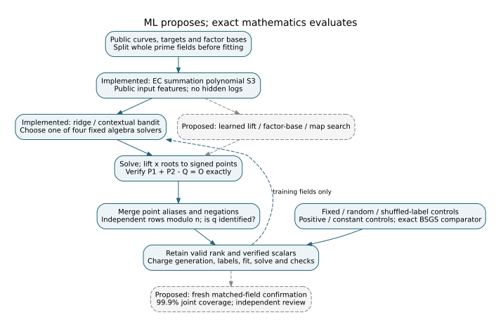
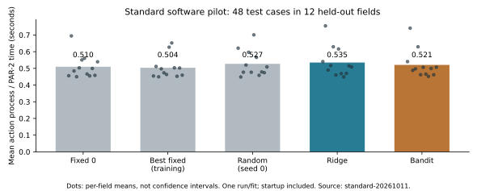
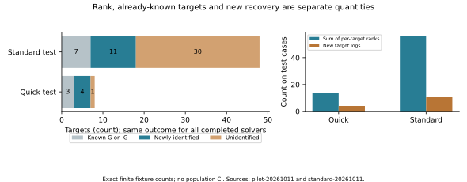

# ML-assisted EC relation research flow

2026-10-11 UTC. Status: **implemented and measured engineering pilot**; exact
software replays passed. No independent scientific review, sealed bound,
hypothesis promotion, or new cryptographic-size resistance result.

## What changed

ML now chooses an algebra solver for an actual elliptic-curve decomposition
problem. Its output passes an exact point-relation checker and modular rank
evaluator. This replaces a vague pattern search with a measurable question:
does guidance yield additional target-identifying relations or lower full cost
on fields and curves excluded from training?

The first bridge uses the existing ridge and one-step contextual-bandit
selector from `tasks/polynomial_solver_ml`. It solves bounded S3 systems,
lifts their roots to points, verifies the signed group equation, removes
dependent information, and checks whether the target scalar is uniquely
identified. Learned choices among four solvers are implemented; learned lifts,
factor bases, endomorphisms and other relation generators are **proposed
extensions**. Existing `tools/rl_isogeny_search.py` is another ML search tool,
but its structural scores are not used as a substitute for verified recovery.

[Workflow diagram](workflow.svg) · [editable source](workflow.dot) ·
[runnable task](../../../tasks/ec_relation_ml/README.md) ·
[frozen pilot and proposed confirmation design](../../../tasks/ec_relation_ml/PROTOCOL.md)

## Measured pilot results

Both profiles were fixed before execution. Source commit:
`3e02da06533b7664a168d5dae1c493a5dd6421aa`. All **864 solver
jobs** were retained and every completed output matched separate exhaustive
evaluation of the original polynomial equations plus exact relation checks.
The 13 mathematical/data-boundary tests passed. Positive and constant-reward
learning controls passed; shuffled labels were replayed as a diagnostic.

| Profile | Independent finite fields | Cases | Jobs | Completed | Censored |
|---|---:|---:|---:|---:|---:|
| quick | 12 | 24 | 96 | 96 | 0 |
| standard | 48 | 192 | 768 | 768 | 0 |

Quick test: **8 targets in 4 held-out fields**,
14 independent relation rows,
7 verified target logs. Of those,
3 were already known G/-G and
**4 were newly identified**.
Standard test: **48 targets in 12 held-out fields**,
56 independent rows,
18 total verified target logs,
7 initially known and
**11 newly identified**;
30 remain unidentified by this decomposition set.

These ranks are sums of per-target matrix ranks. Targets on one curve share
seed logs; a sum need not be the rank of a single combined batch matrix.
`batch-relations-derived.json` separately deduplicates the combined equations
per exact curve and verifies recovery against both points and the BSGS output.
This is post-hoc exact accounting of the measured root sets, with no new fits
or solver trials and no full batch-cost claim. On the standard test, the sum
of joint per-curve ranks is **39**, and shared information newly identifies
**13** targets (plus 7 initially known). This reuse applies to all solvers
and is not a learned discovery.

All completed solvers solve the same equations, so they deliver the same
relation information. **ML discovered no additional relations in this pilot.**
Its learned decisions concern solver cost. Exact generic BSGS recovered all
192 standard targets; the relational method need not do so.

| Standard test selector | Mean full action process/PAR-2 cost (s) | Independent rank sum | Total verified target logs |
|---|---:|---:|---:|
| Fixed 0 | 0.510 | 56 | 18 |
| Best fixed (training) | 0.504 | 56 | 18 |
| Random (seed 0) | 0.527 | 56 | 18 |
| Ridge | 0.535 | 56 | 18 |
| Bandit | 0.521 | 56 | 18 |

Numbers are one frozen software run, not evidence of a learned mathematical
weakness. The four test-field quick pilot was too small for security inference;
the standard pilot also supplies no preregistered confidence interval. Dots
show observed per-field means, not confidence intervals. Timings include fresh
Python/NumPy/SymPy startup, which dominates these tiny jobs and varies with host
activity. Quick label collection overlapped read-only Git corpus retrieval and
sparse-checkout materialization. Its largest slow child took 1.620 s of process
time but only 0.0294 s inside the timed solver. These observations are retained.
No timing difference is a security finding. The warm-parent BSGS check is a
correctness comparator, not a paired process-timing race.

The quick and standard pilots took **465.3 s together**, including
all 864 acquired action labels and control fits.
Standard offline label acquisition took
396.444 s;
fit-and-select took
0.083 s. All
generation, oracle, fitting, feature, inference and verification times are in
`pilot-summary.json` and the immutable pilot manifests. A one-off attack must
charge label acquisition and fitting; selected-action times alone are not that
full cost. Largest recorded child RSS: 69,689,344 bytes.
Fields span primes 7–233;
subgroups span 3–8 bits.
Root extraction enumerates the small field grid and cannot scale to P-192/P-224.

## Theory in plain language — derived explanation

For Q = [q]G, a valid equation between public points becomes a linear equation
between their unknown logs. On the checked example
E/F17: y²=x³+2x+2, n=19, h=1, G=(5,1), let P=[5]G and Q=[7]G.
The relation 2P-Q=3G gives **2u-q=3 modulo 19**. It has rank one and two unknowns;
it does not identify q. Add P=5G, or u=5: now rank is two and q=7 is uniquely
identified and verifies against Q. Predicting “a relation probably exists” is
not enough; the exact equation and its information gain must survive checking.

The summation polynomial encodes whether x-coordinates can belong to points
whose signed sum is zero. The implemented equation is

`S3(x,y,z) = (x-y)^2 z^2 - 2((x+y)(xy+A)+2B)z + (xy-A)^2 - 4B(x+y)`.

Fix z=x(Q) and constrain x,y to public factor-base x coordinates. Solve, find
base-field y coordinates, choose signs and verify P1+P2=Q. A polynomial root
alone does not verify a usable point relation. Duplicate roots, P and -P, and
scaled/dependent equations do not provide extra rank. An explicit known map
must transport witnesses back to the original curve before it can contribute
information there; this pilot does not automatically discover such maps.

Three different ranks matter. **Unit rank** counts independent multiplicative
units in a number field. **Mordell–Weil rank** counts independent infinite-order
EC points over that number field. **Relation-matrix rank modulo n** counts
independent constraints between finite-subgroup logs. ML prediction of one of
these ranks is not scalar recovery. A higher lift rank can enlarge a point
supply while discovery and combinations consume more work. The earlier
RUN-ECDLP-6d910b found rank gains on selected lifts but no advantage over its
declared BSGS comparison; its exact lift preprocessing was excluded from primary
group-call counts. A new candidate must price that work too.

## What the archived data can and cannot train

The retrospective audit of RUN-ECDLP-9e6cc1 reads 104 cohorts:
24 source number fields, but only
6 distinct finite curves over
3 primes. The nominal
1664 attempts reuse target batches;
they are not that many independent challenges. Requiring both a source-field
and finite-curve holdout links all 104 rows into one connected
component. A random row split would test memory of these reused objects.

These earlier data are suitable for exploratory audits and mechanism proposals.
They have already been inspected and cannot now become fresh confirmation.
Holding out new finite fields under a fixed lift template and holding out wholly
new source fields/templates are separate questions. P-192 and P-224 are two
fixed primes; a family classifier could identify constants or sparse binary
encodings without learning anything about their discrete logs.

For context, the prior controlled generic-attack comparisons remain unchanged:

| Earlier scope | Structured/random normalized rho cost | Marginal 99.9% interval |
|---|---:|---|
| Solinas toy family | 0.9952 | [0.9725, 1.0185] |
| P-192 | 0.9834 | [0.9174, 1.0581] |
| P-224 | 0.9875 | [0.9261, 1.0520] |

These interval estimates are conditional on their recorded sampling/matching.
The Solinas study uses toy fields; P-192/P-224 use full fields with small
16–20-bit subgroups. They did not detect greater generic resistance in those
scopes and do not decide cryptographic-size resistance or eliminate rare
nonlinear structure. ML can guide discovery of a different, verifiable
mechanism; it cannot make these earlier null comparisons into a security proof.

## Next confirmation study — proposed

Use learned guidance to prioritize low-height lifts, factor bases, candidate
relations and solver policies, with exact witnesses and incremental target
identification as feedback. Compare against random proposals, simple public
heuristics, best fixed policies, matched random primes/number fields/seed points
and identical-target generic BSGS/rho. Retain all failed, censored and unavailable
map cases. Prevent seed regeneration of hidden answers: evaluator-held fresh
challenge entropy is revealed only after predictions/checkpoint hashes are fixed.

Target at least 512 independent matched blocks per eligible toy-size stratum,
four independent curves and four random-prime/four random-number-field controls
per structured draw where the eligible population and maps permit. For a fixed
P-192/P-224 field, a block is a new curve/control pairing, not a new structured
prime. Use discovery variance and a frozen practical effect to set power and
final confirmation counts before opening those labels. There is no assumption
that more target rows manufacture independent fields.

Reserve two-sided **99.9667% intervals per family for three primary families**
to obtain 99.9% joint nominal coverage by Bonferroni. Additional primary sizes
or objectives need further correction. Resample independent matched blocks,
charge all acquisition/training/search/verification/memory costs, and freeze
missingness, multiplicity, stopping and any amortization assumptions. New
samples improve precision; a higher confidence level alone widens intervals.
A reproducible signal needs mathematical explanation and independent review
before any larger-group security implication.

## Sources, exact identities and remaining limits

All benchmark curve parameters, generators, subgroups and full EC1 UIDs are in
[curve-identities.csv](curve-identities.csv) and the public `cases.json` files.
The illustrative F17 equation is checked by the 13-test suite, including all
nonzero subgroup point pairs, alias/dependency checks and rank-without-recovery.
Software verification replays producer arithmetic and an independent root
oracle; it is not independent scientific review or authentication of timing.

Provenance is internal/retrieved for the repository sources: prior run IDs
RUN-ECDLP-6d910b, RUN-ECDLP-9e6cc1, RUN-ECDLP-07aad1 and RUN-ECDLP-d0e449;
exact input SHA bindings are in `source-bindings.json`. The knowledge MCP was
not available; bounded repository searches and exact source reads were used.
Copied KN-LIT/KR records under `source-records/` are unchanged snapshots, with
their original verification limits retained. Semaev summation-polynomial
decomposition is established prior art (KN-LIT-001/KR-IC-5a43e5); the curated
record for naive prime-field IC reports a conditional negative result
(KN-LIT-d8e1b9/KR-IC-5931ee). The primary papers were not read in this round;
no claim of novelty or new impossibility is made. KN-LIT-1940 is an internal
abstract-level pointer about twist-class redundancy, not evidence of ECDLP
recovery. The warning motivates a separate transport/template holdout.

`graph-inventory.json` records historical study diagrams and canonical frontier
sources checked. There is no supported frontier change; only these new derived
views are added. Results do not alter any official hypothesis status. Ready PR
tracking files accompany the change; actual publication requires working GitHub
authentication and is reported separately, without fabricating a PR number.
