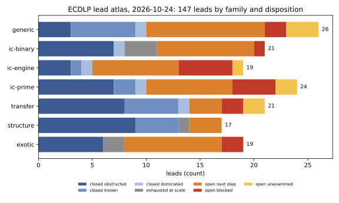
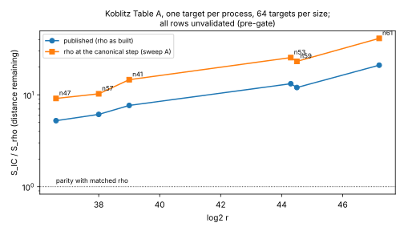
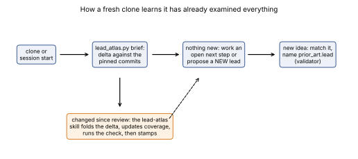

# ECDLP lead atlas: first full review (2026-10-24)

**Question.** Which ECDLP leads have the four repositories (crypto-autoresearcher,
crypto, cryptanalysis, ecc-challenges) already examined? What decided each one, and
what is left? The aim is a state in which a fresh clone can tell, by computation,
that everything has already been examined.

**Scope and method.** Seven parallel surveys, one per lead family (generic rho,
binary IC, the IC solving engine, prime-field IC, transfers, curve structure, and
exotic or statistical ideas). They read the summaries in all four repositories:
decision and evidence records, findings, problem records, study READMEs and
conclusions, leaderboards and benchmark indexes. Each survey drafted lead rows and
mapped every ECDLP-area ledger record to a lead. I merged the rows and resolved
cross-family duplicates. The original survey ran `tools/lead_atlas.py --check
--strict-paths` in its checkouts. A later check against published crypto main
found six study citations then present only on crypto PR #2495 and two walk
citations still present only on open ecc-challenges PR #56, plus one symlink alias
that is corrected in the lead row. Crypto PR #2495 has since merged; its four
distinct study files match current crypto main by Git blob hash. All eight
citations retain immutable source pins. The [provenance problem](../../../problems/ecdlp-lead-atlas-unmerged-evidence.md)
tracks the remaining replay and four-repository verification. The original survey also
folded in cryptanalysis `main` work that its first pass could not see (its cloned
default branch is a stale lineage; see Limitations).

**Status of each statement.** Dispositions summarize the cited records. Six
crypto citations now exist on main, while two walk citations remain on an open
source PR. All eight remain provisional pending complete controlled replay.
This report makes no new measurement and changes no hypothesis, experiment or
goal status. The scoped raw audits described below do not establish the reported
algorithms' soundness. Rankings are this review's *proposal*.

The chart counts filed dispositions. It does not certify their cited experiments.
The typeset report is reproducible from `report.typ` with
`typst compile report.typ report.pdf`; the generated PDF stays out of Git under
the repository's artifact policy. The coverage table stays in Git because
`tools/lead_atlas.py --check` reads it by path.

## Result

- **149 leads**: 72 closed, each with a named obstruction (43 obstructed, 18 known,
  5 dominated, 6 exhausted at scale), 53 open with a decided next step, 16
  blocked and 8 unexamined.
- **Coverage 2078/2078**: every hypothesis and idea in an ECDLP area of the ledger
  maps to a lead (`knowledge/leads/ecdlp/coverage.tsv`). 264 rows are mapped
  `NONE` because they are not about the discrete log: rank records, code-based
  and PQC strays, and arithmetic trivia.
- **Current coverage reconciliation**: 29 records added after the original review are mapped in [`coverage-20261024-mapping-review.json`](coverage-20261024-mapping-review.json). Two separate transfer questions are open: the approved n=7 GHS cover-floor trial and a proposed Weil-restriction Jacobian-class census. Their proofs, census results, and transfer cost are not yet validated. Coverage is complete for this ledger snapshot; the full cross-repository delta review and review stamp remain open.
- **Review pinned**: `REVIEW_STATE.json` records the original review's
  default-branch commits: autoresearcher `4fa15469d`, crypto `da3a1b5d5`,
  cryptanalysis `9760a763d`, ecc-challenges `3a71596ba`. Its 50/9 tally is
  historical. The committed rows now tally 53/8 after the hybrid
  guess-and-determine lead advanced. At this regeneration, `--delta` reports
  changed watched paths in autoresearcher; the three sibling repositories
  were not checked out here, so their later changes remain unverified.

| family | leads | closed | open, next step | blocked | unexamined |
|:--|--:|--:|--:|--:|--:|
| generic (rho, kangaroo, BSGS, pool) | 26 | 10 | 11 | 2 | 3 |
| ic-binary | 21 | 11 | 9 | 1 | 0 |
| ic-engine | 19 | 5 | 8 | 5 | 1 |
| ic-prime | 24 | 10 | 8 | 4 | 2 |
| transfer | 23 | 14 | 5 | 2 | 2 |
| structure | 17 | 14 | 3 | 0 | 0 |
| exotic | 19 | 8 | 9 | 2 | 0 |

The structure and transfer families are nearly exhausted. The theorems that close
them are Tate's isogeny theorem, the Balasubramanian–Koblitz embedding-degree
condition, the genus-g index-calculus floor `q^{2-2/g} ≥ q`, and the triviality of
homomorphisms from a prime-order group into an ℓ-group (ℓ ≠ the group order). The
open frontier is index-calculus engineering and the exponent questions inside the
solving engine.

## Distance remaining to matched rho (measured, copied)

| board | best row | IC / matched rho | caveat |
|:--|:--|--:|:--|
| crypto Table A (Koblitz, one target) | n47 | 5.23x published, 9.13x at the canonical step | rho priced "as built"; sweep A re-prices at 9.13–41.1x |
| crypto Table B (prime field) | fp12 | 5.47x | gap widens with log2 r to 13.5x at fp24 |
| crypto Table C (Koblitz, 32 targets) | n41 | 3.62x | rho from a different session |
| cryptanalysis Koblitz ratchet | n83 rank-finder row | 3.92x cold vs tuned rho | wall time on one host class, factor-base construction uncharged, §5a band unresolved |
| generic rho vs floor | Koblitz signed-Frobenius strong rho | 1.089x floor | canonicalisation counted, not charged |

Every IC row is still "unvalidated (pre-gate)". No row is below its reference. The
online "IC beats rho" readings (n61 13.9x, N83 18.5x and similar) compared IC
against rho with an empty distinguished-point table. They are not results: at equal
advice, Bernstein–Lange rho is 53–317x faster online.

## Next steps, ranked across families (proposal)

1. **Port the cryptanalysis n=83 engineering ratchet to crypto Table A, then re-run
   Table A** with tuned K and production free relations
   (`LEAD-ICB-koblitz-setup-phase-cost`). Set-up is 98.5–99.7% of Table A's S.
   Off-board figures (K retune 0.46x at n41, free relations 0.960x) and the ten
   stacked n=83 producers indicate that this is the cheapest verified IC-baseline
   improvement. It is constant-level only.
2. **Validation gate for the IC boards.** No row can land until it carries a replay
   certificate, a validator report and the §5a band (crypto CLAUDE.md, gate of
   2026-10-19). This blocks every other improvement from counting.
3. **Descent closure degree at (m, l) = (3, 7) and (4, 7)**
   (`LEAD-ICE-descent-closure-degree-at-scale`, blocked on a host with at least
   250 GB). This is the only exponent-level question left for prime-degree binary
   curves: degree 4 puts the ECC2K-130 m=4 row about +7.6 bits over rho, degree 5
   about +10.3 bits, and degree 6 or more closes it. The new
   `LEAD-ICE-hybrid-guess-determine-l7` probes the same question without that host.
4. **Class quotient in the ecc-challenges v2 worker** (`LEAD-RHO-pool-class-quotient`).
   Negation (√2) and, on Koblitz campaigns, signed Frobenius (√(2m)) are missing
   from all 23 non-ECC2K-130 campaigns. The win is certain engineering.
5. **Price the native-XOR SAT arm** (`LEAD-ICE-sat-xor-pdp-oracle`). Its S/rho of
   0.854 at n=17 Koblitz holds only because solver conflicts are unpriced. One
   calibration decides the lead either way.
6. **Optimal Coppersmith shift set** (`LEAD-ICP-coppersmith-smallroot-semaev`). The
   recorded closure "by 0.048" used one Jochemsz–May strategy, with 0.159 of slack
   unused. Ryan's (EUROCRYPT 2025) optimal shifts at (m, w) = (4, 2) are a calculator
   run with a decisive outcome. *Superseded 2026-10-29: done, and the lead is closed
   (`docs/reports/ecdlp-lead-atlas-20261029/`).*
7. **Joux–Vitse sieve on the GF(p^6) weak class, with full accounting**
   (`LEAD-TRF-jv-sieve-fp6-weak-class`). This is the only transfer ever measured
   below strong rho (0.011x including the walk), but its comparisons were withheld
   because the tolerances and hash costs were not frozen. It reproduces a 2012
   result and applies to the weak class only.
8. **Exotic lanes with a decisive cheap test**: the bucket variance W of the
   four-list O2 kernel (`LEAD-EXO-four-list-ktree-join`), and claims K1 and K2 of
   the Miller cocycle (`LEAD-EXO-miller-pairing-cocycle`).

New leads added by the original review:
`LEAD-ICE-linearization-excess-fb-prior`, `LEAD-ICE-hybrid-guess-determine-l7` and
`LEAD-TRF-teske-trapdoor-fp6-weak-class`. The hybrid lead now has measured
evidence and an `open_next_step` disposition. The surveys proposed nine more
candidates; `--match` found each one already present as a lead or a KR row. That
is the gate doing its job.

## Integrity findings for the Coordinator (observed; no status changed here)

- **Ledger backlog.** 971 of the 1,031 ECDLP-area hypotheses (94%) have no
  terminal status: 373 approved, 308 specified, 240 proposed, 47 analyzed, 3
  other. The surveys counted more than 100 approved hypotheses that are arithmetic
  trivia or Stage-0 identity checks ("Eight times six is 48"). They inflate counts
  without touching a lead.
- **Stale or contradicted documents an agent would re-propose from:**
  - `crypto/reports/Index calculus leads next steps.md` calls ten items unexecuted
    that `research/ic_next10_20261014/` ran.
  - `analysis/o2-sum-compatible-filters/README.md` says the four-tree route is
    closed; KN-FIND-ffe1df says it is not.
  - Two monodromy findings conflict: KN-FIND-a1f3c2 against KN-FIND-bdcd60.
  - Two elliptic-net findings conflict: KN-FIND-002 against KN-FIND-b7e091.
- **Status disagrees with evidence:**
  - H-IT-001 was closed on Tate's theorem (EV-IT-511f3d, strong), then reset to
    `weakened` with no new evidence.
  - H-ENDO-001 is `approved` against strong contradicting evidence.
  - H-QSP-cd0c90 expired with no result but is still `approved`.
- **Results without evidence records:** EXP-GRUMPY-cd7b82 stage 1, RUN-AUXIN-fd1edc,
  five KIC runs and the CZLIFT round (20 validated trials).
- **Instruments that could not fail:**
  - The XEDN `max|coeff| = 1` statistic.
  - ECTD meters: identical on all 32 curves.
  - The volcano census's ±10% IC margin. It could not see the measured 5.8% ℓ=2
    floor deficit.
- **Overbroad closure:** KR-RHO-755e35 and EV-IT-511f3d say that isogeny walks never
  find weak curves. That is true over prime fields and false over composite-degree
  binary fields, where it is exactly how the GHS walks and Teske's trapdoor work.
- **Mislabelled regression:** the leaderboard's "96 root-finder replay mismatches" are
  inherited-F4 `solver_ops` rows (BMI2 rewrite, F4 pricing changes), per validation
  sweep D. They are not root-finder rows.
- **Repository hygiene:** the cryptanalysis GitHub default branch is a stale lineage
  (`claude/cryptanalysis-repo-setup-p59kek`, about 530 commits not on `main`).
  Sessions cloning the default read old results. Four atlas evidence paths exist
  only there, so they are pinned with `ref: c273e621`.

## How the harness uses this

- **Session start.** All three research repositories print
  `tools/lead_atlas.py --brief`. When `--delta` is empty, the brief says that
  everything was already examined and points at the open next steps.
- **Ideation.** `/propose-ideas` pastes `--render` and runs `--match` on each returned
  idea. From IDEA-20261025 on, the validator requires `prior_art.lead`: the lead
  the idea advances, or `new` with a reason.
- **Review.** The `lead-atlas` skill folds a non-empty delta into leads, then runs
  `--check` and `--stamp`. CI and `make check-ledger` run `--check`.
- **Saturation.** No unexamined lead, no unmapped record, and nothing new since
  review. At this regeneration, only the mapping gate holds in this checkout:
  eight leads remain unexamined and `--delta` reports changed watched paths.
  Sibling-repository changes were not checked here. Saturation is reported,
  never used to pause a goal.

## Limitations

- **Survey depth.** The surveys read summaries, not every raw run. A disposition is
  only as good as the decision or evidence record it cites. The coverage mapping is
  a scripted classification with hand overrides, and the boundary between
  `OTHER:ic-prime` and exotic among RQ-ECDLP-002 Stage-0 records is noisy.
- **Cryptanalysis lineage.** The first pass read cryptanalysis at its stale default
  branch. The `main`-only ECDLP material was folded in afterwards: the n=83 IC
  ratchet, the genus-2 cover and speed studies, and the n=83 surfaces run.
  Tooling-only changes were not.
- **Unvalidated sources.** Every gap figure is copied from unvalidated (pre-gate)
  rows.
- **Source and validation gap.** Six study citations retain the immutable
  [crypto PR #2495](https://github.com/aburan28/crypto/pull/2495) pin
  `1397a09db5fb48edc2f9c2edca78035a2e4da5ca`. The PR merged as
  `19ecb8d37f8d8523a14e5014ba9a7172e02111aa`, and its four distinct cited
  study files are byte-identical on crypto main `5cb553810e5bbfbd8691ec614ffcaacefc625757`
  ([merged-source check](crypto-merged-source-check.json)). Scoped raw audits
  reproduced [Table B cost fields](tableb-ledger-audit.json),
  [six rule-v4 paired ratios](v4-pair-audit.json) and
  [ten hybrid minimum guess counts](hybrid-raw-audit.json)
  ([recompute script](audit-crypto-hybrid.py)); they did not rerun the algorithms
  or close current-main CI. Two walk citations are pinned to open
  [ecc-challenges PR #56](https://github.com/aburan28/ecc-challenges/pull/56)
  at `1f49962624b13fbed4a3e9ad980d757f5fa5bc59`, which is currently
  conflicted. The four cryptanalysis branch-ref paths and the eight
  `ecc-challenges` paths were verified through the GitHub content API at their
  cited commits ([16-file path receipt](source-path-check.json)), but not
  through a complete local four-repository replay.

Sources: the lead rows (`knowledge/leads/ecdlp/<family>/`), each citing its own
records; the snapshot of all rows (`atlas-snapshot.md`); the scoped source-path
receipt (`source-path-check.json`); figures (`figures.py`, drawn only from
committed rows and the cited leaderboard and sweep values).
