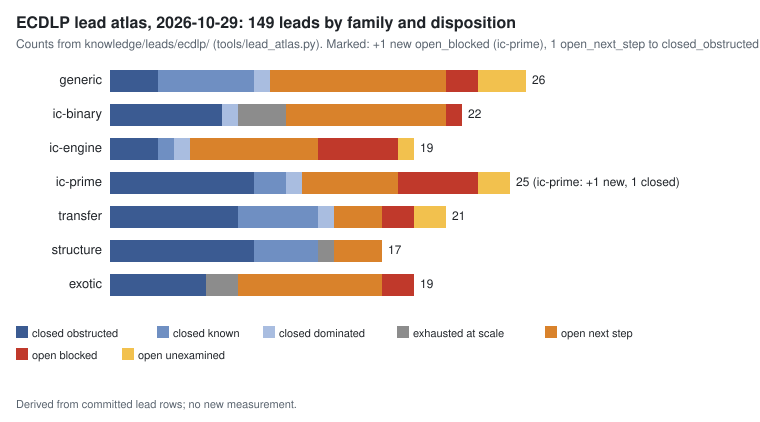

# ECDLP lead atlas: review of 2026-10-29 (prime-field IC delta)

**Question.** What changed in the four repositories between the first full review (2026-10-24, `docs/reports/ecdlp-lead-atlas-20261024/`) and 2026-10-29? Which lead dispositions did those changes move?

**Scope and method.** One review agent ran in the `prime-ic-prep` workflow of 2026-10-29, followed by an independent cross-track reviewer. It ran `python3 tools/lead_atlas.py --delta` and folded every listed path into its owning lead: 227 watched paths in crypto-autoresearcher, 93 in crypto and 77 in cryptanalysis. It mapped the unmapped ECDLP ledger records with `--coverage`, ran `--check` until it passed, and stamped the review `prime-ic-prep-20261029`. Prime-field index calculus (`ic-prime`, `ic-engine`) had priority, because that was the session's question. Companion program: crypto `research/prime_ic_program_20261029/`.

**Status of each statement.** Dispositions are *derived* from committed evidence and cite it. They are not new measurements, and they change no hypothesis, experiment or goal status. Numbers are *measured* values copied from the cited records.

## Result

- **149 leads**: 74 closed with a named obstruction (45 obstructed, 18 known, 5 dominated, 6 exhausted at scale), 50 open with a decided next step, 17 blocked, 8 unexamined.
- **Coverage 2092/2092.** Every ECDLP-area ledger record maps to a lead; this review added 44 rows to `coverage.tsv`.
- **Two disposition changes**, both in `ic-prime`:
  - **New** `LEAD-ICP-pkm-tower-algebraic-oracle` (open_blocked). It covers PKM tower and APS partitioned factor bases solved algebraically over F_p, measured by first and last fall degree. No lead covered it before, although it is the only prime-field route that meets the owner's 2026-10-24 algebraic criterion. Blocked by the fall-degree relaunch route (harness host), the stranded Mac runs, and memory for m = 4 at N = 20.
  - `LEAD-ICP-coppersmith-smallroot-semaev`: open_next_step to **closed_obstructed** (proof, scoped). Any lattice built from (p, f)^t on one S₃ block with equal per-variable bounds reaches at most 0.3293 (three unknowns) or 0.3536 (two). The optimiser found nothing above 1/2 with unequal bounds. The demand is 8/9 (crypto `research/smallroot_optimal_reach_20261026`). This **supersedes next step 6 of the 2026-10-24 report** ("optimal Coppersmith shift set"): that calculation is done and closed the lead. `revisit_when` names joint three-block lattices, unequal bounds above 1/2, rank-r GAP bases and non-Coppersmith solvers. The unequal-bound value 1/2 is numerical, not proved.
- **Folded without a disposition change** (prime-field IC):
  - `LEAD-ICP-prime-ic-constant-engineering`: `best_measured` is now the 2026-10-29 20-bit factor-base change, N 32 → 45, Σ S_sel/Σ S_inc 0.818 [0.773, 0.866] at w = 0 and 0.726 [0.677, 0.778] at w = 1 (crypto `research/prime_base_oracle_tuning_20261029`). Its next action is that row's second-host replay, then the hash-table floor.
  - `LEAD-ICP-residual-partial-relations`: on-main evidence from crypto `ic_prime_residual_lp_20261026` and `ic_planner_exhaustive_20261026`. The residual collector is a birthday search; it is generic on the curve-free null.
  - `LEAD-ICB-prime-degree-algebraic-decomposition`: the m = 2 linear Weil-descent ladder, slope 0.647 [0.639, 0.655], 36,440× strong rho at n = 41 (crypto `research/ic_m2_linear_ladder_20261024`).
  - `LEAD-ICE-rootfind-pairtable-oracle`: corrected. Table B rows use `mitm_m2_negfold_walk*` pair tables, not root finding (crypto `docs/ic/leaderboard.json`).
  - Scope notes for the owner criterion of 2026-10-24 and the Option C ruling recorded 2026-10-29 (crypto `research/prime_ic_program_20261029/DECISIONS.md`). These apply to the rootfind, generic-table and constant-engineering leads.
- **Other families.** These folds attach evidence and change no disposition:
  - CZLIFT outcomes, in the three p-adic and global-lift TRF leads.
  - Sheriff strength downgrades (CORR-20261026-c94668).
  - PEXT, Prym, NISTSEED, P-256 parallel tracks, isogeny fibers R5/R6, six-class rho, the known-label graph and cubic-gluing records.

| family | leads | closed | open, next step | blocked | unexamined |
|:--|--:|--:|--:|--:|--:|
| generic (rho, kangaroo, BSGS, pool) | 26 | 10 | 11 | 2 | 3 |
| ic-binary | 22 | 11 | 10 | 1 | 0 |
| ic-engine | 19 | 5 | 8 | 5 | 1 |
| ic-prime | 25 | 12 | 6 | 5 | 2 |
| transfer | 21 | 14 | 3 | 2 | 2 |
| structure | 17 | 14 | 3 | 0 | 0 |
| exotic | 19 | 8 | 9 | 2 | 0 |

Counts are from `dispositions.json`, which `figures.py` writes from the committed rows. "Closed" includes exhausted at scale.

## Prime-field IC after this review

Three lanes remain, as set out in crypto `research/prime_ic_program_20261029/README.md`:

1. **Baseline definition.** The prime-field algebraic track has no baseline until the Semaev-naive + msolve reference arm runs (approved; not yet implemented). The eight Table B prime rows pass the validation gate and are generic-track rows under Option C.
2. **Exponent.** Only `LEAD-ICP-pkm-tower-algebraic-oracle` at m ≥ 4 can move it. The PKM note §3.7 shows that no oracle beats rho at m ≤ 3. A derived estimate at 256 bits puts m = 4 within reach of rho only if d_F ≤ 4.
3. **Constant.** `LEAD-ICP-prime-ic-constant-engineering`: the 20-bit factor-base gain, then the hash-table prefetch (owner-approved run, waiting on crypto #2783/#2806).

## Limitations

- ecc-challenges was not checked out. Its `REVIEW_STATE.json` pin (`3a71596ba`) is carried over from 2026-10-24 and was not re-examined.
- `--check --strict-paths` reports 7 errors that predate this review. They are paths cited from the unmerged crypto PRs #2783, #2806 and #2807, and they resolve when those PRs merge. Plain `--check` passes.
- Merging `main` into the review branch brought in one lead added by another session (148 → 149) and 23 administrative watched paths: decision records, problem records and CI reports. `REVIEW_STATE.json` keeps the stamp's own tally (148 leads), so those paths appear in the next `--delta`.
- The PDF is rendered with reportlab (`build_pdf.py`), because this container has no Typst or LaTeX engine.

## Files

- `dispositions.svg`, `dispositions.json`, `figures.py`: the figure, its counts, and the script that draws both from `knowledge/leads/ecdlp/`.
- `atlas-snapshot.md`: `python3 tools/lead_atlas.py --render` at this review.
- `report.pdf`, `build_pdf.py`: this README as a PDF, with the figure redrawn from `dispositions.json`.
