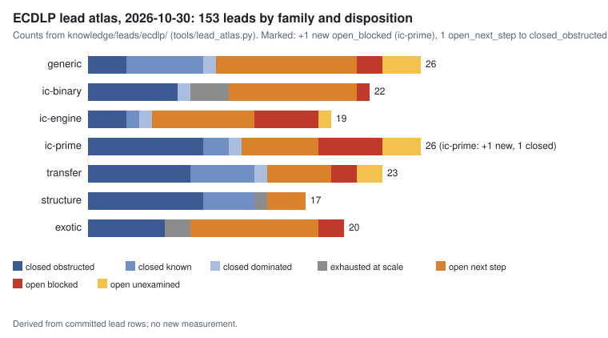

# ECDLP lead atlas: review of 2026-10-30

**Question.** What changed in the three checked-out repositories between the 2026-10-29 review (`docs/reports/ecdlp-lead-atlas-20261029/`) and this session's checkouts? Which leads do those changes advance?

**Scope and method.** One session ran `python3 tools/lead_atlas.py --delta` against the 2026-10-29 pins and folded every listed path into its owning lead or recorded it as not about ECDLP. That was 469 watched paths: 341 in crypto-autoresearcher, 48 in crypto and 80 in cryptanalysis. The review covers each repository up to the commit checked out in this session:

| repository | reviewed commit |
|:--|:--|
| crypto-autoresearcher | `ed4ded06` (main) |
| crypto | `3fe55f62` |
| cryptanalysis | `eefacd27` |

Later main commits of crypto and cryptanalysis were not checked out. The container's disk allowance was spent: the crypto update alone touches 15,607 files. Those commits appear in the next `--delta`. ecc-challenges was not checked out, and its pin is carried over from 2026-10-24.

**Status of each statement.** Dispositions are *derived* from committed evidence and cite it. They are not new measurements, and they change no hypothesis, experiment or goal status. Numbers are *measured* values copied from the cited records.

## Result

- **153 leads** (149 at the 2026-10-29 stamp, 152 before this review).
  - 74 closed with a named obstruction: 45 obstructed, 18 known, 5 dominated, 6 exhausted at scale.
  - 53 open with a decided next step, 17 blocked, 9 unexamined.
- **Coverage 2100/2100.** This review added 14 rows to `coverage.tsv`.
  - Two hypotheses were simply unmapped (H-ECDLP-8dfef7, H-ECDLP-98a95a); each names its lead in `prior_art`.
  - Twelve ECDLP records sat outside the tool's area filter. The hypotheses H-CMFB, H-PFIVE, H-PNEXT, H-PSEARCH and H-SEMAEV use area prefixes missing from `ecc_areas`. The ideas IDEA-20261029-* and IDEA-20261030-* are one-line JSON, which the area regex cannot read. They are mapped by hand, and the filter gap remains in `tools/lead_atlas.py`.
- **One new lead.** `LEAD-EXO-hashed-factor-base-tensor-ecdl` (open_next_step) covers the native implementation of Akshima et al.'s hashed-factor-base ECDL (Bochum v0.2) in crypto and cryptanalysis.
  - Its subexponential bound is conditional on the unverified openai/math #k-SAT preprint (KN-LIT-caa51d).
  - Only small-case correctness is checked. Matched measurement is blocked.
  - The next step is an independent audit. It must test whether the obstruction recorded in `LEAD-ICB-decomposition-encoding-and-sat` applies: there the #SAT exponent loses to enumeration at Semaev-scale variable counts.
- **No disposition change** among existing leads. Evidence folded:
  - `LEAD-ICP-coincidence-harvest-structured-base`: the EXP-PFDR-bb0d26 review is complete. H-PFDR-727bfc is supported (EV-PFDR-07d608, strong): log-GAP x-labels match the uniform null in 44 of 45 cells (KN-FIND-c81e5b). The break-even ladder remains the next step.
  - `LEAD-ICE-decomposition-probability-audit`: the s4_expr defect rerun (EV-SEMAEV-593b7a). It changed the ICINV m4 and FIB C16-1 outputs and was inert in every capped cell. No frozen conclusion changes.
  - `LEAD-ICP-isogeny-transported-relation-yield`: the CM-family small-x window base is exchangeable with a random base to ±0.04% at C24 (EV-CMFB-e3d1ec, toy, preliminary). The CM structure itself is untested.
  - Component improvements, all engineering, with rho ahead in each:
    - Joux–Vitse cover IC Hilbert stop, paired S ratio 1.85–1.88×, validated with caveats (`LEAD-TRF-jv-sieve-fp6-weak-class`);
    - char-2 D₄ Frobenius root finding, 0.854 and 0.815, an IC lower bound (`LEAD-ICB-composite-degree-c2pnb`);
    - aimed-subset gather, collect phase 1.093× established (`LEAD-ICB-koblitz-setup-phase-cost`);
    - k = 5 sum table at 0.22–0.70× the mitm incumbent on holdout curves, generic track, not admitted (`LEAD-ICP-generic-table-decomposition`).
  - Negative diagnostic: the Hecke D39 rank closure is reproduced by doubling rows alone (`LEAD-ICP-lattice-ic-relation-construction`).
  - Problem records and decisions attached to their leads: NISTSEED, PFDR theory rulings, BINSTD, FROB, ICEX, PEXT, the known-label index, the quartic-review repairs and Koblitz modular round 22.
- **Not about ECDLP:** PQC ideas and hypotheses (ML-KEM, ML-DSA, LWE, FN-DSA, SLH-DSA, HQC, NTRU), CI and runner repair reports, process problems, and session logs.

| family | leads | closed | open, next step | blocked | unexamined |
|:--|--:|--:|--:|--:|--:|
| generic | 26 | 10 | 11 | 2 | 3 |
| ic-binary | 22 | 11 | 10 | 1 | 0 |
| ic-engine | 19 | 5 | 8 | 5 | 1 |
| ic-prime | 26 | 12 | 6 | 5 | 3 |
| transfer | 23 | 14 | 5 | 2 | 2 |
| structure | 17 | 14 | 3 | 0 | 0 |
| exotic | 20 | 8 | 10 | 2 | 0 |
| **all** | **153** | **74** | **53** | **17** | **9** |

## Files

- `dispositions.svg`, `dispositions.json`, `figures.py`: the figure, its counts, and the script that draws both from `knowledge/leads/ecdlp/`.
- `atlas-snapshot.md`: `python3 tools/lead_atlas.py --render` at this review.
- `report.pdf`, `build_pdf.py`: this README as a PDF, with the figure redrawn from `dispositions.json`.
