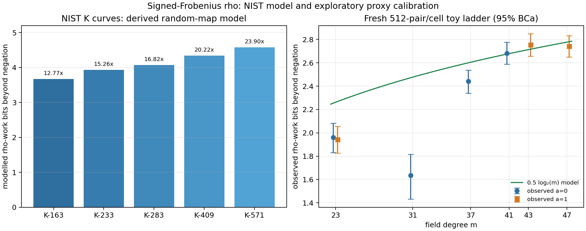
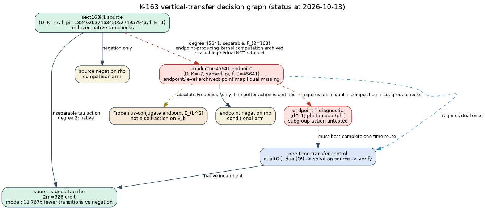

# Koblitz rho incumbent and isogeny-transfer search

Date: 2026-10-13
Base revision: `387dd4aeba486c198913fbecc45661b6a26f8cb5`

Status: **evidence integration, derived consistency audit, and fresh
word-sized calibration.** No cryptographic-size solve, explicit K-163/K-283
transfer map, sealed measured bound, or weak-endpoint claim was produced.

## Outcome

The user's significance assessment is correct. On a NIST Koblitz subgroup,
the usable signed-Frobenius action reduces the random-map rho expectation by
`sqrt(m)` relative to the same curve's negation-only rho. That is 3.674 to
4.579 rho-work bits, or 12.77x to 23.90x fewer expected transitions, from
K-163 through K-571. It is an operationally material incumbent for every
isogenous-endpoint comparison. It is not a loss of subgroup entropy, a new
attack, or a measured wall-clock gain; the extra factor `sqrt(2)` belongs only
to comparison with unquotiented plain rho.

A fresh seven-cell word-sized run now tests the counter mechanics with 512
paired targets per cell. All 10,752 executions verified, and a full audit
reproduced all 10,752 counts. At `m=41,43,47`, observed walk savings of
2.681, 2.754, and 2.741 bits have pointwise 95% intervals containing
`0.5 log2(m)`. The smaller-subgroup cells undershoot, most sharply at `m=31`.
The run therefore exposes finite-size and setup effects rather than supporting
a blind field-degree extrapolation.

The result does **not** establish a new weak isogenous representative. The
fresh run calibrates source actions only; it constructs no map or conductor
endpoint. Earlier `m=37` and `m=41` C studies remain contextual replications.
A new fixed-setup reanalysis brings both of their setup-excluded operation
ratios close to `sqrt(m)`, but their counters and sampling design differ from
the fresh run and are not pooled with it.

The genuinely new route is therefore not another blind isogeny search or toy
rho implementation. It is:

1. preserve and certify one explicit vertical map and dual, first on the
   existing `m=37`, degree-73 proxy;
2. compare one-time endpoint-to-Koblitz transfer against any action transported
   through the map at every walk step;
3. only then persist a K-163 degree-45641 kernel/map and extend the comparison
   to a named NIST subgroup.

## What was checked

The deterministic tool [`audit.json`](audit.json) consumes the archived
[NIST endomorphism sweep](../../../research/endosweep_nist_20261006/nist.json),
binds its SHA-256 digest, trusts its point/action check booleans, and
independently recomputes:

- the subgroup order from `N(delta)`;
- the trace/order/cofactor relation;
- `lambda^2-mu lambda+2 = 0 (mod r)`;
- `lambda^m=1` and, because each `m` is prime and `lambda!=1`, exact action
  order `m`;
- signed orbit order `2m`, conditional on the archived prime-subgroup identity;
- all three random-map expectations and the conditional endpoint crossover.

It uses `sympy.isprime` as a strong prime screen but emits no primality
certificate and does not replay the archived point arithmetic. Its scope is
therefore a derived consistency audit, not independent reproduction. The
human-readable table is [`audit.md`](audit.md).

| curve | gain beyond negation (derived bits) | transitions factor | conditional negation-only endpoint step-cost ceiling |
|:--|--:|--:|--:|
| K-163 | 3.674364 | 12.767145x | 7.8326% |
| K-233 | 3.932093 | 15.264338x | 6.5512% |
| K-283 | 4.072329 | 16.822604x | 5.9444% |
| K-409 | 4.337979 | 20.223748x | 4.9447% |
| K-571 | 4.578673 | 23.895606x | 4.1849% |

The ceiling is conditional: it applies only if negation is the endpoint's best
usable quotient. It is the maximum endpoint cost per effective transition,
relative to one fully charged native signed-Frobenius transition, that could
offset the lost orbit quotient before setup or transfer. It is not evidence
that a floor actually meets the ceiling.

## Fresh matched toy ladder

The new standalone study is
[`research/koblitz_rho_ladder_20261013/`](../../../research/koblitz_rho_ladder_20261013/README.md).
Its protocol was committed before launch. Each cell has 512 independent
planted targets, with signed-Frobenius, negation, and plain-rho arms paired on
the identical target and algorithm seed. The primary counter excludes fixed
setup, starts, and verification.

| cell | log2(r) | cofactor | observed bits beyond negation (95% BCa) | model | residual |
|:--|--:|--:|--:|--:|--:|
| a=0, m=23 | 20.999 | 4 | 1.960 [1.830, 2.083] | 2.262 | -0.302 |
| a=1, m=23 | 22.001 | 2 | 1.944 [1.826, 2.055] | 2.262 | -0.318 |
| a=0, m=31 | 20.457 | 1492 | 1.636 [1.432, 1.815] | 2.477 | -0.841 |
| a=0, m=37 | 27.781 | 596 | 2.443 [2.338, 2.537] | 2.605 | -0.162 |
| a=0, m=41 | 39.000 | 4 | 2.681 [2.588, 2.776] | 2.679 | +0.003 |
| a=1, m=43 | 32.113 | 1894 | 2.754 [2.657, 2.849] | 2.713 | +0.041 |
| a=1, m=47 | 36.636 | 1318 | 2.741 [2.650, 2.834] | 2.777 | -0.036 |

The model lies inside the pointwise intervals only for `m=41,43,47`. This is
consistent with a finite-subgroup-size effect in this implementation; seven
selected cells do not identify an asymptotic exponent. The large cofactors at
`m=31,37,43,47` are disclosed, and degree is never used as a substitute for
`log2(r)`.

Canonicalisations are counted but unpriced in the signed and negation arms,
so the ratio of their incomplete counted-GAE totals is not a one-sided bound.
The host was `L0`; wall ratios are descriptive. At `m=31`, a 1.636-bit walk
advantage corresponds to a descriptive wall point ratio of only 0.959x. At
`m=41,43,47`, descriptive wall ratios are 5.48x, 4.64x, and 5.55x, below the
walk factors. This is exactly why transition bits cannot be reported as
end-to-end attack bits.

The quantitative view [`rho-discount.svg`](rho-discount.svg) separates the
derived NIST model from the fresh word-sized observations. Its editable source
is [`plot.py`](plot.py).

## Archived C proxy studies and fixed-setup correction

- **[`m=37` study](../../../research/isogeny_volcano_rho_20261005/README.md):**
  5,000 crater-negation and 5,000 signed-Frobenius solves, with 136,000
  verified solves across the full study. Its archived total-operation ratio is
  5.73x (95% CI [5.62, 5.84]), not a pure step ratio and not a 90% interval.
  Reported wall gain was 2.78x--2.99x.
- **[`m=41` replication](../../../research/isogeny_volcano_rho_m41_20261006/README.md):**
  3,000 solves in each crater arm and 24,000 verified solves across the full
  study. Its archived total-operation ratio is 6.36x (95% CI [6.20, 6.53]);
  reported idle wall gain was about 3.0x.

Those totals contain an identical target-table setup term in both arms: 155
operations at `m=37` and 167 at `m=41`. The reproducible reanalysis in the
fresh study yields setup-excluded target-dependent ratios of 6.041
([5.920, 6.165]) and 6.370 ([6.205, 6.538]), respectively, versus model values
6.083 and 6.403. The apparent old `m=37` model miss was therefore primarily
fixed-setup amortisation. These broader counts still include starts,
look-ahead, cycle escapes, and abandoned work and are not homogeneous with
the fresh `walk_operations` counter.

Both archived studies are standalone observations, not ledger evidence or
sealed measured bounds. They also compared sampled conductor levels with the
same solver and group. Their lower levels were statistically equivalent to
crater negation-only operations within their declared margins, and no tested
curve beat crater plus native Frobenius. This remains limited proxy evidence,
not a theorem or a measurement at K-163.

## Transfer logic: the control that matters

Let `phi:E->E'` have degree `d` coprime to subgroup order `r`, where `E` is
the Koblitz representative. On the endpoint subgroup one can test

`T = [d^(-1) mod r] o phi o tau o dual(phi)`.

If all constituents are defined, this is a global morphism, while the proved
automorphism property concerns its restriction to the selected subgroup. It
is not the degree-preserving rational conjugate `phi tau phi^(-1)` and is not
an automorphism of the ambient curve.

But `T` may be the wrong operational strategy. For an ECDLP supplied on `E'`,
the attacker can map the generator and target through the dual once, solve on
`E` with native signed Frobenius, then recover and verify on `E'`. A per-step
transported action must beat this one-time transfer route. Conversely, an
ECDLP already supplied on the Koblitz source stays there unless the endpoint
has a separately cheaper complete attack.

The diagram [`transfer-gates.svg`](transfer-gates.svg), from editable
[`transfer-gates.dot`](transfer-gates.dot), marks verified structure, model
comparisons, and missing maps separately.

## Vertical and horizontal paths by family

### K curves

The named K curves have `D_K=-7`, explicit native `tau`, and `f_E=1`; their
large `f_pi` records the index of `Z[pi]`, not an automatic ECDLP discount.
The maximal order has class number one, so its horizontal class action is
trivial up to isomorphism. Horizontal cycles on nonmaximal floors are a
different question and were not searched here for advantageous endpoint
predicates.

- K-163 has archived endpoint-producing conductor-45641 and conductor-82153
  constructions. The archive retains endpoint coefficients and level checks,
  but no replayable point map, kernel polynomial, dual, exceptional set, or
  subgroup transfer certificate.
- K-283 has a conductor-1697 census implementation whose own README says it
  has not been executed through the canonical run entry point and constructs
  no source-to-floor map.
- An endpoint coefficient outside `F_2` makes absolute Frobenius a map to a
  conjugate curve, not a native endpoint self-action. The conjugate orbit alone
  does not grant a `sqrt(m)` quotient to a walk on one endpoint.

The precise missing-map obligation is tracked in
[`problems/koblitz-vertical-isogeny-maps-not-persisted.md`](../../../problems/koblitz-vertical-isogeny-maps-not-persisted.md).

### P curves

The archived NIST sweep has `f_pi=1` for P-192, P-256, P-384 and P-521, so
there are no conductor-changing vertical edges in those classes. P-224 has
`f_pi=3`. Current code enumerates its four rational degree-3 kernels and
codomains but does not implement a point evaluator, dual, subgroup recovery,
or graph closure. That blocker is recorded separately in
[`problems/p224-degree3-point-maps-not-certified.md`](../../../problems/p224-degree3-point-maps-not-certified.md).

This does not erase ordinary parameter-size conclusions: P-192 has roughly a
96-bit generic group-work exponent, and P-224 roughly 112 bits, before a
declared success constant. Whether that is called weak depends on the frozen
threshold; it is not evidence of a special isogenous representative.
For P-192/P-256/P-384/P-521, `f_pi=1` closes only the vertical conductor axis;
horizontal class-group walks and representative-specific endpoint predicates
remain open and were not enumerated in this round. P-224 likewise still needs
its degree-3 component and horizontal/descending edge labels certified.

### B curves

The archived sweep has `f_pi=1` for B-163, B-233, B-283 and B-409, excluding
conductor-changing vertical edges. B-571 remains unresolved in that artifact.
The B curves do not inherit a native Koblitz `tau` action merely because they
share a binary field degree. They are useful same-field/null controls, not
surrogates for the K curve baseline.
For B-163 through B-409, `f_pi=1` excludes conductor-changing vertical edges
but does not exclude horizontal class-group moves. No horizontal endpoint
search was performed here; B-571 remains unresolved even on the conductor
axis in the archived sweep.

### sect113r1

sect113r1 is not a speculative isogeny weakness: a published FPGA computation
already solved its ECDLP, as summarized by `KR-RHO-2480c6`. Its approximately
113-bit subgroup gives only about a 56-bit generic square-root scale. It is a
published solved target; a `weak` verdict still requires a declared threshold
that exceeds the reported attack cost. Under such a threshold the cause is
class-wide subgroup size, not a newly discovered conductor endpoint. This
round did not perform a new sect113r1 run or freeze that threshold.

## Confidence and verdict gates

Algebraic identities need exact certificates, not p-values. Runtime and walk
claims need paired evidence. The accompanying protocol requires identical
targets/seeds and randomized blocks, retains failures and timeouts, and uses
paired bootstrap intervals; multi-endpoint claims require hierarchical
resampling and multiplicity correction. Full-size NIST runs can measure fixed
walk/canonicalization/map throughput, but cannot be reported as completed
ECDLP solves.

The exploratory ladder satisfies its frozen 512-pair/cell completion rule,
preserves 589 local trail-cap restarts, passes every counter identity, and has
a full deterministic replay. Its intervals are pointwise, not simultaneous;
its wall observations are L0; and canonicalisation remains unpriced. Those
limits keep it out of the measured-bound and weak-curve verdict paths.

The labels remain:

- exact orbit/action plus formulas: usable structural rho discount;
- one endpoint with a fully charged below-threshold attack:
  `WEAK_REPRESENTATIVE_EXISTS`;
- a complete below-threshold map/solve/recovery path from the named source:
  `SOURCE_TRANSFER_WEAK`;
- uniform public coverage or a certified class invariant: `CLASS_WEAK`;
- bounded null results only: `NO_WEAKNESS_FOUND_WITHIN_SCOPE`;
- missing maps, failed controls, or excessive censoring: `INDETERMINATE`.

No new weak-curve label is assigned to a NIST K/P/B isogenous endpoint here.
sect113r1 is a published solved target and would qualify under a declared
threshold above the reported attack cost; this threshold-free report assigns
it no new verdict.

## Next experiment

Use the protocol in
`docs/experiments/koblitz-isogeny-rho-transfer.md`. The first implementation
target should be the existing `m=37` degree-73 edge, not K-163. In parallel,
the source baseline needs a fully priced canonicalisation/fixed-transition
benchmark, including full-size NIST K blocks that do not pretend to be
completed ECDLP solves.

1. modify the endpoint-producing GP path to retain a map/kernel witness;
2. construct and verify the dual and both compositions;
3. verify subgroup preservation and planted-log recovery;
4. compare one-time transfer, native source `tau`, endpoint negation, and the
   transported-action diagnostic;
5. only after those gates pass, persist the K-163 degree-45641 kernel and add a
   big-integer rho/transition backend.

Any new quantitative advantage requires a matched `claims/*.json` record and
independent verification. This report deliberately creates no such claim from
model arithmetic or the unpromoted standalone studies.

## Sources and limits

Primary internal artifacts inspected:

- `research/endosweep_nist_20261006/nist.json` and its report;
- `experiments/EXP-BINSTD-7100ec/stage0/c2-rho-table.json` and its reviewed
  C2/C3 arithmetic;
- the linked `m=37` and `m=41` full-volcano rho study directories;
- the frozen fresh ladder, compressed raw records, analysis, and full replay
  receipt in `research/koblitz_rho_ladder_20261013/`;
- `research/ecc2k130_conductor_isogenies_20261007/`;
- `tools/isogeny_class_screen.py` and its tests;
- `knowledge/frontiers/ecdlp/generic-rho/KR-RHO-2480c6.yaml`.

This search did not independently reopen every primary publication, rerun the
archived C studies, execute the K-283 census, produce an explicit map, price
signed canonicalisation completely, or run a horizontal predicate search
across the P/B classes or nonmaximal K floors. The report preserves those
boundaries rather than treating absence of a map or an unsearched horizontal
endpoint as absence of a weakness.
