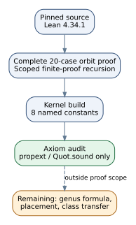

# PEXT n=7 Lean build correction (2026-10-24)

**Scope.** `EXP-PEXT-212d5c`, `H-PEXT-d536a1`, Lean 4.34.1. This is a source and proof-build validation record, not an experiment run or a scientific review. No hypothesis, evidence, experiment, or goal status changes here.

## Observation

At autoresearcher main `dcfdd16cdf7783a059ca1e6e4cc5efbf77434b7b`, `lake build CoverCensusN7` failed. `Orbit.period_three_or_twentyone` omitted the out-of-range branch of its bounded case split. `Rot7.span_sizes` and `Rot7.weight4_dim3_or_6` hit Lean's default recursion limit while elaborating their finite `decide` proofs. The failed declarations printed `sorryAx`, so their earlier source text was not a successful kernel proof. The pre-fix Git blob is `a8854d49cf`.

The correction derives `1 ≤ k ≤ 20` from the theorem's hypotheses using `omega`, explicitly discharges all 20 possible cases using the existing return and gcd lemmas, and scopes `maxRecDepth 8192` to the two finite `decide` declarations. It changes no theorem statement, finite enumeration function, spectrum list, or experiment protocol.

On the corrected source, the pinned `lake build CoverCensusN7` completed. The eight named theorem constants printed only Lean's `propext` and `Quot.sound` axioms, or no axioms. [The build log](fixed-build.log) and [machine-readable receipt](receipt.json) record the source hash, toolchain, command and each theorem's axiom set. The new `PEXT n7 Lean proof` workflow runs the same build and rejects missing reports or any extra axiom on future changes to this Lean project. Local controls accepted the intact log and rejected both a missing theorem report and an injected `sorryAx`.

## Inference and limits

The eight finite and orbit lemmas now compile without `sorryAx` under the pinned Lean toolchain. This does **not** prove the full n=7 genus-floor hypothesis. The experiment's source explicitly leaves the arbitrary sigma-set module decomposition, placement enumeration, cross-ratio invariant, genus formula and isogeny-class transfer outside Lean. The approved trial and independent scientific review remain necessary before promoting those claims. No attack-cost or security claim follows from this correction.

The atlas's current coverage mapping puts this work in `LEAD-TRF-odd-prime-ghs-cover-floor`; it records an open next step, not a completed validation of the hypothesis.
