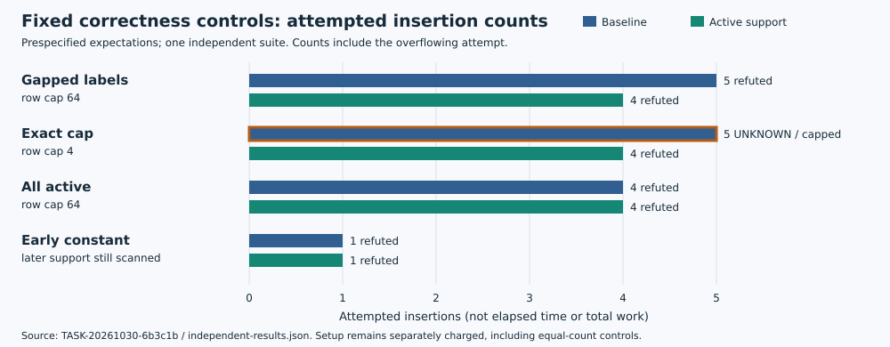

# Cold active-support implementation passes independent software checks

**DEC-20261030-af5218 · 30 October 2026 · fixed software scope**

The reviewed cold-loop change is now implemented and independently exercised. The new refuter preserves original variable labels and the ordered certificate interface; its private per-solve bridge uses the existing SAT callbacks without mutating shared modules. All six software-review joints hold. **Accept the implementation at the frozen fixture scope and select a separately frozen cost comparison next.**

## Observation

The producer completed one suite: **14 cold fixtures, 24 native slots, 392 parent assertions and 466 native assertions**. The fresh reviewer independently authored and ran one suite on the same prescribed families: **14 cold fixtures, 24 native slots and 1,387 passing named assertions**, including 50 malformed-input checks. Neither actor recorded a failed suite or retry. These assertion counts use different harness granularity; they are not added, divided or treated as statistical samples.

The independent source check compares the candidate kernel directly with raw frozen `core.refute`: only the multiplication iterator changes to increasing original active indices. Common-validation baseline outputs equal raw baseline outputs on every cold fixture. The candidate scans all generators for support, including above-cap and unvisited late generators, and records setup separately. All-active, early-constant, zero/cap, duplicate-generator, modular-zero, order and inactive-model controls passed.

The figure reads four predeclared fixture records from the independent receipt. Counts are **attempted insertions**, including the overflowing call. The exact-cap case intentionally leaves baseline UNKNOWN at attempt five while active support refutes at four. All-active and early-constant cases retain equal search counts while adding support setup. There is one fixed observation per actor, no sampling uncertainty or runtime inference. Plot data and JSON locations are in `report-inputs.json`.

## Comparison and inference

| Review joint | Recorded conclusion |
|---|---|
| Source fidelity | Exact kernel-body seam and raw-baseline dispatcher equality hold. |
| Support/setup | Original labels and eager all-generator accounting hold, including early stops. |
| Certificate/cap | Successful ordered certificates match; baseline-success implication and exact cap behavior hold. |
| Private integration | Unchanged callbacks, alternating private instances and shared identities hold. |
| Coverage/failures | Arithmetic and projected completeness checks, rejection controls and censorship semantics hold. |
| Actual execution | One independent suite, 24 declared native instances, all assertions passed. |

Each native family ran both refuters with `model_only`, `partial_prefix` and `partial_prefix_aa`. All 24 outputs were complete, with expected projected sets: positive `[3]`, negative `[0,1,2]`, empty `[]`, and auxiliary-fiber `[0]`. Checks included genuine partial assignments, empty clauses, fixed-assignment backtracking, zero-PC-budget leaf fallback, corrupted proofs/prefixes/models, missing coverage and a supplied closed-cover censored transcript. The latter remained censored. One valid auxiliary witness establishes a projected model, not every assignment in its fiber.

The environment was Python 3.12.8, python-sat 1.9.dev17 and Cadical195 with a hash-bound native library. Native slots used degree two, row cap 256, 512 PC calls, native conflict/decision budgets 20,000 per call and nine outer calls; watchdogs were five seconds per slot and 180 seconds per suite, with two GiB process address space. Timestamps are custody data. The curve `run_cell` API exists but was not invoked.

## Limits and concrete continuation

The acceptance covers these source-fidelity and fixed software checks. Prime p and frozen arithmetic semantics remain premises; parsing does not certify primality. The cold theorem's implication is one-way from baseline success: UNKNOWN is neither non-refutability nor a demand for equal behavior. The finite suite is not a universal implementation proof. Setup/events, insertions and legacy arithmetic remain different units.

The fresh reviewer intentionally read target source and old helpers, while the new producer harness/results/README/snapshot remained hidden. The unchanged native independence gate passed. Requested native gpt-6.1-sol/xhigh/fork-none remains distinct from unauthenticated serving model/provider/effective effort and capacity floors. There was no postdispatch exchange before sealing. No new paper or novelty review was performed.

The next technical dependency is a **separately frozen paired residual/whole-search comparison** retaining `quartic`, `membership`, `quadratic` and `quadratic_aa`, A/A, controls, complete projected/signed witnesses and the complementary-point reference. Its additive exporter must include per-call validation/support sidecars. It must also keep initial encoding construction **and checker-side reconstruction of the encoding**, witness reconstruction/checking, private loading, diagnostic copying/checkpoints, serialization, memory and failures. The old exporter omits the new sidecar; reusing it unchanged would omit setup. A timing claim requires its own frozen clock/isolation evidence. Warm reuse and bookkeeping remain separate factors. This decision does not design, approve or launch that experiment.

Earlier raw even-s grouped regularity acceptance remains intact: under its stated hypotheses, `d_reg=1+3s/2` in **2s variables** versus `s+1` in **3s variables**, with the qualified mutant-closure upper bound (DEC-20261029-0857a9). This software package changes no degree frontier, lead disposition or H/EXP/EV/KN/goal status. Complete shared-coefficient signed charts remain the separate continuation. Corpus promotion is not warranted by this fixed instrument check.

## Sources and custody

Producer TASK-20261030-e8280b: source publication `3d4d18598a7d7585cc2b085c5ed4e4c7380054e0`; 15-path snapshot `881f4ae2a91fdc84b29be5f20181e8aac90fd50c`. Independent TASK-20261030-6b3c1b: publication `31ce804453`, completed release `bc34a35380`. Detailed [review](../../../research/prime_sat_active_support_implementation_20261030/TASK-20261030-6b3c1b/review.md), [receipt](../../../research/prime_sat_active_support_implementation_20261030/TASK-20261030-6b3c1b/independent-results.json), [contract](../../../coordination/prime_sat_active_support_implementation_20261030/software-contract.json) and [decision](../../../ledger/decisions/DEC-20261030-af5218.yaml) retain exact boundaries.

Coordinator parsed both receipts, verified all reviewer artifact hashes and all 17 before/after source bindings, without rerunning tests or checkers. The producer receipt retains its exact JSON content through a verified S3 gzip pointer; the independent receipt is inline. `report-inputs.json` binds actual gate, storage and source provenance and lists canonical graph sources checked unchanged. Root-owned rendering, all-page inspection, exact ten-path archive and final publication remain pending at composition.
