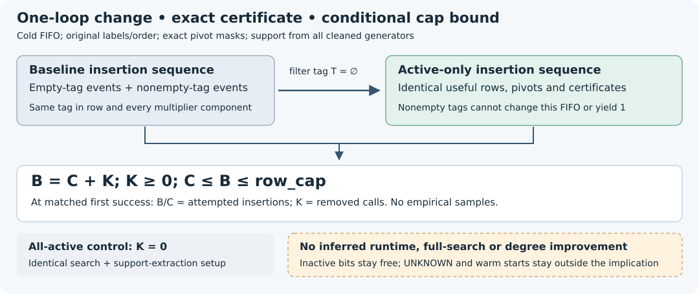

# Cold active-support certificate preservation

**DEC-20261030-722a2d · IDEA-20261030-b6f05e · TASK-20261030-94b46f**  
Scoped manual source derivation; one independent reviewer, two sealed phases; zero new runs.

**Approve the exact cold source implication for archival use.** If the bound baseline `refute` routine succeeds, changing only its multiplication loop to the original increasing active-variable indices produces the **identical ordered multiplier certificate**, with no more attempted insertions and within the same row cap. All seven review joints hold, and the unchanged native independence checker passed. An actual implementation and any cost benefit remain to be tested under a later admission.

## The statement and why it holds

Work in the Boolean quotient over a prime field. Clean every ordered input generator modulo the prime, and let A contain every variable appearing in any cleaned generator, including generators above the degree cap. Keep original variable and generator labels, exact leading-mask order `(bit_count, mask)`, the cold empty basis, FIFO, limits, normalization and early stopping. Count insertion attempts **before** cleaning and degree rejection, including zero, dependent and over-degree calls. Primality and valid canonical integer masks are premises.

Every baseline row and each component of its multiplier vector have one exact inactive-variable mask T. Active multiplication preserves T; inactive multiplication adds to it. Equal pivot masks can only reduce rows with the same T. Thus nonempty-T rows cannot change the empty-T basis or create a constant. Filtering baseline insertion events and FIFO to T empty gives precisely the active-only trace, in the same order and with the same arithmetic and certificates.

At the matched first success, let B and C count baseline and candidate attempted insertions. The ordered event injection gives **B = C + K**, with K the number of removed calls and K ≥ 0. Every candidate prefix is within the baseline successful prefix, so **C ≤ B ≤ row_cap**. This is a call-count identity conditional on success, not a measured speedup, rank comparison or complete polynomial-calculus theorem. Inactive model bits stay free: active solutions extend by every inactive Boolean assignment.

The diagram is symbolic and not to scale. It displays the proved relation and its all-active equality control; there are no samples, timings or empirical uncertainty bars in this review. Source: `research/prime_sat_five_tests_20261029/core.py`, SHA-256 `c67fc44404b282ac963f1021a4b6197ebbb4a8bf382c70a2576db45172065a4f`.

## What the review checked

| Reviewed joint | Finding |
|---|---|
| Algebraic identity | Inactive-zero specialization fixes generators; identities lift at original labels; inactive model coordinates remain free. |
| Source invariant | Rows and all certificate components share T; exact pivot equality preserves the partition. |
| Ordered simulation | The empty-T FIFO subsequence is the literal candidate trace, including duplicate/dependent generator attempts. |
| Cap semantics | Pre-clean/pre-degree counting, early constants, zero caps and overflow give C ≤ B on baseline success. |
| Negative controls | All-active overhead, empty support, order dependence and invalid transfer to mixed warm starts are explicitly worked. |
| Models and costs | No equality of UNKNOWN results, whole-search paths, ranks, arithmetic totals or total runtime follows. |
| Producer comparison | The revealed notes agree on the cold theorem; no blind proof correction was needed. Additions remain labeled post-reveal. |

All-active support gives K = 0 and adds support-extraction work. For an explicit symbolic ordering control over any odd prime, take f = 1+x+y, g = xf−1 and h = yf−1 at degree cap two. Multiplying the first queued row by x versus y first yields different first-success certificates `(x,−1,0)` and `(y,0,−1)` at the fourth insertion. This is a handwritten control, not a software execution. The mixed warm start `(1+y)x` for input x breaks the tag invariant outside the cold premise. Divisibility-based pivot rules are likewise a different algorithm. A different definition of support from accepted initial rows would need its own span argument; the review does not declare all such variants false.

## Evidence quality and remaining work

The reviewer sealed its derivation before seeing the producer YAML and notes. Blind producer comparison remained unresolved; final comparison became holds only after release. The native gate passed at 18:06:52 UTC on 30 October 2026. Seven artifact hashes and nine bound source/checker hashes match current bytes. This is one reviewer in two phases. The gate checks bytes and declared chronology, not undisclosed reads, authenticated wall clocks or serving-model identity. Native `gpt-6.1-sol/xhigh/fork-none` was requested under an explicit fallback amendment; actual provider, model and effective effort remain unverified. Policy-output truncation/repeated reads and timing limitations are disclosed.

The result concerns the stipulated one-loop source variant. Queue exhaustion still returns UNKNOWN; it is not a non-refutability certificate. No strict insertion saving or changed capped result is exhibited here. Support extraction, construction, restriction, search, proof production/checking, reconstruction, failures, memory, serialization and I/O all remain chargeable. Parent-row reuse and callback bookkeeping are separate factors. There is no new degree-of-regularity, formal-proof, novelty, runtime, exponent or scalar-recovery result.

The earlier accepted raw even-s grouped presentation result remains intact: under its stated assumptions, d_reg changes from 1+3s/2 in 2s variables to s+1 in 3s variables; its mutant-closure upper bound does not establish a strict actual solving-degree or runtime gain (DEC-20261029-0857a9). The digit/shared-coefficient lead rows and relevant frontier rows were inspected and left unchanged: this local source lemma changes no general frontier bound or lead disposition. No H/EXP/EV/KN or goal status changes, and no corpus promotion, are warranted here.

**Next concrete design:** implement only the reviewed cold loop change and its correctness controls, then freeze a paired residual/whole-search cost comparison retaining **quartic, membership, quadratic and quadratic_aa**, A/A, controls, complementary-point reference, complete projected sets and signed rational witnesses. Isolate optional warm reuse/bookkeeping. Preserve all cost phases and censored outcomes. This recommendation admits no execution or unchanged scaling. Complete shared-coefficient signed charts plus interval idempotent membership remain the next separate lane; coefficient coupling modulo variable U precludes inferring a degree bound from idempotent notation.

The exact gate and custody receipts are embedded in `report-inputs.json`. Root's post-merge scoped hygiene passed for 22 paths; full ledger validation refused the sparse checkout (45,163 off-disk paths), without override. A continuation checkpoint passed PUT/fresh-GET byte comparison but excludes these unfinished report outputs and has no tested restore. PDF inspection, the exact 23-path archive and final publication remain pending at composition. GOAL-PFDR-fd09e0 remains active.
