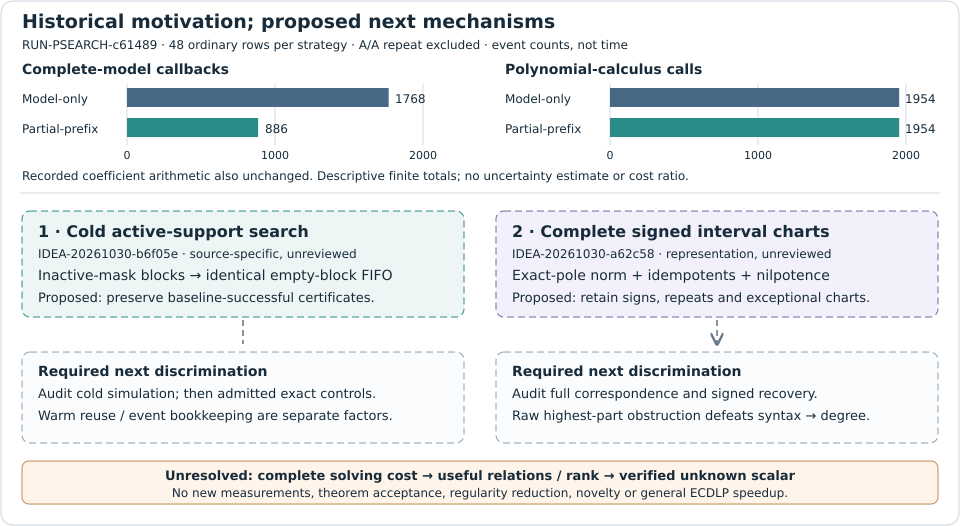

# Two structural continuations for prime-field decomposition

**2026-10-30 · Proposals published; scientific acceptance is false and novelty is unverified.** This report records a theory/source search under GOAL-PFDR-fd09e0, RQ-PFDR-ae2fba and BATCH-a99822. Generator TASK-20261030-12cc63 produced two proposals; snapshot TASK-20261030-9216da owns this report. No new experiment, solver invocation, implementation or independently reviewed theorem was produced.

The first priority is **cold active-support certificate search**, because it targets a concrete arithmetic routine in the existing solver. The second is **complete signed divisor charts with interval membership**, a representation proposal whose correspondence must be established before a solving comparison. Both use the explicitly authorized factor-base/decomposition exception; neither claims an escape from the program's object-class barriers or a general ECDLP algorithm.

The upper panels reproduce recorded event counts from RUN-PSEARCH-c61489 / EXP-PSEARCH-3ea9fe / DEC-20261030-0c834c: sums over 48 ordinary rows per strategy, excluding the strategy A/A repeat. Its 12 inputs were F17: y²=x³+2x+2 and F97: y²=x³+x+4, digit widths 2,3 and the first three target x representatives. These descriptive counts have no population uncertainty estimate. Recorded coefficient arithmetic also remained unchanged. The lower dashed paths are **proposed**, not measured improvements. No new numerical data justify a new performance plot.

## 1. Cold active-support search — proposed, source-specific

[IDEA-20261030-b6f05e](../../../ledger/proposals/IDEA-20261030-b6f05e.yaml) and its [derivation](../../../ledger/proposals/IDEA-20261030-b6f05e.notes.md) retain original bit labels, generator order, pivots, FIFO processing and cap semantics. Let A contain every variable occurring in any cleaned residual generator, including generators above the row-degree cap. Multiply queued rows only by variables in A; keep inactive bits free in the original model domain.

Standard specialization of absent variables preserves certificate identities and degree. The stronger **unreviewed cold-source simulation** groups rows and all certificate multipliers by their inactive-variable mask. Exact pivots prevent cross-block reduction; a nonempty block cannot produce 1. The empty-block FIFO subsequence is therefore proposed to match active-only search exactly, so every baseline-successful certificate appears within no more attempted insertions under the same row cap.

This is not completeness of the selected-echelon engine. UNKNOWN outcomes, ranks, future learned clauses and whole SAT trajectories may differ. The full-support case offers no removable blocks and adds support-extraction overhead. Parent-row specialization/re-elimination and event-driven prefix bookkeeping are **separate optional factors**; a mixed-mask warm start falls outside the cold simulation premises.

**First discriminating check, not a launch:** independently audit the block induction against the bound source, then prospectively admit exact-certificate and cap-boundary controls. Any valid baseline-successful cold case that loses its certificate falsifies the scoped simulation. Only a separately frozen whole-search comparison can assess cost, retaining all four encodings, full projected sets, signed witnesses, fallback, complementary-point reference, A/A and isolated optional factors. Charge support extraction, failed rows, proof copying/checking, memory, callbacks and I/O. A local monomial-universe reduction is not an actual matrix-size, runtime or regularity result.

## 2. Complete signed charts and interval bits — proposed representation

[IDEA-20261030-a62c58](../../../ledger/proposals/IDEA-20261030-a62c58.yaml) and its [derivation](../../../ledger/proposals/IDEA-20261030-a62c58.notes.md) address E/Fp: y²=f(x)=x³+ax+b, p>3, nonsingular. The algebraic correctness domain includes two-torsion; cryptanalytic interpretation retains a prime-order target and separately justified subgroup support. No particular new curve was tested.

For k affine summands among five, use h=A+B·y with exact pole order d=k+1 for finite R=(r,sR), imposing h(−R)=0; use d=k for R=O. Normalize the highest-pole term. With c=1 for even d and −1 for odd d, encode c(A²−fB²)=(X−r)U for finite targets, or U=c(A²−fB²) for identity targets. U is monic of degree k. Include the all-identity case and absent pole-one chart explicitly. Recover the **signed** zero divisor of h, subtract exactly one −R for a finite target, and pad with identities. Target overlap, common A/B roots, inverse pairs, tangencies and repeated roots cannot be discarded. Rational descent, complete local recovery and characteristic-five factorization remain proof obligations.

For an interval I=t+[0,2^s) modulo p, with 2^s<p, work in Q=Fp[X]/U and introduce idempotents e_j. Put n=X−t−Σ2^j e_j and require e_j²=e_j, n^k=0, and [f(f^((p−1)/2)−1)]^k=0 in Q. Root evaluation and standard local-ring/CRT facts motivate interval and rational-ordinate support, including multiplicities. Replacing n^k=0 by n=0 loses repeated-root cases. Signed recovery uses bounded-degree factorization and local orders, not a concealed scan of all p coordinates. Every construction, factorization attempt, square root and recovery cost remains chargeable.

**Degree obstruction, derived but unreviewed:** for Q=F5[z]/z², X=1+z and e=a+bz, the coefficient equations of e²−e and (X−e)² have the unique affine solution (1,0), yet their highest homogeneous parts generate (a²,ab). Thus b^D survives at every positive degree: the first degree at which that raw highest-part ideal contains the entire graded component is not finite. This is not Castelnuovo–Mumford regularity or an actual solving-degree/SAT-time lower bound. Variable-U reduction couples coefficients; idempotent notation does not make the joint equations quadratic. Introducing quadratic gates changes the presentation and its cost.

The optional translated-interval population argument is also unreviewed: Hasse plus averaging suggests expected at most seven **charged full interval scans** to find at least 2^s/8 rational x coordinates for a whole prime-order curve with p≥17. It says nothing about useful relations, rank or scalar recovery. First audit the complete correspondence and exceptional controls; a later complete tiny signed census and matched five-point encoding comparison need separate admission. Permutation savings alone, circuit size or a populated base do not establish a solver advantage.

## Filing, provenance and limits

Root accepted schema completeness and actual-match positioning after **three returns**, at 16:44:43 UTC. Repairs addressed malformed flow-YAML claim fields, schema-inadmissible IDEA identifiers in the nearest-reference block, and explicit discussion of actual lexical matches. Predecessor comparisons remain in the notes; claim/mechanism strings were retained during match reconciliation. Filing acceptance is not scientific review. The generator receipt's earlier revalidation-pending field is preserved; the subsequent root acceptance is separately bound in report-inputs.json.

The generator reports reading Stacks [00J4](https://stacks.math.columbia.edu/tag/00J4), Lemmas 10.53.2/6, [07BH](https://stacks.math.columbia.edu/tag/07BH), Lemma 10.18.3, and Sutherland [Lecture 23](https://math.mit.edu/classes/18.782/2023sp/LectureNotes23.pdf), Theorem 23.3 pp.1–2, and [Lecture 7](https://math.mit.edu/classes/18.783/2023/LectureNotes7.pdf), Theorem 7.3 pp.1–2. These support standard foundations, not the complete new claims. PC-restriction prior art was available only as a primary search excerpt with direct access denied; incremental-SAT prior art was abstract-only. These are recorded source scopes, not new primary retrieval by this report's author. Full novelty clearance and independent proof review remain absent.

Requested inference was research-deep / Sonnet high; prospectively admitted native Codex fallback was used. Serving model, provider, effective effort and capacity are unverified; no Sonnet/Opus execution or independent-review claim is made. Source publication b01b60dd80b3b7f31044b6604dd5c9228ebbf9e0 and completed release 7a31b80b6b5359bcafdc3141bbe1d5193983b392 precede this claimed report. Exact hashes, actual filing/native amendment receipts and source qualifications are in [report-inputs.json](report-inputs.json).

Read-only checks covered the digit and shared-coefficient lead records, relevant frontier rows and the prior PSEARCH report/graph. They remain unchanged because this task accepts no scientific result or revised historical observation. The broader sparse repository was not fully validated; the reported full-ledger refusal is retained. No H/EXP/EV/KN/DEC/goal transition or new trial approval occurs. General prime-field ECDLP speedup, unknown-scalar recovery, complete end-to-end advantage and a new regularity reduction remain unestablished. Current PDF rendering, every-page inspection and exact twenty-path archive are root-owned pending steps at composition.
