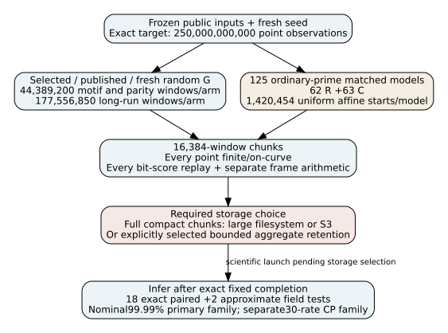
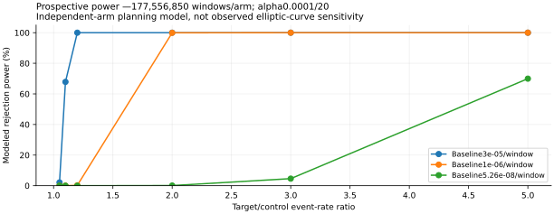

# 250-billion campaign preparation —12 October2026

**Preparation and engineering observations only. The250-billion scientific run
has not been launched.** Its required data destination/retention choice is
pending. No new scientific rates, p-values, or completed250-billion result are
claimed. The prior completed study remains PR2108.

## Prepared scope

The exact target is250,000,000,000 point observations in976,562,500 window
observations, from443,892,000 independent-start draws. Points within windows
are dependent and named cohorts share their start. Each256-point window
records x bit64 and exact run/parity/motif integer scores. Actual published
generators and fresh public random generators remain matched controls.

| Population | Windows/cohort or model | Cohorts/models |
| --- | ---: | ---: |
| P-192 motif |44,389,200|3|
| P-224 parity |44,389,200|3|
| P-224 long run |177,556,850|3|
| Ordinary-prime matched models |1,420,454|125|

62 R and63 C models use every nonsingular/liftable field in the frozen144+144
P-224 pools:61 more coefficient/step-x models than the previous64. They reuse
existing primes, match A=-3, B and step x=2^64+2, and do not match group/step
orders. Exact p,A,B,N, published/selected points, subgroup identities and model
UIDs are in `inputs.json`. PARI exact primality/cardinality plus separate Python
[N]H checks passed for all125; control selection uses no new window outcome.

## Prospective inference and power

The primary family contains18 exact paired McNemar contrasts: generator
contrasts for motif/parity and long-run thresholds22,28,30,32; plus2 approximate
Welch comparisons of selected run≥22 versus62/63 ordinary-field rates.
Alpha0.0001/20 gives nominal99.99% family confidence, with a field-approximation
caveat. A separate30-marginal-rate CP family uses alpha0.0001/30, covering the
eight fixed long-run thresholds and motif/parity rates. The union is nominal
99.98% subject to Welch approximation. Infer only after the exact target.

**Derived planning model:** doubling a1e-6 baseline has about99.93% power for
the long-run cohort. Doubling the fair-coin run32 reference~5.26e-8 has only
about0.104% power. Larger samples constrain more of the rare-rate range; they
do not eliminate every localized/rarer effect. Actual paired dependence can
change power. Fair-coin probabilities are benchmarks, not an IID assumption
for curve-point bits. No ECDLP or prime-family causal claim follows.

## Checked implementation and pending storage

The runner retains exact event joint/marginal counts, freezes source/config
and storage at launch, and uses sealed write-once chunk records. It tests every
point on-curve and finite and independently replays every bit-string score.
Separate Python frame arithmetic checks starts, public rG, recurrences and the
universal x-triple law. Full retained compact chunks are hashed after lossless
compression and confirmed at the destination before releasing new scratch.
Failed attempts remain. A bounded scheduling queue stops new work on failure.

Five engineering tests passed with distinct small engineering streams:
exact target/joint counts; native frame caps/full-coordinate stream hashes and
an intentional resource stop; bad S3-checksum preservation with a fake client;
13,312-point14-job end-to-end aggregate/resume/analysis/corruption fixture.
An independently counted tiny-curve fixture with a proper order-two step
produces256-bit zero runs, checking the positive run≥28 frame path separately
from selected-event flags.
The fake client validates code logic, not live AWS authentication. The first
engineering run correctly refused resume when a simultaneously prepared power
file changed the source hash; the sequential rerun passed. No scientific stream
was consumed. Implementation independence is within one session, not a separate
research review.

**Observed dependency:** the32 GB working filesystem has about550 MB free,
and current managed runtime revision121 has no configured AWS outbound identity.
Full compact data are expected to need~60 GB; reserve~70 GB on a filesystem.
The user was asked to choose S3, a larger filesystem, or explicit bounded
aggregate retention. Aggregate mode preserves exact sufficient counts and fixed
full witnesses/examples, while most individual bit strings/scalars are not
stored for later arbitrary ML searches. That choice is required at launch.
See [named storage obstruction](../../../problems/solinas-250b-storage-unavailable.md).

The included CLI supports uninterrupted execution and exact resumption without
an agent per chunk. The machine must remain active. Runtime estimates from the
prior97.5-minute5.91-billion run suggest days on this host; estimates are
advisory runtime facts, not speedup or ECDLP-cost claims. No old raw data,
archive, receipt, report, canonical mechanism or official scientific status
was changed. Prior PR2108 report/diagram and the frontier schema/inventory were
checked; this preparation adds no verified mechanism to a canonical graph.

## Internal source records

- [Protocol and standalone commands](../../../tasks/solinas_250b/README.md)
- [Exact public inputs](../../../tasks/solinas_250b/inputs.json)
- [Control preparation](../../../tasks/solinas_250b/control-preparation.json)
- [Prospective power](../../../tasks/solinas_250b/power-plan.json)
- [Engineering tests](../../../tasks/solinas_250b/test_campaign.py)
- [Completed predecessor](https://github.com/aburan28/crypto-autoresearcher/pull/2108)

Sources are internal artifacts read/produced in this session, with exact source
hashes. No external literature novelty claim or scientific-state transition.
