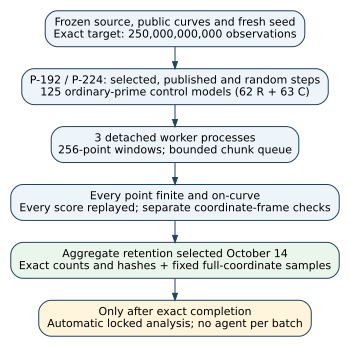
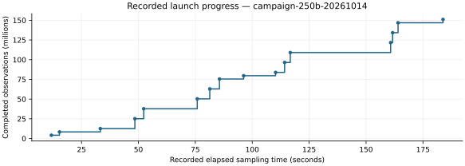

# 250-billion campaign launch — 14 October 2026

**Execution observations only. The campaign was running at this snapshot;
the 250-billion study is incomplete.** No interim significance test, scientific
verdict or security claim is reported.

Measured snapshot: `2026-10-14T14:41:33.286299+00:00`. **150,994,944 point observations**,
16 of 27,133 chunks, 589,824
window observations and 262,144 start draws.
All 150,994,944 native finite/on-curve checks passed. All 16 completed chunks
passed independent score replay and separate coordinate-frame arithmetic checks.
Zero failed attempts and zero infrastructure stops were recorded at the snapshot.
Completed-chunk process CPU time sums to 506.049
seconds (measured; excludes in-flight chunks). Three worker processes remained active.





The graph contains recorded progress values only, sourced from the fixed launch
publication's `progress-series.json`. It has no statistical uncertainty interval:
these are exact completed-observation counters, not estimated population rates.
Points inside a window are dependent; named cohorts share starts. The target does
not mean 250 billion independent or distinct field points.

## Fixed remaining scope

| Population | Planned windows per cohort/model | Cohorts/models |
| --- | ---: | ---: |
| P-192 motif candidate | 44,389,200 | 3 |
| P-224 parity candidate | 44,389,200 | 3 |
| P-224 long-run candidate | 177,556,850 | 3 |
| Ordinary-prime controls | 1,420,454 | 125 |

Exactly 976,562,500 window observations × 256 points = 250,000,000,000 point
observations, from 443,892,000 independent-start draws (derived prospective
arithmetic). Named steps are selected H, actual published G, and fresh public rG.
The 62 R and 63 C models include every eligible model in the frozen ordinary-prime
pools; primes are reused from earlier work. Coefficients and step x are matched,
group/step orders are unmatched. All 125 field/cardinality preparations passed
PARI checks and separate Python [N]H checks before launch.

The fixed primary family has 18 exact paired generator contrasts and 2 approximate
field comparisons. Alpha 0.0001/20 gives nominal 99.99% family confidence, subject
to the field-test approximation. The separate 30-rate CP interval family is nominal
at least 99.99% under independent windows. Their union is nominal 99.98%, subject
to the same approximation. No final tests or rate intervals exist yet; the analyzer
runs only after exact completion. No outcome-based stopping or sample enlargement.
These counts do not resolve every ultra-rare or localized effect.

## Retention and reproducibility

**Aggregate mode is running.** It retains exact marginal/joint event counts,
descriptor sums/squares, source and stream hashes, sealed per-chunk validity records,
and prospectively selected full-coordinate witness/example frames. Most individual
bit strings/scalars are not saved for later arbitrary ML searches. Full compact
retention remains an open storage requirement: approximately 60–70 GB, versus
about 550 MB initially free and no configured managed AWS identity. Old datasets
and archives remain intact. See the [storage problem](../../../problems/solinas-250b-storage-unavailable.md).

Source commit `068797c4d5d59c9e73531f751e820c9250fe7c9a` was pushed before sampling. The base
was `89c01354bcd0a89585b490629055c7144f256127`; its merge preserved already-published upstream files.
The runtime dirty tree contained only the untracked preparation report and new
launch-publication directory; frozen scientific source files were unchanged.
Python 3.12.14, NumPy 2.3.5, SciPy 1.17.0;
OpenSSL 3.5.7 9 Jun 2026 (Library: OpenSSL 3.5.7 9 Jun 2026). Model/policy/usage metadata were not exposed and remain null.

Exact launch command, with OPENBLAS_NUM_THREADS=1 and OMP_NUM_THREADS=1:

```sh
/workspace/solinas-runtime/report-venv/bin/python /workspace/solinas-250b/tasks/solinas_250b/campaign.py --output /workspace/solinas-250b/tasks/solinas_250b/runs/campaign-250b-20261014 --storage aggregate --workers 3
```

The detached PID was 1168 and had parent PID 1 at the snapshot. The machine
must remain active. The identical command resumes sealed work after interruption;
source/config/storage changes or corrupt records are refused. Completion and final
analysis are automatic, without an agent per batch. Runtime is expected to take
days on this host; this is advisory, not a performance or attack-cost claim.

## Immutable records and next action

- [Launch and exact command](../../../tasks/solinas_250b/publication/launch-20261014/launch.json)
- [Fixed progress snapshot](../../../tasks/solinas_250b/publication/launch-20261014/progress-at-snapshot.json)
- [Snapshot checksums and chunk records](../../../tasks/solinas_250b/publication/launch-20261014/manifest.json)
- [Protocol and standalone script](../../../tasks/solinas_250b/README.md)
- [Exact identities and parameters](../../../tasks/solinas_250b/inputs.json)
- [Prospective power record](../../../tasks/solinas_250b/power-plan.json)
- [Historical preparation report](../solinas-250b-20261012/report.md)
- [Completed predecessor PR 2108](https://github.com/aburan28/crypto-autoresearcher/pull/2108)

P-192 identity: urn:ec-record:1:sha256:b4bdde6340ec696e5fa11f3baf1ef941462bc731a526029d2bdc9dc49812aa4b.
P-224 identity: urn:ec-record:1:sha256:e2397ca7cfb5bfad66d0ec042758a09a0ee496e566266b793d2a9f36cf555484.
Sources are internal artifacts, read in this session. This launch changes no
canonical mechanism graph or official research status. The next action is to
finish the fixed campaign and publish its sealed completion and locked analysis
in a fresh report. This PDF is a launch snapshot, not a final-results report.
