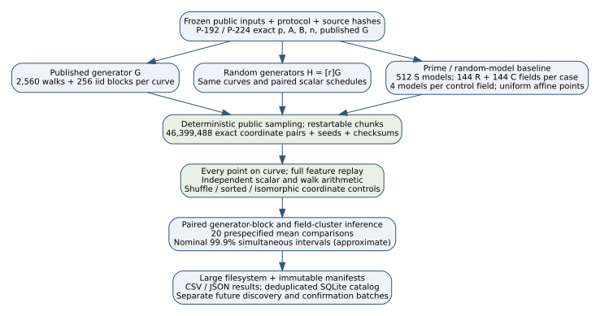
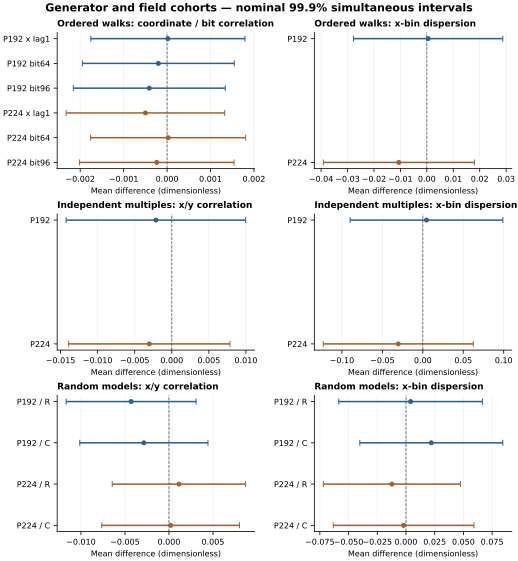

# Solinas primes: random and published generator cohorts

2026-10-12. Measured observations from `cohorts-20261012`, frozen source
`18e4cca389b76f208b8fec37c1f0c73eb24a1f1c`. Derived report, with no hypothesis promotion.

**Measured:** None of the 20 corrected intervals excludes zero. These data did not resolve a mean difference in the prespecified features. This concerns tested mean features on two exact standard
curves and the specified random-model controls. It does not establish equality,
exclude rare or higher-order patterns, or measure relative ECDLP resistance.

## What the two cohorts mean

**Derived:** the prime defines F_p, a field of residues. A and B then define
the curve y²=x³+Ax+B. A generator G picks an ordering of its group of points.
These are three choices. P-192 uses p=2^192-2^64-1; P-224 uses
p=2^224-2^96+1. Their group orders n are different integers from p. Both exact
standard curves have prime n and cofactor one.

**Derived:** on a prime-order curve every H=[r]G with 1≤r<n is a generator.
Multiplication by r permutes the nonzero residues modulo n. Therefore uniform
k in 1..n-1 makes [k]G and [k]H have exactly the same point distribution. This
does not depend on numerical coordinate conventions. Uniform-multiple samples
are calibration checks for this identity. In an ordered walk the next point is
Q+G or Q+H, so the ordering can depend on the generator. Its consecutive points
are dependent and need block-level inference.

**Measured design:** per standard curve and generator cohort, 2,560 paired
random-start walks ×4,096 =10,485,760 points, plus 256 paired independent-multiple
blocks ×1,024 =262,144 points. Each random cohort block uses a fresh H=[r]G.
The published cohort uses the exact official G and the same public scalar
schedule. Random-model baseline: 512 models at each fixed S prime; 144 R fields
and 144 C fields per case, four models/field, 1,024 uniform affine points/model.
Controls are same-bit primes within ±1%; C also matches p mod 12. All random
models remain included, without order selection. Those points are not labelled
generators of potentially noncyclic groups. These reused fields are 578 distinct
primes, including the two fixed standard primes; they are not new field draws.

**Identification limit:** official G exists on its own standard curve. Its
coordinates cannot be assumed valid on random-prime curves. Published-vs-random
G comparisons hold the standard curve fixed; random-prime controls address the
random-model population separately. This does not identify a general prime-by-G
interaction. Standard coefficients, prime group order, and generator selection
can all differ from arbitrary models. C does not match the enormous 2-adic
valuations of P-192 p+1 or P-224 p-1.



## Sampling size: fraction, coverage, precision, and power

**Derived:** n_sample/N is called the *sampling fraction*. A fixed fraction of
a 192-bit population is infeasible and is not necessary for estimating broad
distribution statistics. For simple random sampling without replacement the
finite-population correction is sqrt((N-n_sample)/(N-1)); it is effectively one
at these scales. This correction does not turn dependent walks into iid draws.
For P-192, p is about 6.28×10^57. Ten million points are a fraction about
1.6×10^-51 of that size; the number of independent walks is 2,560.

**Derived:** *power analysis* sizes a test for a chosen effect, variance,
confidence and power. *Rare-event detection* sizes a sample for a recognizable
event with probability q. With independent draws, at least one event at 99.9%
confidence needs ceil(log(0.001)/log(1-q)) draws:

| Event probability q per independent draw | Draws for ≥99.9% detection |
|---:|---:|
| 0.01 | 688 |
| 0.001 | 6,905 |
| 0.0001 | 69,075 |
| 1e-06 | 6,907,752 |

These are hypothetical recognizable events, not measured failures. For rare
generator types the draw is a generator, not one of its walk points; for rare
field types it is a new field. If q scales as 1/p, sample size scales as p.
An effect occurring in one point out of the whole field will not be located
by a few million points. Uniform marginal distributions are equal across
generators by the bijection above, irrespective of sample size. A targeted
coefficient or scalar family needs a targeted prospective cohort.

## Prespecified comparisons and uncertainty

Walks: x lag-1 correlation; exact x bits64/96 lag-1 correlations; 32-bin x
dispersion (Pearson chi-square divided by 31). Independent multiples and random
models: x-bin dispersion and x/y correlation. The latter measures a mean
feature, not all joint coordinate dependence. All values are dimensionless.

Two cases ×(4 walk +2 iid +4 field)=20 comparisons. Individual nominal confidence
99.995%, Bonferroni familywise nominal confidence 99.9%. Paired Student intervals
on generator blocks; Welch intervals on S random-model draws versus control
field means. They are approximate intervals, not guaranteed exact finite-sample
coverage. S has one fixed prime per case; 512 models do not create 512 primes.
Official G is one fixed instance; 2,560 starts do not create 2,560 official Gs.
Columns Δ90% are variance-based approximate 90%-power detectable mean differences
with this multiplicity. They do not express sensitivity to every pattern.



| Case | Population | Metric | Control | Difference | Corrected interval | Independent units L/R | Δ90% |
|---|---|---|---|---:|---|---:|---:|
| P-192 | walk | x_lag1 | random-generators | 1.94461e-05 | [-0.00175563, 0.00179452] | 2560/2560 | 0.002335 |
| P-192 | walk | bit64_lag1 | random-generators | -0.000200669 | [-0.0019492, 0.00154786] | 2560/2560 | 0.0023001 |
| P-192 | walk | bit96_lag1 | random-generators | -0.000408787 | [-0.00215879, 0.00134122] | 2560/2560 | 0.0023021 |
| P-192 | walk | x_bin_dispersion | random-generators | 0.000495566 | [-0.0277513, 0.0287424] | 2560/2560 | 0.037157 |
| P-192 | iid | x_bin_dispersion | random-generators | 0.00453629 | [-0.0898165, 0.0988891] | 256/256 | 0.12366 |
| P-192 | iid | xy_correlation | random-generators | -0.002146 | [-0.014252, 0.00996] | 256/256 | 0.015866 |
| P-192 | random-model affine points | x_bin_dispersion | R fields | 0.00405632 | [-0.0585076, 0.0666203] | 512/144 | 0.082157 |
| P-192 | random-model affine points | x_bin_dispersion | C fields | 0.0220545 | [-0.0401928, 0.0843017] | 512/144 | 0.081743 |
| P-192 | random-model affine points | xy_correlation | R fields | -0.00429829 | [-0.011682, 0.00308546] | 512/144 | 0.0096962 |
| P-192 | random-model affine points | xy_correlation | C fields | -0.00284988 | [-0.0101336, 0.00443384] | 512/144 | 0.0095654 |
| P-224 | walk | x_lag1 | random-generators | -0.000498163 | [-0.00232386, 0.00132753] | 2560/2560 | 0.0024016 |
| P-224 | walk | bit64_lag1 | random-generators | 2.40615e-05 | [-0.00176102, 0.00180914] | 2560/2560 | 0.0023482 |
| P-224 | walk | bit96_lag1 | random-generators | -0.000237753 | [-0.00201888, 0.00154338] | 2560/2560 | 0.002343 |
| P-224 | walk | x_bin_dispersion | random-generators | -0.0105831 | [-0.039162, 0.0179958] | 2560/2560 | 0.037594 |
| P-224 | iid | x_bin_dispersion | random-generators | -0.0303364 | [-0.123039, 0.0623664] | 256/256 | 0.1215 |
| P-224 | iid | xy_correlation | random-generators | -0.00303993 | [-0.0139248, 0.00784488] | 256/256 | 0.014266 |
| P-224 | random-model affine points | x_bin_dispersion | R fields | -0.0122779 | [-0.071982, 0.0474262] | 512/144 | 0.078398 |
| P-224 | random-model affine points | x_bin_dispersion | C fields | -0.00207126 | [-0.063298, 0.0591555] | 512/144 | 0.080387 |
| P-224 | random-model affine points | xy_correlation | R fields | 0.00113422 | [-0.00644445, 0.00871289] | 512/144 | 0.0099541 |
| P-224 | random-model affine points | xy_correlation | C fields | 0.000188557 | [-0.00763592, 0.00801303] | 512/144 | 0.010276 |

## Calibration and coordinate controls

First 32 blocks/cohort/case (64 per case): shuffle identical point sets as a
negative ordering control; sort x as a deliberately correlated positive control;
map the same points by (x,y)->(4x,8y) into the isomorphic model
(A,B)->(16A,64B). These are descriptive diagnostics outside the primary family.
The isomorphism preserves the group but can change numeric coordinate features.

| Case | Blocks | Shuffled mean x lag1 | Diagnostic 99% interval | Minimum sorted lag1 | Mean absolute lag1 change under u=2 |
|---|---:|---:|---|---:|---:|
| P-192 | 64 | -0.0018663 | [-0.0069502, 0.0032177] | 0.9999996 | 0.018853 |
| P-224 | 64 | -0.0034606 | [-0.0084152, 0.001494] | 0.9999996 | 0.017487 |

**Software-verified:** all 46,399,488 points satisfy
their exact curve equations; all 14,592 raw-file checksums
and features replay correctly; 163,840
dispersed transitions and 768
scalar multiplications match separate affine integer arithmetic. Isomorphic
checks cover 524,288 transported points.
This is same-session software verification, not independent scientific review.
Seven prelaunch unit tests and restart/corruption/configuration/concurrent-writer
engineering checks passed. No failed job was silently discarded.

## A script you can run over time

**Implemented and exercised:** standalone Linux/Python/OpenSSL runner with public
deterministic seeds, no model/network requirement during execution, fixed queue,
atomic immutable chunk publication, checksums and restart. Every batch preserves
its executable source. `run_batch.sh OUTPUT SEED WORKERS` runs measurement,
verification and analysis. A changed source/config refuses resume; use the
frozen `source/` copy to replay an old batch. A new seed needs a new directory.

```bash
bash bootstrap.sh
bash run_batch.sh /large-filesystem/ec-study/batch-0001 batch-0001 3
.venv/bin/python catalog.py --root /large-filesystem/ec-study --output /large-filesystem/ec-study/catalog.sqlite
```

Use cron, systemd or your compute queue for future fixed batches. The SQLite
catalog deduplicates identical seed/design copies and retains field/model/G
identities, supporting clustered statistical analysis or ML splits. All exact
raw coordinates remain on the large filesystem. A default batch is
2,412,773,376 bytes of coordinates plus metadata. Measured run wall
time 577.7s and summed job CPU time
1654.7s are descriptive timings on this machine,
not a computational security bound.

New seeds add point/start/generator replicates at fixed inputs; they do not
increase independent primes. Use held-out confirmation seeds after discovering
a feature, and group ML splits by physical field/curve where appropriate. Do not
pool individual walk points or declare repeated batches to have one-batch 99.9%
global confidence. Predeclare pooled or sequential inference before extending
claims. A family-wide prime interaction needs a separate expanded input design.

## Exact identities, sources and archive

**Internal/retrieved provenance, checked by this measurement session:** public
input constants and field pools from EXP-ECDLP-5184f7/RUN-ECDLP-d0e449, with all
source SHA-256 values in the frozen inputs. Prime/cardinality certificates are
reused source evidence; new point arithmetic is independently checked in code.
No claimed exhaustive literature search or hypothesis/status transition.

- P-192: `EC1P192Cniststandardhb4bdde6340ec`; full UID `urn:ec-record:1:sha256:b4bdde6340ec696e5fa11f3baf1ef941462bc731a526029d2bdc9dc49812aa4b`. p=6277101735386680763835789423207666416083908700390324961279; A=6277101735386680763835789423207666416083908700390324961276; B=2455155546008943817740293915197451784769108058161191238065; n=6277101735386680763835789423176059013767194773182842284081; h=1; G=[602046282375688656758213480587526111916698976636884684818, 174050332293622031404857552280219410364023488927386650641].
- P-224: `EC1P224Cniststandardhe2397ca7cfb5`; full UID `urn:ec-record:1:sha256:e2397ca7cfb5bfad66d0ec042758a09a0ee496e566266b793d2a9f36cf555484`. p=26959946667150639794667015087019630673557916260026308143510066298881; A=26959946667150639794667015087019630673557916260026308143510066298878; B=18958286285566608000408668544493926415504680968679321075787234672564; n=26959946667150639794667015087019625940457807714424391721682722368061; h=1; G=[19277929113566293071110308034699488026831934219452440156649784352033, 19926808758034470970197974370888749184205991990603949537637343198772].

- [Frozen protocol](../../../tasks/solinas_generator_cohorts/PROTOCOL.md), configuration and standalone README.
- [Completed receipt](../../../tasks/solinas_generator_cohorts/runs/cohorts-20261012/receipt.json), frozen design/source hashes, public inputs and environment.
- [Analysis](../../../tasks/solinas_generator_cohorts/runs/cohorts-20261012/analysis.json), [verification](../../../tasks/solinas_generator_cohorts/runs/cohorts-20261012/verification.json), comparisons CSV and lossless JSONL record shards.
- [Editable diagram](workflow.dot), source/PDF, [graph inventory](graph-inventory.json), portable-runner bundle and full data ZIP manifests. Raw bytes remain outside Git with per-chunk hashes.
- Historical point-distribution, ML and materialized frontier diagrams checked; no canonical mechanism edge changes justified by these scoped mean observations. Historical evidence remains immutable.
