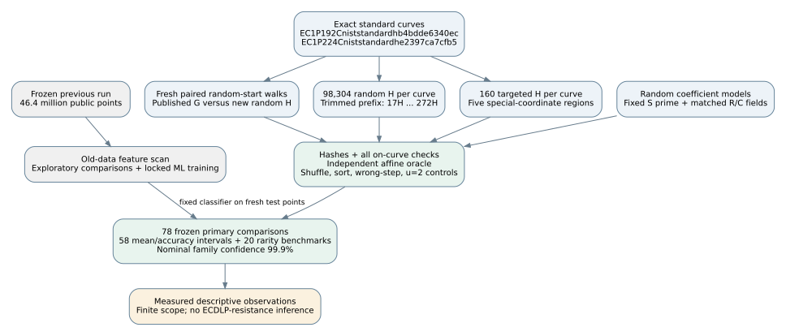
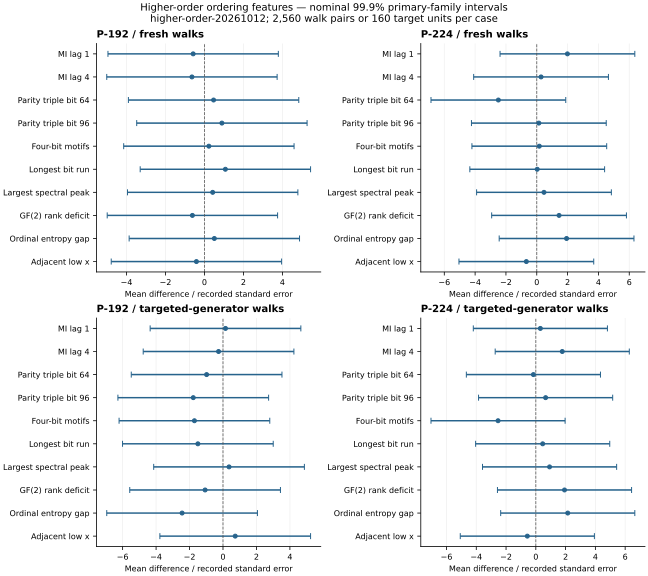
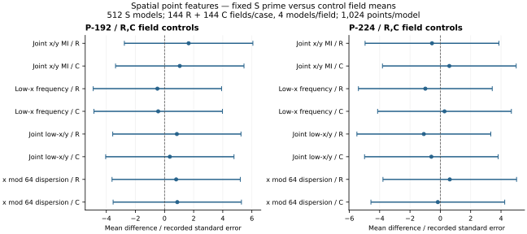
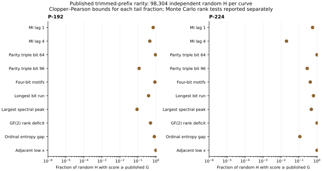
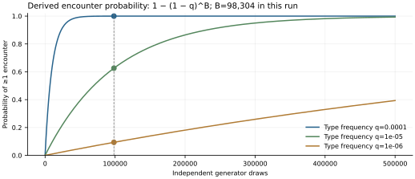
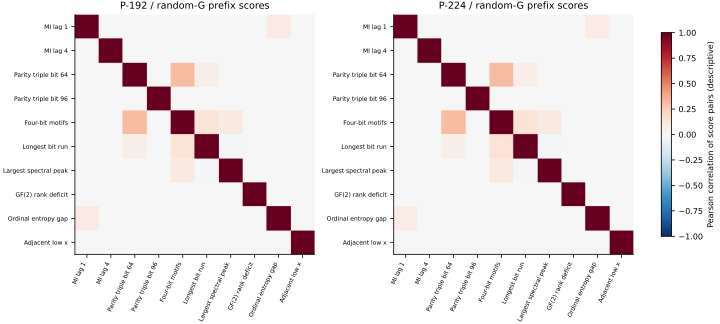
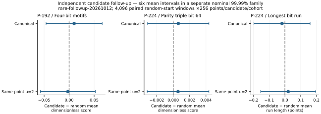

# Rare and higher-order Solinas point patterns

2026-10-12. **Measured and derived descriptive observations only.** Run
`higher-order-20261012`; frozen source `29f2459899a4b8c5a6581a459132bb4d1103a582`. No official
scientific status transition, independent research review or security claim.

**Measured:** 0 of 58 primary mean/accuracy intervals exclude zero; 0 of 20 published-prefix reference tests cross the corrected threshold. The tested features did not resolve a published-generator or fixed-S-prime effect in this fresh batch.

**Measured follow-up:** 6,291,456 additional independent
points checked all three exploratory rare-prefix candidates. None of its
nine corrected comparisons resolved a random-start effect. The two stages
contain 83,706,368 fresh public coordinates;
their confidence families are separate as described below.

The earlier statement “Rare or higher-order patterns remain open” motivated
this extension. It narrows that open question for the declared feature menu,
generator populations and point windows. It does not close it universally.

## What higher-order structure actually appeared

**Derived universal identity:** for consecutive Q−H,Q,Q+H, with x coordinates
L,X,R and u=x(H), the addition law implies

`(L+R)(X−u)^2 = 2((Xu+A)(X+u)+2B) mod p`.

Add the affine formulas for x(Q−H) and x(Q+H), substitute y²=x³+Ax+B,
and collect terms. This equation applies to any nonsingular short Weierstrass
curve when the three points are affine; it is not tied to the form of p.
The x-only relation does not distinguish H from −H and does not identify
an unknown scalar. It is a positive arithmetic control showing why small
pairwise correlations never imply an absence of algebraic relations.

**Measured:** 1,677,840 spread triple checks all satisfied
the identity. Deliberately wrong x(2G) steps gave
0/2048 hits; within-block
shuffling gave 0/2048.
The separate affine oracle also checked 1,677,840
transitions and 5,314 scalar/generator starts.

## Fixed discovery and fresh sample

**Measured:** all 46,399,488 old points, 14,592
records, were scanned without altering historical data. The scan records 56
exploratory comparisons; zero-excluding discovery intervals: 0
(none). They are not counted as fresh confirmation.

**Measured:** 77,414,912 new points, 11,842 jobs,
4,025,575,424 raw bytes, zero job failures. Per exact standard
curve: 2,560 paired blocks ×2,048 points/cohort, 98,304 random-generator
prefixes ×256 points, 160 deliberately targeted generators, four paired
random-start walks ×1,024 points/target plus trimmed prefixes. All deterministic
prefixes cover multiples 17 through 272. Rare targets are near x=0,2^64,
2^96,p−2^64,p−1; only the smaller y root is selected.

New field-point samples reuse 3,328 frozen random models on 578 distinct
primes: each case has 512 models on one fixed S prime, 144 R +144 C fields,
four models/field, 1,024 uniform affine points/model. R matches field size
within 1%; C also matches p modulo 12. No new independent field draw is
claimed. Orders/models were retained without favorable filtering.

**Derived exact baseline:** H=rG with nonzero r modulo prime n permutes all
nonzero multiples. Uniform kG and kH have identical distributions. An effect
must involve ordering, selected scalar windows or a different curve/field
population. Official G is one fixed point, not 2,560 independent generator
choices. Its coordinates are never transferred to unrelated random fields.

## Controls, confidence and ML holdout

Ten fixed ordering descriptors: lag-1/4 mutual information, triple parity at
x bits 64/96, four-bit motifs, longest equal-bit run, largest spectral peak,
32×32 binary Hankel-rank deficiency, ordinal entropy gap and adjacent low-x
events. Four spatial features: joint x/y mutual information, low-x frequency,
joint low-x/y frequency and x modulo 64 dispersion. Binary matrix rank is
not elliptic-curve group rank or ECDLP difficulty.

**Derived inference:** 78 primary comparisons: 58 approximate mean/accuracy
intervals and 20 Monte Carlo random-generator reference tests. Bonferroni
family α=.001, α/test=1.28205128e-05; nominal mean interval
confidence 99.9987179%. Approximate Student/Welch
coverage relies on independent seeded blocks/targets or control field means.
Four target starts are averaged per target; targets are a fixed selected set,
not a random sample of a whole generator population. No per-point inference.
Secondary region tests are a separate exploratory family, not extra primary
discoveries. Its zero-excluding intervals: 0 (none).

**Exploratory targeted prefixes:** 3 of 3,200
score descriptors in the fixed selected set fell in a tail containing at most
0.1% of the random-generator bank. [All targeted-prefix ranks](target-prefix-ranks.json)
are retained, including G, the score and its u=2 companion. This threshold is
a descriptive summary chosen after sampling, not an added primary test.
The targets were selected deliberately; these ranks do not quantify their
density in the field. Independent random-start primary comparisons test the
pooled finite-set effect, not every individual selected generator separately.

**Measured controls:** 32 blocks/case have within-block shuffled, sorted-x
positive and u=2 isomorphic companions. The positive sorted controls passed.
u=2 rescales x→4x,y→8y,A→16A,B→64B and preserves the group. Numerical score
changes under it are coordinate dependence, not independent curve evidence.

**Measured ML:** the locked ten-feature classifier was trained only on old
walks trimmed to 2,048 points and evaluated once on new 2,048-point blocks.
No generator coordinates, field identifiers, seeds, scalar values or labels
enter its feature vector. Labels are used solely as training targets.

| Case | Fresh accuracy | Corrected approximate accuracy interval | Test pairs |
|---|---:|---:|---:|
| P-192 | 49.414062% | [46.390261%, 52.437864%] | 2560 |
| P-224 | 49.746094% | [46.680033%, 52.812155%] | 2560 |

## Rare-prefix comparison and what sample size can see

Published G's trimmed-prefix score is compared with all 98,304 random H
on its exact curve. Reference p=(1+number of scores ≥ official)/(98,304+1);
ties count conservatively, and all ten score tails/case are in the primary
family. This describes unusualness under a uniform-generator benchmark;
it does not prove the original generator selection was random.

**Derived encounter probabilities:** the uniform bank encounters at least
one q-frequency generator type with probability 1−(1−q)^98,304. For q=10^−4:
99.994624%; q=10^−5:
62.582995%; q=10^−6:
9.362672%. This is encounter probability,
not a guarantee that the 256-point descriptors recognize the effect. Patterns
of frequency about 1/p require targeted designs, not a proportional blind
sample of a 192-/224-bit field. The special-coordinate generators address
five named sets without pretending to cover every algebraic rare family.

**Exploratory:** prefix scores share points/bits and are correlated. The
matrix below and [joint-tail counts](bank-joint-tails.csv) describe that
dependence, using empirical 99th-percentile thresholds within the same bank;
they are not independent tests or a Solinas-specific mechanism. Selected
bank maxima in `analysis.json` are expected order statistics in a large
search, not discoveries simply because their values look unusual.

## Independent fresh checks of the three rare-prefix candidates

**Measured:** all three exploratory candidates received a second frozen,
committed-and-pushed protocol before new sampling. Each fixed G was compared
with fresh random generators in 4,096 independent paired 256-point windows
with uniform random starts. 6,291,456 additional points;
384 jobs; zero failures. Total fresh coordinates in both
stages: 83,706,368. The same selected
prefix is never counted as fresh confirmation.

**Derived fresh observations:** 0 of six
mean intervals excludes zero; 0 of three
exact paired rare-event tests crosses the corrected threshold. This separate
nine-test family has nominal 99.99% confidence, not a combined 87-test 99.9%
family. A simple two-family union bound is nominal 99.89%, subject to the
mean-interval approximation. Each event is score≥the original discovery
score; rare rate tests use exact discordant-pair McNemar/binomial calculations.
Six arm-rate Clopper–Pearson intervals use their own .0001 family correction.

| Candidate | Coordinates | Mean difference | Corrected approximate interval |
|---|---|---:|---:|
| P-192-two64-23-motif64 | canonical | 0.009967885 | [-0.04614044, 0.06607621] |
| P-192-two64-23-motif64 | isomorphic-u2 | -0.002416831 | [-0.05736709, 0.05253343] |
| P-224-p_minus_two64-19-triple64 | canonical | 0.0006132351 | [-0.003130428, 0.004356898] |
| P-224-p_minus_two64-19-triple64 | isomorphic-u2 | 0.0005901667 | [-0.003176419, 0.004356752] |
| P-224-two64-1-longrun64 | canonical | -0.01855469 | [-0.1972846, 0.1601752] |
| P-224-two64-1-longrun64 | isomorphic-u2 | 0.02050781 | [-0.1545544, 0.19557] |

| Candidate | Original threshold | Target hits | Random hits | Exact paired p | Target-rate corrected CP interval |
|---|---:|---:|---:|---:|---:|
| P-192-two64-23-motif64 | 4.26851 | 2/4096 | 1/4096 | 1 | [9.981802e-07, 0.004084203] |
| P-224-p_minus_two64-19-triple64 | 0.212598 | 7/4096 | 5/4096 | 0.7744141 | [0.0001693083, 0.006422064] |
| P-224-two64-1-longrun64 | 22 | 0/4096 | 0/4096 | 1 | [0, 0.002851212] |

The P224 22-bit-run candidate had zero repeats in 4,096 windows in both
arms, with an upper arm-rate bound of about 0.285%. This does not exclude
events as rare as its original bank rank (3/98,304) or an effect concentrated
in its known deterministic prefix. The prefix remains exactly reproducible;
these fresh tests concern **random-start effects**, not erasing that earlier
observation. Motif-threshold hits were 2 versus 1; parity-threshold hits 7
versus 5, with no corrected difference resolved. The candidates' ordinary
random-start mean scores were near their random-G controls.

**Measured integrity:** all 6,291,456 follow-up
points, file hashes and canonical/u=2 score replays passed. The separate
affine oracle checked 196,608 transitions,
1,536 starts and
384 control generators. Sampling
wall 55.91s, summed job CPU
164.82s. Same-session verification only.

[Follow-up protocol](../../../tasks/solinas_higher_order/followup/PROTOCOL.md),
[candidate configuration](../../../tasks/solinas_higher_order/followup/config.json),
[run results](../../../tasks/solinas_higher_order/runs/rare-followup-20261012/analysis.json)
and separate raw-data bundle preserve every observation. A further test of
prime specificity would require the same targeted construction on matched
ordinary-prime curve models and a prospective subgroup/order policy; this
fixed-standard-curve follow-up does not supply that causal comparison.

## Full numerical primary results

Raw mean intervals, with actual independent unit counts. Plot units are
differences divided by their recorded standard errors; this table and
[comparisons.csv](../../../tasks/solinas_higher_order/runs/higher-order-20261012/comparisons.csv)
retain the original feature units.

| Case | Population | Metric | Comparator | Mean difference | Corrected interval | Units L/R |
|---|---|---|---|---:|---:|---:|
| P-192 | fresh walks | mi_lag1 | fresh random generators | -5.700522e-05 | [-0.0004868712, 0.0003728608] | 2560/2560 |
| P-192 | fresh walks | mi_lag4 | fresh random generators | -6.411853e-05 | [-0.0005007949, 0.0003725579] | 2560/2560 |
| P-192 | fresh walks | triple64 | fresh random generators | 0.0001741202 | [-0.00144796, 0.001796201] | 2560/2560 |
| P-192 | fresh walks | triple96 | fresh random generators | 0.0003337304 | [-0.001295582, 0.001963043] | 2560/2560 |
| P-192 | fresh walks | motif64 | fresh random generators | 0.003761614 | [-0.06864454, 0.07616776] | 2560/2560 |
| P-192 | fresh walks | longrun64 | fresh random generators | 0.05625 | [-0.1726381, 0.2851381] | 2560/2560 |
| P-192 | fresh walks | spectral64 | fresh random generators | 0.01502931 | [-0.1404173, 0.1704759] | 2560/2560 |
| P-192 | fresh walks | hankel64_deficit | fresh random generators | -0.0140625 | [-0.1135029, 0.08537789] | 2560/2560 |
| P-192 | fresh walks | perm_gap | fresh random generators | 1.504127e-05 | [-0.0001145014, 0.000144584] | 2560/2560 |
| P-192 | fresh walks | lowx_pairs | fresh random generators | -4.007389e-06 | [-4.654434e-05, 3.852956e-05] | 2560/2560 |
| P-192 | fresh affine points | xy_mi | R random fields | 0.0007083793 | [-0.001182286, 0.002599045] | 512/144 |
| P-192 | fresh affine points | xy_mi | C random fields | 0.0004373121 | [-0.001407288, 0.002281913] | 512/144 |
| P-192 | fresh affine points | x_tail64 | R random fields | -0.0001118978 | [-0.001116539, 0.0008927439] | 512/144 |
| P-192 | fresh affine points | x_tail64 | C random fields | -0.0001051161 | [-0.001167263, 0.0009570312] | 512/144 |
| P-192 | fresh affine points | xy_tail64 | R random fields | 2.415975e-05 | [-0.0001015727, 0.0001498922] | 512/144 |
| P-192 | fresh affine points | xy_tail64 | C random fields | 1.059638e-05 | [-0.0001178273, 0.0001390201] | 512/144 |
| P-192 | fresh affine points | x_mod64_dispersion | R random fields | 0.008495405 | [-0.03837128, 0.05536209] | 512/144 |
| P-192 | fresh affine points | x_mod64_dispersion | C random fields | 0.009470245 | [-0.03825879, 0.05719928] | 512/144 |
| P-192 | targeted-generator walks | mi_lag1 | matched fresh random G | 6.109725e-05 | [-0.001774001, 0.001896195] | 160/160 |
| P-192 | targeted-generator walks | mi_lag4 | matched fresh random G | -0.0001137195 | [-0.002046012, 0.001818573] | 160/160 |
| P-192 | targeted-generator walks | triple64 | matched fresh random G | -0.000984589 | [-0.005514007, 0.003544828] | 160/160 |
| P-192 | targeted-generator walks | triple96 | matched fresh random G | -0.001819349 | [-0.006430561, 0.002791862] | 160/160 |
| P-192 | targeted-generator walks | motif64 | matched fresh random G | -0.05763957 | [-0.2096738, 0.09439467] | 160/160 |
| P-192 | targeted-generator walks | longrun64 | matched fresh random G | -0.1578125 | [-0.6312918, 0.3156668] | 160/160 |
| P-192 | targeted-generator walks | spectral64 | matched fresh random G | 0.02172188 | [-0.2486683, 0.2921121] | 160/160 |
| P-192 | targeted-generator walks | hankel64_deficit | matched fresh random G | -0.0515625 | [-0.2687415, 0.1656165] | 160/160 |
| P-192 | targeted-generator walks | perm_gap | matched fresh random G | -0.0002536941 | [-0.0007211068, 0.0002137186] | 160/160 |
| P-192 | targeted-generator walks | lowx_pairs | matched fresh random G | 1.985582e-05 | [-0.0001024306, 0.0001421422] | 160/160 |
| P-224 | fresh walks | mi_lag1 | fresh random generators | 0.0001994843 | [-0.0002389409, 0.0006379094] | 2560/2560 |
| P-224 | fresh walks | mi_lag4 | fresh random generators | 2.7338e-05 | [-0.0004027693, 0.0004574453] | 2560/2560 |
| P-224 | fresh walks | triple64 | fresh random generators | -0.000938951 | [-0.002586717, 0.0007088148] | 2560/2560 |
| P-224 | fresh walks | triple96 | fresh random generators | 4.963954e-05 | [-0.001560761, 0.00166004] | 2560/2560 |
| P-224 | fresh walks | motif64 | fresh random generators | 0.002558272 | [-0.06524481, 0.07036136] | 2560/2560 |
| P-224 | fresh walks | longrun64 | fresh random generators | 0.0015625 | [-0.2309429, 0.2340679] | 2560/2560 |
| P-224 | fresh walks | spectral64 | fresh random generators | 0.01662479 | [-0.1387063, 0.1719559] | 2560/2560 |
| P-224 | fresh walks | hankel64_deficit | fresh random generators | 0.03242188 | [-0.06561232, 0.1304561] | 2560/2560 |
| P-224 | fresh walks | perm_gap | fresh random generators | 5.335565e-05 | [-6.726134e-05, 0.0001739726] | 2560/2560 |
| P-224 | fresh walks | lowx_pairs | fresh random generators | -6.869809e-06 | [-5.130141e-05, 3.756179e-05] | 2560/2560 |
| P-224 | fresh affine points | xy_mi | R random fields | -0.0002473579 | [-0.002235859, 0.001741143] | 512/144 |
| P-224 | fresh affine points | xy_mi | C random fields | 0.0002579662 | [-0.001658589, 0.002174521] | 512/144 |
| P-224 | fresh affine points | x_tail64 | R random fields | -0.0002303653 | [-0.001258281, 0.0007975504] | 512/144 |
| P-224 | fresh affine points | x_tail64 | C random fields | 6.29425e-05 | [-0.0009461253, 0.00107201] | 512/144 |
| P-224 | fresh affine points | xy_tail64 | R random fields | -3.072951e-05 | [-0.0001554988, 9.403977e-05] | 512/144 |
| P-224 | fresh affine points | xy_tail64 | C random fields | -1.547072e-05 | [-0.0001307164, 9.977498e-05] | 512/144 |
| P-224 | fresh affine points | x_mod64_dispersion | R random fields | 0.006417411 | [-0.0390024, 0.05183722] | 512/144 |
| P-224 | fresh affine points | x_mod64_dispersion | C random fields | -0.001798115 | [-0.04992289, 0.04632666] | 512/144 |
| P-224 | targeted-generator walks | mi_lag1 | matched fresh random G | 0.0001306979 | [-0.00179948, 0.002060876] | 160/160 |
| P-224 | targeted-generator walks | mi_lag4 | matched fresh random G | 0.0006564621 | [-0.001009387, 0.002322312] | 160/160 |
| P-224 | targeted-generator walks | triple64 | matched fresh random G | -0.0001804061 | [-0.005196968, 0.004836156] | 160/160 |
| P-224 | targeted-generator walks | triple96 | matched fresh random G | 0.0006023728 | [-0.003522635, 0.004727381] | 160/160 |
| P-224 | targeted-generator walks | motif64 | matched fresh random G | -0.07462618 | [-0.2071103, 0.05785794] | 160/160 |
| P-224 | targeted-generator walks | longrun64 | matched fresh random G | 0.05 | [-0.4390348, 0.5390348] | 160/160 |
| P-224 | targeted-generator walks | spectral64 | matched fresh random G | 0.06643883 | [-0.257725, 0.3906027] | 160/160 |
| P-224 | targeted-generator walks | hankel64_deficit | matched fresh random G | 0.0953125 | [-0.1274805, 0.3181055] | 160/160 |
| P-224 | targeted-generator walks | perm_gap | matched fresh random G | 0.0002654607 | [-0.0002922358, 0.0008231571] | 160/160 |
| P-224 | targeted-generator walks | lowx_pairs | matched fresh random G | -1.52737e-05 | [-0.0001358797, 0.0001053323] | 160/160 |
| P-192 | ML independent-seed test | accuracy_minus_half | balanced chance benchmark | -0.005859375 | [-0.03609739, 0.02437864] | 2560/2560 |
| P-224 | ML independent-seed test | accuracy_minus_half | balanced chance benchmark | -0.002539063 | [-0.03319967, 0.02812155] | 2560/2560 |

| Case | Prefix score | Published value | Random H at least as extreme | Reference p | Bonferroni p |
|---|---|---:|---:|---:|---:|
| P-192 | mi_lag1 | 0.132029 | 69,404/98,304 | 0.706017 | 1 |
| P-192 | mi_lag4 | 0.153134 | 45,026/98,304 | 0.4580337 | 1 |
| P-192 | triple64 | 0.00787402 | 93,516/98,304 | 0.9512944 | 1 |
| P-192 | triple96 | 0.102362 | 11,448/98,304 | 0.1164641 | 1 |
| P-192 | motif64 | 0.431884 | 86,593/98,304 | 0.8808708 | 1 |
| P-192 | longrun64 | 9 | 38,480/98,304 | 0.391445 | 1 |
| P-192 | spectral64 | 7.22656 | 8,784/98,304 | 0.08936473 | 1 |
| P-192 | hankel64_deficit | 1 | 49,228/98,304 | 0.5007782 | 1 |
| P-192 | perm_gap | 0.00323457 | 80,767/98,304 | 0.8216062 | 1 |
| P-192 | lowx_pairs | 0 | 98,304/98,304 | 1 | 1 |
| P-224 | mi_lag1 | 0.143072 | 55,690/98,304 | 0.5665124 | 1 |
| P-224 | mi_lag4 | 0.222802 | 1,973/98,304 | 0.02008036 | 1 |
| P-224 | triple64 | 0 | 98,304/98,304 | 1 | 1 |
| P-224 | triple96 | 0.0708661 | 28,080/98,304 | 0.2856518 | 1 |
| P-224 | motif64 | 0.979974 | 41,375/98,304 | 0.4208942 | 1 |
| P-224 | longrun64 | 8 | 62,465/98,304 | 0.6354305 | 1 |
| P-224 | spectral64 | 5.3395 | 47,411/98,304 | 0.4822949 | 1 |
| P-224 | hankel64_deficit | 0 | 98,304/98,304 | 1 | 1 |
| P-224 | perm_gap | 0.0192384 | 10,864/98,304 | 0.1105234 | 1 |
| P-224 | lowx_pairs | 0 | 98,304/98,304 | 1 | 1 |

## Integrity, reproducibility and scope

**Measured verification:** every one of 77,414,912 raw points
passed its equation/range check and every raw SHA-256 matched. All
213,058 feature units were replayed with the same
locked feature code; separate synthetic tests checked formulas and GF(2)
matrix rank. 209,730 generator instances were checked
on-curve and 606,720 transported points checked.
This is same-session verification, not an independent scientific review.
Fresh sampling used 819.92 seconds
wall and 2383.03 summed job CPU seconds on
three workers. Old scan wall: 35.39 seconds.
Execution host/software, exact command and dirty-state entries are preserved
in `environment.json`; frozen source/input hashes matched throughout.

Exact measured standard identities (internal frozen public-parameter
provenance, not a new externally retrieved standards citation):

- P-192: `EC1P192Cniststandardhb4bdde6340ec`; full UID `urn:ec-record:1:sha256:b4bdde6340ec696e5fa11f3baf1ef941462bc731a526029d2bdc9dc49812aa4b`. p=6277101735386680763835789423207666416083908700390324961279; A=6277101735386680763835789423207666416083908700390324961276; B=2455155546008943817740293915197451784769108058161191238065; n=6277101735386680763835789423176059013767194773182842284081; cofactor 1; G=[602046282375688656758213480587526111916698976636884684818, 174050332293622031404857552280219410364023488927386650641].
- P-224: `EC1P224Cniststandardhe2397ca7cfb5`; full UID `urn:ec-record:1:sha256:e2397ca7cfb5bfad66d0ec042758a09a0ee496e566266b793d2a9f36cf555484`. p=26959946667150639794667015087019630673557916260026308143510066298881; A=26959946667150639794667015087019630673557916260026308143510066298878; B=18958286285566608000408668544493926415504680968679321075787234672564; n=26959946667150639794667015087019625940457807714424391721682722368061; cofactor 1; G=[19277929113566293071110308034699488026831934219452440156649784352033, 19926808758034470970197974370888749184205991990603949537637343198772].

**Limits:** two fixed standard primes; one official G per curve; finite
feature menu and scalar windows; the existing random-field/model pool;
fixed targeted generator sets. No relative ECDLP resistance, scalar recovery,
security exponent or bound is measured. Exact universal triple structure is
distinct from the absence/presence of a resolved cohort mean difference.

Use the [agent-free runner](../../../tasks/solinas_higher_order/README.md),
new seed and new output folder for every future batch. Reuse archived old
discovery features with `--reuse-discovery`; no old raw rescan or agent is
needed. Keep immutable raw/feature shards, hashes and environment metadata.
Before pooling future runs, freeze a cross-batch inference plan rather than
repeating until a p value looks favorable. A useful next controlled extension
would target additional algebraically defined generator/model families or
longer lags, with matched ordinary-prime instances and fresh confirmation.

Internal sources read: [prior generator-cohort report](https://github.com/aburan28/crypto-autoresearcher/blob/195227dac94f03034eb0978b0214282c20a4da97/docs/reports/solinas-generator-cohorts-20261012/report.md),
[prior distribution report](https://github.com/aburan28/crypto-autoresearcher/blob/195227dac94f03034eb0978b0214282c20a4da97/docs/reports/solinas-point-distribution-20261012/report.md),
[prior ML relation flow](https://github.com/aburan28/crypto-autoresearcher/blob/195227dac94f03034eb0978b0214282c20a4da97/docs/reports/ec-relation-ml-20261011/report.md).
New artifacts: [protocol](../../../tasks/solinas_higher_order/PROTOCOL.md),
[source freeze](../../../tasks/solinas_higher_order/publication/source-freeze.json),
[run receipt](../../../tasks/solinas_higher_order/runs/higher-order-20261012/receipt.json),
[analysis](../../../tasks/solinas_higher_order/runs/higher-order-20261012/analysis.json),
[verification](../../../tasks/solinas_higher_order/runs/higher-order-20261012/verification.json),
lossless JSONL record/feature shards and raw-data checksum inventory.
Historical reports and ECDLP frontier records were checked for affected
graph content; no isogeny, endomorphism or attack-cost edge is changed.
