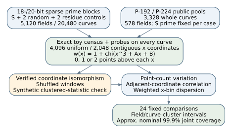
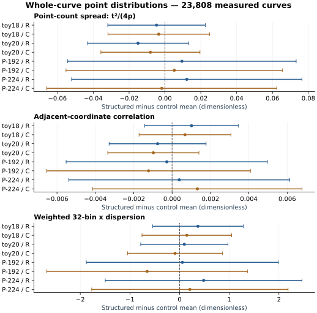
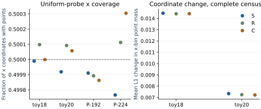

# Solinas primes and elliptic-curve point distributions

2026-10-12. Measured observations from `point-distribution-20261012`; measurement
source `69cdec441c5aec84a18483c32bb7d22d0a387bba`. Derived report, without an official research-state transition.

**Measured:** None of the 24 primary intervals excludes zero. The study did not resolve a mean difference in these prespecified metrics at the stated simultaneous confidence level. This does not establish equality or exclude other patterns.

## The theory in plain terms

The field is F_p: integers modulo a prime p. An elliptic curve is a particular
equation over that field, y²=x³+Ax+B. The field and the curve are separate
choices. For any x, evaluate the right-hand side. A nonzero square gives two
points, one with y and one with -y. Zero gives one point. A nonsquare gives
no point. Thus x-coordinate coverage counts which x values lift, while point
mass counts the points above each x. These are different distributions.

**Derived:** with chi the quadratic character and chi(0)=0, w(x)=1+chi(x³+Ax+B).
The full order is N=1+sum_x w(x), including infinity. Its trace t=p+1-N obeys
Hasse's bound |t|≤2√p. If Z is the number of roots of the cubic, liftable
coordinates number (N-1+Z)/2. Coverage is close to one half, with deviations
determined by the trace and at most three cubic roots; being close to half is
expected and cannot alone decide whether a prime family changes local patterns.

Sparse signed-power-of-two prime formulas simplify some modular arithmetic.
They do not change the 0/1/2 lifting rule. A numerical distribution effect has
to be measured against comparable prime fields and curve models. This study
uses complete small-field distributions and fixed-size probes at large fields.

**Derived baseline:** in this uniform nonsingular coefficient population,
E[t²/(4p)]=(1-1/p²)/4 and E[x coverage]=1/2+(p-1)/(2p²).
These expectations are nearly fixed for every prime of a given size. They
explain why local and higher-order features need their own comparisons.
The general derivation and independent exhaustive checks at five small primes
are in [THEORY.md](THEORY.md) and [theory-check.json](theory-check.json).

## Fixed design and controls

**Measured scope:** 512 independent matched prime blocks per 18-/20-bit stratum,
one NAF-weight≤6 prime plus two random and two p mod 96 controls, four uniformly
drawn nonsingular models per field: 5,120 distinct primes and 20,480 curves.
Complete prime populations contain 10,749 / 38,635 primes; the declared sparse
populations contain 2,955 / 5,108 primes respectively. Controls match bit size
and ±5% proximity. R may also be sparse, as an unrestricted random population should be.

**New measurements on existing inputs:** each P-192/P-224 case uses 512 models
at its fixed S prime, 144 R fields and 144 C fields with four curves each:
3,328 curves across 578 fields. These controls were prepared under
RUN-ECDLP-d0e449, matching bit size, ±1% proximity and mod 12 for C. Full curve
counts are reused exact PARI inputs. All curves are retained; earlier small
subgroups or attack outcomes do not determine inclusion.

Every base curve has 4,096 uniform x probes and a contiguous 2,048-coordinate
window. There are 97,517,568 uniform base-curve probes and 48,758,784 window
evaluations. Probe coordinates are not themselves uniform point samples:
weights account for the number of points above each coordinate. Windows,
probe inputs and outputs, full toy census masks and cubic zeros are retained.

**Controls:** two random and two residue controls per toy block; two classes
of 144 random control fields per large case; shuffled windows preserving their
counts; a public isomorphic companion of the first model at each field;
synthetic clustered sequences used only to test the statistic. A coordinate
change (x,y)→(u²x,u³y) preserves N while potentially changing numerical bins,
gaps and window correlations. Companions are not independent sample units.

## Prespecified measurements and uncertainty

1. Point-count spread t²/(4p), between zero and one.
2. Lag-1 Pearson correlation of liftability in the fixed window.
3. Weighted 32-bin x-mass dispersion, conditional on actual uniform-probe
   proposal counts. This is a descriptive score, not a chi-square p-value.

For toys, each statistical row is the four-curve field mean and each paired
difference averages two controls, giving 512 block differences. For large
cases, S has 512 curve draws at one fixed prime; controls have 144 field means.
Use paired Student/Welch intervals with alpha .001/24, nominal 99.9958333%
per interval and nominal 99.9% simultaneous coverage. These are approximate
intervals, with constrained-matching dependencies and no exact finite-sample
or power guarantee. All point rows in a curve remain together.

| Case | Metric | Control | S minus control | Simultaneous interval |
|---|---|---|---:|---|
| toy18 | trace_square | R | -0.00468282 | [-0.0318937, 0.0225281] |
| toy18 | trace_square | C | -0.00345731 | [-0.0317861, 0.0248714] |
| toy18 | window_lag_1 | R | 0.00101192 | [-0.00142486, 0.0034487] |
| toy18 | window_lag_1 | C | 0.000673661 | [-0.00172122, 0.00306854] |
| toy18 | probe_bin_dispersion | R | 0.368426 | [-0.544576, 1.28143] |
| toy18 | probe_bin_dispersion | C | 0.145202 | [-0.757314, 1.04772] |
| toy20 | trace_square | R | -0.0150104 | [-0.0432087, 0.0131879] |
| toy20 | trace_square | C | -0.0080999 | [-0.0357409, 0.0195411] |
| toy20 | window_lag_1 | R | -0.00075586 | [-0.00328292, 0.0017712] |
| toy20 | window_lag_1 | C | -0.000977171 | [-0.00335263, 0.00139829] |
| toy20 | probe_bin_dispersion | R | 0.0950435 | [-0.783325, 0.973412] |
| toy20 | probe_bin_dispersion | C | -0.0929196 | [-1.04763, 0.861795] |
| P-192 | trace_square | R | 0.00947393 | [-0.0542555, 0.0732034] |
| P-192 | trace_square | C | 0.00520386 | [-0.0551876, 0.0655953] |
| P-192 | window_lag_1 | R | -0.000277945 | [-0.00552368, 0.00496779] |
| P-192 | window_lag_1 | C | -0.0012278 | [-0.00653944, 0.00408385] |
| P-192 | probe_bin_dispersion | R | 0.0552906 | [-1.8774, 1.98798] |
| P-192 | probe_bin_dispersion | C | -0.65363 | [-2.67717, 1.36991] |
| P-224 | trace_square | R | 0.0121787 | [-0.0521038, 0.0764611] |
| P-224 | trace_square | C | -0.00180721 | [-0.0660067, 0.0623923] |
| P-224 | window_lag_1 | R | 0.000373965 | [-0.00538794, 0.00613587] |
| P-224 | window_lag_1 | C | 0.00131788 | [-0.00413592, 0.00677168] |
| P-224 | probe_bin_dispersion | R | 0.483629 | [-1.49721, 2.46447] |
| P-224 | probe_bin_dispersion | C | 0.206728 | [-1.77026, 2.18372] |

## Coverage and coordinate controls

These are descriptive sample means without primary uncertainty intervals.
The inferential intervals appear in the primary plot and comparison table.

| Case | Arm | Fields | Curves | Probed x coverage | Lag 1 | Shuffled lag 1 |
|---|---|---:|---:|---:|---:|---:|
| toy18 | S | 512 | 2048 | 0.499990 | -0.000347 | -0.000755 |
| toy18 | R | 1024 | 4096 | 0.500098 | -0.001358 | -0.001259 |
| toy18 | C | 1024 | 4096 | 0.499999 | -0.001020 | -0.000839 |
| toy20 | S | 512 | 2048 | 0.499919 | -0.001234 | -0.001060 |
| toy20 | R | 1024 | 4096 | 0.500092 | -0.000478 | -0.000330 |
| toy20 | C | 1024 | 4096 | 0.500058 | -0.000257 | -0.000049 |
| P-192 | S | 1 | 512 | 0.499911 | -0.000443 | -0.002294 |
| P-192 | R | 144 | 576 | 0.499893 | -0.000165 | -0.000522 |
| P-192 | C | 144 | 576 | 0.499863 | 0.000785 | -0.002047 |
| P-224 | S | 1 | 512 | 0.499766 | -0.000227 | -0.002202 |
| P-224 | R | 144 | 576 | 0.500112 | -0.000601 | 0.000373 |
| P-224 | C | 144 | 576 | 0.500305 | -0.001545 | -0.000969 |

The second panel compares the same numerical bins in complete toy censuses,
isolating the coordinate effect; N remains exactly equal. See
[coordinate-checks.json](coordinate-checks.json). Companion probe windows
use distinct UID-derived seeds, so their absolute lag changes also include
sampling changes and are not interpreted as an isolated coordinate effect.

## Verification, data and limits

**Software-checked:** 12 prelaunch tests passed, including exhaustive y-loop
counts, full matching, isomorphism, wrapped gaps, synthetic pattern detection
and rejection of point-row pseudoreplication. Post-run verification checked
5,698 field artifacts, 23,808 base curves,
380,928 independent character
evaluations, public point examples, census identities and checksums.
The fixed run had no failed field rows. This is same-session software
verification, not an independent scientific review.

Worker CPU time 4649.3 s; launch wall time
1566.7 s, three workers. Full retained raw
arrays total 1,981,842,986 bytes. Archive paths and checksums
are recorded separately; binary arrays remain available in the local full
dataset bundle, while PR records retain every field metric and its hash.

Whole-curve IDs hash exact p,A,B and model under the point-distribution URN
namespace; [point-distributions.csv](point-distributions.csv) lists them with
all primary metrics, coverage, densities and gap maxima. There is
no chosen generator or subgroup, so these are explicitly not EC1 subgroup IDs.
No scalar-recovery task was run. Numeric clustering is coordinate-dependent.
Fixed P-192/P-224 results do not sample an entire large-prime family. Toy
effects need not transfer to large fields; absence of detected mean differences
does not exclude higher-order structure. A new interesting metric discovered
in these data would need fresh confirmation rather than reusing these tests.

**Proposed next check:** choose any additional distribution descriptor from
these data, lock it, and test it on fresh fields and independent curves.
ML is optional exploratory analysis after these descriptive measurements;
there is no trained predictor or cryptanalytic conclusion in this record.

## Sources and graph upkeep

All supporting sources below were retrieved from exact local repository paths;
provenance `internal/retrieved`, verified_by this report builder and the active
measurement session. There is no claimed exhaustive KB/literature search.

- [Frozen protocol](../../../tasks/solinas_point_distribution/PROTOCOL.md) and config.
- [Public prepared inputs](../../../tasks/solinas_point_distribution/runs/point-distribution-20261012/inputs.json).
- [Immutable receipt](../../../tasks/solinas_point_distribution/runs/point-distribution-20261012/receipt.json), environment/source hashes and per-field records.
- [Analysis](../../../tasks/solinas_point_distribution/runs/point-distribution-20261012/analysis.json) and [verification](../../../tasks/solinas_point_distribution/runs/point-distribution-20261012/verification.json).
- P-192/P-224 original curve pools: EXP-ECDLP-5184f7 / RUN-ECDLP-d0e449 preparation/curves, exact file hashes retained in inputs.json.
- [Comparison CSV](comparisons.csv), [editable diagram](workflow.dot), SVG figures and report.typ/PDF.
- [Graph inventory](graph-inventory.json): inspected materialized historical point-supply, rank, attack and ML graphs and the frontier directory. No canonical edge changes: this study changes none of their established mechanism claims. Earlier immutable evidence is preserved.
