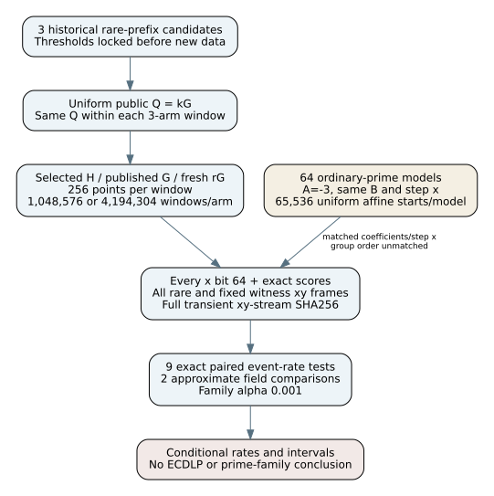
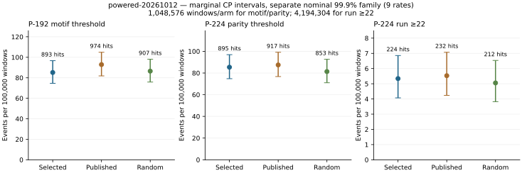
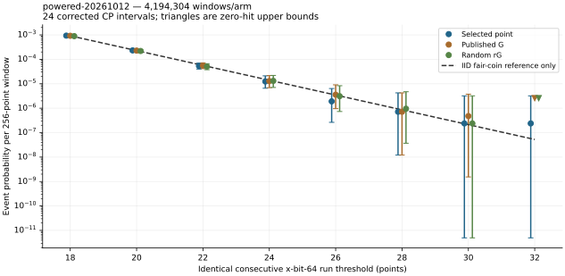
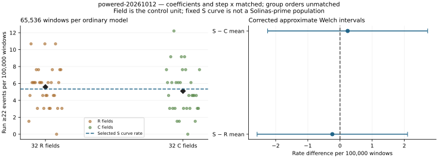
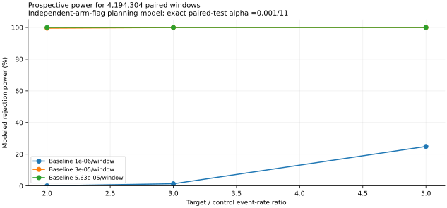

# Powered rare point-pattern study — 12 October 2026

**Observations only.** This report records the user-requested pursuit of the
remaining rare-effect question. It changes no official research status and
makes no ECDLP security, attack-cost, or prime-family causal claim. Run ID:
`powered-20261012`. 0 of 11 predeclared comparisons crossed their
corrected threshold; see all counts and limits below. A threshold crossing is
a replication lead; no crossing closes only the measured event-rate scope.

## Measured scope and controls

**Measured:** 5,905,580,032 point observations in
23,068,672 256-point window observations;
640 requested/completed jobs; 0 failed attempts.
There are 10,485,760 independent-start draws; named cohorts share their start
within each three-arm window. Points inside a window are dependent and the
observation count does not mean distinct or independent points.
Elapsed wall time was 5,847.83s; summed measured job CPU time was
17,497.85s. Host platform: `Linux-6.18.44-x86_64-with-glibc2.41`. These are runtime facts,
not performance-advantage or ECDLP-cost measurements.

Three historical candidates from [PR #2107](https://github.com/aburan28/crypto-autoresearcher/pull/2107)
have selected-point, actual published-generator, and fresh random rG cohorts.
They use precisely the same uniformly drawn Q=kG per matched window. P-192
motif and P-224 parity candidates each have 1,048,576 windows/cohort; the P-224
22-bit-run candidate has 4,194,304/cohort. Additional controls are 32 R and32 C
ordinary-prime models, each with65,536 uniform affine starts. All have A=-3,
the same B integer modulo p, and step x=2^64+2. Selection uses liftability,
not event scores. Full group/step orders are not matched. R/C primes reuse the
prior pools; they are not new independent primes.

## Derived event-rate observations

Rates below are events per100,000 windows. Intervals are two-sided exact
Clopper-Pearson with Bonferroni alpha0.001/9, a separate nominal at-least-99.9%
family under independent windows. A zero count has a nonzero upper bound.

| Event | Cohort | Hits/windows | Rate/100,000 | Corrected CP interval/100,000 |
| --- | --- | ---: | ---: | ---: |
| P-192 motif threshold | Selected point | 893/1,048,576 | 85.1631 | [74.5926, 96.7194] |
| P-192 motif threshold | Published G | 974/1,048,576 | 92.8879 | [81.8294, 104.9317] |
| P-192 motif threshold | Random rG | 907/1,048,576 | 86.4983 | [75.8419, 98.1403] |
| P-224 parity threshold | Selected point | 895/1,048,576 | 85.3539 | [74.7711, 96.9224] |
| P-224 parity threshold | Published G | 917/1,048,576 | 87.4519 | [76.7346, 99.1549] |
| P-224 parity threshold | Random rG | 853/1,048,576 | 81.3484 | [71.0271, 92.6557] |
| P-224 run ≥22 | Selected point | 224/4,194,304 | 5.3406 | [4.0708, 6.8586] |
| P-224 run ≥22 | Published G | 232/4,194,304 | 5.5313 | [4.2371, 7.0737] |
| P-224 run ≥22 | Random rG | 212/4,194,304 | 5.0545 | [3.8221, 6.5352] |

The nine paired comparisons use exact conditional McNemar tests on discordant
windows. Two field comparisons use approximate Welch intervals on S chunk
rates and ordinary field rates. Primary family alpha0.001; per-test threshold
9.09090909e-05. Bonferroni coverage is
nominal for the field approximation, not an exact finite-sample guarantee.

| Comparison | A-only/B-only | Two-sided p | Crosses primary threshold |
| --- | ---: | ---: | --- |
| P-192-two64-23-motif64:selected-vs-random | 892/906 | 0.75917 | False |
| P-192-two64-23-motif64:published-vs-random | 973/906 | 0.127841 | False |
| P-192-two64-23-motif64:selected-vs-published | 893/974 | 0.0640724 | False |
| P-224-p_minus_two64-19-triple64:selected-vs-random | 895/853 | 0.326767 | False |
| P-224-p_minus_two64-19-triple64:published-vs-random | 915/851 | 0.133812 | False |
| P-224-p_minus_two64-19-triple64:selected-vs-published | 895/917 | 0.621789 | False |
| P-224-two64-1-longrun64:selected-vs-random | 224/212 | 0.59838 | False |
| P-224-two64-1-longrun64:published-vs-random | 232/212 | 0.367233 | False |
| P-224-two64-1-longrun64:selected-vs-published | 224/232 | 0.7431 | False |
| P-224-selected-vs-ordinary-R | —/— | 0.675499 | False |
| P-224-selected-vs-ordinary-C | —/— | 0.692108 | False |

Exact paired p-values preserve the empirical within-window dependence.
Conservative difference intervals in `analysis.json` subtract the simultaneous
marginal CP bounds; they are not exact paired-difference intervals.
**Derived:** selected/random run≥22 rate ratio is
1.0566, with conservative interval
[0.6229, 1.7945] from the already declared
simultaneous marginal bounds. This constrains this specific generator contrast
and event; it is not a prime-family or ECDLP conclusion.

## Measured long-run spectrum and ordinary-prime controls

The spectrum was declared before sampling. Its 24 corrected CP intervals form
a separate exploratory nominal99.9% family. The IID fair-coin line is an exact
integer-DP reference, not a premise that elliptic-curve bits are IID.

| Run threshold | Cohort | Hits | Probability/window | Corrected CP interval | Fair-coin reference |
| --- | --- | ---: | ---: | ---: | ---: |
| 18 | selected | 3,909 | 0.00093197823 | [0.00087216807, 0.00099453971] | 0.00091516723 |
| 18 | published | 3,851 | 0.00091814995 | [0.00085879405, 0.00098025731] | 0.00091516723 |
| 18 | random | 3,720 | 0.00088691711 | [0.0008286, 0.00094798599] | 0.00091516723 |
| 20 | selected | 972 | 0.00023174286 | [0.00020253081, 0.00026371751] | 0.00022695278 |
| 20 | published | 953 | 0.00022721291 | [0.00019829986, 0.00025888872] | 0.00022695278 |
| 20 | random | 919 | 0.00021910667 | [0.00019073623, 0.0002502402] | 0.00022695278 |
| 22 | selected | 224 | 5.3405762e-05 | [4.0019037e-05, 6.957106e-05] | 5.6265477e-05 |
| 22 | published | 232 | 5.531311e-05 | [4.166792e-05, 7.1736386e-05] | 5.6265477e-05 |
| 22 | random | 212 | 5.0544739e-05 | [3.7554502e-05, 6.6314329e-05] | 5.6265477e-05 |
| 24 | selected | 52 | 1.2397766e-05 | [6.5647162e-06, 2.1035953e-05] | 1.3947408e-05 |
| 24 | published | 54 | 1.2874603e-05 | [6.9082525e-06, 2.1645251e-05] | 1.3947408e-05 |
| 24 | random | 55 | 1.3113022e-05 | [7.0809324e-06, 2.1949003e-05] | 1.3947408e-05 |
| 26 | selected | 8 | 1.9073486e-06 | [2.6355571e-07, 6.3950746e-06] | 3.4570647e-06 |
| 26 | published | 15 | 3.5762787e-06 | [9.5741295e-07, 9.0294124e-06] | 3.4570647e-06 |
| 26 | random | 13 | 3.0994415e-06 | [7.332915e-07, 8.3027639e-06] | 3.4570647e-06 |
| 28 | selected | 3 | 7.1525574e-07 | [1.2072604e-08, 4.2431399e-06] | 8.5681648e-07 |
| 28 | published | 3 | 7.1525574e-07 | [1.2072604e-08, 4.2431399e-06] | 8.5681648e-07 |
| 28 | random | 4 | 9.5367432e-07 | [3.6765646e-08, 4.7075366e-06] | 8.5681648e-07 |
| 30 | selected | 1 | 2.3841858e-07 | [4.9671055e-12, 3.2066357e-06] | 2.1234153e-07 |
| 30 | published | 2 | 4.7683716e-07 | [1.5423067e-09, 3.7486353e-06] | 2.1234153e-07 |
| 30 | random | 1 | 2.3841858e-07 | [4.9671055e-12, 3.2066357e-06] | 2.1234153e-07 |
| 32 | selected | 1 | 2.3841858e-07 | [4.9671055e-12, 3.2066357e-06] | 5.2619724e-08 |
| 32 | published | 0 | 0 | [0, 2.5699001e-06] | 5.2619724e-08 |
| 32 | random | 0 | 0 | [0, 2.5699001e-06] | 5.2619724e-08 |

**Measured rare example:** one selected-point window contained32 consecutive
zero bits, starting at point offset160. The largest observed run lengths were
[32, 31, 30] for selected,
published, random respectively. This descriptive characterization adds no
test or sample. At threshold32, the simultaneous CP intervals include the
fair-coin reference in all three arms. A single selected hit versus zero other
hits does not resolve a generator effect. Its complete coordinates and public
start/step data are preserved in `publication/extreme-windows.json` and the
raw event frame; all are covered by the separate verifier.

The ordinary comparison unit is the field, not billions of pooled points.
There are32 fields/pool and only one fixed S prime for this candidate.
Different group orders, subgroup orders and lifted step y limit causal
interpretation. The comparisons are conditional on the declared models and
the reused prime pools. A general effect of sparse prime representation is
not identified by these controls alone.

## Theory and remaining rare-effect scope

**Derived:** On a finite prime-order curve, each nonzero generator traverses
the same full point set. Uniform Q makes the single-point marginal invariant
under translation, up to the prospectively excluded infinity/start convention.
Changing H changes the ordering and joint distribution of consecutive points;
it can therefore change bit-run, parity and motif frequencies without changing
the full-orbit marginal point coverage. The sparse Solinas modulus is a field
representation and arithmetic property, not evidence of an ECDLP advantage.

The original deterministic prefix outliers still exist. This fresh study
measures their descriptors' **global random-start rates**, not the probability
of revisiting the exact historical start. A phenomenon confined to a few
specific starts in a ~2^192 or~2^224 group can be real and essentially invisible
to any feasible uniform sample. Sampling design depends on event prevalence
and effect size, rather than a fixed percentage of the entire field.

**Derived prospective planning:** At baseline3e-5, a doubled long-run event
rate has about99.54% modeled power with4,194,304 paired windows. At baseline
1e-6, doubling has about0.057% power. These figures use independent arm flags
for planning; correlated observed arms can change power. Motif/parity have
about97.83% modeled power for doubling a1e-4 baseline. No interval or negative
test excludes every higher-order, alternate-coordinate or rarer effect.

The primary, marginal-rate, and exploratory-tail families are separate.
Their simple union has at most0.003 nominal error (nominal99.7%), subject to
the two Welch approximations; the report does not call all outputs a single
99.9% family. Old PR2107 families are not combined with this new family.

Next discriminating work is fresh-seed replication of any threshold crossing;
for events below the powered regime, accumulate additional preplanned seeds
with the included standalone runner, or define a separate prospective
structured-start study for the exact historical prefixes. These are future
tasks, not results of this run. No adaptive post-outcome enlargement occurred.

## Independently checked implementation and preserved data

**Measured native validity:** all5,905,580,032 points
were finite and on-curve. **Separate Python verification:** every stored
window's three scores was recomputed from its complete bit string;
6,185,472 rare/witness point coordinates,
6,161,310 affine transitions,
8,886 start draws,
15,276 public scalar multiplications,
and6,137,148 universal x-triple relations passed.
The verifier inventories every rare frame and checks its paired arms.
Four engineering tests passed, including full-coordinate hashes, independent
point arithmetic, planted/negative bit sequences, exact DP brute force,
write-once resume and corrupt-data refusal. This is independent arithmetic in
one session, not a separate research review.

Compact retention includes **every measured bit64 string**, all three exact
integer scores, all fresh public generator scalars, full256-point coordinates
for every threshold-event window (all paired arms), four predetermined witness
windows per chunk, and SHA256 of every full transient coordinate stream. Most
non-event full xy streams are not stored; seeds/source regenerate them.
`--full-coordinates` prospectively retains every coordinate on a large disk.
Do not describe the compact dataset as a saved survey of all coordinate bits.

Lossless archive: `solinas-rare-events-20261012-data.zip`; 1,338,064,750
bytes; SHA256 `68a67d9912d3fcfee76af151d5d19aa381b216f928ca19d82f3990e783be3019`. All4,256
entries were checked against their SHA256 and byte count after compression.
Earlier raw datasets and reports remain immutable. The repository commits
small records, full manifests, protocol, source and analysis; the large ZIP is
a local download artifact, not asserted to be uploaded to any cloud service.

## Reproduce and provenance

Frozen scientific source commit:
[`2f58493ab588832a11ac5771e0ba023958c44dfb`](https://github.com/aburan28/crypto-autoresearcher/tree/2f58493ab588832a11ac5771e0ba023958c44dfb/tasks/solinas_rare_events).
The source was pushed before launch. Seed:
`solinas-rare-events-20261012-powered-v1`. Python3.12.14,
NumPy2.3.5, SciPy1.17.0; OpenSSL 3.5.7 9 Jun 2026 (Library: OpenSSL 3.5.7 9 Jun 2026); workers3.
Runtime dirty status was `?? tasks/solinas_rare_events/runs/` because the newly created
run records were untracked; the sampling source was committed and clean.
All frozen source-file hashes are in `design.json`; exact command, compiler
stdout/stderr, job CPU/wall facts and source copies are preserved. Runtime
facts are not performance-advantage claims. Unexposed model/usage fields are null.

Run `python research.py --output /large-disk/study`, then `python verify.py`
and `python analyze.py` with that output path. A new public seed and a new
directory enable independent accumulation without an agent. Scripts refuse
source/config changes on resume and preserve failed attempt artifacts.
The portable runner bundle and README include all public models and dependencies.

**Internal evidence links:** [protocol](../../../tasks/solinas_rare_events/PROTOCOL.md),
[analysis](../../../tasks/solinas_rare_events/runs/powered-20261012/analysis.json),
[verification](../../../tasks/solinas_rare_events/runs/powered-20261012/verification.json),
[completion](../../../tasks/solinas_rare_events/runs/powered-20261012/completion.json),
[power plan](../../../tasks/solinas_rare_events/power-plan.json),
[dataset manifest](../../../tasks/solinas_rare_events/publication/dataset-manifest.json).
Exact curve/subgroup parameters and full UIDs are in `inputs.json`; no curve
identity is inferred from bit length. Previous report and diagram at PR2107
and the canonical `knowledge/frontiers/ecdlp/` inventory/schema were checked;
no verified mechanism, attack cost, or official scientific state changed, so
historical diagrams and canonical frontier rows remain unchanged.

Named curve identities:

- P-192: `urn:ec-record:1:sha256:b4bdde6340ec696e5fa11f3baf1ef941462bc731a526029d2bdc9dc49812aa4b`; subgroup order N=6277101735386680763835789423176059013767194773182842284081; published G=(602046282375688656758213480587526111916698976636884684818, 174050332293622031404857552280219410364023488927386650641).
- P-224: `urn:ec-record:1:sha256:e2397ca7cfb5bfad66d0ec042758a09a0ee496e566266b793d2a9f36cf555484`; subgroup order N=26959946667150639794667015087019625940457807714424391721682722368061; published G=(19277929113566293071110308034699488026831934219452440156649784352033, 19926808758034470970197974370888749184205991990603949537637343198772).

Sources are internal immutable experiment artifacts read in this session;
no external literature claim or exhaustive novelty assertion is made.
