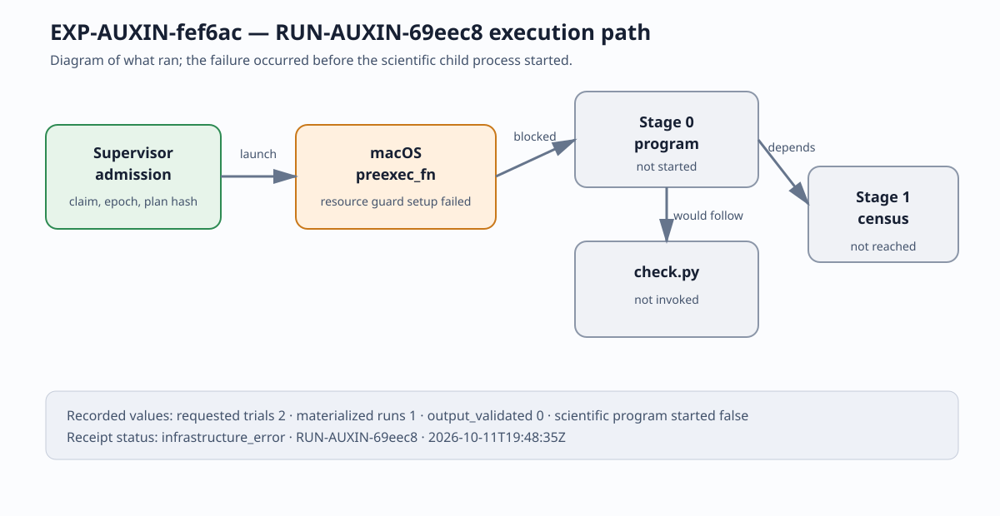

# EXP-AUXIN-fef6ac run report — observation record

This report records the execution outputs only. It does not evaluate the AUXIN hypothesis, assign evidence strength, or change any experiment, hypothesis, or goal status. The attempted Stage 0 launch stopped in the supervisor's macOS `preexec_fn` before the scientific program began; the operational failure is not a value of any scientific metric.

## Identity and custody

- Experiment: `EXP-AUXIN-fef6ac`
- Hypothesis: `H-AUXIN-9d9ee0`
- Goal: `GOAL-AUXIN-a93442`
- Task: `TASK-20261004-f88f65`
- Approval: `DEC-20261004-927012`
- Run: `RUN-AUXIN-69eec8`
- Run directory: `experiments/EXP-AUXIN-fef6ac/runs/RUN-AUXIN-69eec8/`
- First trial start: `2026-10-11T19:48:35.407017Z`
- Trial receipt finish: `2026-10-11T19:48:35.437853Z`
- Source commit recorded by the runner: `74de5c3280d161fba4073c68c4f671415966f25a`
- Run-record publication commit: `d8d90a393e`
- Plan SHA-256: `4e0a325e4a79ecce5434fe7892ead09d4dbbd7aa2ffaf827fdace1f2c6724834`

The run receipt is [execution-receipt.json](../../runs/RUN-AUXIN-69eec8/execution-receipt.json). The supervisor claim was owned by `executor-auxin-fef6ac`, epoch `1`; its completed claim release records the failure as infrastructure-only and leaves the task retryable on a supported Linux executor.

## Exact execution

The supervisor was invoked as:

```text
/usr/local/bin/python3 tools/experiment_execution.py run --plan experiments/EXP-AUXIN-fef6ac/trial-plan-v1.json --owner executor-auxin-fef6ac --epoch 1
```

The child command captured in `command.txt` was:

```text
python3 experiments/EXP-AUXIN-fef6ac/implementation/run.py --stage 0 --trial-plan experiments/EXP-AUXIN-fef6ac/trial-plan-v1.json --run-dir experiments/EXP-AUXIN-fef6ac/runs/RUN-AUXIN-69eec8
```

The frozen plan requested two trials in sequence:

1. `stage0-cheon-freeze` → `RUN-AUXIN-69eec8`
2. `stage1-cheon-census` → `RUN-AUXIN-aa27b4`, dependent on Stage 0

The first trial requested the Stage 0 formula, threshold, dual-method, consecutive-integer obstruction, and nearby-object freeze. Stage 1 was not admitted after the Stage 0 infrastructure failure.

## Recorded result

The runner recorded:

```yaml
status: infrastructure_error
detail: Exception occurred in preexec_fn.
returncode: null
check_returncode: null
scientific_conclusion: null
platform: darwin
python: 3.13.1
scientific_program_started: false
```

The generated files are present: `launch.json`, `execution-receipt.json`, `command.txt`, `environment.json`, `stdout.log`, `stderr.log`, `check.stdout.log`, and `check.stderr.log`. `manifest.yaml`, `raw-result.json`, Stage 0 freeze files, Stage 1 census files, and `RESULTS.md` were not generated because the child process did not start. The captured stdout, stderr, and checker logs are empty.

No wall-time or CPU-time measurement was recorded by the runner; the timestamps above are the only timing values used here. No sample, curve count, factorization result, control value, uncertainty, certificate, or O-* observation was produced.

## Execution diagram

Because the run has no pair of comparable scientific measurements, the report uses a pipeline diagram rather than a quantitative comparison graph. It plots no inferred or substituted value. The diagram source/data are [graph-data.json](graph-data.json), and the rendered diagram is [graph.svg](graph.svg). The run ID is included in the diagram caption and receipt line.



## Operational follow-up

After the host-side pre-exec failure, the exact plan was not modified and no alternate run ID was minted. A Linux recovery was attempted through the pinned local container path, but the Docker API did not answer and no configured RunPod executor or remote connector was available in this session. That recovery attempt produced no additional run directory. A future Linux/RunPod executor can retry the frozen task with a fresh claim; this report does not treat the failed admission as mathematical evidence.
