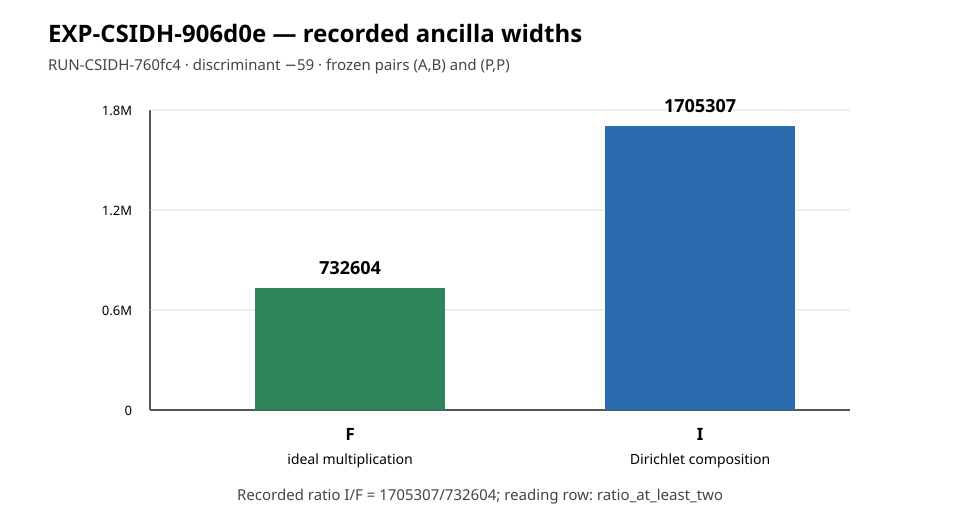

# EXP-CSIDH-906d0e execution report

## Scope and disposition

This is an observation-only report for the single frozen trial
`ancilla-ratio-frozen-cell`, recorded as `RUN-CSIDH-760fc4`. The supervisor
returned `output_validated` and the independent checker returned code 0.
This report does not change the hypothesis, experiment, or goal status.



## Frozen inputs and custody

- Experiment: `EXP-CSIDH-906d0e`
- Trial: `ancilla-ratio-frozen-cell`
- Run: `RUN-CSIDH-760fc4`
- Plan: `experiments/EXP-CSIDH-906d0e/trial-plan-v2.json`
- Plan SHA-256: `d42d49a15c1d11d4f55e4cfac4c127ea927d60e74710507c53a47d78c478dfd3`
- Execution checkout commit: `5a926654419a261409b03e4ab85e5f7d260ea3a9`
- Dispatch-plan SHA-256: `763e9c9712275540a288360f0738230a82326554b44821fe876182e892fa731b`
- Owner and lease: `executor-csidh-906d0e`, epoch `1`
- Execution command: `python3 tools/experiment_execution.py run --plan experiments/EXP-CSIDH-906d0e/trial-plan-v2.json --owner executor-csidh-906d0e --epoch 1`
- Container: `crypto-ci-python:20261008`, network disabled
- Run receipt: `returncode: 0`, `check_returncode: 0`, `status: output_validated`

## Recorded observations

The recorded widths were:

- `width_F = 732604`
- `width_I = 1705307`
- exact recorded ratio: `1705307/732604`
- producer-recorded decimal field: `2.327734`
- reading row: `ratio_at_least_two`

Both frozen pairs agreed: `agreement_AB=true` and `agreement_PP=true`. The
principal/reference value checks passed, the width and ancilla accounting
checks passed, and both discriminant `-60` refusal controls were true. The
producer recorded `attack_claimed=false`. The checker independently reported:

```text
check ok: row ratio_at_least_two, width_F 732604, width_I 1705307
```

## Interpretation boundary

These are the recorded widths and controls for one discriminant, one encoding,
two frozen input pairs, and the named circuit construction. They do not by
themselves establish an end-to-end implementation advantage, an ECDLP cost
reduction, a quantum resource bound beyond this cell, or behavior at another
discriminant or encoding. All raw outputs, manifests, readings, supervisor
receipt, command, environment, and checker logs remain under the run directory.
