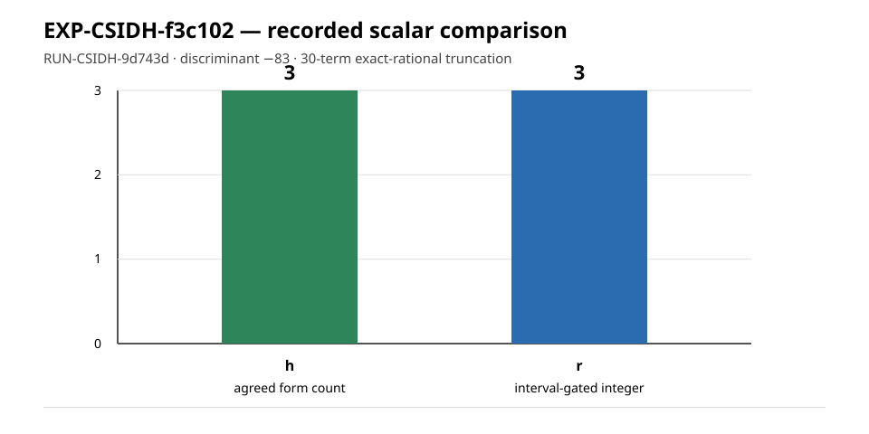

# EXP-CSIDH-f3c102 execution report

## Scope and disposition

This is an observation-only report for the single frozen trial
`truncation-vs-form-count`, recorded as `RUN-CSIDH-9d743d`. The supervisor
returned `output_validated` and the independent checker returned code 0.
This report does not change the hypothesis, experiment, or goal status.



## Frozen inputs and custody

- Experiment: `EXP-CSIDH-f3c102`
- Trial: `truncation-vs-form-count`
- Run: `RUN-CSIDH-9d743d`
- Plan: `experiments/EXP-CSIDH-f3c102/trial-plan-v2.json`
- Plan SHA-256: `0aa8207091fbd570bb36613b98abefaa23baca817b6f875060dd1958bacbc8c1`
- Execution checkout commit: `9a62784add253f84452ee4abf63d32efc2f81c07`
- Dispatch-plan SHA-256: `0984cd3d0fa32eb79032ef60db9bbcfdc179cc2f6bb73be4c74029ac81ecc526`
- Owner and lease: `executor-csidh-f3c102`, epoch `1`
- Execution command: `python3 tools/experiment_execution.py run --plan experiments/EXP-CSIDH-f3c102/trial-plan-v2.json --owner executor-csidh-f3c102 --epoch 1`
- Container: `crypto-ci-python:20261008`, network disabled
- Run receipt: `returncode: 0`, `check_returncode: 0`, `status: output_validated`

## Recorded observations

The two frozen form enumerations agreed and each returned count `h = 3`.
The interval-gated nearest integer was `r = 3`; the recorded absolute
difference was `|r - h| = 0`. The interval-length gate was true and the
nearest-integer gate status was `ok`.

The run recorded the exact rational truncation

```text
L30 = 2541037817707 / 2329089562800
```

and the rational interval

```text
[871981630373833198601/275608931598000000000,
 613473869237676853207/193896706103100000000]
```

The controls recorded as true were: `-83` fundamental, `-332`
non-fundamental, `-84` fundamental self-check, enumeration agreement,
`chi(1) = 1`, reduced-fraction status, and agreement of the two Kronecker
implementations. `attack_claimed` was false. The checker independently
reported: `check ok: row match, gate ok, r 3, h 3`.

## Interpretation boundary

These are the recorded values for one discriminant and one 30-term frozen
truncation under the named rational enclosure and controls. They do not by
themselves establish a class-number formula, a security level, an
ECDLP-cost reduction, or behavior at another discriminant or truncation
length. The raw result, manifest, reading, supervisor receipt, command,
environment, and checker logs are preserved under the run directory.
