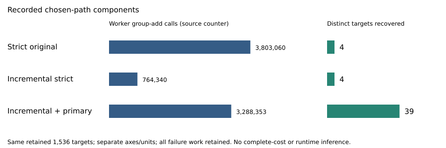

# Retained reference and paid-component audit

DEC-20261030-c55f30 · BATCH-128d4e · EXP-ECDLP-080f41 / RUN-ECDLP-939237 · 2026-10-30

## Observation

The audit preserves a positive finite result: the registered primary t1.e2 path produced43 publicly verified recovery events covering39 distinct targets, while each strict evaluator produced4 events covering4 targets. These are the same1536 retained public targets and12288 attempted blindings per method/cell. The primary has successful observations in both confirmation panels. This is a concrete working-input lead worth inspecting; complete success density and a fully paid comparable solver cost remain open.

Three independent sessions derived their assigned quantities blind, sealed them, and received explicit root release before reading producer source/results. J-law holds for the complete retained inventory under the declared ideal independent-hash model. J-truth and J-cost are inconclusive for their full historical-witness/full-cost requirements, while their inspected finite equations and component identities agree. None of these is a vote on the whole research direction.

| Audited quantity | Coverage |
|---|---:|
| Retained curves / reconstructed orbit entries |48 /821686|
| Orientation draws / conditional uniform rows |24552 /73728|
| Decoder words / public candidate equations |3068802 /2280562|
| BSGS final equations / prepared setup equations |1536 /216|
| Physical predicate calls / paid M=0 rows |1033728 /15820|

## Comparison

The table below describes alternative chosen-path component views given public E,G,Q,r. It includes the chosen actual online execution, once-paid prepared setup and blinding RNG. The primary includes the entire actually executed incremental strict work plus its t1.e2 decoder; a future optimized program is not substituted. The study physically executed both evaluators, all six decoder cells and diagnostic controls. Their costs are preserved separately.

| Chosen path | Group-add calls | Field multiplications | Field inversions | Unique targets |
|---|---:|---:|---:|---:|
|Strict original|3803060|17000119|3588568|4|
|Incremental strict|764340|5270199|709592|4|
|Incremental + primary t1.e2|3288353|12794145|2957893|39|

Columns use separate, nested primitive units and must not be added. These are source-instrumented component counts with independent algebraic reconciliation, not native counter replay or measured runtime. Same-target scheduling permits this descriptive comparison; differing success behavior, missing process/memory costs and unqualified execution dimensions prevent an expected-cost/runtime conclusion. Exact component-per-unique fractions remain in observations.json, with null for zero-hit populations.

| Panel | Strict events / distinct | Primary events / distinct | Primary group calls |
|---|---:|---:|---:|
|A|4 /4|25 /23|1630656|
|B|0 /0|18 /16|1657697|

Every attempted failure remains paid. Both strict methods retain7688 empty,4469 rejected and127 undefined attempts, alongside4 recoveries. All3068802 word records and all15820 M=0 cell rows were inspected. Zero-hit curves are22/24 for original and12/24 for primary; an observed zero-hit ratio is undefined, not proof of q=0. Curve input generation separately retains49155 proposals:46596 field rejects,2511 order rejects and48 accepted; target sampling retains19 duplicate proposals.

Host BSGS is a separately costed diagnostic baseline:24 setups,1536 successful final equations,2594 table points summed across tables (largest249). Its host primitive setup vector has3338 group-add calls and online vector141042; higher-level setup-group2594 and online-group82494 are separate counters. These host units/backends cannot be divided into the worker table. A solver given public inputs and a paid reproduction of this scientific cohort have different setup policies; both are disclosed. No P1/3 algorithm/reference is supplied.

## Inference and limitation

Finite public recovery witnesses and retained reference agreement are useful evidence about these fixed inputs. They do not identify the full fixed-function success density or transfer to an arbitrary curve family. No full-orbit recovery census was executed by this audit. The matched-M reference samples distinct nonzero guesses: conditional hit probability is min(M,r−1)/(r−1). Its M-determination is paid candidate work. Six cells share targets, blindings and traces; domain separation is not independent scientific replication.

All24552 retained orientation draws and73728 conditional uniform rows agree with independent reconstruction. The ideal-hash qualification matters: deterministic byte agreement does not prove physical entropy, late seed generation or iid stages. No retained saturation, raw hash rejection, duplicate orientation or ineligible/degenerate mask was observed; fixed public controls do not certify those unobserved production branches.

The truth audit verifies all1536 final BSGS scalars, but source rows do not retain baby tables, giant-step sequences or explicit collision(i,j). Independently derived indices are not original execution witnesses. The initial full truth-audit invocations also lack captured code hashes; later available scripts/hashes are preserved without inventing earlier custody. Law recovered its actual executed source with root comparison; cost captured before/after code. These are distinct provenance facts.

Source counter identities do not supply native replay, full host-verifier process work, simultaneous cache/RSS/representation bytes, interpreter/integer/I/O, energy/currency or qualified clocks. A complete primitive-count comparison can be a legitimate future target without clocks; a clock claim additionally needs a qualified clock. S+T+E[Ccomplete]/q needs iid complete fresh restarts, q>0 and finite cost. Heterogeneous repeated targets/cells and an observed hit fraction do not meet those premises automatically.

The original native invalid_output/check1/publishedfalse remains unchanged. The completed-YAML versus strictJSON supervisor mismatch is an operational fact; the later qualified typed bridge does not rewrite old status. The source-produced report's original inspection gap, old blind-reference inconclusive record and all old reviews remain historical. Goal active, H-ECDLP-6674c9 specified and IDEA-20261029-009e52 proposed remain unchanged. The linked problem records exact witness/cost/custody exits; recording it resolves none.

## Next discriminating work — conditional design

Rank first a separately frozen, independently implemented SAME48/all6 exact success-density diagnostic. Enumerate every nonzero scalar state per fixed curve/function, retain errors/erasures/caps/list budgets/public checks and compare exact q with the same-domain average min(M(s),r−1)/(r−1). A positive exact q plus a proved uniform-blinding mapping can qualify randomized recovery on that fixed function; it establishes no population-wide or complexity result. All orbit/log/census work is charged diagnostic work and never candidate advice.

This builds on prior work: EXP-ECDLP-8dc19d already has small exact censuses at r=17,29,61,127, including a preserved r17 q=8/16 working example; its implementation explicitly refuses larger r. The proposed question is the current48 ordinary10/13/16-bit curves, all6 cells, current mask and M(s), rather than a new census concept. Exact current densities are not computed here.

Controls must include true-half positive recovery, negated-half refusal under stated length/cap assumptions, actual archived anchored-odd q0 fixtures, erasure/cap/list boundaries and wrong public scalar/conversion. Independent predictions and implementation precede source/results. Reconcile every retained trace/public recovery. A mismatch produces a smallest witness; incomplete enumeration/custody leaves that named obligation inconclusive.

Fresh-population confirmation is rank2: a conditional three-batch shape of48 curves each, under the existing per-invocation cap, with union exclusions for all48 current and218 prior curves plus earlier new batches. Freeze exact samplers, methods/caps, curve-target-blinding hierarchy, uncertainty, controls, paid costs and fixed stopping before any draw. No outcome-based optional stopping or retry under consumed IDs.

Before either launch: repair the native representation contract under a new metadata source version while pinning scientific logic separately; freeze complete protocol/source/typed bridge/mutation controls, resource/storage envelopes, per-invocation before/after code hashes, independent primitive replay and matched backend/setup/success/stop policies. Require fresh IDs, actual preapproval/approval, current selector readiness/checkpoint/claims and complete custody. This is conditional design, not an approved runnable experiment.

## Review architecture, evidence and next custody

The unchanged aggregate checker first returnedRC1 because its interface supports one phased owner contract while the frozen aggregate lists three per-owner plans. The technical gate is the conjunction of three SHA-bound ORIGINAL full-phase checksRC0, lossless ROOT-DERIVED views removing only phased_release, and an aggregate-view checkRC0. Every other typed field, read set, verdict, control and blindness declaration remains unchanged; original files/plans/checker are intact. No single invocation checked all phases. Original refusal, projections, exact removed blocks/bytes, commands and directive are retained in the root technical-validation evidence. This documented procedure deviation is metadata, not a mathematical failure.

Earlier joint-label/machine-ID and phase1 representation refusals/corrections remain preserved. The actual evidence is the three checks/report/read-attestation packages:3393bd law,88d5bd truth and f55ebb cost. Original phase1 publication6f1a20fad9, releaseabc17d567a and ACK246078079c are historical pair-phase records; cost's separate exact chronology remains in its own attestation. The effective scope amendment is221468fbcc; formal composition claim isefd6f58546. Source and release hashes are indexed in observations.json. The Coordinator requested coordinator-orchestration-code/high; serving model is unverified, with no invented probe or model ID.

Primary sources read: original frozen protocol/spec/trial; actual independent reports/checks; HAC3.55–3.58 for setup/online/table costs; prior census source and working-domain record. Internal pointers are not additional independent evidence. No novelty or exhaustive-literature conclusion is made. Canonical relation graphs were checked for affected scientific relationships; none changes because this record changes no relationship or status.

Root must inspect every page of this new PDF, validate exact small report-data derivation and old/new committed-source metrics/tests, then archive via b895bb using actual R1/R2 Git bindings and policy-appropriate PDF storage. Law's44520B PDF is a policy-eligible native Git artifact; its empty publisher receipt is not S3 GET evidence. Stored truth/cost artifacts retain actual matching modern/legacy pointers/full-GET evidence. New audit coverage metrics are neutral inspected-record counts, never estimates, unknown-as-zero or improvements. All existing metric IDs/readers remain intact.

The global ledger remains nongreen with41 preexisting unrelated errors per root. Selected new-record checks do not suppress them. Final custody is not complete until root verifies the real archive receipt. Knowledge promotion is not warranted: this descriptive audit supplies no new theorem or qualified complete attack-cost claim.

Linked problem: problems/classical-ecdlp-retained-reference-cost-qualification.md. Full conditional design, evidence hashes, component/host vectors and zero/unknown values accompany this report in observations.json and fresh-next-cohort-plan.json.
