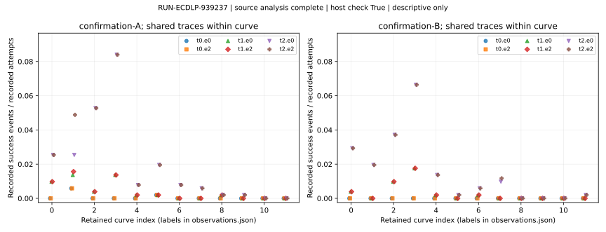

# Controlled classical ECDLP run observations

EXP-ECDLP-080f41 / RUN-ECDLP-939237 / GOAL-ECDLP-e70832 / H-ECDLP-6674c9. Observations only; this report changes no scientific status.

One physical candidate VM was retained. Native supervisor status remains `invalid_output` (driver0, checker1, publishedfalse) after a JSON/YAML manifest serialization refusal. The separately derived complete read-only JSON representation passed independent compatibility/custody validation. Host postrun returned0, source status `complete`. These distinct statuses remain recorded.

## Recorded process and coverage

| Quantity | Recorded value |
| --- | --- |
| Native first-trial start UTC | 2026-10-29T22:58:42.290270+00:00 |
| Native terminal UTC | 2026-10-29T23:09:08.554907+00:00 |
| VM creates / candidate engine executions | 1 / 1 |
| Engine returncode / controller status | 0 / complete |
| Collection / UID1000 quiescence / actual termination ACK | True / True / True |
| Native source authority | `6ce9937047cb26279f61a128ecc45751dc135a78` |
| Native dirty-tree field | unknown |
| Host verifier | checked |
| Host observed row counts | `{"cells": 73728, "intents": 36864, "setups": 216, "singles": 345600, "traces": 36864}` |
| Unified export flow | `{"attempted": 2, "completed": 2, "excluded": [], "interrupted": 0, "not_completed": 0, "planned": 2, "resumed": 0}` |
| Retained analysis counts | `{"retained_curve_cell_pairs": 144, "retained_curves": 48, "retained_decoder_cells": 73728, "retained_physical_trace_records": 36864}` |

The graph displays every retained curve/cell row from the source analysis, with separate confirmationA/B panels. Six decoder cells share traces; paired original/incremental evaluator aggregates share the same single VM. Missing outcomes remain missing. The plotted fractions are labelled arithmetic on recorded successes and attempts, with no new interval, p-value or fit.

## Logical evaluator rows

- `RUN-ECDLP-939237.original` / `confirmation_original` / `candidate-vm` / replicate0: status`succeeded`; recorded measurements `{"counted": {"retained_attempts": 12288, "retained_predicate_queries": 172032, "strict_recovered_events": 4, "unique_targets_recovered": 4, "unique_targets_retained": 1536}, "cpu_sys_seconds": null, "cpu_user_seconds": null, "max_rss_bytes": null, "wall_seconds": null, "wall_valid": false}`.
- `RUN-ECDLP-939237.incremental` / `confirmation_incremental` / `candidate-vm` / replicate0: status`succeeded`; recorded measurements `{"counted": {"retained_attempts": 12288, "retained_predicate_queries": 172032, "strict_recovered_events": 4, "unique_targets_recovered": 4, "unique_targets_retained": 1536}, "cpu_sys_seconds": null, "cpu_user_seconds": null, "max_rss_bytes": null, "wall_seconds": null, "wall_valid": false}`.

## Six shared decoder views and recorded conditional uniform references

The following are labelled sums across24 confirmation curves. Each cell uses the same retained traces/targets. Uniform is the single recorded matched-M conditional reference for that cell; determining M remains paid candidate work. These counts add no inference or advantage claim.

| Cell | Candidate events / attempts | Recorded uniform events / rows | Recovered curve-target pairs |
| --- | ---: | ---: | ---: |
| t0.e0 | 4 / 12288 | 3 / 12288 | 4 |
| t0.e2 | 4 / 12288 | 0 / 12288 | 4 |
| t1.e0 | 42 / 12288 | 33 / 12288 | 38 |
| t1.e2 | 43 / 12288 | 35 / 12288 | 39 |
| t2.e0 | 214 / 12288 | 184 / 12288 | 183 |
| t2.e2 | 227 / 12288 | 149 / 12288 | 196 |

## Calibration and references

Calibration recorded summary: `{"all_complete_1800": true, "arm_records": 192, "by_stage": {"discovery": {"arm_records": 96, "retained_draws": 172800, "signed_numerator_range": [-168, 152], "undefined_draws": 76}, "validation": {"arm_records": 96, "retained_draws": 172800, "signed_numerator_range": [-208, 171], "undefined_draws": 51}}, "n_range": [1800, 1800], "retained_draws": 345600, "scope": "Labelled sums/ranges of192 retained arm records; not independent curve-population samples or a confidence interval.", "signed_numerator_range": [-208, 171], "undefined_draws": 127}`. Exact signed numerators, actual all-draw denominators, correct/wrong/undefined counts and complete1800flags are preserved in observations.json. The frozen1/512resolution literal is NOTQUALIFIED for calibration. Undefined draws remain in the denominator. A score grid is not uncertainty.
BSGS source summary: `{"retained_target_records": 1536, "scope": "Source-generated independent BSGS entries; full cold/warm setup/online vectors remain in references.json. No timing claim.", "status_counts": {"success": 1536}}`.
The source calibration/error-erasure histograms, conditional matched-M nonzero uniform streams, mask orientations/support/duplicates/ties, BSGS cold/warm vectors and all setup/common/query/list/public-verification components remain in the unchanged source files. Their scopes and missing/partial states are retained there. M0 means zero reference guesses; common/setup/M-determination work remains charged.

## Registered controls and uncertainty

Frozen controls/excuses: `{"aa": {"comparison": null, "not_applicable_reason": "Fresh A/A alias is unimplemented; deterministic original/incremental equality and independently checked known F11/F23 semantics qualify source only. This descriptive study makes no noise-floor/performance/null-inference claim; a fresh A/A release claim is withheld.", "present": false}, "negative": {"arm": null, "not_applicable_reason": "Host matched-M uniform and exact-mask orientation ensembles are descriptive conditional references, not exchangeable inferential null arms; no p-values. Their law/counts are frozen in extensions.", "null_population": null, "present": false}, "positive": {"arm": null, "expected_detection": null, "not_applicable_reason": "No extra fresh planted arm; known F11/F23 source controls checked before protocol, host BSGS verifies every actual target only after ACK. This does not qualify fresh detector sensitivity or a negative scientific verdict.", "present": false}}`.
Fresh A/A, positive-arm and inferential-negative outcomes are not inferred from source fixtures, bridge controls or host references. Curve is the population unit. Source-provided zero-event bounds, when present, retain their stated fixed-curve restart assumption; nonzero fractions are descriptive. No curve-population interval, exchangeable-null p-value or exponent fit is added.

## Failures, representation and scope

Host source errors: `[]`.
Unified export validation: `{"findings": [], "protocol_qualified": true, "schema_compliant": true}`.
The original native YAML, receipt, checker traceback, raw archive and all51native files remain unchanged. The fullJSONview preserves all supervisor fields/types and has explicit storage/source mapping; independent TASK-20261029-3b5feb checked10positive conditions/48mutant refusals and ordinary full C4 check. This is representation/custody qualification, separate from host verification.
Derived manifestSHA256 `2c60bea2625d1287a1d827afc496b177e0b17a24bd55f6518b2bd16546c2e755`; view-provenanceSHA256 `0e59dd89e53c7012745ba203be4255d09496cdb7c5c5e556d92ca9342ab66684`.
Native elapsed orchestration is not algorithm timing. Wall clocks, actual VM isolation and independent native worker counter replay remain unqualified; nativeRSS, interpreter allocations, I/O and Python integer internals are unmetered. Source component counts remain separate and carry no mixed total or attack-cost ratio. No scientific verdict is added.

## Source, command, seed and provenance

Native environment: `{"commit": "6ce9937047cb26279f61a128ecc45751dc135a78", "platform": "linux", "python": "3.12.14 (main, Aug 25 2026, 14:00:49) [Clang 22.1.3 ]", "runtime_lock": null, "runtime_lock_sha256": null, "source_sha256": {"harness/classical_ecdlp_controlled_followup/cohort.py": "cd5896f63f52351d499104ea14e36ddf66a4bd586efaba8e651ebce2053a8ff3", "harness/classical_ecdlp_controlled_followup/constructor.py": "31e58db07649df4e61ec2cbcaa1969789bc2c7f229c21f8555daaaaad8fdc451", "harness/classical_ecdlp_controlled_followup/controller.py": "2afcae5d1ef861cc05278ed557639ed638cbb5ea9a476020a8b222f74b7200e1", "harness/classical_ecdlp_controlled_followup/curve.py": "6ce0b50fcc78287de7091c36383b5ccefb5dbe208ba3d1ab1c80b1ddbc326400", "harness/classical_ecdlp_controlled_followup/driver.py": "2bcabf08a5a583490196acefb6da250ee3d8eaf9131e742f489ff08d81901e38", "harness/classical_ecdlp_controlled_followup/engine-interface.json": "3a7be27cbc28d1e0ddc062b640dbddac23b233bbfa8de3343b0963cb1e3e3cec", "harness/classical_ecdlp_controlled_followup/engine.py": "22da83d6494ea66c520b0e58eaa4b54e621c822d8f0275deda8822c7179915fb", "harness/classical_ecdlp_controlled_followup/host/reference.py": "ee58b639fecbed063e74d6e825ca5a6d0e19dc79816c3713092defc8dcfa3ce2", "harness/classical_ecdlp_controlled_followup/host/verifier-interface.json": "3d14cb7073ddbbe18a15575e987523a3e94a5686ac3e3c2c3f5ad2eabf3e3926", "harness/classical_ecdlp_controlled_followup/host/verify.py": "244bcbd4ff7621d046165d9fa23402cd39db1e4cf17656f9841c38d2ddab4da3", "harness/classical_ecdlp_controlled_followup/postrun/analysis.py": "0660d62ec2852d4762d80d3fd88d2d0017d147f516592b41faeec97eacf24688", "harness/classical_ecdlp_controlled_followup/postrun/render_report.py": "b8ba085eff7379c3bc365db6f9b06e6d43f43c40a9b6d4216780947bbfb90470", "harness/classical_ecdlp_controlled_followup/postrun/run_postrun.py": "e683de86d6a1ba39eeb3775878f2ba11db79ca7a2013b0cfdc821cbd05afb7a0", "harness/classical_ecdlp_controlled_followup/worker_runtime.py": "1a342283c81bf39d8a2dfde5924cfde53d9a9b5c66ae038a22b213d19c8156ed", "schemas/experiment-export.v1.json": "108f0ae9c1be3ed141bca3c22216eba049f2c76677f11013109a4740f19bd757", "schemas/experiment-protocol.v1.json": "a9b948f2be323f862b98301eb7a5aa147ecc29db35041737f0aa3dfd03ad2443", "schemas/experiment-review.v1.json": "afdf927fb6ecbcbf8c4bc31569144a6ab4aad024cebab3e8f76a7f10c9829ad3", "tools/experiment_protocol.py": "0f46a2b856bb1df2d155c4a676b46c6118d82c45cf8e5cc0492315aeb45c84e4"}, "specification_sha256": "36bca9ea337e78353e4681c8063c1a81d4559ef36d9506e83906b6b8a327f038"}`.
Actual native argv: `["/workspace/classical-ecdlp-endpoint-reuse/runtime-20261028/bin/python", "harness/classical_ecdlp_controlled_followup/driver.py", "run", "--repo-root", "/workspace/classical-ecdlp-validation-ready", "--protocol", "experiments/EXP-ECDLP-080f41/protocol.json", "--image-receipt", "harness/classical_ecdlp_endpoint_reuse/modal/receipts-b2/image-build.json", "--compute-plan", "experiments/EXP-ECDLP-080f41/compute-plan.json", "--prior-exclusions", "harness/classical_ecdlp_controlled_followup/prior-exclusions.json", "--worker-manifest", "harness/classical_ecdlp_controlled_followup/worker-source-manifest.json", "--host-manifest", "harness/classical_ecdlp_controlled_followup/host-source-manifest.json", "--engine-interface", "harness/classical_ecdlp_controlled_followup/engine-interface.json", "--host-interface", "harness/classical_ecdlp_controlled_followup/host/verifier-interface.json", "--experiment-id", "EXP-ECDLP-080f41", "--run-id", "RUN-ECDLP-939237", "--out", "/workspace/classical-ecdlp-validation-ready/experiments/EXP-ECDLP-080f41/runs/RUN-ECDLP-939237"]`.
Actual host postrun command: `{"argv": ["/workspace/classical-ecdlp-endpoint-reuse/runtime-20261028/bin/python", "harness/classical_ecdlp_controlled_followup/postrun/run_postrun.py", "--repo-root", "/workspace/classical-ecdlp-validation-ready", "--out", "coordination/goals/GOAL-ECDLP-e70832/batches/BATCH-cbf9d7/derived-supervisor-views/RUN-ECDLP-939237/manifest-json-v1/supervisor", "--destination", "experiments/EXP-ECDLP-080f41/postrun-from-view-346631"], "bridge_validation_files_sha256": {"checks.json": "32ea0d7ab7bdde8966e54da198e324f5b3590156e797a16d8675ed151e2cb206", "read-attestation.yaml": "15a6f3ddfa161676710a39a812d87ab885d60a9a2a04f70a969d405694b09034", "report.md": "2db8dad80207d6f235341a76bd93e2e9048c1fc2617f305423b43a70d220f4f6"}, "candidate_or_VM_invocation": false, "claim_sha256": "d591fd90292024ec0e3d4ec839f4f947e90281db186d12b10b6e2347adfee3f3", "clock_qualified": false, "cwd": "/workspace/classical-ecdlp-validation-ready", "finished_at": "2026-10-30T00:41:42.291091+00:00", "queue_sha256": "82a63f1d20e3db28193289e71572b09fe54a25358fd99890ac149666e6fee237", "returncode": 0, "source_head": "4250e3dac442e1099d11a57ac56a718ae3a5e79e", "started_at": "2026-10-29T23:53:15.463213+00:00", "task_id": "TASK-20261029-cbafca"}`.
Candidate public nonce is retained in the sealed native cohort/nonce records. Any source host seed is retained only if the source emitted it after full authenticated workload verification, collection seal/readback, quiescence and actual termination acknowledgement. This report draws no entropy.
Actual source output root: `experiments/EXP-ECDLP-080f41/postrun-from-view-346631`. Original source-created reports/export/validation remain unchanged. Any experiment-root export is a new separately rebased derivative with its own actual file-check record.
All48 exposed curve models/bases and original(p,j) identities are retained in exposed-curves.json and observations.json, with original cohort/ledger hashes. These enable future exclusions without resampling; frozen inputs are unchanged. Exact source hashes/bytes: observations.json. Prelaunch calibration qualification, later Coordinator assessment, point-in-time root resources and actual commands/failures are separately indexed in postrun custody. The native dirty field is unknown; external earlier clean-tree observations do not fill that native field.
This local graph records this run only. Canonical research graphs are unchanged: no scientific status or graph-supported mathematical finding is changed by this producer report.

Procedural primary sources read: AGENTS.md; docs/agent-contract-extended.md (literature/observation rules); agents/executor.md; run and research-visuals skills; effective cbafca card; frozen protocol/output contract; fullnativeJSONbridge contract/addendum; source postrun/analysis/renderer/reference. Provenance internal. No external paper or novelty search was needed for this administrative reporting task; no scientific novelty claim or model probe is made.
