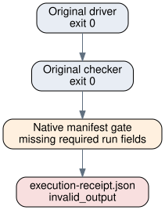

# EXP-ECDLP-20ac31: original native execution observation

Observations only. No scientific verdict, support/weaken decision or attack claim is made. The driver and checker completed; the native supervisor rejected the obsolete manifest.

- Hypothesis: H-ECDLP-18c7f7; goal: GOAL-ECDLP-001.
- Run: [RUN-ECDLP-08e0d9](../../runs/RUN-ECDLP-08e0d9/execution-receipt.json); one requested deterministic trial, driver/checker exits 0, supervisor-valid 0, invalid-output 1, no recorded timeout.
- Code commit: `783ff525b95c13e8f9390b41d06d640303aa67d4` from the supervisor environment, not from the incomplete original manifest. Dirty-tree status and CPU/GPU model were not recorded.
- Native status: `invalid_output`. Exact failure: manifest.yaml fails the run schema (tools/validate_ledger.py): bad run id None; run missing required field 'id'; run missing required field 'status'; run missing required field 'code'; run missing required field 'environment'; run missing required field 'inputs'; run missing required field 'timing'; run missing required field 'result'; run.code.commit missing (not reproducible); run.code.command missing (not reproducible); run.result.certificate.kind must be one of discrete_log|decomposition|none
- Declared memory: 256MiB (limit, not measured peak). CPU seconds and peak RSS are unrecorded.
- Derived supervisor interval: 0.162657seconds = 2026-10-18T04:23:14.412012+00:00 minus 2026-10-18T04:23:14.249355+00:00. One deterministic observation, no uncertainty interval or speed comparison.
- Recorded original metrics: `{"beyond_matrix": true, "matrix_holds": false, "planted_ok": true}`. These are retained observations, not admitted scientific evidence.
- Certificate: missing in the obsolete manifest; the raw worksheet claims no attack. No certificate or formal verification is inferred.

Exact original inputs:

```json
{
  "curve": "y^2 = x^3 + 6x + 2",
  "prime_min": 23,
  "prime_max": 120,
  "minimum_nonzero_y_points": 24,
  "shuffles": 300,
  "rank": 285,
  "seed_label": "IDEA-20261006-30b5f6",
  "named_future_run_slot": "RUN-ECDLP-08e0d9"
}
```

Exact frozen command argv (working directory was repository root):

```json
[
  "python3",
  "experiments/EXP-ECDLP-20ac31/implementation/run.py",
  "--trial-plan",
  "experiments/EXP-ECDLP-20ac31/trial-plan.json",
  "--run-dir",
  "/workspace/crypto-autoresearcher/experiments/EXP-ECDLP-20ac31/runs/RUN-ECDLP-08e0d9"
]
```

The native checker ran the original frozen controls, with exit 0. Its original scope and all controls/seeds are retained in [facts.json](facts.json) and the unchanged [specification](../../specification.yaml). No new random draw or unregistered re-scoring occurred.



The diagram is used because this run has one wall interval and no two comparable scientific measurements; exit codes describe process outcomes. Caption: RUN-ECDLP-08e0d9, n=1 deterministic worksheet, no reported uncertainty. [Editable graph](diagram.dot), [PDF report](report.pdf). No canonical scientific graph changes: the only new observation is operational manifest rejection.

Fresh reproduction, if separately approved and natively admitted, uses EXP-ECDLP-5d6ec1 / RUN-ECDLP-6671fe; it preserves the original raw reading as in-sample calibration. The original run remains immutable invalid_output and needs_reconciliation.
