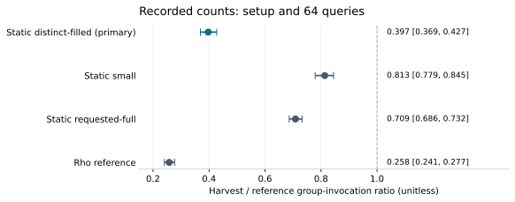

# Classical endpoint-reuse run observations

This is a descriptive record of RUN-ECDLP-b883bf for EXP-ECDLP-2b4ff1, H-ECDLP-3509c4 and GOAL-ECDLP-e70832. It reports execution, public correctness checks and the frozen analysis; it makes no scientific verdict or official status transition.

All **768 planned native children completed** with no recorded failed, timed-out or unattempted child. All **49,152 target-arm scalar witnesses** passed independent public equation checks. The fixed panel contains **64 ordinary curves ×2 replicates ×64 targets =8,192 target IDs**, evaluated by six arms. The verifier checked6,432retained terminal equations and 5,885 promotions; all 128 A/A pairs matched.

Records: [run manifest](../../runs/RUN-ECDLP-b883bf/manifest.yaml), [frozen protocol](../../protocol.modal-vm.v1.json), [plot/table data](data.json), [checked graph hashes](graph-check.json).

## Recorded comparison at 64 targets

| Candidate / reference | Role | Recorded ratio | Recorded 95% cluster interval |
|---|---|---:|---:|
| `harvest / static_filled` | Primary at 64 queries | 0.396997 | [0.369279, 0.427424] |
| `harvest / static_small` | Secondary | 0.813385 | [0.779203, 0.844648] |
| `harvest / static_full` | Secondary | 0.708837 | [0.686410, 0.732354] |
| `harvest / rho_reference` | Secondary | 0.257833 | [0.240586, 0.277172] |
| `harvest_disabled / static_small` | A/A | 1.000000 | [1.000000, 1.000000] |

For each curve, sum the two replicate costs for each arm, divide harvest by the reference, and take the geometric mean of the 64 curve ratios. Intervals are the frozen analysis's pointwise 95% cluster-bootstrap intervals from 10,000 resamples of curves, preserving both replicates and all prefixes. Only harvest/static_filled after 64 queries is the registered primary contrast. Secondary rows are descriptive; their intervals make no familywise discovery claim.



The metric sums reported solver-native setup and online group_additions, including public answer checks and endpoint promotion checks. Common input certification, parsing, output, orchestration and non-EC bookkeeping are separate costs. Scalar-multiplication/doubling diagnostics are not added again. A group invocation is not a complete application-runtime unit.

## Execution and controls

- One approved supervisor trial, RUN-ECDLP-b883bf, on CPU-only Modal VM `sb-01M5ZDNY7CWH1T1Z5HET0QP6JD`; no scientific retry or restoration. Supervisor return code0 and output checker return code0; receipt status `output_validated`.
- Six arms: `static_small`, `static_full`, `static_filled`, `harvest`, `harvest_disabled`, `rho_reference`. `static_full` pays the requested raw-chain budget and may underfill; `static_filled` pays to reach the distinct endpoint count. Harvest uses verified endpoint admission into the bounded known-plus-pending arena.
- Registered sizes12,14,16,18subgroup bits, 16fresh ordinary nonanomalous curves each, j neither 0 nor 1728, cofactor 1..3. Targets were sampled uniformly with replacement. Hidden target labels were not inputs to the solver VM or read by the independent verifier.
- Exact A/A: 128 cell pairs, 256 control streams, 16,384 target rows, four registered fields equal (`prefixes`, `status_counts`, initial-entry SHA and target-answer/counter-trace SHA); 0 mismatches.
- Independent public verifier: 64 fixtures, 128 settings cells, 768 producer cells, 143,301 raw rows, 49,152 cases, 49,152 final scalar witnesses, 6,432 terminal equations and 5,885 promotions. Producer target statuses: 49,152 solved; 0 failed/censored/invalid. Analysis field `primary_panel_eligible=true` is retained as a recorded field, not a claim-review decision.
- Supervisor driver interval 46.669368 seconds, from 2026-10-27T19:34:00.933932Z to19:34:47.603300Z; final supervisor receipt 19:34:49.841671Z. This interval includes control and transport activity and is unqualified.

Exact launch:

```sh
python3 tools/experiment_execution.py run \
  --plan experiments/EXP-ECDLP-2b4ff1/trial-plan.json \
  --owner executor-modal-endpoint --epoch 1
```

The launch argv, supervisor Python version, command, public per-cell seeds and input SHA bindings are retained in `launch.json`, `command.txt`, `environment.json`, the frozen trial plan and each native `execution.json`. Private labels are not needed for the public checks.

## Recorded resource and count diagnostics

| Arm | Group invocations: sum across 128 cells | Whole-child CPU seconds: sum | Maximum child RSS (MiB) |
|---|---:|---:|---:|
| `static_small` | 2,008,664 | 1.308498 | 35.828 |
| `static_full` | 2,392,775 | 1.538447 | 35.828 |
| `static_filled` | 4,531,318 | 2.649086 | 35.828 |
| `harvest` | 1,624,878 | 1.371418 | 35.703 |
| `harvest_disabled` | 2,008,664 | 1.311432 | 35.828 |
| `rho_reference` | 6,277,301 | 3.349042 | 35.828 |

These columns are labelled arithmetic, not additional statistical analyses. The count column sums the 128frozen prefix 64counters per arm; it is not the geometric-mean comparison above. CPU sums wait4 user + system seconds over whole native children, including common input validation, parsing, setup, targets, output and teardown. RSS is the maximum recorded Linux wait4 ru_maxrss across 128 children, converted from KiB tobytes by source A, then divided by1,048,576 here. These clocks remain unqualified. Per-child observations and all field-counter families remain in the raw archive.

## Limits of this record

- The independent verifier checked public equations and causal trace/state conditions. It did not independently replay native operation counts or attest execution or isolation.
- The verifier did not independently count every curve point. Its public order checks are Hasse/divisibility and subgroup checks. The trace state hash64 is not a cryptographic certificate.
- All producer clocks have wall_valid=false. The Modal VM does not attest L2 or exclusive physical-host placement. CPU/RSS and supervisor elapsed time are retained operational diagnostics.
- The fixed endpoint limit bounds known plus pending slots; it does not bound whole-process RSS. Sorting, hashing, lookup and other non-EC costs are not priced by group invocation counts.
- This fixed64-query panel covers 12/14/16/18-bit prime subgroups, 16 curves per size. It does not identify a scaling exponent or provide a cryptographic-size runtime estimate.
- Thirty repeated public-query records within cells are retained under the registered with-replacement sampling. The 8,192 identifiers are unique; the public points need not all be distinct.

## Source and artifact custody

- Native/helper/verifier/analysis source A: `fe01ccd832832488c58abeef17548b0a8db6035f`.
- Modal adapter source B2: `de6ed88850fc8bad17ccbabfad8b66a791e478e5`. Binary SHA256: `0eb981311b4dd0de7da9faf51178d1d97759d48a54e4c143f2f9d44ef31d8c48`.
- Frozen protocol canonical SHA256: `c2c74431575058b141bc6a49dda895e87f59a2ea2c77b9db6635960ad7c480b1`. Public inputs-manifest SHA256: `080d635cd1528274d3b04901a688b8ddbfa30c5f63f87b09ed10970456f7e293`. Protocol frozen2026-10-27T19:25:53Z, before the fresh cohort draw.
- Full controller evidence archive: 43,223,355 bytes, SHA256 `80fe9afc0762b80bfa030c13a6f4df32b358a70fc57bbdcf7e5ff1b0bc06d88c`, at `s3://setec-astronomy-artifacts/store/sha256/80/80fe9afc0762b80bfa030c13a6f4df32b358a70fc57bbdcf7e5ff1b0bc06d88c`. The run's storage pointers and readback record provide transport details. The archive contains all raw streams, input slices, child observations and retained source/provider identities.
- Data for these figures and tables, with exact source-file SHA256s, are in `data.json`; `extract_observations.py` performs only copied-summary extraction and labelled sums, and `render_report.py` renders them without launching a solver, sampling or fitting.
- Frozen-analysis source: `harness/classical_ecdlp_endpoint_reuse/protocol/analysis.py`; public verifier: `harness/classical_ecdlp_endpoint_reuse/verification/verify_public.py`. Actual verifier/analysis command records, summary hashes and exports are retained by the accompanying postrun archive.

## Development calibration and prior context

Before the new cohort was drawn, calibration attempt 01 exposed unreadable support-source permissions and stopped before any native child. Its complete failure receipt was retained. The B2 image correction made the source readable and immutable to UID1000 and added an engine-import probe. The repaired image passed 783 native software checks. A separate calibration on one already-used18-bit fixture and 16already-used public points repeated to64 queries completed sixchildren and 384 public witness checks. Its runtime estimate was planning metadata, not confirmation data; it did not alter the fixed study design.

Internal sources checked for report scope: the frozen protocol and analysis, native child/parent receipts, independent verification summaries, and `docs/reports/classical-ecdlp-endpoint-reuse-20261026/report.md` (mechanism and prior-work audit). These are internal retrieved records; this report adds no literature-completeness claim.

Canonical graph check: the existing mechanism SVG and its rendering source, plus the separate non-generic proof-search map/source/rendering, were checked and left unchanged. This finite run changes neither the causal algebra diagram nor uniform-constructor proof obligations and makes no official scientific transition. `graph-check.json` records the exact checked hashes. The new graph above records only this run's observations.
