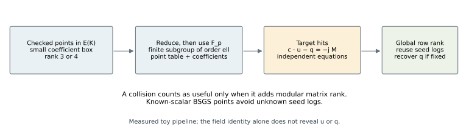
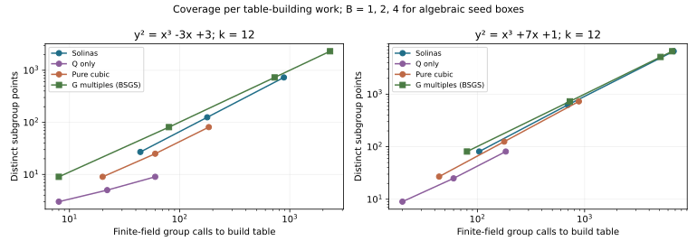
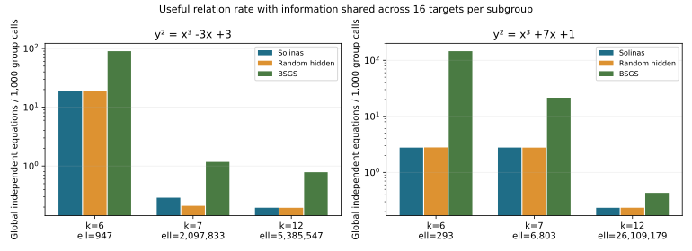
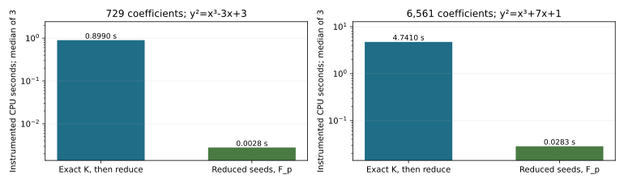

# Solinas point coverage and useful relations — 2026-10-11 UTC

**Measured** follow-up: **RUN-ECDLP-6d910b**, **EXP-ECDLP-4c6a09**, **H-ECDLP-4da36f**, **GOAL-ECDLP-001**.
User request: “Yes measure this point coverage and useful relations per unit.”
Raw observations are locally committed at `2ee51a2b6a4c9919fd7102d8baae524d8cab80ec`. No independent review or research-status promotion was performed.

## Result

Added rank expands small-coefficient point supply. With relations shared across a
batch, the Solinas method recovered **96/96 synthetic target scalars**. The generic
BSGS controls recovered the same targets with **less group work in every one of
the six matched cohorts**. This is a result for these measured methods and toy
inputs; it is not a conclusion about every possible algebraic relation.

At the largest prime, p = **68,719,472,639**, coefficient boxes [-4,4]^s give:

| Curve | r_Q → r_K | ell | Q points | K points | K coverage | K calls | BSGS calls | K/BSGS work |
|---|---:|---:|---:|---:|---:|---:|---:|---:|
| x³-3x+3 | 1 → 3 | 5,385,547 | 9 | 729 | 0.01354% | 92,149 | 20,396 | 4.52× |
| x³+7x+1 | 2 → 4 | 26,109,179 | 81 | 6,561 | 0.02513% | 81,266 | 36,989 | 2.20× |

Both Solinas boxes cover **81×** as many subgroup points as the corresponding
rational-only boxes. They also enumerate 81× as many coefficient vectors. At
this prime none of those box points collide. Extra rank therefore gives extra
points; it does not give extra points for free. Every row above recovered 16/16
targets for K and BSGS. BSGS is the best of the *declared* measured controls, not
an optimized claim over all batch algorithms or all table sizes.

## Useful information per unit work

A useful relation adds rank to one modular linear system over F_ell. The unknowns
are the seed logs u_i and the 16 target logs q_j. A duplicate hit or dependent
equation adds no information. One seed equal to the public G has known log 1;
seed points equal to -G or O likewise have known labels. Every other seed label
remains unknown to the solver.

At k=12, the rank-3 case gives **18** independent global equations using
**92,149** finite-field group calls: **0.1953 relations/1,000 calls**. Its BSGS
control gives **16** using **20,396** calls: **0.7845/1,000**.
The rank-4 case gives **19** using **81,266** calls: **0.2338/1,000**;
matched-size BSGS gives **16** using **36,989** calls: **0.4326/1,000**.
The additional two or three equations pay for previously unknown generator logs.
All recovered scalars were checked both against the target point and the
separately held synthetic scalar truth.

The random finite-field null uses the same curve, subgroup, seed count, known
generator slot, coefficient box and targets. At the largest prime its shared
recovery costs are **92,465** and **80,996** calls, compared with **92,149** and
**81,266** for Solinas. These near-equal costs do not establish a special Solinas
advantage. There is one random seed set per configuration, two selected models,
and no population-level confidence interval or significance claim.

## Theory and the tested relation mechanism

**Derived.** K = Q(alpha), alpha³-alpha-1=0, reduces at alpha → 2^k when
p=(2^k)^3-2^k-1 is prime. Checked algebraic points map into E(F_p). We project by
h=#E(F_p)/ell into its largest prime-order subgroup and use a common public G.
The exact field/curve/subgroup/generator identities are retained in
[curve-identities.csv](curve-identities.csv), including full EC1 UIDs.

For a coefficient vector c, P_c=Σ c_i F_i. A table collision P_c=P_d gives
(c-d)·u=0 modulo ell. A target hit Q-jMG=P_c gives c·u-q=-jM. Gaussian elimination
counts only independent equations; q is recovered only if its coordinate is
uniquely determined. All relation witnesses are verified with finite-field
arithmetic. The solver receives public points and permitted known labels only.

The shared batch can learn seed logs from one target and reuse them for others.
The preserved cold-target phase resets those constraints between targets: at
k=12 it recovered 14/16 and 16/16 Solinas targets, using 261,072 and 230,529
calls. Its per-target equation counts are not global batch rank. The additive
shared phase uses exactly the same frozen points, targets and 32,768-probe cap,
and reduces these costs to the figures above.

Ordinary BSGS stores known points iG and probes Q-jMG. A hit immediately gives
q=i+jM. It avoids unknown factor-base seed logs. It is a measured generic
control here, not a new algorithm or an asymptotic ECDLP improvement.

## What exact number-field work costs

Every exact-K grid reduction was checked entry-for-entry against generating from
the reduced seeds directly in F_p. The outputs agree. Reduction is a group
homomorphism, so once the seeds are available, finite-field generation supplies
the same reduced point set without doing all additions over K.

Three instrumented timing repetitions are retained. For B=4, Solinas exact-K
generation, precomputation and reduction at k=12 have component medians totaling
about **0.899 CPU s** for 729 entries and **4.741 CPU s** for 6,561 entries.
The coordinate numerator/denominator proxy reaches **495** and **646 bits**.
This proxy is not a canonical height. Exact-K timers include the bit-size check;
the first reduction repeat includes row output. Cached Python table timings
include relation construction and checks. These are machine observations with
different implementations, not portable operation weights or sealed bounds.
Prior descent/seed-discovery times remain separately recorded and are excluded
from the primary finite-field counts, which already favor BSGS.

## Scope, controls and limitations

* Two previously highlighted rank-gain models; this is not a representative
  curve sample and neither is a deployed NIST curve.
* k=6,7,12; subgroup orders are 947, 2,097,833, 5,385,547 for (-3,3), and
  293, 6,803, 26,109,179 for (7,1). Small subgroups can saturate cheaply and
  must not be mistaken for cryptographic scale.
* 78 coverage cells, B=1,2,4; 90 method configurations per cold/shared phase;
  96 common synthetic targets. Unfinished target searches are censored at the
  cap, not treated as impossibility or zero rank.
* Matched pure cubic K=Q(cuberoot(3)) ranks are 2 and 3. Random low-weight
  K=Q(beta), beta³+beta-1=0, has rank 1 for (-3,3) and bounds [2,3] for (7,1).
  Its 2- and 3-dimensional labels are not asserted exact when only bounded.
  That field has no degree-one reduction at k=7,12: all four unavailable
  model/prime comparisons remain explicitly recorded.
* Sign-change control beta³-beta+1=0 with alpha=-beta gives identical reduced
  seeds, coverage, global relation rank, recoveries and group counts. It is an
  isomorphic control, not an independent field sample.
* Meaningful controls reject dependent equations, rank-deficient target
  recovery and contradictory equations. All exact-K tables match the counted
  finite-field implementation; all reported recovered scalars are correct.
* One initial GP table attempt failed because nfmodpr returns t_FFELT at degree
  one. Its source/logs are retained. The new attempt converts via degree-one
  trace, which is the identity mathematically. No failed process is evidence
  about the hypothesis. The original coverage/rank source and results stay intact.

**Remaining opportunity.** A new mechanism would need cheaper nontrivial
relations, improved height-bounded lifting, or another measured advantage over
generic known-scalar point generation. Rank gain and linear combinations alone
do not supply that advantage in this measured scope. Larger fields and deployed
curves remain untested by this benchmark.

## Evidence and reproduction

* [Frozen plan](../../runs/RUN-ECDLP-6d910b/plan.json) and [shared-information addendum](../../runs/RUN-ECDLP-6d910b/shared-relations-plan.json).
* [Principal shared-batch raw result](../../runs/RUN-ECDLP-6d910b/benchmark-shared-attempt-01/raw-result.json).
* [Cold-target raw result](../../runs/RUN-ECDLP-6d910b/benchmark-attempt-01/raw-result.json).
* [Coverage and costs](../../runs/RUN-ECDLP-6d910b/benchmark-attempt-01/coverage.json).
* [Exact-field GP scripts, tables and repeats](../../runs/RUN-ECDLP-6d910b/point-preparation-attempt-02/exact-grids/).
* [Matched descent records](../../runs/RUN-ECDLP-6d910b/matched-ranks-result.json).
* [All methods CSV](methods.csv), [paired results](paired-results.csv), [coverage CSV](coverage.csv).
* [Source and reproduction notes](../../runs/RUN-ECDLP-6d910b/README.md); PARI/GP 2.17.2, Python 3.12.14.

Every phase retains source snapshots, script hashes, commands, raw stdout/stderr,
process measurements and failed attempts. Source GPL-2 license is retained.
[Integrity checks](../../runs/RUN-ECDLP-6d910b/integrity-check.json) verify hashes and
that historical coverage/rank raw files are unchanged. No independent review
was performed. GitHub publication remains blocked by the unchanged preceding
authentication failure; results are locally committed and downloadable.

Graph checks: historical coverage and rank report sources/renderings, plus the
canonical ECDLP frontier inventory. No canonical graph or measured-bound record
changes: these scoped primitive counts are not an ECBND sealed frontier bound.
This new report and its editable figures describe the new observations without
changing historical evidence, hypotheses, experiments or frontier statuses.
