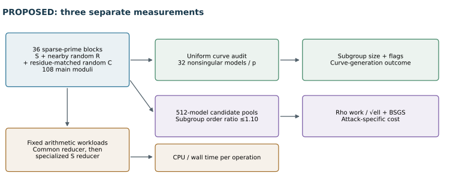
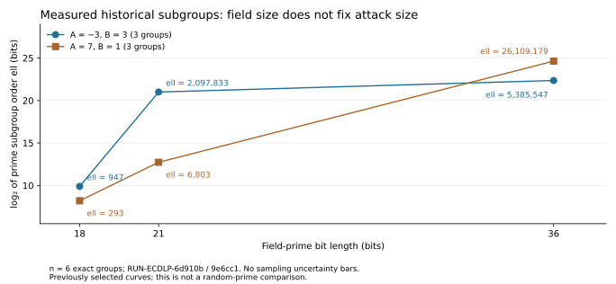

# Solinas versus random primes: a controlled ECDLP study

2026-10-11 UTC • Proposed identifier **EXP-ECDLP-5184f7** • Related work **EXP-ECDLP-4c6a09**, **GOAL-ECDLP-001**.

**Proposed design, not an experiment result.** This document and `plan.json` specify the next experiment. No new ECDLP trials have been run, no official experiment approval is recorded, and no hypothesis or frontier status changes. The attack/oracle/timing integration still needs implementation. The user requested a design; readiness and registration belong to preparation for execution.

## Question and the three quantities to keep separate

Does selecting a Solinas-style prime produce curves that require more attack work than selecting a comparable random prime?

| Quantity | Measurement | What a difference would mean |
|---|---|---|
| Curve-generation outcome | Largest prime subgroup order, cofactor, trace, twist order and obvious weakness flags | This prime-selection recipe produces different curve properties |
| Attack cost at matched subgroup size | Verified Pollard-rho group operations divided by √ell; memory-accounted BSGS as a separate control | Higher cost for the declared attacks and sampled curves |
| Cost of arithmetic | CPU/wall time per fixed field or point workload, using common then specialized reduction | A difference in implementation speed |

**Derived boundary.** Two cyclic prime-order groups with exactly the same order are abstractly isomorphic. A generic algorithm operating through an opaque group interface has no access to the binary form of the field prime. A benchmark can measure attack performance and the curve properties selected by a prime family; it cannot establish intrinsic generic hardness caused by the prime representation. Stronger resistance would require evidence that a validated structure-dependent shortcut works on comparable random-prime curves and is avoided here.

Our preceding experiment varied number fields while holding the base primes fixed. It therefore supplies no random-prime comparison. Its larger rank examples and the mixed random-field relation costs remain observations about point-generation methods.

The arrows specify planned measurements, not measured effects. The [PDF overview](report.pdf) explains the controls and interpretation alongside this diagram.

## Samples fixed before any attacks

The main cohort contains **36 distinct sparse prime blocks**: 12 each at 24, 28 and 32 bits. Exhaustively enumerate and certify the finite catalog

`p = 2^b − 2^a + s·2^c + t`, with `1 ≤ c < a ≤ b−2` and `s,t ∈ {−1,+1}`.

Deduplicate integer moduli, retain every representation, and sample uniformly without replacement from the verified catalog. This is a specified Solinas-style binary ensemble, not a claim to sample all Solinas primes. Three sampling seeds, 2026101105–2026101107, select four primes each per size. A catalog smaller than 12 is a preparation impediment; do not expand the definition to satisfy the quota.

Each sparse prime S receives two independently drawn controls:

* **R:** a random prime of the same bit length in `[ceil(.99 pS), floor(1.01 pS)]`.
* **C:** another random prime in the same interval, additionally satisfying `pC mod 12 = pS mod 12`.

Choose controls by uniform odd-integer rejection sampling with exact primality verification. Using the next prime above a random integer would bias the sample. R has no residue restriction: it measures the total contrast. C asks whether a difference survives a simple congruence control. Matching congruences alone could remove a real mediated effect, so C never replaces R. Exclude the sparse catalog and all pinned anchors from both controls; all selected moduli must be distinct. Keep all rejection records, with a 20,000-candidate cap per control. Selection sees no curve count or attack result. The main sample is **108 moduli**.

Keep the **six exact historical moduli** as separate case studies, each with its own R/C controls: P-192-shape primes at k=6,7,12; P-256 at k=4; P-224 at k=8; and P-384 at k=6. Their bit sizes are 18,21,36,32,56,72. The first four admit the toy attack stage; the 56-/72-bit cases receive only the structural audit. These 18 additional moduli are not pooled with the main cohort. Broad sparse-family findings do not automatically transfer to the original four polynomial shapes.

## Curves: unconditional audit, then matched attack sample

For every modulus, draw nonsingular `y²=x³+Ax+B` models with A and B exactly uniform in F_p, using a recorded keyed byte stream and rejection sampling. Shared block/curve seeds are allowed, but models over different fields are different curves; identical integer coefficients are not asserted. Uniform coefficient models do not mean uniform isomorphism classes.

Audit the **first 32 nonsingular models per modulus without screening them out**. Record N=#E(F_p), its complete factorization, the largest prime ell and its multiplicity, h=N/ell, trace, Frobenius discriminant, j, quadratic-twist order/factors, and the declared weak-curve flags. Report `log₂(ell)/2` as a generic-work proxy, not a certified security level. A larger typical subgroup or a lower rate of flagged curves is a generation outcome, distinct from conditional attack hardness.

For attack matching, prepare the full **512-model pool per attack-eligible modulus**, regardless of the earlier audit outcomes. Retain all curves. Candidate subgroups must meet the fixed screen:

* Ordinary curve, N≠p and j outside {0,1728}.
* Largest prime ell occurs to multiplicity one and has 16–26 bits.
* No embedding degree k≤20, detected by `p^k=1 mod ell`.

The screen removes obvious confounders; it is not a certificate excluding all efficient endomorphisms, pairing reductions or other attacks. Record the unchecked features explicitly. Curves rejected for matching remain in the unconditional audit and candidate trace.

Match S to R and S to C by maximum-cardinality, then minimum-cost bipartite matching on `|log(ellS/ellX)|`, with an admissible ratio at most 1.10 and candidate-index tie breaks. Take at most eight common S rows in candidate-index order. No curve is reused within a contrast. Selection never sees attack cost. Retain empty or short blocks; do not replace their primes. At least eight nonempty prime blocks in a size stratum are required to quote a stratum estimate.

Project public points by h and certify `G≠O`, `ell G=O`. Every record must carry the exact EC1 field/curve/subgroup/generator identity from `tools/curve_identity.py`, not merely an A/B alias. Prior models (−3,3) and (7,1) may appear in a separately labeled order diagnostic, because they were already selected for rank gains.

## Attacks, targets and work accounting

Generate **four uniform synthetic targets per group**, Q=qG with q∈[1,ell−1]. Save q in a validation-only artifact; algorithms receive only public group parameters, G, Q and their public seeds. Returned answers must satisfy qG=Q and match separately held truth. Target generation and point/cardinality discovery are preparation work, measured separately.

The primary attack is **Pollard rho with a 16-adding walk**, fixed SHA-256 partitioning, Brent cycle detection and seeds 1,2,3,4 for each target. Every point is tracked as `aG+bQ`. A collision produces q only when its scalar denominator is nonzero; otherwise restart within the same total work allowance. Precompute the 16 adding points, measure their cost separately, and include that cost in a secondary end-to-end work total. Restart setup after precomputation counts against search work.

Use an integer group-call cap that reaches the normalized horizon 20: `ceil(20√ell)` search calls across all restarts. Report the primary outcome `U=min(W_search/√ell,20)` and whether recovery occurred by that horizon. A solve after 20 but before integer rounding exhaustion is a raw recovery and a censored primary outcome. This convention is specified by `measurement-boundary.json` and supersedes the slightly varying rounded horizon wording in the initial plan.

The main cohort has at most **13,824 primary rho attempts**: 36 blocks × 3 arms × 8 groups × 4 targets × 4 walk seeds. A predeclared 32-adding-walk replication and opaque-label control run on all main matched groups, with their own logged source/seed boundary. They are additional observations, not extra independent primes.

Run **BSGS** on the same targets with `M=min(4096,ceil√ell)` stored points. Its deterministic cap `ceil(ell/M)+1` covers every target in a valid correctly implemented subgroup. Report M, actual bytes and group calls; normalize this secondary method by `M+ell/(2M)` rather than pretending its memory cap is irrelevant. The main sample has at most **3,456 BSGS target attempts**.

Use the same generic arithmetic implementation in every prime arm first. Count additions/doublings, scalar multiplications, field products/inversions, setup, collision checks, restarts and verification separately. Verification is not hidden inside the primary attack count. Run correctness replay on counters/source/seeds while excluding measured timing fields.

## Controls that can invalidate a claimed difference

| Control | Required behavior or diagnostic |
|---|---|
| Same-group sham labels | Same curve/G/Q/seeds with permuted family tags give identical scalar answers and operation counts |
| Subgroup matching | Actual ell ratio ≤1.10; report imbalance and unmatched cases, then normalize by √ell |
| Curve isomorphism | Scale A/B/G/Q by a recorded nonzero u. Transported hashing reproduces the exact walk; native-coordinate hashing diagnoses encoding artifacts |
| Coordinate-blind group oracle | Hide coordinate/prime representation behind opaque labels, without exposing internal scalar labels or target truth |
| Independent walk | Fixed 32-adding-walk replication across every main matched group, rather than selecting favorable cases |
| BSGS | Independently verified known-scalar method under the declared memory boundary |
| Easy subgroup | A small-prime subgroup ell∈{5,7,11,13} from the recorded pools must solve and register lower raw work; do not apply asymptotic normalization to it |
| Reducer comparison | Generic and specialized reductions on identical S inputs agree exactly; their timing differences stay separate from search work |
| Timing order | Fixed randomized/ABBA batches, CPU affinity, one timing worker and no concurrent preparation jobs |
| Truth and replay | Every scalar checked; replayed deterministic counts agree; crashes and watchdogs stay implementation observations |

Sham/isomorphism controls use the first two eligible S groups per size stratum. No timing result selects them. An absent easy control prevents an instrument pass for that stratum; it does not demonstrate mathematical resistance.

The arithmetic panel uses the main and anchor moduli: 65,536 seeded products/reductions, 16,384 nonzero inversions and 4,096 public-point additions, five sequential batches each. Compare the common generic reducer first, then the specialized sparse reducer on exactly the same S operands. Record CPU model, affinity, compiler/runtime versions, governor information where readable, wall/CPU timing and memory. Actual deployed NIST primes may be a separately designed arithmetic-only extension; they are not part of this frozen attack sample.

## Analysis and decision rules

Compute normalized restricted-mean search work for each curve using all its targets and walk seeds, including censored attempts at the horizon. Form paired S/R and S/C log ratios and average curves with equal weight within each prime block, then equal weight across blocks. Bootstrap **whole paired prime blocks within bit-size strata**, 10,000 replicates, for **99% confidence intervals**. Seeds, targets and multiple curves under a prime are nested observations, not independent primes. State the actual matched block count. No achieved statistical power is asserted before preparation.

The predeclared practical effect margin is **20%**:

* Higher measured attack cost: the overall 99% lower confidence bound for S/R exceeds 1.20, with the same direction in at least two size strata and every relevant control passing.
* Practical similarity: the entire 99% interval lies within [1/1.20,1.20]. Failure to reject equality alone does not meet this rule.
* Otherwise: inconclusive in the sampled scope, including insufficient matching or control failures.

If more than 5% of attempts in either arm are censored, conclusions concern restricted work at the fixed cap; do not report the unrestricted mean as though observed. All resource failures are distinct from mathematical censoring. If a coordinate-walk difference disappears under opaque labels or transported isomorphisms, label it a walk/representation effect. If only seconds differ, label it arithmetic/implementation speed. If ell distributions differ but matched normalized attacks do not, label it a curve-generation effect.

Even a passing higher-rho-cost rule establishes higher cost for that attack on the measured sample. A general resistance claim requires a validated applicable structural attack, independent reproduction and review. BSGS provides an always-retained upper bound; no result can claim extra resistance while omitting the cheaper available control. None of this constitutes an asymptotic improvement or sealed ECBND frontier bound.

## Resources, stops and deliverables

Two preparation workers maximum, one isolated timing worker, 4 GiB address-space limit per worker and 8 GiB combined headroom. A 600-second process watchdog is machine protection. The campaign has no wall-clock or batch ceiling; fixed samples, candidate caps and attack work caps supply the stopping boundary. Do not add primes, curves or targets after seeing outcomes. An implementation may need shorter task chunks while preserving the frozen sample.

The completed run must retain verified prime catalogs and rejection traces; every curve count/factorization and matching matrix; exact EC1 identities; public targets and separate validation truth; attack sources and seeds; every collision/restart/censor; preparation, setup, search and verification costs; timing environment; clustered analysis; editable figures; and an inspected PDF. A launcher, field/point/solver cross-checks, sham/isomorphism/oracle checks and full provenance must exist before official registration/approval. No independent review was obtained in this design session.

## Evidence and provenance

All following citations are **internal immutable evidence**, read during this work. They motivate the controls; they are not results of the proposed experiment.

* EXP-ECDLP-4c6a09 / RUN-ECDLP-24c35a: [original prime/field/curve records](../../runs/RUN-ECDLP-24c35a/raw-result.json), supplying the six anchor moduli and corrected shapes.
* RUN-ECDLP-9e6cc1: [previous fixed-prime plan](../../runs/RUN-ECDLP-9e6cc1/plan.json), showing that only number fields were varied.
* [Previous measured summary](../random-fields-20261011T0523Z/summary.json) and [six exact historical identities](inputs/historical-curve-identities.csv).
* [Machine-readable proposed plan](plan.json), [measurement boundary clarification](measurement-boundary.json), [source hashes](design-provenance.json), [editable report builder](build_design_report.py).

The report's historical chart compares field size with subgroup size for six already measured curves. It is explicitly not a Solinas-versus-random-prime result. Earlier reports and canonical frontier graphs are unchanged. The full requested design is saved locally; scientific implementation and execution are subsequent work.

This chart uses the six copied identities above: exact subgroup orders, sample size six, internal RUN-ECDLP-6d910b / RUN-ECDLP-9e6cc1 evidence. It has no sampling-error bars and supports only the need to measure subgroup order separately from field size. Its editable source is `build_design_report.py`.
