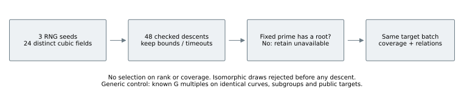
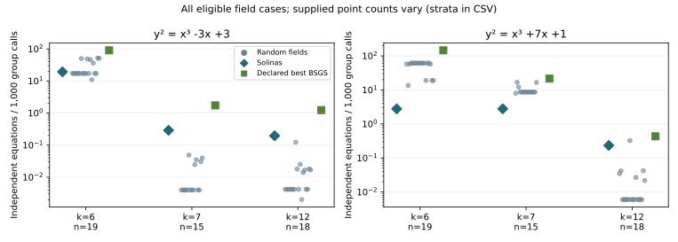
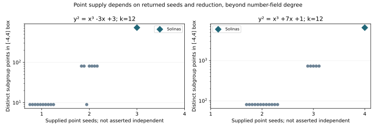

# Random cubic fields: seeded matched controls — 2026-10-11 UTC

**Measured observations:** RUN-ECDLP-9e6cc1, EXP-ECDLP-4c6a09, H-ECDLP-4da36f, GOAL-ECDLP-001.
User request: “Run random seed fields.” Raw records are locally committed at `41c59c6a2bea2deb43f48f40ec125bd182e58bf3`.

## Results

Ran **24 distinct cubic number fields**, **48 field/model descents**, and **104 eligible field/model/prime relation benchmarks** out of 144 fixed comparisons. The same six groups and 96 public synthetic targets from RUN-ECDLP-6d910b were reused. **1075/1664 repeated field-target attempts** recovered correctly, with 55 complete 16-target batches. These attempts reuse targets and are not independent samples.

None of the random-field cases that recovered all 16 targets used fewer group calls than the declared best generic BSGS control. Solinas still recovers 16/16 in every fixed cohort; its unchanged largest-prime costs are 92,149 and 81,266 group calls. Generic table sizes 9, 81, 729, 6,561 and ceil(sqrt(ell)) are now present in every cohort; only previously missing sizes were run. The selected full-recovery generic costs at this prime are 12,960 and 36,989 calls. Coverage and useful-relation rates must be read with seed count and recovery completeness.

| Curve rhs | Eligible / 24 | Same seed count | Random relation rate: median [min, max] | Solinas rate | BSGS rate |
|---|---:|---:|---|---:|---:|
| x³-3x+3 | 18 | 1 | 0.123 [0.123, 0.123] | 0.195 | 1.235 |
| x³+7x+1 | 18 | 1 | 0.323 [0.323, 0.323] | 0.234 | 0.433 |

Rates are independent global equations per 1,000 cached finite-field group calls, including seed projection, table construction and queries. The random rate in this table is restricted to the same supplied point count and unknown-log count as Solinas; it is not matched on field discriminant or exact rank. An unfinished search does not establish that a point or rank gain is absent.

Memory boundary: the selected generic controls at k=12 store 6,561 and 6,561 points; Solinas stores 729 and 6,561. The stricter equal-entry controls use 729 and 6,561 entries and require **58,263** and **36,989** calls for 16/16 recoveries. Table size, coefficient payloads, relation matrix storage and exact-K coordinates have different memory costs; no portable byte estimate is asserted.

* x³-3x+3, k=12: 1 random fields match the Solinas supplied point count and unknown-log count; 1 recover all 16 targets. 0 have a higher verified-recovery rate per group call than Solinas.
* x³+7x+1, k=12: 1 random fields match the Solinas supplied point count and unknown-log count; 1 recover all 16 targets. 1 have a higher verified-recovery rate per group call than Solinas.

## Rank and point supply

* x³-3x+3: rational rank 1; 18 exact, 6 bounded, 0 unfinished/error descents. 9/24 fields have certified positive rank gain; exact-rank histogram {1: 9, 2: 8, 3: 1}.
* x³+7x+1: rational rank 2; 10 exact, 5 bounded, 9 unfinished/error descents. 6/24 fields have certified positive rank gain; exact-rank histogram {2: 6, 3: 3, 4: 1}.

One concrete non-Solinas example is **random-12**: its sampled polynomial is t³+t²−2t−4 and its canonical field polynomial is t³+2t−1 (field discriminant −59). Its exact ranks are **3 and 4**, matching the highlighted Solinas ranks on both curves. It has a degree-one reduction at k=12 and none at k=6,7. This example establishes that those rank gains also occur in a different cubic field; efficiency is measured separately.

* x³-3x+3: random-12 rank 3, 729 points, 16/16 recovered, **146,690 group calls**, 0.1227 useful relations/1,000 calls. Exact-K component medians total 0.756 CPU s; coordinate-fraction proxy reaches 357 bits (not canonical height).
* x³+7x+1: random-12 rank 4, 6,561 points, 16/16 recovered, **58,802 group calls**, 0.3231 useful relations/1,000 calls. Exact-K component medians total 7.480 CPU s; coordinate-fraction proxy reaches 1010 bits (not canonical height).

Only one sampled field matches the Solinas supplied seed count at k=12 for each model. Its first-curve rate is lower than Solinas and its second-curve rate is higher. This mixed result does not establish a general field ranking; both are slower than equal-entry BSGS for complete recovery.

Every emitted rank bound uses certified class/unit data and checked points. Bounds do not imply an exact rank; a timeout retains the emitted information. If no point vector was emitted, inherited rational points provide an explicitly labeled fallback for coverage. Those fields remain in the sample, but their measured seed set is not asserted to span E(K). At most four seeds are used. The first rational point is anchored, then returned points are added in order, omitting exact/sign duplicates. Raw point vectors are preserved.

**Derived theory.** Rank describes independent infinite-order directions in E(K). Reduction at a degree-one prime sends checked points to E(F_p); multiplication by h projects into the same cyclic subgroup of prime order ell. In that subgroup all seeds have the form F_i=u_iG. More rank can supply more reduced points, but it does not reveal the u_i.

For P_c=Σc_iF_i, a collision P_c=P_d gives (c-d)·u=0. A target hit Q-jMG=P_c gives c·u-q=-jM modulo ell. A useful relation increases one global modular matrix rank; recovery requires q to be uniquely determined. Seed information is shared across 16 targets. Known-scalar BSGS uses iG and immediately gets q=i+jM from a hit. Rank alone therefore does not establish a scalar-recovery advantage.

The inherited label policy recognizes only seeds equal to G, −G or infinity. Other scalar labels must be learned by the measured collision/hit system, even for rational multiples that a more optimized implementation might recognize cheaply. Comparisons apply to this declared algorithm, with its counters and information boundary, rather than all methods using these fields.

## Sampling, missing reductions and costs

RNG seeds: **2026101102, 2026101103, 2026101104**, eight accepted fields per seed. Draw monic t³+a₂t²+a₁t+a₀ with a₂,a₁ in [-4,4] and nonzero a₀ in [-4,4]. Reject reducible polynomials and duplicate `polredabs` field classes; exclude the prior Solinas, random low-weight and pure-cubic control classes. All used draws and rejections are retained, and the 24 accepted fields pass pairwise `nfisisom` checks. This is a seeded polynomial ensemble with rejection, not a uniform distribution of number fields. No rank, roots or coverage outcomes influenced acceptance.

The fixed primes are p=262,079; 2,097,023; 68,719,472,639. For each original polynomial choose its least modular root. No degree-one prime means unavailable; p and the field sample are never replaced. Roots, including absent roots, appear in [fields.csv](fields.csv), and all unavailable statuses in the benchmark raw result. Multiple embeddings can give different reductions; only the declared least-root embedding is tested.

Exact-K boxes [-4,4]^s were generated with three timing repetitions and reduced entry-for-entry against independent cached finite-field generation. Every eligible completed table agrees. Because reduction is a group homomorphism, reducing the seeds and then adding in F_p yields the same reduced table. Prior descent times and exact-K CPU timers are retained separately; the primary primitive counts use the cached implementation and exclude discovery, exact-K arithmetic and validation. This boundary favors algebraic fields by omitting discovery cost and is not an end-to-end cryptographic runtime claim.

Limits: two curves selected for prior Solinas rank gains, coefficient bound four, at most four supplied points, a fixed 32,768-probe cap per target, and small subgroups. Fields are reused across curves/primes, and canonical rejection induces dependence. Observed ranges describe this sample; no population confidence interval or significance claim is made. Equal point count is not equal rank, saturation, coordinate height or discriminant.

An initial point-export attempt emitted no terminal marker because the GP execution command was on the function-definition line. Every such first attempt was rejected before measurement, and a fresh corrected exporter uses separate lines. These attempts and the resulting all-unavailable intermediate benchmark are preserved; they are not mathematical outcomes.

One Python sampler parse initially failed on PARI's trailing column-vector tilde after successful sampling. The failed script/logs are preserved; a new parser reused the same completed draw output, with no resampling. Any resource or implementation failures are recorded as unavailable computations, not mathematical negative evidence.

## Evidence and reproduction

* [Frozen plan](../../runs/RUN-ECDLP-9e6cc1/plan.json), [sample and rejected draws](../../runs/RUN-ECDLP-9e6cc1/sampling-result.json).
* [Premeasurement generic-control addendum](../../runs/RUN-ECDLP-9e6cc1/generic-controls-addendum.json), [only missing generic table sizes](../../runs/RUN-ECDLP-9e6cc1/additional-generic-controls/raw-result.json).
* [48 descent records](../../runs/RUN-ECDLP-9e6cc1/random-ranks-result.json).
* [Coverage, relation witnesses, cost counters and unavailable comparisons](../../runs/RUN-ECDLP-9e6cc1/benchmark-attempt-02/raw-result.json).
* [Exact-field grids and raw GP processes](../../runs/RUN-ECDLP-9e6cc1/point-preparation-attempt-02/).
* [Methods CSV](methods.csv), [seed-count strata](strata.csv), [discovery/exact-K/cached costs](costs.csv), [field identities](fields.csv), [ranks](rank-results.csv), [complete curve/subgroup/G identities](curve-identities.csv).
* [Summary JSON](summary.json), [prior point/relation report](../point-relations-20261011T0407Z/report.md), [source and reproduction](../../runs/RUN-ECDLP-9e6cc1/README.md).

Source provenance: internal immutable run/source records, copied with SHA-256. No independent scientific review or hypothesis/frontier status change occurred. Historical graphs/reports remain unchanged; fresh figures describe these additive observations. Scoped group-call counts do not update a sealed ECBND bound. GitHub publication remains unavailable under the preceding unchanged authentication failure; local commits and the downloadable archive preserve the work.
