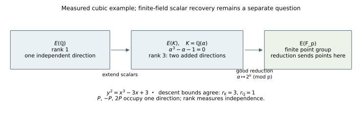
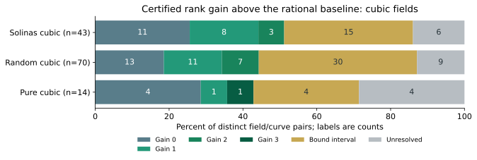
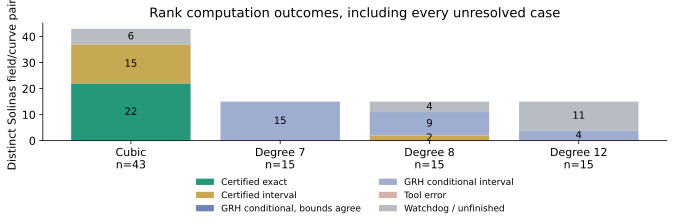

# Solinas rank follow-up — 2026-10-11 UTC

Measured follow-up for **EXP-ECDLP-4c6a09**, **H-ECDLP-4da36f**, **GOAL-ECDLP-001**.
The user authorized this additive work by asking “Measure rank.” The original
coverage experiment remains unchanged; it did not measure rank.

## What was measured

All **335 distinct rational curves** have exact PARI rank bounds. Their rank
distribution is **{0: 108, 1: 181, 2: 45, 3: 1}**. This follow-up covers **157 distinct
number-field/curve pairs**, including every **88 distinct Solinas pairs** and every
original cubic control. Higher-degree random and pure-field controls are outside
this follow-up scope. The original cells remain mapped in [ranks.csv](ranks.csv).
Rank depends on the characteristic-zero model and field, not on the toy reduction
prime, k, or original seed, so identical pairs are measured once.

| Arm / shape | Pairs | Certified exact | Certified interval | GRH conditional | Error / unfinished | Certified positive gain |
|---|---:|---:|---:|---:|---:|---:|
| P-192 | 43 | 22 | 15 | 0 | 6 | 12 |
| P-224 | 15 | 0 | 0 | 15 | 0 | 0 |
| P-256 | 15 | 0 | 2 | 9 | 4 | 0 |
| P-384 | 15 | 0 | 0 | 4 | 11 | 0 |
| Random cubic | 70 | 31 | 30 | 0 | 9 | 22 |
| Pure cubic | 14 | 6 | 4 | 0 | 4 | 4 |

“Certified” means the tool's class/unit data were checked with bnfcertify,
large-prime local success required an exact square witness, and automatic
Sha-square parity lower-bound increases were disabled. This is a computation
record, not an independent review or a research-status promotion.

## Concrete positive cubic cases

For **K = Q(alpha), alpha³-alpha-1 = 0**, the following short models
**y² = x³ + Ax + B** have certified exact rank gains. The CSV contains all cases,
including zero gain and unresolved intervals.

| A | B | Rank over Q | Rank over K | Added rank | Instance |
|---:|---:|---:|---:|---:|---|
| -3 | 3 | 1 | 3 | 2 | `NF-0e782b8386c498b3` |
| 7 | 1 | 2 | 4 | 2 | `NF-4593a9d32625a5cd` |
| 12 | -4 | 1 | 3 | 2 | `NF-fe01a55d76b4885c` |
| -20 | 0 | 1 | 2 | 1 | `NF-2571f7f55788cc5c` |
| -13 | -16 | 0 | 1 | 1 | `NF-ec227f4dd0bf6c56` |
| -11 | -14 | 0 | 1 | 1 | `NF-ae5dd6eb2eb6c27c` |
| -10 | 7 | 2 | 3 | 1 | `NF-3ccbf81b1bab94bd` |
| -9 | -4 | 1 | 2 | 1 | `NF-2b5b7744affd4492` |
| -8 | -14 | 0 | 1 | 1 | `NF-971bbdc9052d905e` |
| -5 | 12 | 1 | 2 | 1 | `NF-24b488848bfeac62` |
| 15 | 11 | 1 | 2 | 1 | `NF-f76bdd9ee0e199eb` |

For **A=-3, B=3**, rank over Q is **1** and rank over K is **3**. Three
representatives found by descent are

* (1, 1);
* (1-2 alpha, -2 alpha²+2 alpha-1);
* ((6 alpha²+7 alpha-27)/25, (-121 alpha²-162 alpha+182)/125).

All point equations were checked exactly in K. Descent certified three
independent classes modulo 2 and a 2-Selmer upper bound of three. They need not
be a saturated integral basis; equality of rank bounds determines rank without
claiming saturation. This field has no rational 2-torsion for this curve.

The field relation is doing concrete algebraic work. If x=1-2 alpha and
y=-2 alpha²+2 alpha-1, then
**y²-(x³-3x+3) = 4 alpha (alpha³-alpha-1) = 0**.
That identity supplies a point. Descent supplies the additional independence
check that turns the point supply into a rank measurement.

## How to read rank

The group E(K) has a finite torsion part and a free part Z^r. Rank r is the
number of independent infinite-order directions. P, -P, and 2P belong to
one direction; many discovered points can still have rank one. Field extension
can add directions, and the measured quantity is r(E/K)-r(E/Q).

2-descent finds classes that give a lower rank bound and a Selmer group that
gives an upper bound. The raw Selmer dimension includes rational 2-torsion:
subtract dimension 0, 1, or 2 according as x³+Ax+B has 0, 1, or 3 roots in K.
The base-field lower bound also remains valid after extension. If the bounds
coincide, the tool determines the rank; otherwise it reports an interval.

This characteristic-zero rank is separate from the finite group E(F_p).
Good reduction sends algebraic points into that finite group, where they can
collapse together. Rank gain alone supplies no unknown-scalar recovery method.
The structure measured here is the Mordell-Weil group E(K). Additional
endomorphisms require explicit algebraic maps; this rank follow-up does not
compute an endomorphism ring or a GLV decomposition.

## Comparisons and missing information

Each arm counts its distinct field/model pairs. Arms overlap: the random
generator can draw the Solinas polynomial itself, and some other defining
polynomials yield isomorphic fields. We did not merge identities using an
unverified isomorphism. These counts therefore do not constitute independent
field samples or establish a Solinas advantage. No conditional bound or unknown
value is averaged as though exact. No statistical significance claim is made.

Higher-degree auxiliary class/unit data may retain the generalized Riemann
hypothesis (GRH) assumption of bnfinit. Every such result is explicitly labeled
conditional, even if its bounds agree. Missing number-field upper bounds remain
missing. Watchdogs, a failed local test, or an API failure do not imply rank zero
or absence of rank gain. All rational baselines remain available.
GRH is an unproved conjecture about zeros of certain L-functions. It supports
the completeness bounds used by the class-group algorithm; bnfcertify can
remove that dependency, at substantial cost in the auxiliary fields of
degrees 21, 24 and 36 arising from these larger extensions.

## Execution and source provenance

Predecessor **RUN-ECDLP-aba670** measured 335 exact rational ranks and was stopped
after exposing a projective-output compatibility error and a residue-table
allocation overflow. Its completed results are retained. **RUN-ECDLP-7cfef7**
reuses **8** error-free exact number-field results,
completes every remaining cubic instance, and preserves any higher-degree
descents actually started. **RUN-ECDLP-280de8** and **RUN-ECDLP-959b32** measure
candidate-group upper bounds for all 45 higher-degree Solinas pairs, with the
degree-12 workload split into the latter record using the identical method.
In the general no-2-torsion case,
the norm-square kernel before local tests contains the Selmer group, so its
dimension is an upper bound; it is not asserted equal to the Selmer dimension.
With 2-torsion, the two descent images inject into K(S,2), giving
r <= 2 dim K(S,2)-2. Its rough-bound controls contain known ranks 1 and 3.
No additional NF rank lower bound comes from this upper-bound-only method.

The two full-descent workers and two candidate-bound workers overlap on this
four-CPU-quota host. Each has a 4 GiB address-space cap, initial stack
128 MiB, max stack 2 GB, fixed seed 1, precision 80 decimal digits, and a 120 s
process watchdog. Cubic point searches use LIMTRIV=2 then 4 when needed,
LIM1=LIM3=2; higher-degree initial searches use zero limits and supplied rational
points. Results and all aborted stages are retained. These are machine/process
limits, not a negative mathematical conclusion or campaign closure.

Simon source is pinned to Sage commit
`46a9468cf7fccca63c6b873cb52b73ea141da068`. Original and modified files, exact
patches, URLs, and SHA256 values are retained in
[source provenance](../../runs/RUN-ECDLP-7cfef7/source/provenance.json). The modified
copy certifies class/unit data, disables both automatic Sha parity increases,
normalizes projective outputs before PARI point changes, caps exact residue
enumeration, and throws on an unresolved large-prime test. Randomized local
search only accepts an exactly verified positive witness; it never supplies a
negative obstruction after failed sampling.

Sources retrieved and read in this session: Sage's
[rank_bounds wrapper](https://github.com/sagemath/sage/blob/46a9468cf7fccca63c6b873cb52b73ea141da068/src/sage/schemes/elliptic_curves/ell_number_field.py)
and [Simon GP code](https://github.com/sagemath/sage/tree/46a9468cf7fccca63c6b873cb52b73ea141da068/src/sage/ext_data/pari/simon).
Original input source (internal/retrieved):
[PR #2035](https://github.com/aburan28/crypto-autoresearcher/pull/2035), original
coverage commit `8e1cc6c5313fdab887d09b98a712ea05996d7b18`.
No independent mathematical review was performed. This uses standard 2-descent;
no improvement to rank algorithms or ECDLP complexity is asserted.

## Evidence and reproduction

* [Frozen plan](../../runs/RUN-ECDLP-7cfef7/plan.json)
* [Cubic descent raw JSON and actual scope](../../runs/RUN-ECDLP-7cfef7/raw-result.json)
* [Higher-degree candidate-bound raw JSON](../../runs/RUN-ECDLP-280de8/raw-result.json)
* [Degree-12 candidate-bound raw JSON](../../runs/RUN-ECDLP-959b32/raw-result.json)
* [Predecessor raw JSON](../../runs/RUN-ECDLP-aba670/raw-result.json)
* [Rational and number-field instance logs](../../runs/RUN-ECDLP-7cfef7/instances/)
* [Runner source](../../runs/RUN-ECDLP-7cfef7/source/run_rank.py)
* [Summary and consistency checks](summary.json)
* [All rank bounds and exact identities](ranks.csv)
* [Combined derived ranks with source-run identity](combined-ranks.json)

Follow-up raw SHA256: `f3d0af7c3c88cdbda3576fe8f20c02a5fa80f5167f872629a5642eb2a6f7df1f`.
Candidate-bound raw SHA256: `55f346e251b2955744262cb1d061c7aca38ecabb742d298bd9eb1251c3e5c7cf`.
Degree-12 raw SHA256: `385a64bffb67e20990a0c6bc7cd58a7002ec08419b74f6a8daef65d3ccbdd0f3`.
Original coverage raw SHA256: `71ffe56253681626967a7b5abf8e9a81dfdc0601a18de3171e21654be8fec835`.
Use the pinned GP library and extracted PARI 2.17.2 runtime, then copy the plan
and sources into a fresh output directory before execution. Never overwrite
these completed records. GP can exit zero after errors; this runner parses
explicit sentinels, retains errors and watchdogs, and checks all returned points.

Graphs checked: historical G3 construction/coverage/gamma/discriminant figures
and the canonical ECDLP frontier path inventory. Existing historical graphs
stay intact. The new rank graph reflects this new evidence; no ECDLP bound,
frontier record, hypothesis status, or experiment status was changed.
