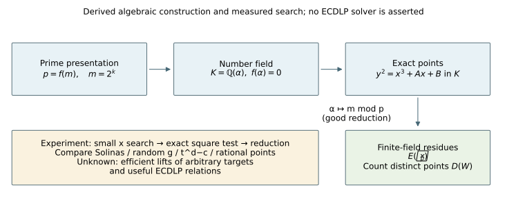
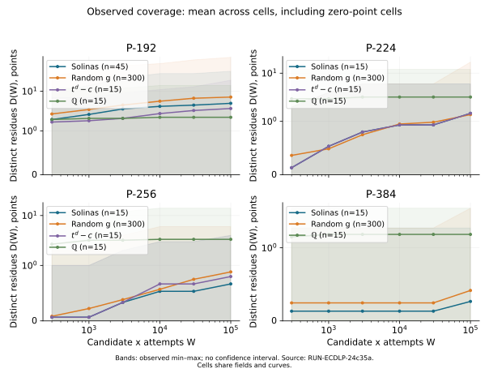
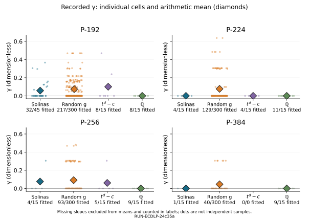
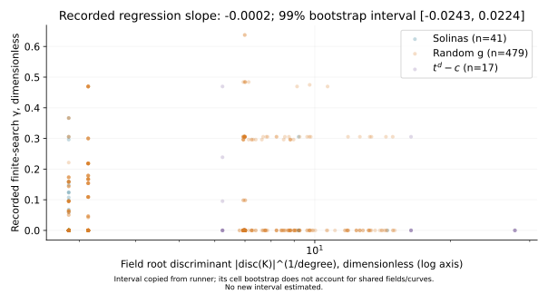

# Solinas number-field experiment — observations and theory

Date: 2026-10-11 UTC. Experiment **EXP-ECDLP-4c6a09**; hypothesis
**H-ECDLP-4da36f**; goal **GOAL-ECDLP-001**. Original implementation:
[PR #2035](https://github.com/aburan28/crypto-autoresearcher/pull/2035),
commit `8e1cc6c5313fdab887d09b98a712ea05996d7b18`. This is an execution report and derived
explanation. It does not promote, reject, or close a research claim.

## Recorded outcome — measured unless labeled arithmetic

The complete documented input set produced **1395 cells** in
**767.995 seconds**. The full seeded replay produced the same raw JSON
bytes in **823.411 seconds**: CTRL-REPLAY **passed**.
Both invocations retained seeds 1, 2, 3, 20 requested random fields per shape,
5 curves per field, and all 6 checkpoints through 100,000 candidate x attempts.
Completed cells by seed: `{'1': 465, '2': 465, '3': 465}`.
Every cell reached the final work count: **True**.
Scientific process failures in these two invocations: none (see preserved
exit-code records). Timings overlap on the same four-CPU-quota host and are
execution measurements, not algorithmic performance bounds.

The following means are arithmetic on the recorded gamma values. Missing
gamma values are omitted from these means and explicitly counted; a missing
gamma means the runner had fewer than two positive-coverage checkpoints.
There are **821 missing slopes out of 1395 cells**.

| Shape | Solinas fitted/total | Solinas mean gamma | Random fitted/total | Random mean gamma | Solinas minus random |
|---|---:|---:|---:|---:|---:|
| P-192 | 32/45 | 0.057999 | 217/300 | 0.074362 | -0.016363 |
| P-224 | 4/15 | 0.000000 | 129/300 | 0.077376 | -0.077376 |
| P-256 | 4/15 | 0.076352 | 93/300 | 0.091570 | -0.015218 |
| P-384 | 1/15 | 0.000000 | 40/300 | 0.045811 | -0.045811 |

Recorded regression of gamma on natural log of field root discriminant:
slope **-0.000221**, runner's 99% bootstrap interval
**[-0.024314, 0.022378]**, **n=537** fitted
non-rational-field cells. The interval is copied from the existing runner;
it resamples cells, not independent field clusters. Repeated fields and
curves therefore limit a confidence interpretation. No new significance
test or confidence interval is claimed. The pooled regression also has no
degree adjustment and is not a causal estimate of a discriminant effect.

The frozen specification compares absolute mean-gamma differences to 0.2
and asks whether the regression interval contains zero. These thresholds
are preserved; the table and interval expose the recorded values directly.
Its “within sampling error” comparison for point counts and heights does
not specify an executable statistical test, so no post hoc test has been
added here. The full scientific success criterion is not assessed.



## What is being constructed? — derived algebra

A Solinas prime is presented using a short formula such as
`p = f(m)`, with `m = 2^k` and a sparse integer polynomial `f`.
For the P-192 shape, `f(t) = t^3 - t - 1`.
The deployed P-192 prime uses `m = 2^64`; this experiment uses smaller `m`.
The finite field is still the ordinary field of integers modulo `p`.
The formula supplies a useful presentation; it does not by itself supply
new elliptic-curve endomorphisms or an algorithm for unknown discrete logs.

Now introduce an algebraic number alpha satisfying `f(alpha) = 0` and form
`K = Q(alpha)` (assuming `f` is irreducible). This field has characteristic
zero. Its elements can be expressed as rational linear combinations of
`1, alpha, ..., alpha^(d-1)`, where `d = degree(f)`.
The relation `f(alpha) = 0` lets us simplify products exactly.
For the cubic example, `alpha^3 = alpha + 1`.

Because `f(m) = p`, substitution `alpha -> m mod p` respects this defining
relation: `f(m) = 0 mod p`. More precisely, it defines a ring map
`Z[alpha] -> F_p`. It is NOT a homomorphism from the entire characteristic-zero
field `K` to `F_p`; a field homomorphism would preserve characteristic.
Fractions can be reduced when their denominators are invertible modulo `p`.
For the monic polynomials here, `(p, alpha-m)` is the degree-one maximal
ideal of the order `Z[alpha]` defining this reduction. At good reduction,
the corresponding elliptic-curve reduction respects point addition.

For a curve `E: y^2 = x^3 + A*x + B` with rational coefficients, extending
coordinates from `Q` to `K` can give additional points `E(K)`.
An exact point whose affine coordinates reduce maps to a point on `E(F_p)`.
The implication is useful in this direction. The construction does not
give an efficient way to lift an arbitrary target point of `E(F_p)` to a
small point of `E(K)`.

## A worked example — derived identity, not a measured trial

Choose `f(t) = t^3 - t - 1`, `m = 4`, and `p = f(4) = 59`.
On `E: y^2 = x^3 - x + 3`, the point `(alpha, 2)` satisfies the equation:
`alpha^3 - alpha + 3 = (alpha+1) - alpha + 3 = 4 = 2^2`.
Reduction sends it to `(4, 2)` because
`4^3 - 4 + 3 = 63 = 4 mod 59`.
The curve discriminant is `-16*(4*(-1)^3 + 27*3^2) = -16*239`,
which is nonzero modulo 59, so this curve has good reduction there.
The cubic is irreducible over Q by the rational-root test (neither 1 nor -1
is a root). This small example is below the run's prime-size cutoff and
is used only to explain the map; no rank or torsion claim is made about it.

## Why discriminants enter — derived relation and proposed mechanism

In the real/complex embeddings of a number field, its algebraic integers
form a lattice. Its covolume is `2^(-r2)*sqrt(|disc(K)|)` in the standard
Minkowski embedding, where `r2` is the number of conjugate complex pairs.
A smaller field discriminant can make this lattice denser and motivates
searching for smaller coordinates. The degree-normalized measure used here
is the root discriminant `|disc(K)|^(1/d)`.
That is a motivation, not a guarantee that `x^3 + A*x + B` is a square in K.
The experiment also searches a bounded power-basis coefficient box, which
is not identical to a ball in Minkowski space or a canonical-height ball.

The polynomial discriminant and field discriminant need not coincide:
`disc(f) = disc(K) * [O_K : Z[alpha]]^2`.
The runner records both its exact polynomial discriminant and PARI's
number-field discriminant, using the latter for the regression when
available. This distinction avoids treating an order's discriminant as
the maximal order's discriminant without checking the index.

## What the existing experiment measures — implementation description

For each seeded curve and field, the runner tries coordinates
`x = (a0 + a1*alpha + ... + a_(d-1)*alpha^(d-1))/e`, with integer
coefficient vectors in bounded sup-norm shells and `e` in `{1,2,3,4}`.
Eight auxiliary degree-one primes supply modular square tests. Surviving
candidates receive the library's number-field square-root search; accepted
roots are checked exactly in K. The square-root procedure has bounded
reconstruction effort, so exact verification of accepted points does not
certify completeness of discovery. The run compares the existing search
algorithm across fields, not an exhaustive enumeration of E(K).

The cumulative work count `W` is candidate x attempts. At six recorded
checkpoints through W=100,000, `D(W)` counts distinct affine points reduced
at the designated prime above p. Both signs of a nonzero y can contribute.
The runner fits the slope gamma of `log D` against `log W`, using up to the
last three positive-D checkpoints (at least two are required).
Gamma near zero indicates little additional coverage over that tail;
a larger gamma indicates more growth within this finite search window.
It is not an asymptotic ECDLP complexity exponent.

Controls include random monic irreducible polynomials with the same degree
and number of nonzero coefficients, fields `Q[t]/(t^d-c)` when the toy
prime selector finds one, and Q itself. They use the declared seeds,
curve-generation rule, and search ladder. Degree/weight matching does not
match prime sizes, field isomorphism classes, integral bases, or independent
samples. The seeded random generator samples polynomials with replacement;
repeated polynomial/curve instances are retained in the records.

The runner also reports points it classifies as non-rational and
non-torsion, and the smallest naive logarithmic x-height among those points,
divided by log(p). This height is a coefficient proxy: after clearing
coefficient denominators to a common denominator e, it is
`log(max(e, |a0|, ..., |a_(d-1)|))`. It is not an absolute Weil height
of an algebraic number or a canonical point height. These measurements
do not certify point independence or rank. The rank arm is explicitly
skipped because no number-field descent tool is provided. Point signs and
repeated cells must not be interpreted as independent rank contributions.

For background, the Mordell–Weil theorem describes `E(K)` as a finite
torsion group plus `r` independent integer directions; `r` is the rank.
The points P, -P, and 2P all use one direction. Even a non-rational,
non-torsion point can be a division of a rational point and add no rank
relative to E(Q). Establishing rank gain therefore needs independence
modulo the rational subgroup, not just coordinates outside Q.

## What remains between this and an ECDLP method — proposed research gap

In the special number field sieve for multiplicative discrete logs, small
norms can factor into small prime ideals and produce usable relations.
Elliptic-curve points have an additive group law; small coordinates do not
automatically give an analogous factorization or known-scalar relation.
For this direction to solve an ECDLP, further work must supply affordable
lifts or relations for arbitrary targets, justify relation independence,
and count the full costs of construction and recovery against a baseline.
This experiment measures one ingredient: the existing algorithm's supply
of small number-field points and their finite-field coverage. Neither high
coverage nor low coverage alone establishes a discrete-log algorithm or
rules out all such algorithms.


## Recorded coverage and slopes



Lines are arithmetic means across all cells of an arm, including zero-point
cells. Shading is the observed minimum-to-maximum range, not uncertainty of
the mean. Search work counts candidate x attempts, not processor time.



Dots are recorded cell values; diamonds are arithmetic means of nonmissing
values. Shared fields, repeated curves, and two signs of points are not
independent samples. These slopes concern a fixed finite search window.



The regression uses PARI's field discriminant whenever available. Non-Q
cells missing that control: **0**.

## Exact tested scope and descriptive counts

The four labels identify NIST polynomial *shapes*. No deployed NIST-size
ECDLP was solved or searched. Solinas input primes in this run are:

| Shape | k, m=2^k | p=f(2^k) | p bits |
|---|---:|---|---:|
| P-192 | 6 | 262079 | 18 |
| P-192 | 7 | 2097023 | 21 |
| P-192 | 12 | 68719472639 | 36 |
| P-224 | 8 | 72057594021150721 | 56 |
| P-256 | 4 | 4043313151 | 32 |
| P-384 | 6 | 4722366482869628174399 | 72 |

All curves are `y^2=x^3+A*x+B` with the recorded A and B, nonsingular with
good reduction at the selected p according to the existing launcher.
The complete per-cell identities (defining polynomial, p, A, B, seed and
curve index) are in [cells.csv](cells.csv) and the raw JSON. No subgroup or
unknown-log challenge is selected; coverage is on the full curve's recorded
affine residues. Q is a degree-one control, not a comparison number field
of matching degree. The t^d-c arm exists only where the existing toy-prime
selector found an eligible field.

The next table is arithmetic on the raw records. “Distinct polynomials”
counts presentations, not field isomorphism classes. Distinct finite curves
counts the triples (p,A,B). Heights are means over the recorded finite
minimum-height values, not over missing entries. New-point counts are the
runner's non-rational/non-torsion classification, not independent ranks.

| Shape | Arm | Cells | Distinct polynomials | Distinct finite curves | Mean final D | D range | Mean reported new points | Height n | Mean min log-height/log p |
|---|---|---:|---:|---:|---:|---|---:|---:|---:|
| P-192 | solinas | 45 | 1 | 44 | 4.955556 | [0, 32] | 3.200000 | 24 | 0.063173 |
| P-192 | random_g | 300 | 5 | 70 | 7.140000 | [0, 72] | 4.673333 | 166 | 0.092125 |
| P-192 | tdc | 15 | 1 | 14 | 3.666667 | [0, 19] | 2.000000 | 4 | 0.039660 |
| P-192 | Q | 15 | 1 | 15 | 2.200000 | [0, 14] | 0.000000 | 0 | missing |
| P-224 | solinas | 15 | 1 | 15 | 1.466667 | [0, 6] | 0.000000 | 0 | missing |
| P-224 | random_g | 300 | 10 | 134 | 1.383333 | [0, 17] | 0.160000 | 13 | 0.020757 |
| P-224 | tdc | 15 | 1 | 15 | 1.466667 | [0, 6] | 0.000000 | 0 | missing |
| P-224 | Q | 15 | 1 | 15 | 3.200000 | [0, 12] | 0.000000 | 0 | missing |
| P-256 | solinas | 15 | 1 | 15 | 0.666667 | [0, 4] | 0.000000 | 0 | missing |
| P-256 | random_g | 300 | 55 | 295 | 0.883333 | [0, 6] | 0.053333 | 6 | 0.004498 |
| P-256 | tdc | 15 | 1 | 15 | 0.800000 | [0, 4] | 0.133333 | 1 | 0.000000 |
| P-256 | Q | 15 | 1 | 15 | 3.333333 | [0, 14] | 0.000000 | 0 | missing |
| P-384 | solinas | 15 | 1 | 15 | 0.266667 | [0, 2] | 0.000000 | 0 | missing |
| P-384 | random_g | 300 | 60 | 300 | 0.416667 | [0, 4] | 0.000000 | 0 | missing |
| P-384 | tdc | 0 | 0 | 0 | missing | None | missing | 0 | missing |
| P-384 | Q | 15 | 1 | 15 | 1.600000 | [0, 4] | 0.000000 | 0 | missing |

## Required tail records — copied observations

Largest recorded gamma cell (ties use the first cell in run order):

```json
{
  "seed": 1,
  "field": {
    "d": 7,
    "disc": -816631,
    "g": [
      -1,
      0,
      0,
      0,
      1,
      0,
      0,
      1
    ],
    "g_text": "t^7 +t^4 -1",
    "k": 6,
    "kind": "random_g",
    "nfdisc_pari": -816631,
    "p": "4398063288319",
    "p_bits": 43,
    "root_discriminant": 6.991576648173042,
    "root_discriminant_field": 6.991576648173042,
    "shape": "P-224",
    "weight": 3
  },
  "curve": {
    "A": "-2",
    "B": "4"
  },
  "curve_index": 3,
  "gamma": 0.6375284889080888,
  "final_D": 17
}
```

Smallest recorded field root discriminant among degree > 1 cells (ties
use the first cell in run order):

```json
{
  "seed": 1,
  "field": {
    "d": 3,
    "disc": -23,
    "g": [
      -1,
      -1,
      0,
      1
    ],
    "g_text": "t^3 -t -1",
    "k": 6,
    "kind": "solinas",
    "nfdisc_pari": -23,
    "p": "262079",
    "p_bits": 18,
    "root_discriminant": 2.8438669798515654,
    "root_discriminant_field": 2.8438669798515654,
    "shape": "P-192",
    "weight": 3
  },
  "curve": {
    "A": "-3",
    "B": "3"
  },
  "curve_index": 0
}
```

## Reproduction and limits

Primary run: `RUN-ECDLP-24c35a`. Replay: `RUN-ECDLP-e09a9d`.
Raw SHA-256 (both runs when replay passes): `71ffe56253681626967a7b5abf8e9a81dfdc0601a18de3171e21654be8fec835`.
The manifests include exact source hashes, compiler/library versions,
timestamps, per-cell time, and the executed argv. Launch records include
dirty-tree state. The primary source tree was clean; the replay dirty state
contains the primary run's untracked output directory, with no source edits.
Source implementation and specifications were not changed.
The launch-file model label denotes the interface-stated GPT-6 family;
no provider model-ID probe or inference-usage counter was available. It is
not a verified resolved model identifier.

Exact scientific argv (primary output path shown):

```text
/workspace/solinas-run/experiments/EXP-ECDLP-4c6a09/implementation/target/release/g3 --kmin 4 --kmax 12 --min-bits 12 --max-primes-per-shape 3 --random-g 20 --curves 5 --ladder 300 1000 3000 10000 30000 100000 --seeds 1 2 3 --aux-primes 8 --out experiments/EXP-ECDLP-4c6a09/runs/RUN-ECDLP-24c35a
```

This invokes the existing release binary with the specification's complete
arguments. Build command:

```sh
cargo build --release --locked --features pari --manifest-path experiments/EXP-ECDLP-4c6a09/implementation/Cargo.toml --bin g3
```

Build and run environment uses workspace-local rustup/cargo and extracted
Debian PARI packages, leaving system libraries unchanged:

```text
CARGO_HOME=/workspace/solinas-toolchain/cargo
RUSTUP_HOME=/workspace/solinas-toolchain/rustup
PATH=/workspace/solinas-toolchain/cargo/bin:$PATH
C_INCLUDE_PATH=/workspace/solinas-runtime/pari/usr/include/x86_64-linux-gnu:/workspace/solinas-runtime/pari/usr/include
LIBRARY_PATH=/workspace/solinas-runtime/pari/usr/lib/x86_64-linux-gnu
LD_LIBRARY_PATH=/workspace/solinas-runtime/pari/usr/lib/x86_64-linux-gnu
CARGO_BUILD_JOBS=2
```

Actual compiler: `rustc 1.99.0 (b940084d7 2026-09-28)`. Actual PARI:
`libpari GP/PARI CALCULATOR Version 2.17.2 (released) (FFI)`. Platform: `linux x86_64`.
The launcher was built with the optional PARI feature enabled.
Each process was capped at 4 GiB virtual address space. CPU/RSS measurements
are preserved in the process JSON files beside this report; child usage
includes minor launch-time git/rustc subprocesses. Execution logs and raw
results remain in the original write-once run directories.

Controls observed: CTRL-SHAPE is `True` in raw output;
CTRL-REPLAY is `True` from literal byte comparison.
Random-g field selection uses the existing irreducibility admission
predicate; no separate independent field-certification phase was performed.
All rank-arm labels remain the launcher's explicit skipped label. The frozen
specification's comparisons require separate research interpretation and
review; this report preserves its metrics rather than changing its criteria.

Scope limits: fixed candidate budget, bounded square-root reconstruction,
power-basis and denominator restrictions, unequal prime sizes, replacement
sampling, shared curves, missing fitted slopes, no rank/independence
certificate, no arbitrary-target lift, and no end-to-end relation or ECDLP
recovery experiment. Low or high observed coverage concerns this algorithm
and these inputs only.

Proposed follow-up checks, not performed in this session: independently
reimplement the point-search/square-root arm; compare equal completed
coefficient shells at higher degrees; preregister an analysis accounting
for degree and repeated field/curve clusters; and use descent or independent
generators to measure rank gain over E(Q). An ECDLP claim would additionally
require arbitrary-target lifts or useful relations and complete recovery
costs. These are future checks, not extra trials attributed to this run.

Existing graph check: the tracked G3 experiment directory and ECDLP frontier
tree contained no existing SVG/Mermaid/DOT/Typst/PDF graph specific to this
experiment in this revision. No canonical graph or scientific status was
changed; all visuals here are new views of the cited observations.

## Sources and artifacts

All experiment citations have provenance **internal** (files inspected in
this session). The algebraic example and ring-map argument are **derived**
above. No external paper is being cited from memory.

- [Frozen specification](../../specification.yaml): declared controls,
  inputs, prediction, bounds, rank-arm omission and launcher.
- [Original G3 source](../../implementation/src/main.rs): measures and
  summaries, at the exact code revision recorded above.
- Shared `EXP-ECDLP-84af7b/implementation/nfield/src/field.rs`, `ecnf.rs`,
  `gp.rs`: arithmetic, bounded square-root reconstruction, point search,
  reduction, torsion classification and PARI discriminants; hashes are in
  each manifest.
- [Primary raw JSON](../../runs/RUN-ECDLP-24c35a/raw-result.json),
  [primary manifest](../../runs/RUN-ECDLP-24c35a/manifest.yaml),
  [primary launch record](../../runs/RUN-ECDLP-24c35a/launch.json),
  [primary stderr](../../runs/RUN-ECDLP-24c35a/stderr.log).
- [Replay raw JSON](../../runs/RUN-ECDLP-e09a9d/raw-result.json),
  [replay manifest](../../runs/RUN-ECDLP-e09a9d/manifest.yaml),
  [byte-comparison receipt](replay-check.json).
- [Derived summary](derived-summary.json), [all cell identities](cells.csv),
  [graph source](make_figures.py), [report generator](write_report.py),
  [PDF source](report.typ), [PDF](report.pdf).

## Publication status

Raw records are committed locally as `88fa19cb` on
`run/solinas-number-fields-20261011`. GitHub rejected the configured
username/token when pushing with the installed GitHub CLI credential helper.
No PR was opened. The preserved publication-attempt JSON files record the
failure. The explanatory report has a separate local commit.
