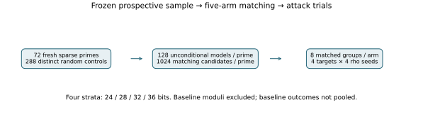
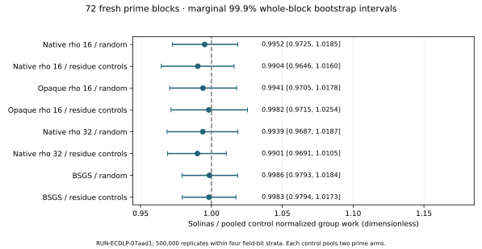

# Wider Solinas prime comparison — 2026-10-11

**Measured native-rho Solinas / pooled random-control ratio 0.995249; marginal 99.9% CI [0.972470, 1.018543].** Decision under the frozen margin [1/1.2,1.2]: practically similar normalized rho cost in this sampled scope. The reserved three-family Bonferroni 99.9667% interval is [0.970572, 1.020734], offering approximate joint 99.9% primary coverage if three family tests are completed. The two other named prime definitions remain a separate user clarification; this run asserts nothing about them.

## Scope and design

EXP-ECDLP-5184f7 / RUN-ECDLP-07aad1 is a prospective extension of RUN-ECDLP-a24605. It excludes every baseline modulus and pools no baseline result. It samples 18 distinct sparse primes per 24/28/32/36-bit stratum, 72 total; two independent size-matched random primes and two size-and-mod-12-matched random primes per block, **288 controls**. Prime form: p=2^b−2^a+s2^c+t, 1≤c<a≤b−2, s,t=±1, deduplicated by integer. Candidate draws and exact PARI primality decisions are retained.

All 368,640 prepared models and 46,080 unconditional models are retained. Each prime has a fixed pool of 1,024 uniform nonsingular coefficient models. Conditional largest-subgroup attacks exclude anomalous, supersingular, special-j and embedding-degree≤20 cases; ell has 16–28 bits, multiplicity one. Eight S candidates must match all four control arms within 10% ell. Matching is maximum-cardinality, then minimum log-order distance, with fixed SciPy assignment tie handling. There are 2,880 matched groups and four tiny easy groups.

## Measured results and integrity

All **150,864** attack jobs completed. Main rho censor count: **0**. All returned scalars and collision equations passed the runner checks. All **768** sham/replay/transport equality checks and four BSGS easy positive controls passed. The supplement checks 512 jobs on 16 actual isomorphic endpoint models. Exact EC1 identities, subgroup orders and generators are in [all-curve-identities.csv](all-curve-identities.csv).

| Contrast | Ratio | Marginal 99.9% interval |
|---|---:|---:|
| rho_S_R | 0.995249 | 0.972470–1.018543 |
| rho_S_C | 0.990387 | 0.964580–1.016045 |
| oracle_S_R | 0.994060 | 0.970491–1.017795 |
| oracle_S_C | 0.998155 | 0.971476–1.025449 |
| rho32_S_R | 0.993932 | 0.968675–1.018727 |
| rho32_S_C | 0.990098 | 0.969075–1.010467 |
| bsgs_S_R | 0.998585 | 0.979256–1.018419 |
| bsgs_S_C | 0.998303 | 0.979408–1.017326 |

Rho uses search group calls/sqrt(ell), restricted at horizon 20. Setup and verification remain separate. Each control mean pools two independent prime arms per matched slot; eight slot log-ratios average to one prime-block observation. Seeds and targets are repetitions, not 150,000 independent samples. All 72 blocks receive equal weight. The 500,000-replicate bootstrap resamples whole blocks within bit strata; nominal percentile coverage is approximate. Three-family adjustment applies to the primary comparisons only; exploratory contrasts are marginal.

BSGS uses M=min(4096,ceil(sqrt(ell))), retains allocated table bytes and normalizes setup+search by M+ell/(2M). Every one of 11,536 BSGS jobs matches exact counts: setup=M+popcount(M)+bit_length(M)−1; search=floor(q/M). Its empirical contrast therefore includes finite target-position and subgroup/table-size effects; a BSGS difference alone is not a field-prime resistance result.

## Population and arithmetic

The unconditional generic proxy 0.5 log2(largest prime factor of curve order) differs by 0.025650 bits for S minus pooled R, with marginal 99.9% CI [-0.10605022392968946, 0.1555381376430235]. This is a group-order proxy, not a certified security bound. Full N, factorization, trace, twist order and obvious-weakness flags remain in each modulus's curves.json; no weak curves are removed from the unconditional audit.

| Python workload | Generic S / pooled R | Marginal 99.9% CI | Median fold / builtin S seconds |
|---|---:|---:|---:|
| products | 0.9470 | 0.8888–1.0123 | 8.7403 |
| inversions | 0.9664 | 0.9057–1.0337 | 1.0048 |
| point_additions | 0.9968 | 0.9122–1.0938 | 1.6625 |

All 6,480 arithmetic observations have exact output agreement. Inversion intentionally uses the identical builtin pow in both paths. This Python folding prototype does not measure production optimized field arithmetic; timings and their intervals describe this implementation and machine, not intrinsic ECDLP work or a sealed bound.

## Theory, boundaries and provenance

Generic rho solves synthetic Q=qG using collisions, requiring order sqrt(ell) group operations. The field's binary expression can change primitive arithmetic costs without changing that operation count. Abstract isomorphism of equal-order cyclic groups does not supply a computable coordinate map between arbitrary elliptic curves. The opaque solver interface prevents this implemented solver from consulting coordinates, not adversarial reflection. The tested degree-1 maps explicitly transport G and Q and preserve the subgroup.

This is a finite toy study with uniform short-Weierstrass coefficient models and matched largest-prime subgroups. It is not a universal result about Solinas primes, real deployed ECDLP, structure-aware attacks, number-field rank or all possible arithmetic backends. The 36-bit stratum broadens field sizes but does not approach deployed cryptographic sizes. There is no asymptotic algorithm, scientific-state promotion, sealed bound, or frontier update; generic rho and memory-accounted BSGS remain the reference methods. Original reports and canonical frontier graphs stay unchanged.

Sources and this extension's contract froze at [run manifest](../manifest.json) before selection. See [frozen contract](../contract.json), [exact commands and phase outcomes](../execution-result.json), [machine summary](../analysis/summary.json), [prime blocks](../analysis/prime-block-metrics.json), [checks and identities](derived-checks.json), and all retained preparation, attack and arithmetic directories. The 192-MiB matching array is retained locally and in the ZIP; committed per-block JSON shards reconstruct its exact original bytes using reassemble-matching.py and verified hashes. This is a storage representation change, not a trial correction. No independent scientific review was obtained.
