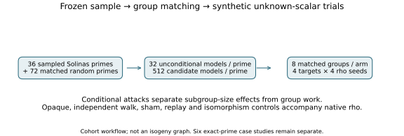
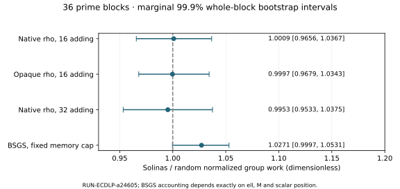

# Solinas prime comparison — 2026-10-11

Measured primary native-rho Solinas/random ratio: **1.000903**, requested marginal **99.9% CI [0.965615, 1.036702]**. The originally frozen 99% CI is [0.974189, 1.030343]. Both lie inside the declared practical-similarity margin [1/1.2, 1.2]. This sample does not support a material increase in generic attack cost from the sampled sparse prime forms.

The requested 99.9% intervals are a labeled post-run sensitivity analysis with 200,000 whole-prime-block bootstrap replicates. They do not replace the immutable prespecified analysis. A larger prospective sample follows the user's subsequent request; these intervals do not claim joint family-wise coverage or exact finite-sample coverage.

## Measured scope and controls

EXP-ECDLP-5184f7 / RUN-ECDLP-a24605 sampled 36 distinct 24/28/32-bit sparse primes with one size-matched random control and one size-and-mod-12-matched random control each. The sparse catalog is p=2^b−2^a+s2^c+t, 1≤c<a≤b−2, s,t∈{−1,1}, deduplicated by integer. Prime blocks receive equal weight; seeds and targets are repetitions, not independent prime samples.

There are 108 main moduli, 18 additional exact-prime case-study moduli, 61,632 nonsingular prepared models, 864 matched main groups, 96 case-study groups and three easy groups. All **47,292** attack jobs completed without infrastructure failure. All returned scalars and collision equations passed the runner checks. Main rho censoring is zero; two easy rho jobs reached their cap, and their complete-coverage BSGS positive controls passed. All **288** sham/replay/transport checks passed. The derived supplement checks 192 isomorphic jobs on their actual endpoint curves and lists 1,095 exact EC1 identities.

## Attack comparisons

| Contrast | Ratio | Marginal 99.9% interval |
|---|---:|---:|
| rho_S_R | 1.000903 | 0.965615–1.036702 |
| rho_S_C | 0.989252 | 0.952319–1.026981 |
| oracle_S_R | 0.999699 | 0.967895–1.034303 |
| oracle_S_C | 0.987342 | 0.941175–1.032702 |
| rho32_S_R | 0.995338 | 0.953263–1.037489 |
| rho32_S_C | 1.001297 | 0.971295–1.033230 |
| bsgs_S_R | 1.027099 | 0.999654–1.053066 |
| bsgs_S_C | 1.002664 | 0.981150–1.026436 |

Rho measures restricted mean search group calls / sqrt(ell), horizon 20; setup and verification are retained separately. BSGS uses setup+search divided by M+ell/(2M), with M=min(4096,ceil(sqrt(ell))) and allocated table bytes retained. The memory boundary is unchanged across prime arms.

**The small BSGS difference is retained.** Its original 99% S/R interval excluded 1, with ratio 1.027099. A deterministic post-run accounting check passed for every one of 3,852 BSGS jobs: setup calls=M+popcount(M)+bit_length(M)−1, search calls=floor(q/M). Once ell and table size are set, this count follows target scalar position. It is not evidence of a prime-shape-dependent obstacle. The diagnostic does not alter the frozen primary rho analysis.

## Population and arithmetic

The unconditional 3,456-model main audit gives S−R generic proxy difference −0.153680 bits (proxy=0.5 log2 largest prime factor of #E). Requested 99.9% interval: [-0.5306039814448554, 0.2350535968409259]. This proxy is not a certified security bound, and this sample does not show larger usable subgroups.

Python arithmetic measured 2,520 batches over 126 moduli with exact output equality. Generic S/R ratios for products, inverses and point additions are 1.026673, 1.029412 and 1.065883; their intervals include 1. The Python binary-fold prototype was slower than builtin reduction (median product ratio 9.1994; point-addition ratio 1.7259). Inversion intentionally uses the identical builtin pow in both backends. These measurements describe this prototype and machine; they do not measure optimized Solinas C/assembly arithmetic or a deployed attack.

## Theory and limits

Q=qG is tested on synthetic prime-order subgroups. Generic rho's collision search takes order sqrt(ell) group operations. Sparse binary expressions help represent and reduce field integers; that alone gives no new relation for q. Equal-order cyclic groups are abstractly isomorphic, but this statement does not provide an efficient map between arbitrary coordinate curves. Opaque rho reduces access to coordinate structure in this implemented solver; it is not an adversarially enforced oracle against reflection.

The test concerns the declared finite prime catalog, toy-sized groups, uniform nonsingular short-Weierstrass coefficient models, matching rules and implemented attacks. It does not settle structure-aware attacks, industrial-size ECDLP, number-field rank, production arithmetic, or all primes called Solinas. The 56/72-bit anchors were audited and timed but not forced into toy attack groups. Four attack-eligible exact anchors are case studies and are not pooled into the main confidence intervals. No hypothesis, frontier, asymptotic algorithm claim or sealed measured bound is promoted.

## Provenance and artifacts

Implementation sources were committed before selection (fa315f9efc97fdd4c6b1e484aa720cc828a79beb); arithmetic and analysis were committed before attacks (054f1988e). See [run manifest](../manifest.json), [frozen measurement source](../measurement-source-freeze.json), [original analysis](../analysis/summary.json), [requested confidence sensitivity](requested-confidence-99_9.json), [derived accounting](post-run-diagnostics.json), [all exact curve identities](all-curve-identities.csv), [raw attack index](../attacks/job-index.json), and the retained preparation, attack and arithmetic directories. This report's source and SVGs are generated by finish_baseline.py, copied alongside. Scientific review is not independent; observations remain unpromoted. Historical reports and canonical frontier graphs are unchanged.
