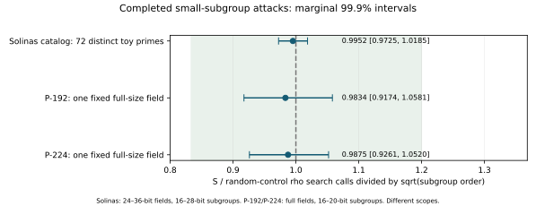
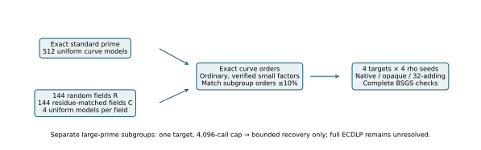
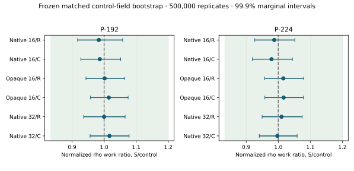
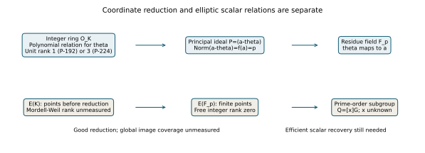

# P-192 and P-224 full-field comparison — 2026-10-11

Measured observations from EXP-ECDLP-5184f7 / RUN-ECDLP-d0e449. All 39,570 scheduled jobs completed. These two exact primes were confirmed by the user; they are separate fixed-prime studies, not new independently sampled Solinas prime families.

| Fixed prime | Native rho S/R ratio [99.9% CI] | Matched pairs | Independent matched R fields |
| --- | --- | --- | --- |
| P-192 | 0.9834 [0.9174, 1.0581] | 116 | 89 |
| P-224 | 0.9875 [0.9261, 1.0520] | 126 | 91 |

P-192: practically similar generic small-subgroup work in this tested scope.
P-224: practically similar generic small-subgroup work in this tested scope.

The decisive scope limit is the subgroup: the complete attacks use **16–20-bit prime-order subgroups inside the full 192/224-bit fields**. They do not solve the full cryptographic subgroup and do not establish that P-192 or P-224 is safer or weaker than random-field cryptography. Separate large-subgroup walks are censored at 4,096 search calls.

## Frozen design and controls

Source, sampling, stopping and analysis froze at 6b0d33cf3d0fed77cff7520fd18801afa0eaf53b before scientific selection. Each fixed prime has 512 uniform nonsingular curve models. Each case has 144 globally distinct size-matched random fields (R) and 144 size-and-mod-12-matched random fields (C), four curve models per control field. Total: **576 random fields, two fixed fields, 3,328 unconditional main models**. Each fixed S prime has 288 random controls, compared with four controls per S prime in the wider Solinas study, and 512 unconditional S models rather than 128. Across these two cases there are 576 random fields; it has fewer total models because full-size point counting is much more expensive. No prior observations are pooled.

Uniform rejection draws and exact PARI primality decisions are retained. Curve orders are exact PARI ellcard outputs with Hasse checks. Partial factorization uses primes below 2^20 and records exact primality flags for the remaining cofactor; unresolved composite cofactors are not treated as prime or as complete factorization. Small attack subgroups require ordinary curves, nonspecial j, N≠p, multiplicity one, and no embedding degree ≤20. Matching maximizes cardinality, then minimizes log-order distance, with ≤10% subgroup-order mismatch. A curve is used once per contrast; shared S identities across R/C are retained.

Four independently generated public synthetic targets and four solver seeds per curve drive each rho variant. The solver receives points, order, seed and cap, not synthetic scalar truth or prime-family tags. Native rho16, opaque rho16, independent native rho32 and complete BSGS are compared. The opaque interface limits this fixed solver's coordinate access; it is not a formal adversarial oracle or a security proof. Setup, search and verification are recorded separately. Native/opaque work is restricted search calls/sqrt(ell), capped at 20. BSGS uses setup+search divided by M+ell/(2M), with M≤4096. Its memory counts include allocated table nodes, buckets, container object and stored coordinate heap limbs, excluding allocator metadata and other process state.

## Higher confidence without counting dependent observations twice

The primary estimate is the exponentiated mean paired log ratio, with equal weight to each matched control field. All pairs, targets and solver seeds in that field stay together in **500,000 whole-field bootstrap replicates**. The matching is fixed, not rerun. Approximate marginal 99.9% intervals and reserved three-family Bonferroni 99.9667% intervals are in analysis/summary.json. The latter reserve approximate joint 99.9% primary coverage for the prior wider Solinas test and these two cases; other diagnostics have marginal coverage only. The frozen practical-similarity band is [1/1.2,1.2], with at least 25 matched R fields and 50 pairs required for a decision.

P-192: reserved primary interval [0.911861, 1.064873].
P-224: reserved primary interval [0.920215, 1.057862].

Curve-population binary rates use all 512 independent S curve draws and the first uniform curve per independent control field for conservative binomial intervals. Both 99.95% rate intervals produce a conservative ≥99.9% difference interval under the sampling model. Every other control curve remains in descriptive counts. Trace comparisons use all four models per field with clustering. Fixed-seed pseudorandomness and an enormous prime pool sampled without replacement are the experimental random-sampling approximation.

## Attack diagnostics and integrity

| Case | Contrast | Ratio [marginal 99.9% CI] |
| --- | --- | --- |
| P-192 | rho_S_R | 0.9834 [0.9174, 1.0581] |
| P-192 | oracle_S_R | 1.0016 [0.9433, 1.0644] |
| P-192 | rho32_S_R | 0.9998 [0.9361, 1.0654] |
| P-192 | bsgs_S_R | 1.0060 [0.9610, 1.0530] |
| P-192 | rho_S_C | 0.9865 [0.9273, 1.0516] |
| P-192 | oracle_S_C | 1.0146 [0.9576, 1.0748] |
| P-192 | rho32_S_C | 1.0166 [0.9562, 1.0779] |
| P-192 | bsgs_S_C | 1.0044 [0.9584, 1.0508] |
| P-224 | rho_S_R | 0.9875 [0.9261, 1.0520] |
| P-224 | oracle_S_R | 1.0157 [0.9576, 1.0797] |
| P-224 | rho32_S_R | 1.0102 [0.9496, 1.0744] |
| P-224 | bsgs_S_R | 0.9790 [0.9403, 1.0195] |
| P-224 | rho_S_C | 0.9789 [0.9192, 1.0442] |
| P-224 | oracle_S_C | 1.0168 [0.9583, 1.0789] |
| P-224 | rho32_S_C | 0.9971 [0.9408, 1.0588] |
| P-224 | bsgs_S_C | 0.9951 [0.9524, 1.0408] |

All 400 sham/replay/inverse-transport equality checks passed. All returned synthetic scalars and collision equations passed the external arithmetic checks. 2972 BSGS jobs match setup=M+popcount(M)+bit_length(M)−1 and search=floor(scalar/M). Main small-subgroup rho censors: 0. 264 actual isomorphic endpoint jobs were checked in this derived report, including 8 censored large-transport jobs. The two tiny-subgroup BSGS positive controls complete if present; finite-cap tiny rho censors are valid censored observations.

Full EC1 aliases/UIDs, fields, models, subgroup orders, cofactors and generators are in all-curve-identities.csv and full-curve-identities.json (1807 rows). Arithmetic identities describe the full finite group and explicitly mark their seed's point order unresolved; that point is not falsely asserted to generate the whole group.

## Large subgroups: the experiment cannot infer full security

| Case | Arm | Recovered targets / specified trials | Exact-model 99.9% upper recovery probability |
| --- | --- | --- | --- |
| P-192 | S | 0/64 | 0.1120 |
| P-192 | R | 0/92 | 0.0793 |
| P-192 | C | 0/92 | 0.0793 |
| P-224 | S | 0/64 | 0.1120 |
| P-224 | R | 0/76 | 0.0952 |
| P-224 | C | 0/80 | 0.0906 |

These bounds concern the selected synthetic challenge distribution and this **4,096-search-call** solver only. They are not lower bounds on every algorithm, not an ECDLP-bit estimate, and not evidence of extra resistance. The standard NIST coefficient/order/generator anchors also have one capped target each; they are anchors, not a repeated-curve population. Their exact primality, nG=O and curve order were checked by PARI and the public arithmetic instrument. Constants are recalled public NIST parameters; internal arithmetic verification supplies the measured mathematical identity, not an external standards-document citation.

## Curve order and arithmetic

| Case | Unconditional endpoint | S−R probability difference [conservative ≥99.9% interval] |
| --- | --- | --- |
| P-192 | small_subgroup_eligibility | -0.0734 [-0.2823, 0.1228] |
| P-192 | certified_large_factor | -0.0341 [-0.2154, 0.1213] |
| P-192 | prime_curve_order | 0.0000 [-0.0560, 0.0161] |
| P-224 | small_subgroup_eligibility | -0.0130 [-0.2200, 0.1751] |
| P-224 | certified_large_factor | 0.0323 [-0.1364, 0.1674] |
| P-224 | prime_curve_order | -0.0050 [-0.0722, 0.0208] |

These rates describe order primality and certified factors in sampled curves. A small factor of N does not make a separate large prime-order subgroup weak. Partial factorization does not establish the full curve's largest prime factor when its residual is composite. All R/C rates, raw hit counts and trace intervals are retained in analysis/summary.json.

| Case | Full-field operation | Python builtin S/R timing ratio [99.9% conditional interval] | S fold/builtin timing ratio |
| --- | --- | --- | --- |
| P-192 | products | 1.0417 [1.0272, 1.0556] | 1.6471 |
| P-192 | inversions | 1.0021 [0.9869, 1.0157] | 5.6146 |
| P-192 | point_additions | 0.9604 [0.9036, 1.0019] | 1.0648 |
| P-224 | products | 1.0058 [0.9929, 1.0183] | 1.4336 |
| P-224 | inversions | 0.9632 [0.9336, 0.9801] | 1.0383 |
| P-224 | point_additions | 0.9336 [0.8754, 0.9818] | 1.0109 |

All 8700 arithmetic observations have exactly equal reference outputs. Timing intervals resample control fields conditional on the single S five-batch median, excluding S systematic timing error. Fold/builtin ratios are descriptive prototype measurements on one fixed field; no prime-population interval is claimed. Both inversion paths use identical Python pow. The P-192 inversion rows nevertheless have a 5.61× fold-label/builtin-label median ratio; this timing variation has an unmeasured cause and is recorded in arithmetic/timing-observation.json. It is not an algorithmic difference. No observations were discarded or repeated. Primary group-call results do not use these timings. These are not optimized native or assembly comparisons and are not ECDLP-security measurements.

## Theory in plain language

1. **A special prime changes coordinate arithmetic.** With P-192, 2^192 ≡ 2^64+1 (mod p). With P-224, 2^224 ≡ 2^96−1 (mod p). These identities replace high bits with shifts and additions/subtractions during modular reduction. That can speed up point arithmetic for honest users and attackers alike. It does not itself tell us the hidden scalar in Q=[x]G.
2. **The elliptic-curve subgroup determines generic collision work.** A prime-order subgroup of size ell is cyclic; generic rho typically needs work proportional to sqrt(ell). Matching ell and dividing work by sqrt(ell) lets this study ask whether the implemented walk behaves differently because of the field. For the actual standard subgroup orders the generic scale is roughly 2^96 and 2^112 operations, vastly above a 4,096-call walk. These are generic-model scales, not certified universal attack lower bounds.
3. **Rank has two different meanings here.** E(F_p) is finite, so its free integer rank is zero; a prime-order subgroup needs one generator. Mordell-Weil rank over a number field counts independent infinite-order points before reduction. A larger number-field rank may supply more candidate reduced points, but those points land in the same finite cyclic subgroup. It does not reveal their discrete logs or create independent finite-group dimensions.
4. **A lift still needs useful relations.** For f(2^k)=p, a suitable number-field prime ideal can reduce lifted points to F_p. A homomorphic reduction preserves group addition. A practical attack would additionally need cheap target lifts, broad point coverage, enough independent scalar relations, and cheaper end-to-end solving than rho. This run does not measure that number-field machinery, relation rank or asymptotic advantage; earlier archived number-field reports remain separate.
5. **An abstract isomorphism is not an efficient attack.** Two prime-order cyclic groups are abstractly isomorphic. Computing the needed coordinate/scalar correspondence can itself require solving the discrete log. This study's explicit coordinate isomorphism controls have known degree-one maps and inverse encodings; arbitrary unrelated curves do not acquire those maps from having a similarly shaped field prime.

## The chosen number-field lifts: exact algebra, separate from curve rank

| Prime | Polynomial f(t) | Field degree | Signature (real, complex pairs) | Unit rank | Lift-field discriminant |
| --- | --- | --- | --- | --- | --- |
| P-192 | t^3-t-1 | 3 | [1, 1] | 1 | -23 |
| P-224 | t^7-t^3+1 | 7 | [1, 3] | 3 | -816631 |

Many number fields can have F_p as a residue field. These two lifts are selected because their low-coefficient polynomials reproduce the standard primes; their degree and unit rank describe the selected lifts. A curve-specific calculation is needed to determine elliptic endomorphisms. These are exact derived invariants, not sample estimates and not elliptic-curve Mordell-Weil ranks. The chosen lift-field discriminants are separate from any sampled curve's Frobenius or endomorphism-field discriminant, whose full ring/conductor audit remains unresolved. PARI certifies irreducibility, signatures, field discriminants and index one in theory/number-fields.json with raw GP source/output alongside. P-192 evaluates f at 2^64; P-224 at 2^32. Each evaluation equals the stated prime. The monic polynomial also gives the exact norm identity Norm(a−theta)=f(a)=p. Thus the ideal (a−theta) is principal and prime, with norm p. It equals (p,theta−a) in the recorded integer basis. Since p does not divide the field discriminant, this degree-one ideal is unramified, and the ring-of-integers quotient is F_p. The derivation is retained in theory/principal-ideal-derivation.json.

 This is a reduction of integral/local coordinates; it is not a field homomorphism from the characteristic-zero field K to F_p.

The rank of O_K's multiplicative unit group is r1+r2−1 by Dirichlet's theorem, hence 1 and 3. Elliptic-curve rank concerns E(K) under point addition and remains unmeasured here. Scalar-relation matrix rank over the subgroup field is a further distinct quantity. Any link from unit rank to useful elliptic scalar relations still needs an explicit algorithm and measured end-to-end costs. Simply scaling coordinates by a unit sends E(A,B) to E(u^4 A,u^6 B), preserving the hidden scalar under the known isomorphism. For nonspecial j, this is generally a different curve model; it supplies no additional independent scalar equation by itself.

## Provenance, failures and limits

All evidence here is internal measured or derived evidence tied to RUN-ECDLP-d0e449, manifest.json, the frozen contract, preparation/attacks/arithmetic raw outputs and analysis/summary.json. Prior Solinas reference: RUN-ECDLP-07aad1, kept separate. Source and kernel hashes, exact commands, dependency versions and resource limits are in manifest.json; actual phase exits/timings are in execution-result.json. Engineering failures and corrections are retained: missing Boost headers, the old instrument's 26-bit subgroup guard, and an overstrict tiny-rho recovery assertion. The initial instrument issues occurred before scientific sampling and are not negative mathematical evidence. During preparation, the absent optional SEA tables were supplied after exact parity verification of four completed P-224 order/factor/primality records. The fixed Debian data package, original GP hash, wrapper and application time are in engineering/seadata-*.json. Completed measurements stay unchanged; remaining GP launches load the data. Preparation timings mix these data setups and are not causal field-hardness measurements. The primary attack kernel and frozen sampling/analysis code stay unchanged.

There is no independent scientific review, sealed bound, asymptotic result, complete general endomorphism-ring audit or official research-state promotion. Canonical knowledge/frontiers/ecdlp and historical report/graph inventories were checked; no supported frontier or mechanism changes, so those immutable graphs remain as archived. Only this run's explanatory workflow and comparison figures are added. A higher confidence level widens intervals at a fixed sample size; it does not eliminate bias or extend the tested subgroup scope. PR publication depends on working GitHub authentication.
