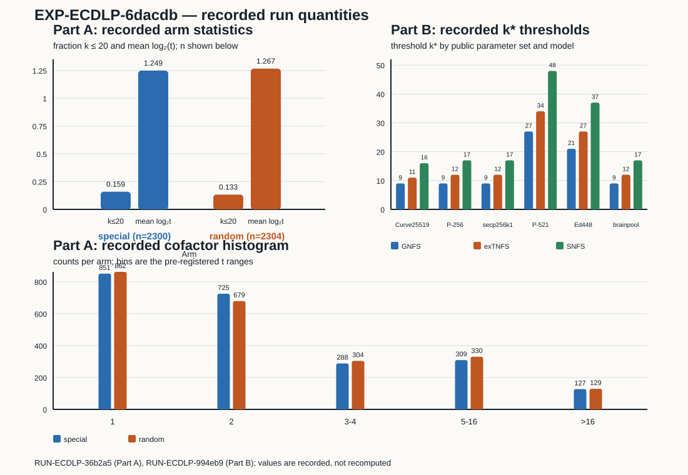

# EXP-ECDLP-6dacdb execution report

Observation-only record for `RUN-ECDLP-36b2a5` and `RUN-ECDLP-994eb9`. This
report records the completed process, checker outputs, and measured quantities;
it does not assign evidence strength, change the hypothesis or experiment
state, or make a scientific verdict.

## Scope and custody

- Goal: `GOAL-ECDLP-001`; question: `RQ-ECDLP-002`; hypothesis:
  `H-ECDLP-bd1572`; experiment: `EXP-ECDLP-6dacdb`.
- Corrected frozen plan: `experiments/EXP-ECDLP-6dacdb/trial-plan-v2.json`,
  plan SHA-256
  `798321ec3932d92a09eede9152fe198d72d2aeab6e7e9d6502fafc3790fa0567`.
  The additive dispatch correction is `CORR-20261011-2c3e1f`; it changes the
  queue binding and task/run identifiers, not the scientific fields or source
  hashes.
- Queue: `BATCH-62ac7b`; executor handoff: `TASK-20261011-672eaf`; lease
  owner `executor-ecdlp-6dacdb-v2`, epoch 1. The execution receipts record
  dispatch-plan SHA-256
  `b7940519fd5c0c4068dda9f7f3dbbe030e5598b53ac9ae0c073a7f78c6d4c614`.
- Remote execution checkout commit:
  `2f5957be13584d31dd0b2ace1815a1d3aec7e6fa`; platform Linux; Python 3.12.11.
  Source hashes recorded in both environments are `check.py`
  `8a48844801cdd34b519d908952a2825c465ebc5a806c945bb13a9d113ad20114`,
  `primeset.py`
  `27f240e6b4f34783e67741bcf61a344192a6974fb56b20196effdd26c6f33b4b`, and
  `run.py`
  `9d81bc06f4721a0be22069a55c778e74ee7344f45e2ed4e99f41bcc5b1f8f22f`.
  The specification SHA-256 is
  `2649c4cabb8f97626f9e6406abf80ae51d26fe7b0fa4a882b7d3ac25c751a185`.
- The local archival worktree contained unrelated untracked artifacts during
  import; the remote execution identity above is the source identity recorded
  by the runner. Hostname and CPU-time measurements were not present in the
  sealed environment or manifest, so they are missing here rather than
  inferred.
- Run-record commit: `ea813bd52a`; it was pushed before this report was
  created.

## Trials, commands, and process results

Two trials were requested and two completed. Both execution receipts have
`status: output_validated`, `returncode: 0`, `check_returncode: 0`, and no
recorded scientific conclusion. The independent checker was run from each
sealed run directory and returned zero errors.

### Part A — embedding-degree census

- Run: `RUN-ECDLP-36b2a5`; recorded interval
  `2026-10-11T20:35:23.712268Z`--`2026-10-11T20:35:59.065855Z`; wall time
  recorded by the raw result: `34.765450954437256 s`.
- Command:
  `python3 experiments/EXP-ECDLP-6dacdb/implementation/run.py --part A --seeds 1 2 3 --curves 64 --out <run_dir>`.
- Scope: seeds 1, 2, 3; 64 curves per prime; special and matched-random
  prime arms over the frozen small-prime set. The raw result contains 72
  cells. The arm totals recorded by the runner are 2,300 special-arm and
  2,304 random-arm non-anomalous curve samples.
- Checker log: `EXP-ECDLP-6dacdb check: parts A, 12 curve row(s) recounted independently, 0 error(s)`.

### Part B — deployed-parameter order search and threshold table

- Run: `RUN-ECDLP-994eb9`; recorded interval
  `2026-10-11T20:35:59.150197Z`--`2026-10-11T20:36:00.910884Z`; wall time
  recorded by the raw result: `1.7606866359710693 s`.
- Command:
  `python3 experiments/EXP-ECDLP-6dacdb/implementation/run.py --part B --out <run_dir>`.
- Scope: Curve25519, P-256, secp256k1, P-521, Ed448, and brainpoolP256r1;
  order-of-
  `p`-modulo-`l` search through `10^6`; three recorded threshold constants.
- Checker log: `EXP-ECDLP-6dacdb check: parts B, 0 curve row(s) recounted independently, 0 error(s)`.

## Recorded observations

The graph in `graph.svg` plots the following values directly from the raw
results. `plot_data.json` is the extracted plotting data and `plot.py` is the
reproducible SVG renderer.

### Part A values

The recorded `k <= 20` fractions were 0.1591304348 for the special arm
(`n=2300`) and 0.1328125 for the random arm (`n=2304`). The raw result also
records the special-minus-random difference as 0.0263179348 and its standard
error as 0.0104002785. The recorded mean `log2(t)` values were 1.2486514049
and 1.2667237009, respectively, with special-minus-random difference
-0.0180722961 and permutation p-value 0.6835316468.

The recorded `t` histogram counts, in bins `1`, `2`, `3-4`, `5-16`, and
`>16`, were `[851, 725, 288, 309, 127]` for special and
`[862, 679, 304, 330, 129]` for random. The recorded chi-square value was
2.7124839037 and its permutation p-value was 0.6116941529. The three
smallest recorded `(k,l)` pairs were `(1,5)`, `(1,7)`, `(1,11)` for random
and `(1,5)`, `(1,7)`, `(1,29)` for special.

The nearby supersingular control list has 43 entries; all 43 recorded `k`
values are 2. The Part A checker returned zero errors. These are control and
sample observations for the declared scope, not a transition of the
hypothesis.

### Part B values

Each of the six rows records the first searched embedding degree as
`> 1,000,000`; the search bound is a recorded lower bound, not an exact order
value. The recorded `k*` values are:

| parameter set | GNFS 1.923 | exTNFS 1.747 | SNFS/STNFS 1.526 | recorded rho cost `log2` |
|---|---:|---:|---:|---:|
| Curve25519 | 9 | 11 | 16 | 125.8253786 |
| P-256 | 9 | 12 | 17 | 127.8253786 |
| secp256k1 | 9 | 12 | 17 | 127.8253786 |
| P-521 | 27 | 34 | 48 | 260.3253786 |
| Ed448 | 21 | 27 | 37 | 222.8253786 |
| brainpoolP256r1 | 9 | 12 | 17 | 127.5299969 |

The threshold constants are recorded in the raw result with full floating
point values. The source table labels them recalled and optimistic, and drops
the `o(1)` term. Part B records `p_prime: true`, `l_prime: true`, and
`hasse: true` for all six rows. The bound-point order check is true for five
rows; Ed448 is recorded as `null` because this invocation did not bind a base
point and marks that order as recalled-only.

As a derived arithmetic summary only, the largest displayed threshold is
`48`, so combining it with the recorded lower bound `k > 1,000,000` gives a
lower-bound difference of `> 999,952` in `k` units for the displayed table.
This derived quantity is not an additional measurement.

## Missing data and interpretation boundary

CPU time, machine hostname, and a runtime lock hash were not recorded. No
additional samples, curves, constants, or secret-dependent computation were
run in this session. The graph and this report therefore cover only the two
completed trials and their declared scopes. The raw result, manifest,
execution receipt, command, environment, checker logs, and Part B table are
preserved under the two run directories. Scientific interpretation and any
official state transition remain for the independent review/archive tasks.
