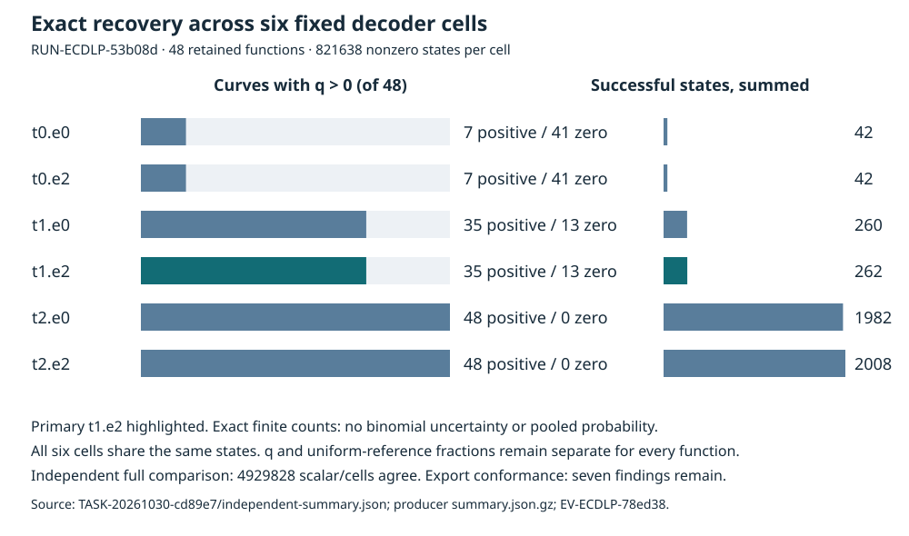

# Independently reconciled finite recovery observations

Coordinator decision **DEC-20261030-f19cb6: revise technical follow-up**. Evidence **EV-ECDLP-78ed38**, aggregate strength preliminary, claim tier toy. The exact finite mathematics is independently verified. Seven historical protocol/export findings remain; no scientific status is changed. Goal GOAL-ECDLP-e70832 stays active and H-ECDLP-6674c9 stays specified. These records become official only after actual root publication and final archive verification.

## Observation

EXP-ECDLP-787704 / RUN-ECDLP-53b08d enumerated the original fixed circuit2.a1 function (alpha=-2, beta=-1, original base) on every one of the 48 retained curves. The complete nonzero domain has 821638 states, six dependent cells have 4929828 scalar/cells, and all identities bring orbit/query checks to 821686 points. An independently sealed disjoint implementation agrees with every state, cell, 288 exact summary rows and per-curve stream hash. The largest field is p=62011 and largest subgroup order r=61717; L is 11,14,17. No new curve/target draw, reference bank, quantum method or index calculus occurred.

| Radius | Erasure cap | Positive q curves | Zero q curves | Successful states, summed | Separate per-curve q range |
| --- | --- | --- | --- | --- | --- |
| 0 | 0 | 7/48 | 41/48 | 42 | 0 to 1/102 |
| 0 | 2 | 7/48 | 41/48 | 42 | 0 to 1/102 |
| 1 | 0 | 35/48 | 13/48 | 260 | 0 to 9/470 |
| 1 | 2 | 35/48 | 13/48 | 262 | 0 to 9/470 |
| 2 | 0 | 48/48 | 0/48 | 1982 | 9/17513 to 19/255 |
| 2 | 2 | 48/48 | 0/48 | 2008 | 9/17513 to 19/255 |

These are exact finite counts, so no binomial interval is assigned. The six cells are dependent views of the same functions, and summed successful states are not a pooled probability. All per-curve fractions and status/list/erasure/zero histograms remain in the independent summary. The 918 states bearing erasures each have one erased position; caps and the original strict-status override remain visible.

## Comparison

For each function, q=successes/(r-1). The analytical distinct-nonzero uniform reference is M(s)/(r-1) per state and sum M(s)/(r-1)^2 over its complete domain. This reference is a mathematical control, not a physically executed BSGS arm. Full retained regression also agrees on 216 setups,345600 singles,688128 trace-query records,36864 original plus12288 incremental attempt objects,73728 cells and3068802 words/public equations. No old producer trial was rerun.

Joint predicate and list-density/reference equations hold in this finite scope. J-blinding holds conditional on genuinely iid uniform fresh nonzero b, since s=b*x*a^-1 permutes the nonzero scalars. The deterministic SHA PRG's iid property is unproved. J-integrity breaks on the seven findings listed below. Root review-format validation and independence checks both returned 0; these check the review record, not frozen-export conformance.

## Inference and decision

At the original primary t1.e2, 35 of48 fixed functions have q>0 and13 have q=0. At t2, all 48 have q>0 under both caps. This is a finite retryability lead worth inspecting with the stated uniform-blinding condition. It does not identify a paid production restart cost or a new-population success law. Larger lists, reference bookkeeping and decoder work must be priced in actual solver comparisons.

DEC-f19cb6 revises the technical execution/export follow-up and ranks the existing two-process runner repair, independent production-source review, runnable admission and then three distinct fresh 48-curve solver cohorts. It does not promote or reject the mathematical hypothesis. Preliminary is the aggregate conformance/transfer ceiling, not doubt about the complete integer enumeration. No p^(1/3) baseline or p^(1/4) improvement is assumed.

## Integrity, controls and retained failures

The native driver/checker returned 0; the captured receipt remains output_validated, published=false, scientific_validity not_assessed. Root publication is separately attested. The unchanged export checker returns1 with seven findings: actual launch commit differs from pinned instrument commit; analytical reference arm lacks execution; one actual bundle versus 96 typed rows; candidate has1 versus 48 instances; reference has0 versus 48; identities differ across arms; analysis script SHA link is missing/different. These defects are preserved in problems/classical-ecdlp-exact-density-export-conformance.md. No arm or row was fabricated.

Independent controls include genuine/negated-half behavior, erasure/cap boundaries,32256 tiny cube/direct comparisons, scalar/sign/conversion and public-check mutations, and18 narrower source/format/process guards. Unsupported old-adapter coverage and physical-counter assumptions each caused a retained failed invocation before correction; sealed mathematics was unchanged. The first reviewer PDF draft and root publication-guard refusal are retained. Producer supervisor end-to-end mutation coverage, original not_run controls/regression and historical custody gaps remain unqualified.

## Limitations and next actions

- These are the 48 retained fixed functions, all 821638 nonzero states and all six dependent cells; finite enumeration has no binomial sampling interval. Transfer to newly sampled curves is unmeasured.
- The conditional uniform reference is analytical: each per-state M(s)/(r-1) and per-function sum M/(r-1)^2. It is not a second executed solver arm or a measured attack cost.
- J-blinding uses genuinely independent uniform fresh nonzero b. The actual deterministic SHA PRG has no iid proof; no operational expected restart cost is inferred.
- Seven frozen protocol/export conformance findings remain. Current native driver/checker0 and independently matching mathematics do not make that export conformant.
- Old native invalid_output/check1/published=false, missing historical BSGS internal witnesses, primitive execution counters, complete attack cost, qualified isolated clocks and per-process peak RSS remain unqualified.
- Diagnostic orbit/log/label tables are verifier-only and never candidate inputs. Named diagnostic word/reference/public-check counts are not full-cost primitive measures.
- Source52 stop-clause completion documents a supported-schema single-arm obstruction; it is not scientific readiness or mathematical failure. The prospective v3 two-process adapter has no result in this composition.
- No novelty, exponent, family-level positive/negative, deployed-curve security or runtime advantage assessment is made; no p^(1/3) baseline has been established here.

1. Finish already-declared TASK-20261030-89247b: two genuinely separate candidate and unchanged BSGS local processes, exact source/input/PID bindings and complete supported strictJSON exports; retain all fixed-unit failures. Archive under TASK-20261030-5c79df.
2. First implement a separately declared full-cohort production route with actual native allocated context, the full original calibration/confirmation schedule or prospectively justified changes, timeout/partial-custody controls and conservative resource/storage bounds. Then independently review the published production source under a new explicit source-review handoff, with immutable source pins and controls against missing/cloned arms, false completion, dropped scientific negatives, source/instance/analysis/hash contradictions. Fixture success alone does not establish the full production route.
3. Complete a separately frozen runnable admission for three distinct fresh 48-curve solver cohorts (144 total), retaining the original sampling law, all 48 current plus 218 earlier exclusions and earlier new-batch identities, fixed primary circuit2.a1, all six cells and paired original/incremental traces. Draw no cohorts until actual preapproval, approval/archive, ready selector and current checkpoint succeed.
4. Execute admitted cohorts with candidate and working BSGS measured on the same public instances and a matched backend; verify every returned scalar publicly. Record setup, failed attempts, repetitions, stopping policy, primitive definitions, memory and any clock qualification separately. Preserve every zero/undefined/capped/failure and every infrastructure stop.
5. Compare per-curve success and complete costs only after independent solver/counter validation. Judge correctness, retryability and cost separately; a cost improvement, if observed, gets a progress-fidelity record with its matched baseline. Do not presuppose a baseline exponent.
6. Keep Goal ACTIVE and H specified. Close only the administrative batch after all 21 task receipts including v3 source/archive and final review/composition archive actually bind and release; no early lane closure.

## Graph and knowledge review

The earlier mechanism.svg and non-generic-next/proof-map.svg were checked as historical endpoint-reuse mechanism/proposed-obligation drawings; this finite density census changes neither their mechanism nor claimed verified coverage, so they remain untouched. The ECDLP frontier map README and KR-RHO-93979e known-bound record were checked: no collision bound or asymptotic claim changes. The new graph above presents the current finite observations. No knowledge promotion is warranted by this technical revise decision; existing linked problem records retain the precisely stated open conformance and cost questions.

## Evidence and source review

The composition reads the frozen public statement, both committed summaries, independent report/review/checks, root publication proof and actual native-check captures. Internal mathematical sources fix the current exact finite claims; no external novelty or literature-completeness claim is made. Relevant contract sources: docs/evidence-and-reproducibility.md, docs/experiment-protocol.md, AGENTS.md and research-visuals. This task ran no scientific experiment. The standard report directory is the already-declared composition destination; old reports and frozen records are unchanged.

- Raw source: experiments/EXP-ECDLP-787704/runs/RUN-ECDLP-53b08d/summary.json.gz@ca7590d80a07eff4735905ed44b847894770c5d4
- Independent source: coordination/goals/GOAL-ECDLP-e70832/batches/BATCH-f7bbdf/reviews/TASK-20261030-cd89e7/independent-summary.json@ca7590d80a07eff4735905ed44b847894770c5d4
- Review publication: bdd53bdbfd; prior raw source publication:2b3c2f791aa964db6bdf2eefd62a6a8ed72b1130.
- Per-joint evidence: coordination/goals/GOAL-ECDLP-e70832/batches/BATCH-f7bbdf/reviews/TASK-20261030-cd89e7/report.md and checks.json.
- Editable PDF source and graph-generation source are fully embedded as UTF-8 text with SHA256/bytes in coordination/goals/GOAL-ECDLP-e70832/batches/BATCH-f7bbdf/composition/observations.json; extract rendering_sources.report_typst.utf8 to report.typ beside diagram.svg and compile with Typst. No source is retained as a hash alone.
