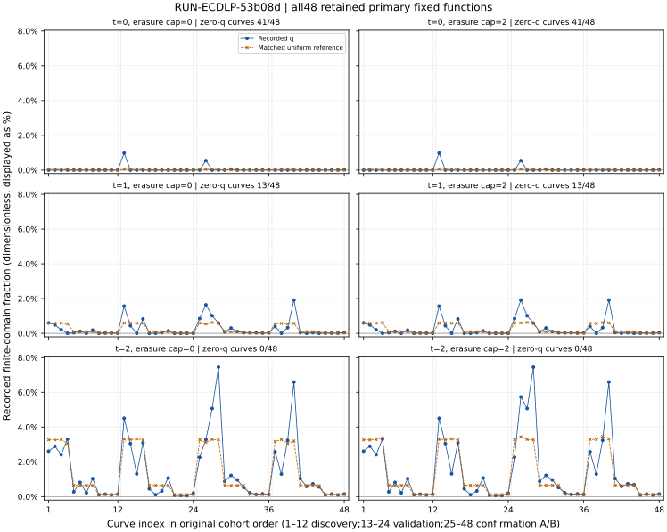

# Exact finite-density census: recorded observations

This report describes recorded outputs and derived arithmetic, not an evidence review or scientific verdict. The native complete census reports 48 fixed primary functions,821638 nonzero scalar states and288 curve-cell summaries. Scientific validity remains not_assessed; independent mathematical validation and frozen-protocol export conformance remain outstanding.

EXP-ECDLP-787704 · H-ECDLP-6674c9 · GOAL-ECDLP-e70832. One physical census invocation, RUN-ECDLP-53b08d, used circuit2.a1 (alpha=-2,beta=-1,a=b=1) on each retained public-cohort base. Each s=1,…,r−1 was recorded once per curve and evaluated in all six (t,e_cap) cells. No new curves, targets, reference bank or entropy were introduced. Denominators and exact fractions are retained for every curve/cell in observations.json and plot-data.json.

Recorded q=Nsuccess/(r−1). The matched conditional-uniform reference is sum_s M(s)/(r−1)^2, where M counts distinct legal nonzero candidates; zero candidates remain paid checks. These fractions describe complete finite fixed-function domains, so no binomial interval or iid curve-family claim is supplied. The comparison is descriptive and is not an attack-cost comparison.

| t/cap | Recovered | Empty status | Rejected status | Undefined | Capped flag | Zero checks | q=0 curves |
|---|---:|---:|---:|---:|---:|---:|---:|
| 0/0 | 42 | 529,478 | 291,200 | 918 | 918 | 34 | 41 |
| 0/2 | 42 | 529,814 | 291,782 | 0 | 0 | 34 | 41 |
| 1/0 | 260 | 192 | 820,268 | 0 | 918 | 314 | 13 |
| 1/2 | 262 | 192 | 821,184 | 0 | 0 | 317 | 13 |
| 2/0 | 1,982 | 0 | 818,738 | 0 | 918 | 1,908 | 0 |
| 2/2 | 2,008 | 0 | 819,630 | 0 | 0 | 1,927 | 0 |

Counts aggregate all48 curves; each cell has821638 states. Aggregated counts are not one fixed-function q.

All918 erasure-bearing states have exactly one erased bit. They are capped in every e_cap=0 cell; t0/e0 retains original UNDEFINED status, while t1/e0 and t2/e0 use CAPPED_ERASURES. No state has two or more erasures in this recorded panel. All-zero density curves, rejected states, empty intervals and zero candidate checks remain included. Controls and retained regression explicitly say not_run in this census; fixed controls were separate pre-admission work, and full independent new/retained validation remains separate.



Native execution-receipt: output_validated, actual driver0/checker0, published=false, scientific_conclusion=null. The published=false field is the immutable native framework capture and is not overwritten by later Git publication. Inner process.returncode=null and termination=pending_outer_supervisor_exit are captured before its eventual exit; actual termination comes from the outer receipt. No native failed or timed-out trial is recorded in this one-trial session.

Recorded diagnostic work: 271,745,536 word visits; 192,946,624 public-equation certifications; 96,468,778 distinct-nonzero reference additions. All49 child processes (one compiler,48 curve enumerations) recorded RC0 and unchanged source snapshots. Full public-orbit/predicate/label preparation and table certificates are separately paid diagnostic computation, not attack execution or old primitive counters. The supervisor start/finish timestamps span 172.692709s (derived elapsed, unqualified); wall_valid=false. CPU totals, per-child RSS, native primitive weights and end-to-end attack cost are unknown. process.ru_maxrss records142392KiB for driver and child lifetime maxima (neither a summed nor per-invocation RSS bound).

Actual execution source commit cb9953014fe0d93f193c3892d73bd284348532ae; dirty state null. Raw archive commit2b3c2f791aa964db6bdf2eefd62a6a8ed72b1130. Python3.12.14; Linux6.18.55 x86_64,5 logical CPUs recorded; CPU model/memory/isolation unknown. g++14.2.0 with -std=c++17 -O3 -DNDEBUG -Wall -Wextra -Werror. Compiled binary SHA256 de5afb21cf32a7c1a64c7feea5efb6247539926972ffda96977fa17e6557fbdf (22192 bytes). Runtime lock null; seed null because enumeration is deterministic. Full executed argv and source/member bindings are in observations.json and immutable launch/environment/process/source records.

Actual start: 2026-10-30T17:22:25.141351+00:00; outer finish: 2026-10-30T17:25:17.834060+00:00.

```text
/workspace/classical-ecdlp-endpoint-reuse/runtime-20261028/bin/python -B harness/classical_ecdlp_exact_density/driver.py census --repo /workspace/classical-ecdlp-validation-ready --out /workspace/classical-ecdlp-validation-ready/experiments/EXP-ECDLP-787704/runs/RUN-ECDLP-53b08d --trial-plan /workspace/classical-ecdlp-validation-ready/experiments/EXP-ECDLP-787704/trial-plan.json --trial-id exact-density-current48
```

The original native export passed native structural checks but the unchanged frozen-protocol export checker returned RC1 with seven findings. The explicitly derived outer export rebases file/host/artifact paths, preserves the actual one bundle and cb995 source commit, keeps raw backend_record/seals unchanged, and leaves the absent frozen analysis.script explicit. Its actual check again returns RC1. No03be source substitution,96 cloned rows, protocol edit or forced green result is used. The original check lacked timestamps/full-source capture; those historical fields remain null. This report's check has actual times and source captures. The linked export-conformance problem remains open; none of these administrative mismatches is a mathematical refutation.

```text
FINDING: export arm circuit2.a1 commit is 'cb9953014fe0d93f193c3892d73bd284348532ae', protocol pinned 03be43e9aae46d3fa6db2b03534bb3867a668085
FINDING: protocol arms with no run in the export: ['conditional-uniform']
FINDING: export has 1 measured rows; the protocol plans 96 (arms x instances x replicates); 96 with warmups. A shortfall must be an infrastructure stop, never a choice
FINDING: arm circuit2.a1: measured 1 instances, expected 48
FINDING: arm conditional-uniform: measured 0 instances, expected 48
FINDING: measured instance identities differ across arms
FINDING: analysis.script.sha256 is missing or differs from the frozen analysis_plan.script.sha256
FAIL: export /workspace/classical-ecdlp-endpoint-reuse/exact-density-20261030/TASK-20261030-fafaa1/check-view/experiments/EXP-ECDLP-787704/export.json against experiments/EXP-ECDLP-787704/protocol.json (7 finding(s))

```

Sources: runs/RUN-ECDLP-53b08d/{execution-receipt.json,summary.json.gz,inputs.json,process.json.gz,export.json}; protocol.json; report export-validation.json; problems/classical-ecdlp-exact-density-export-conformance.md. All288 full rows/histograms are retained in observations.json. No canonical knowledge/claim graph was promoted; study-map.svg is this descriptive report’s new derived view.
