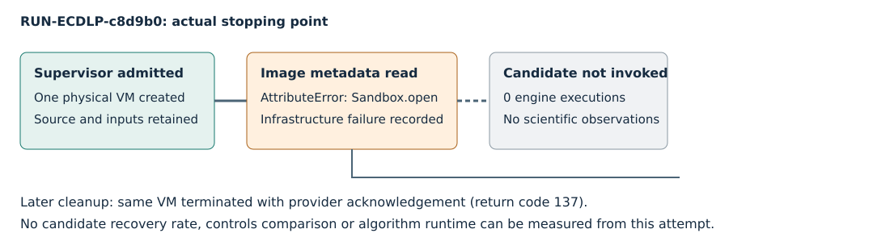

# Classical ECDLP controlled follow-up: failed transport attempt

This report records observations only. The process failed before the candidate engine started; it provides no mathematical verdict or performance comparison.

EXP-ECDLP-956f81 / RUN-ECDLP-c8d9b0; GOAL-ECDLP-e70832; H-ECDLP-6674c9.

## What ran

One trial was requested and attempted; zero completed, one failed with infrastructure_error, and zero timed out. The actual source commit was `3982e1a7626c11b4b57db544cf9548f25d658af0`. The supervisor admitted the frozen trial, created one Modal VM, and encountered `'Sandbox' object has no attribute 'open'` on the first pinned-image metadata read. The native environment records Linux and Python 3.12.14. The VM was requested with 2 CPU and 12288 MiB; these are configuration values, not measured consumption. The native source hashes, full command and parameters are retained in `experiments/EXP-ECDLP-956f81/runs/RUN-ECDLP-c8d9b0/environment.json`, `launch.json` and `command.txt`.

The native authority/launch commit was clean and fully pushed at dispatch. The run directory then contains generated records, so a later dirty-tree reading would describe a different time. Original run bytes were captured as 29 files and stored with complete GET and member-hash verification under `coordination/goals/GOAL-ECDLP-e70832/batches/BATCH-19ba16/failure-captures/RUN-ECDLP-c8d9b0`.

## Recorded outputs and missing measurements

The controller records 1 VM create, 0 candidate engine executions, collection_complete=false, no files collected, termination_ack=null and scientific_validity=not_assessed. The worker was never invoked: no scientific nonce, curve, target or candidate workload was generated. Calibration, confirmation, controls, solver verification, references and analysis were not executed. Candidate recovery counts/rates, predicate counts, curve samples, CPU time and peak RSS are unavailable; unavailable scientific metrics are not zero-valued measurements. No export rows can truthfully describe candidate evaluators for this attempt.

The supervisor timestamps are 2026-10-29T21:53:39.045750+00:00 to 2026-10-29T21:53:40.757379+00:00. Their difference is 1.711629 seconds (derived subtraction), an operational interval only. All clocks are unqualified for algorithm performance; counter replay is unqualified. The driver exit code is 1; the supervisor check command did not execute (check_returncode=null).

## Separate later cleanup

The exact original controller receipt retains termination_ack=null. Later root infrastructure probes used only the same existing VM, pinned metadata and fixed public strings, without invoking the candidate or creating a new VM. The separate cleanup receipt records actual termination acknowledgement at 2026-10-29T22:02:50.903688+00:00, provider return code 137. This is the return code after requested cleanup termination, not a candidate exit or evidence of candidate memory exhaustion. All five fixed infrastructure probes passed. They establish the tested transport surface only, not candidate correctness, throughput or a completed scientific run.



A diagram replaces a quantitative comparison because the experiment produced no comparable scientific observations. Its counts come directly from raw-result.json/controller and execution-receipt.json; the separate later cleanup event is labeled separately.

## Evidence and next work

Read `experiments/EXP-ECDLP-956f81/runs/RUN-ECDLP-c8d9b0/execution-receipt.json`, `raw-result.json`, `modal/controller-receipt.json` and the exact evidence archive/member manifest. Read `coordination/goals/GOAL-ECDLP-e70832/batches/BATCH-19ba16/failure-captures/RUN-ECDLP-c8d9b0/capture-manifest.json`, `.artifacts.json`, `capture-storage-readback.json` and `cleanup-receipt.json` for preservation and later cleanup. Native records were not rewritten. Additive schema completion and transport correction are separate, prospective technical work. This old EXP/RUN is not retried. A new source-bound, admitted experiment with fresh IDs is required for scientific measurements.

## Exact driver argv

```json
[
  "/workspace/classical-ecdlp-endpoint-reuse/runtime-20261028/bin/python",
  "harness/classical_ecdlp_controlled_followup/driver.py",
  "run",
  "--repo-root",
  "/workspace/classical-ecdlp-validation-ready",
  "--protocol",
  "experiments/EXP-ECDLP-956f81/protocol.json",
  "--image-receipt",
  "harness/classical_ecdlp_endpoint_reuse/modal/receipts-b2/image-build.json",
  "--compute-plan",
  "harness/classical_ecdlp_controlled_followup/compute-plan.json",
  "--prior-exclusions",
  "harness/classical_ecdlp_controlled_followup/prior-exclusions.json",
  "--worker-manifest",
  "harness/classical_ecdlp_controlled_followup/worker-source-manifest.json",
  "--host-manifest",
  "harness/classical_ecdlp_controlled_followup/host-source-manifest.json",
  "--engine-interface",
  "harness/classical_ecdlp_controlled_followup/engine-interface.json",
  "--host-interface",
  "harness/classical_ecdlp_controlled_followup/host/verifier-interface.json",
  "--experiment-id",
  "EXP-ECDLP-956f81",
  "--run-id",
  "RUN-ECDLP-c8d9b0",
  "--out",
  "/workspace/classical-ecdlp-validation-ready/experiments/EXP-ECDLP-956f81/runs/RUN-ECDLP-c8d9b0"
]
```

The supervisor invocation was `/workspace/classical-ecdlp-endpoint-reuse/runtime-20261028/bin/python tools/experiment_execution.py run --plan experiments/EXP-ECDLP-956f81/trial-plan.json --owner controlled-candidate-executor --epoch 1`.
