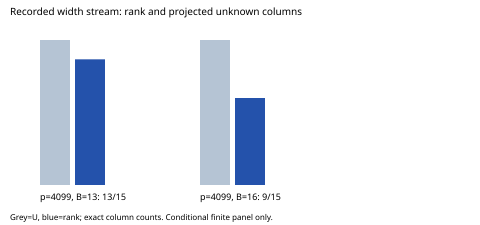

# EXP-ECDLP-a9b6a5 / RUN-ECDLP-967315

Completed: True. Retained cells: 2. These are observations only.

The scientific workload is the complete m16 stream on the same p4099 A2 B13 and B16 curves, generators and public sources as the frozen m8 reference. The new base preserves the old eight atoms and appends under the same public rule. Old m8 source order is materialized independently of the new fixture UID. No m8 scientific replay is included.

For the frozen m8 reference, both p4099 curves had zero rows and rank0/U7. This follow-up is conditioned on those known cases; no unbiased fresh-curve or population inference is licensed. Input-derived U is reported beside measured rank. Old descriptor nesting does not imply monotonic accepted rows, rank or rank/U.

events.jsonl retains every complete source-block status/digest/checkpoint and immediate accepted witness. raw-result.json retains public witnesses, native-to-projected signed maps, affine and augmented ranks, pivot rows, right-kernel bases, progress and raw counters. A failed/incomplete run is censored work, never mathematical negative evidence.

Producer field/group/pow-call/hash vectors, stage vectors, online/final matrix units, encoded status/digest/event bytes and inline checker times are retained separately. Independent checker costs are in verification.json. Counters are partial S: pow internals, Python bookkeeping, general byte movement, complete independent arithmetic counters and compression/upload/readback/storage costs require reconciliation. No ECDLP speedup or security claim is made.

Native authority, exact argv, clean source revision, input/source hashes, versions, timestamps and measured self RSS are recorded by the native manifest and environment. Canonical object custody and actual remote readback remain separate delivery obligations. Hashes and arithmetic replay do not prove prescribed execution.

