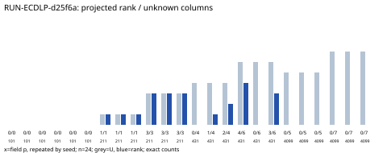

# EXP-ECDLP-cded08 / RUN-ECDLP-d25f6a

Observations only; no scientific verdict or ECDLP gain claim.

Completed: True. Fixed finite cells: 24. Each recorded rank is modulo its target prime r, after public anchors and column normalization. All-known bases (U=0) provide no new unknown-log recovery evidence.

Every attempt and rejection is in events.jsonl; explicit public witnesses, ranks and raw operation vectors are in raw-result.json. Independent checks and their costs are separate in verification.json. Raw operation units are not a complete weighted S score.

Code revision, exact command/input/source hashes, resources, dependencies and limits: manifest.yaml and native environment.json. Software controls are deliberately planted, with public known logs; fresh cells have no supplied log labels. No novel compact router or deployed-curve conclusion.
