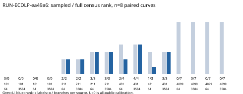

# Fixed Prym rank census / RUN-ECDLP-ea49a6

Observations only. EXP-ECDLP-d6d8e8 / H-ECDLP-51f052 / GOAL-ECDLP-001. RUN-ECDLP-ea49a6 completed one requested native trial: 1,867,776 attempts, 16 cells, 11 controls. Independent complete-stream checker: passed; failed checks: []. No failure, timeout, repair, extra branch or early stop occurred. No scientific verdict or ECDLP improvement is asserted.

| p | B | U | sample rows | rank | full rows | rank | full first attempt |
| --- | --- | --- | --- | --- | --- | --- | --- |
| 101 | 21 | 0 | 31 | 0 | 1244 | 0 | — |
| 101 | 30 | 0 | 40 | 0 | 1506 | 0 | — |
| 211 | 10 | 2 | 17 | 2 | 811 | 2 | 13892 |
| 211 | 24 | 3 | 6 | 3 | 319 | 3 | 20260 |
| 431 | 7 | 4 | 2 | 2 | 109 | 4 | 173778 |
| 431 | 65 | 3 | 1 | 1 | 171 | 3 | 50271 |
| 4099 | 13 | 7 | 0 | 0 | 0 | 0 | — |
| 4099 | 16 | 7 | 0 | 0 | 0 | 0 | — |

Measured accepted rows: 97 sampled and 4160 exhaustive. The two F101 bases are entirely exposed by the public source schedule (U=0); their rows are calibration. Among the six U>0 fixture pairs, sampled matrices reach full rank on two; exhaustive matrices on four. Both F4099 fixtures accept zero rows in either arm. This is an exact statement about the fixed collector/base/source grid, and supplies no general rank cap or security conclusion.

Workload: eight fixed fresh A=2 curves; public sources 1..64; seed 0 fixes source order. Sampled arm: 64 distinct branches per source, 4,096 attempts per fixture. Exhaustive arm: all binomial(8,3) times 4^3 = 3,584 branches, 229,376 attempts per fixture. The factor base, public anchors, source lifts, constructor and alias law match within each pair. Repeated field sizes are distinct curve instances, not extra independent seeds.

Measured producer wall/CPU: 97.490447/97.471312 s; peak self RSS: 49,266,688 bytes. Independent checker wall/CPU: 73.964993/73.951064 s; peak self RSS: 58,650,624 bytes. Derived native start-to-receipt elapsed time: 181.108070 s (timestamp subtraction; includes checker/storage, not an attack-cost bound).

All branch statuses, including rejects and aliases, were independently replayed. Accepted principal witnesses, E1 source equations, E2 cancellation, projected rank/augmented rank, first-full-rank events, finite nullspaces, sample-equation containment and transported atom-permutation A/A passed the frozen checker. The separate observation-integrity review is not implied by this checker pass.

Raw field/group/hash vectors and online/final matrix units are retained per arm and at first-full-rank events in raw-result.json and graph-source.json. Input search retains all 135 inspected candidates. Producer wall includes inline witness/A/A checks; their arithmetic is outside the collector field counters. Pow internals, Python bookkeeping, byte movement, sampled process-group peak and independent operation-count verification remain missing. No complete weighted S, current-best IC comparison, optimized rho reference or blind DLP recovery was measured.

Code authority: 4de214c16d6929d455123b1fdf5f89fc51a07e5b, clean tracked tree at launch. Runtime: Python 3.12.14 on Linux; frozen PyYAML 6.0.3 and reportlab 4.4.9 match. The Cursor-specific /usr/local Python path is absent in this managed runtime; the actual interpreter is recorded in environment.json. Scientific source20/input5 bindings are unchanged. Approval: DEC-20261025-1bd76a; storage/approval snapshots b3bbf59b1 and 58d9e0d3a.

Exact outer command: python3 research/prym_rank_census_20261025/storage-delivery-20261025/execute_with_storage.py run --plan experiments/EXP-ECDLP-d6d8e8/trial-plan.json --owner executor-prym-census --epoch 1. The native command.txt records the frozen launcher invocation; the trial plan binds both launcher and independent checker.

Canonical storage: raw-result.json and events.jsonl are native gzip/blob pointers. Canonical CLI publication and fresh GET/digest checks completed before receipt sealing. Separate artifact-deliveries/RUN-ECDLP-ea49a6/custody.json binds logical content, stored object and receipt digests. Metadata-only native coverage reports output_validated; it does not establish a prescribed-computation proof. Public cache selector: CRYPTO_AR_BLOB_CACHE=/tmp/prym-native-blob-cache.

Procedure note: the completed-release CLI checked only physical raw paths and initially refused two compacted logical outputs. Its documented authoritative-receipt option was then used with both explicit logical content hashes; all 19 declared outputs are bound. No run bytes, sealed receipt, source grid or scores were edited. Credentials were confined to the operational process and excluded from source, run files and commits.

Sources: immutable raw commit 23548ce37; native manifest, verification.json, execution-receipt.json and canonical custody sidecar. Graph source: graph-source.json.
