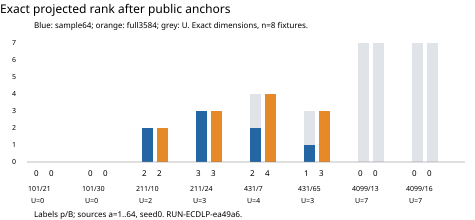

# Observation integrity review — TASK-20261025-5145ac

EXP-ECDLP-d6d8e8 / RUN-ECDLP-ea49a6. Assigned-joint integrity findings only; no scientific verdict or state transition.

Blind input derivation sealed 2026-10-25T03:44:38.004075+00:00; SHA256 `0751c0c2771e291a363d92c99d5b16cdce27a2a340abe6080e150394b418db84`. Only approved specification/config/fixtures supplied mathematical inputs before deliberate unblinding.

Fresh code replayed **1,867,776 attempts**, **4,257 E1 equations**, every matrix certificate in 16 cells, and the fixed sample of **144 principal/E2 witnesses**. The stored statuses, digests, row positions, nested support, projection, rank/augmented rank, kernels, pivots and checkpoints match. Nine core mutations plus two locator mutations reject as expected.

| p | B | r | U | sample rows | full rows | sample rank | full rank |
|---:|---:|---:|---:|---:|---:|---:|---:|
| 101 | 21 | 107 | 0 | 31 | 1244 | 0 | 0 |
| 101 | 30 | 97 | 0 | 40 | 1506 | 0 | 0 |
| 211 | 10 | 199 | 2 | 17 | 811 | 2 | 2 |
| 211 | 24 | 197 | 3 | 6 | 319 | 3 | 3 |
| 431 | 7 | 433 | 4 | 2 | 109 | 2 | 4 |
| 431 | 65 | 443 | 3 | 1 | 171 | 1 | 3 |
| 4099 | 13 | 4021 | 7 | 0 | 0 | 0 | 0 |
| 4099 | 16 | 4111 | 7 | 0 | 0 | 0 | 0 |



All counts/ranks above are independently derived from the finite receipts. Seeds describe ordering only; U=0 cells remain all-public calibration.

**fixture_public_source_projection: holds.** Eight fixture order/prime/generator/base recounts and all 64 declared public images each, signed canonical anchor maps/U; UID/EC1 numerical identity before seal, exact serialization hashes after seal. U=[0,0,2,3,4,3,7,7]; identical projection in both arms; no truth-log table computed. Limits: Exact identity serialization deliberately deferred to phase2.

**complete_support_and_alias_law: holds.** All 1024 ordered source blocks and 1,867,776 descriptors; fresh lift/rejection/alias/interpolation/residual/acceptance outcome and attempt-digest regeneration; all A/A witness hashes and transported E1 equations; sampled canonical equations nested in full up to global sign. All stored outcomes, source checkpoints, candidate counts and accepted row locations match. No rejected work omitted; all fixed work continues beyond first full rank. Limits: Canonicalizer implements the declared finite geometric deck/hyperelliptic orbit, not a global equivalence theorem.

**source_witness_and_exact_rank: holds.** All 4257 public E1 equations and 16 matrices/rank/augmented rank/pivots/solutions/right-kernel/progress/first-full certificates; 144 fixed principal/E2 witness samples (first 4,last 4,SHA-ranked 8,deduplicated; all below 16). Exact matrix values match stored results; full ranks by fixture 0,0,2,3,4,3,0,0 versus U 0,0,2,3,4,3,7,7. Limits: Explicit E2 norm and full principal witness check is the preregistered deterministic sample, not every accepted row.

**native_custody_and_cost_scope: holds.** Approved spec/plan/source/input committed bindings, native claim/source/clean-tree receipt state,19 logical outputs plus archive record, native two-pointer/stored/raw hashes and canonical manifest/custody, own cache readback, partial-counter scope. Committed snapshot bytes and every digest bridge match; all 20 logical snapshot paths accounted. Source commit reachable in cached origin/lane/prym-census-run and origin/lane/prym-rank-census refs. Native published:false is recorded runner publication state; archival commits supply durable bytes. Limits: Own remote GET and independent operation-counter recomputation not performed. No complete weighted S, process-group memory trace, prescribed-computation proof or settlement.

**Custody and cost scope.** The reviewer rehashed both public cache objects, decompressed raw content, verified pointer/stored/raw SHA bridges, canonical .artifacts metadata, custody and snapshot bytes. Producer fresh remote GET claims remain producer evidence. Producer diagnostics: 97.49044729300113 wall seconds, 97.471311791 CPU seconds, 49266688 peak self RSS bytes. Existing checker: 73.96499279300042 wall seconds. Input search is separately retained. Storage has delivery/readback outcomes, without complete work/timing accounting. Counters exclude pow internals, Python bookkeeping, byte movement and verifier work; operation counts were not independently recomputed. No complete weighted S, process-group memory trace or prescribed-computation proof is supplied.

**Controls.** `verification.json` retains exact mutated copies, item locations and rejection text. Valid principal witness; duplicate/sign/zero projection; all-public U=0; and dependent/zero-row rank controls pass. Inherited 11 planted controls match their declared outcomes; the existing checker receipt is borrowed corroboration.

**Method limits and deviations.**
- Finite panel of eight deterministically selected toy curves over four prime fields; seed0 is ordering nuisance, not an independent curve.
- Explicit full principal-divisor/E2 audit covers 144 deterministic accepted rows; every 4257 accepted interpolation/residual/row and E1 equation is replayed. Existing native checker reports every principal witness verified; that receipt is borrowed corroboration.
- Own custody readback is from the public cache only. The immutable producer/custody records assert fresh remote GET; no independent reviewer remote GET or remote availability conclusion is supplied.
- Operation counters were not independently recomputed; input search/checker/storage costs remain separately scoped, with no complete weighted S or execution proof.
- UID/EC1 exact hash serialization checked after blind seal; mathematical input/order/base/public projection derived before unblinding.
- Generic independence checker cannot represent this exact same-task phased blind plan; report retains complete source disclosure and diagnostic rather than claiming its static whole-session gate passed.

First reviewer replay completed all cells before a cache-path assumption stopped custody checks; correcting the reviewer path and repeating succeeded. No immutable artifact changed. The generic independence check cannot encode this same-task staged plan; exact diagnostics are recorded in report.json. No sibling report, credential file/value, process memory or parent branch log was read.

**Sources and provenance.** All scientific support is internal immutable experiment evidence, independently read by reviewer TASK-20261025-5145ac. Sources read as bytes for hashing are included in the complete attestation. No recalled external literature is load-bearing. External canonical graphs were left unchanged because this task authorizes observation review only.

**Recorded phase timing and static check.** Exact first deliberate-unblind timestamp was not captured. It occurred after 2026-10-25T03:44:38.004075+00:00 and before 2026-10-25T03:48:10.196002+00:00. The plan expressly authorizes post-seal phase2 source/output reads. Actual generic checker exit code: 1. It reported one independence problem on six protected paths; it cannot represent this same-task phased allowance. No formal independence-gate pass is claimed. Full command/output are retained in verification.json and report.json.

All three review PDF pages and the one-page original run PDF were visually inspected. Tables, graph, run IDs and limitations are legible.

**Review attestation**

```yaml
review_attestation:
  blind_from_respected: true
  blind_from_respected_scope: Phase1 only, through sealed_at and the published blind
    artifact hash. Phase2 sources deliberately unblinded exactly as this handoff permits.
    This boolean does not mean no protected path was ever read during phase2.
  joints_owned:
  - fixture_public_source_projection
  - complete_support_and_alias_law
  - source_witness_and_exact_rank
  - native_custody_and_cost_scope
  phase1_sealed_at: '2026-10-25T03:44:38.004075+00:00'
  phase1_sha256: 0751c0c2771e291a363d92c99d5b16cdce27a2a340abe6080e150394b418db84
  phase1_sources_read:
  - experiments/EXP-ECDLP-d6d8e8/specification.yaml
  - research/prym_rank_census_20261025/config.json
  - research/prym_rank_census_20261025/fixtures.json
  producer_authorship: false
  read_sibling_reports: false
  separate_session: true
  sources_read:
  - .artifacts/config.json
  - .claude/skills/research-visuals/SKILL.md
  - AGENTS.md
  - agents/validator.md
  - coordination/goals/GOAL-ECDLP-001/batches/BATCH-a00184/archives/TASK-20261025-5de6df.json
  - coordination/goals/GOAL-ECDLP-001/batches/BATCH-a00184/claims/TASK-20261025-e5efb3.1.claim.json
  - coordination/goals/GOAL-ECDLP-001/batches/BATCH-a00184/dispatch_queue.json
  - coordination/goals/GOAL-ECDLP-001/batches/BATCH-a00184/publication-checks.json
  - docs/agent-contract-extended.md
  - docs/lab-contract.md
  - experiments/EXP-ECDLP-d6d8e8/artifact-deliveries/RUN-ECDLP-ea49a6/.artifacts.json
  - experiments/EXP-ECDLP-d6d8e8/artifact-deliveries/RUN-ECDLP-ea49a6/.gitignore
  - experiments/EXP-ECDLP-d6d8e8/artifact-deliveries/RUN-ECDLP-ea49a6/custody.json
  - experiments/EXP-ECDLP-d6d8e8/independent_check.py
  - experiments/EXP-ECDLP-d6d8e8/launch.py
  - experiments/EXP-ECDLP-d6d8e8/packaging/admission-20261025/preapproval.json
  - experiments/EXP-ECDLP-d6d8e8/packaging/admission-20261025/prospective-handoff.yaml
  - experiments/EXP-ECDLP-d6d8e8/runs/RUN-ECDLP-ea49a6/check.stderr.log
  - experiments/EXP-ECDLP-d6d8e8/runs/RUN-ECDLP-ea49a6/check.stdout.log
  - experiments/EXP-ECDLP-d6d8e8/runs/RUN-ECDLP-ea49a6/command.txt
  - experiments/EXP-ECDLP-d6d8e8/runs/RUN-ECDLP-ea49a6/environment.json
  - experiments/EXP-ECDLP-d6d8e8/runs/RUN-ECDLP-ea49a6/events.jsonl
  - experiments/EXP-ECDLP-d6d8e8/runs/RUN-ECDLP-ea49a6/events.jsonl.gz.blob.json
  - experiments/EXP-ECDLP-d6d8e8/runs/RUN-ECDLP-ea49a6/execution-receipt.json
  - experiments/EXP-ECDLP-d6d8e8/runs/RUN-ECDLP-ea49a6/graph-source.json
  - experiments/EXP-ECDLP-d6d8e8/runs/RUN-ECDLP-ea49a6/graph.svg
  - experiments/EXP-ECDLP-d6d8e8/runs/RUN-ECDLP-ea49a6/launch.json
  - experiments/EXP-ECDLP-d6d8e8/runs/RUN-ECDLP-ea49a6/manifest.yaml
  - experiments/EXP-ECDLP-d6d8e8/runs/RUN-ECDLP-ea49a6/raw-result.json
  - experiments/EXP-ECDLP-d6d8e8/runs/RUN-ECDLP-ea49a6/raw-result.json.gz.blob.json
  - experiments/EXP-ECDLP-d6d8e8/runs/RUN-ECDLP-ea49a6/report.md
  - experiments/EXP-ECDLP-d6d8e8/runs/RUN-ECDLP-ea49a6/report.pdf
  - experiments/EXP-ECDLP-d6d8e8/runs/RUN-ECDLP-ea49a6/stderr.log
  - experiments/EXP-ECDLP-d6d8e8/runs/RUN-ECDLP-ea49a6/stdout.log
  - experiments/EXP-ECDLP-d6d8e8/runs/RUN-ECDLP-ea49a6/verification.json
  - experiments/EXP-ECDLP-d6d8e8/specification.yaml
  - experiments/EXP-ECDLP-d6d8e8/trial-plan.json
  - ledger/decisions/DEC-20261025-1bd76a.yaml
  - ledger/handoffs/TASK-20261025-5145ac.yaml
  - ledger/handoffs/TASK-20261025-e5efb3.yaml
  - orchestration/research_budget.py
  - research/prym_experiment_design_20261019/implementation/arithmetic.py
  - research/prym_experiment_design_20261019/implementation/census.py
  - research/prym_experiment_design_20261019/implementation/fixtures.py
  - research/prym_experiment_design_20261019/implementation/independent.py
  - research/prym_experiment_design_20261019/implementation/native_runtime_v2.py
  - research/prym_experiment_design_20261019/implementation/projection.py
  - research/prym_experiment_design_20261019/implementation/recovery-fixtures.json
  - research/prym_experiment_design_20261019/implementation/relations.py
  - research/prym_experiment_design_20261019/implementation/selector-fixtures.json
  - research/prym_experiment_design_20261019/implementation/witness-fixtures.json
  - research/prym_experiment_design_20261019/implementation/witness.py
  - research/prym_rank_census_20261025/build_inputs.py
  - research/prym_rank_census_20261025/check_census.py
  - research/prym_rank_census_20261025/config.json
  - research/prym_rank_census_20261025/fixtures.json
  - research/prym_rank_census_20261025/rank_census.py
  - research/prym_rank_census_20261025/render_design.py
  - research/prym_rank_census_20261025/renderer.py
  - research/prym_rank_census_20261025/runtime_census.py
  - research/prym_rank_census_20261025/storage-delivery-20261025/contract.json
  - research/prym_rank_census_20261025/storage-delivery-20261025/execute_with_storage.py
  - research/prym_rank_census_20261025/storage-delivery-20261025/historical-W2/custody.json
  - research/prym_rank_census_20261025/storage-delivery-20261025/probe-result.json
  - research/prym_rank_census_20261025/storage-delivery-20261025/storage-readiness.json
  - research/prym_rank_census_20261025/storage-delivery-20261025/test_delivery.py
  - research/prym_rank_census_20261025/test_census.py
  - src/crypto_autoresearcher/index_calculus/__init__.py
  - src/crypto_autoresearcher/index_calculus/curve.py
  - templates/research-records.md
  - tools/allocate_id.py
  - tools/artifact_store.py
  - tools/artifacts/artifacts.py
  - tools/check_review_independence.py
  - tools/curve_identity.py
  - tools/experiment_execution.py
  - tools/goal_lanes.py
  - tools/research_dispatch.py
  - tools/sparse_checkout.py
  - tools/validate_ledger.py
  task_id: TASK-20261025-5145ac
  unblinding_order: After blinded-input-derivation.json was written, hashed, and its
    timestamp/hash messaged to Coordinator, before reading result/source. Exact first-read
    timestamp not independently captured.
  verdict: holds
  verdict_scope: Assigned observation-integrity joints only, with stated deterministic
    witness sample and custody/cost limitations.
  unblinding_time:
    first_deliberate_unblind_time: null
    exact_first_read_timestamp_recorded: false
    strictly_after: '2026-10-25T03:44:38.004075+00:00'
    before: '2026-10-25T03:48:10.196002+00:00'
    event_order: Wrote and SHA-hashed blind derivation; messaged Coordinator seal;
      then read result/source. First read was earlier than the successful replay start.
      No exact wall timestamp was captured.
    predeclared_allowance: ledger/handoffs/TASK-20261025-5145ac.yaml review_plan.blindness.phase2_allowed
      and rationale explicitly authorize deliberate unblinding after blind-input seal.
```
