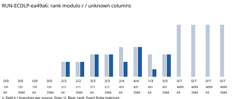

# EXP-ECDLP-d6d8e8 / RUN-ECDLP-ea49a6

Observations only; no scientific verdict or ECDLP gain claim.

Completed: True. Cells: 16. Paired fixed factor bases and public sources; 64 sampled branches versus all 3584 branches per source. Publicly exposed base logs are removed in both arms. U=0 cells are calibration only. No early stop at full rank.

Raw witnesses, rank progress, first full-rank locations, finite nullspace certificates and partial operation vectors: raw-result.json. All branch statuses and commitments: events.jsonl. Independent complete replay and its separate resource cost: verification.json. Native compacted stored forms and any artifact-store manifests retain the same content commitments.

Costs include separately retained public-input search and collector counters, diagnostic wall/CPU time and peak producer RSS. Pow internals, Python bookkeeping, byte movement and independently verified operation counts remain missing; these are not a complete weighted S. No prescribed-computation proof is supplied.

Exact command, clean source revision, source/input hashes, dependency versions and native admission: manifest.yaml, launch.json and execution-receipt.json. These toy observations establish no deployed-curve weakness.
